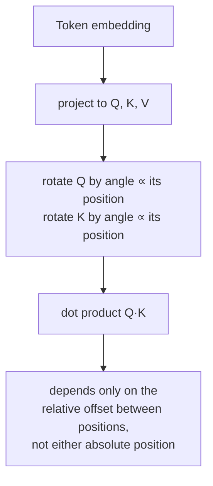

# पाठ 14. Rotary Position Embeddings

**मिशन से संबंध:** पाठ 4 ने स्थापित किया कि position को उन vectors के ज़रिए आना होगा जो `Q`, `K` और `V` बनाते हैं, क्योंकि attention के समीकरण के पास इसके लिए कोई और रास्ता नहीं है, और उसने वह एक तरीक़ा सिखाया जो मूल पेपर अपनाता है: attention चलने से पहले ही token embedding में एक तय sinusoidal vector जोड़ना। **Rotary position embeddings (RoPE)** वह तंत्र है जिसे लगभग हर मौजूदा open model असल में इसके बजाय इस्तेमाल करता है, और वह position उसी रास्ते से डालता है जो पाठ 4 ने पहचाना था, पर एक सचमुच अलग operation से: embedding में पहले से कुछ जोड़ने के बजाय attention computation के अंदर `Q` और `K` को ही घुमाकर।
**मुख्य स्रोत:** [पेपर: "RoFormer: Enhanced Transformer with Rotary Position Embedding", Su et al., 2021](https://arxiv.org/abs/2104.09864)
**पूर्व-आवश्यकताएँ:** [पाठ 4](0004-positional-encoding.md), [Positional encoding](../GLOSSARY.md)

## वार्म-अप

1. ▢ Position को उन vectors में ही क्यों encode करना पड़ता है जो `Q`, `K` और `V` बनाते हैं, attention को किसी अलग signal के रूप में देने के बजाय?

जाँचें

Attention का समीकरण सिर्फ़ `Q`, `K` और `V` पर काम करता है; position के दाख़िल होने के लिए कोई अतिरिक्त input नहीं है। Computation position के प्रति संवेदनशील तभी बनता है जब position पहले से उन vectors में पिरोई जा चुकी हो जो उन्हें बनाते हैं।

2. ▢ Sinusoidal positional encoding को training में देखी गई किसी भी लंबाई से ज़्यादा लंबी sequence पर evaluate क्यों किया जा सकता है, जबकि सीखी हुई position embedding table के लिए नहीं?

जाँचें

Sinusoidal encoding एक सूत्र है, जिसे किसी भी position मान पर evaluate किया जा सकता है। सीखी हुई embedding table में सिर्फ़ उन्हीं positions की पंक्तियाँ होती हैं जिनके लिए उसे बनाया और train किया गया था, और उस सीमा से आगे ढूँढने को कुछ नहीं होता।

## यह जानें

### RoPE embedding में कुछ जोड़ने के बजाय Q और K को घुमाता है

जहाँ sinusoidal encoding token के embedding में एक बार एक तय vector जोड़ता है, उसके `Q`, `K` या `V` में project होने से पहले ही, वहीं **RoPE** इसके बजाय position `pos` पर मौजूद token के पहले से project किए query और key vectors को लेता है और उन पर `pos` के अनुपात वाले कोण से एक **rotation** लगाता है। Vector को 2-आयामी जोड़ियों में बाँटकर (वही जोड़ी-बनावट जो sinusoidal encoding ने अपनी sine/cosine frequencies के लिए इस्तेमाल की थी), हर जोड़ी को ऐसे कोण से घुमाया जाता है जो position और उस जोड़ी की अपनी frequency के साथ scale होता है, कम index वाली जोड़ियाँ positions के आर-पार धीरे घूमती हैं, ज़्यादा index वाली तेज़, ठीक वही frequency संरचना जो पाठ 4 पहले ही बता चुका है।

### घुमाया हुआ dot product सिर्फ़ सापेक्ष position पर निर्भर करता है, किसी की भी absolute position पर नहीं

यही RoPE का असली फ़ायदा है, और यह rotation का अपना गुण है: query vector को position `m` के अनुपात वाले कोण से और key vector को position `n` के अनुपात वाले कोण से घुमाने के बाद उनका dot product लेने पर ऐसा मान मिलता है जो सिर्फ़ `m − n` पर निर्भर करता है, यानी उनके बीच के सापेक्ष अंतर पर, अलग-अलग `m` या `n` पर नहीं। दो rotations अपने कोण जोड़कर compose होती हैं, इसलिए `m` के कोण से घुमाए vector की तुलना `n` के कोण से घुमाए vector से करना गणितीय रूप से उतना ही है जितना मूल, बिना घुमाए vectors की तुलना सिर्फ़ *अंतर* `m − n` से घुमाने के बाद करना। पेपर का अपना कथन ठीक यही पकड़ता है: RoPE *absolute* position को encode करता है (हर vector अपनी position के हिसाब से घुमाया जाता है) पर attention पर उसका असर *स्पष्ट सापेक्ष* position निर्भरता है, क्योंकि attention score में सिर्फ़ positions के बीच का अंतर बचता है।

### यह पाठ 4 के तंत्र से अलग तंत्र है, उसके ऊपर लगा पैबंद नहीं

Sinusoidal encoding जोड़ने वाला है और attention से पहले एक बार होता है, उस बिंदु से आगे embedding में स्थायी रूप से मिला हुआ। RoPE गुणात्मक है (एक rotation) और attention computation के भीतर ही होता है, attention compute करने वाली हर layer पर `Q` और `K` पर नए सिरे से लगाया जाता है, input पर एक ही बार embedding में पिरोए जाने के बजाय। दोनों पाठ 4 की उस ज़रूरत को पूरा करते हैं कि position उन vectors के ज़रिए आए जिन पर attention असल में काम करता है, पर यह ऐसा करने के दो संरचनात्मक रूप से अलग तरीक़े हैं, और RoPE का सापेक्ष-position गुण ऐसी चीज़ नहीं है जो sinusoidal encoding की जोड़ने वाली योजना अपने-आप पैदा करती हो।

### यह ख़ास गुण असली models के लिए क्यों मायने रखता है

जिस model का attention score absolute position की जगह सापेक्ष अंतर पर निर्भर करता है, वह एक ऐसा व्यावहारिक मामला सँभालता है जिसे sinusoidal encoding का अपना पेपर सिर्फ़ अनौपचारिक रूप से तर्क देकर कह सका: किसी token और उससे 5 positions पहले वाले token का संबंध एक जैसा दिखता है, चाहे वह जोड़ी छोटी sequence की शुरुआत में हो या बहुत लंबी sequence के बीच में। Rotation के compose होने के तरीक़े से सीधे निकला यह सापेक्ष-position गुण ही बड़ी वजह है कि RoPE ने व्यवहार में sinusoidal encoding की जगह ले ली, उस लचीलेपन के साथ कि sequence lengths training के समय तय न हों, ठीक उसी तरह जैसे पाठ 4 का सूत्र-आधारित (table-आधारित नहीं) तरीक़ा कर सकता था।

## अभ्यास

1. ▢ RoPE query vector को उसकी absolute position के हिसाब से और key vector को उसकी अपनी absolute position के हिसाब से घुमाता है। फिर भी पेपर attention पर उसके नतीजे वाले असर को *सापेक्ष* position निर्भरता क्यों कहता है?

संकेत

सोचें कि जिन vectors पर दो rotation कोण लगे थे उनकी तुलना करने पर उन कोणों का क्या होता है।

जाँचें

क्योंकि दो rotations अपने कोण जोड़कर compose होती हैं, position `m` के कोण से घुमाए vector की तुलना position `n` के कोण से घुमाए vector से करना बिना घुमाए vectors की तुलना अंतर `m − n` से एक ही बार घुमाने के बाद करने के बराबर है। भले ही हर vector अपनी absolute position के हिसाब से घुमाया गया था, नतीजे वाले dot product में सिर्फ़ दोनों positions के बीच का सापेक्ष अंतर बचता है।

2. ▢ RoPE का position डालने का तंत्र sinusoidal encoding के तंत्र से संरचनात्मक रूप से कैसे अलग है, जबकि दोनों पाठ 4 की इस ज़रूरत को पूरा करते हैं कि position Q, K और V के ज़रिए आए?

जाँचें

Sinusoidal encoding token embedding में एक बार एक तय vector जोड़ता है, attention या किसी projection के होने से पहले, उस बिंदु से आगे representation में स्थायी रूप से मिला हुआ। RoPE इसके बजाय पहले से project किए `Q` और `K` vectors को घुमाता है, attention computation के भीतर हर layer पर नए सिरे से लगाकर, यानी गुणात्मक operation, पहले से किया गया जोड़ने वाला नहीं।

3. ▢ दो tokens किसी sequence की शुरुआत के पास 5 positions की दूरी पर हैं, और दो दूसरे tokens लंबी sequence में काफ़ी बाद में भी 5 positions की दूरी पर हैं। बाक़ी सब बराबर हो तो RoPE के तहत उनके attention scores एक-दूसरे से कैसे जुड़े हैं?

जाँचें

वे उसी सापेक्ष अंतर (5 positions) पर निर्भर करते हैं, इसलिए RoPE का rotation-composition गुण नतीजे वाले attention score को उस साझा अंतर के आधार पर दोनों जोड़ियों से एक जैसा बर्ताव करवाता है, बजाय इसके कि वह इस पर संवेदनशील हो कि हर जोड़ी sequence में कहाँ बैठी है।

4. ▢ क्या RoPE पाठ 4 के इस दावे का खंडन करता है कि position को Q, K और V बनाने वाले vectors में encode करना पड़ता है, क्योंकि RoPE embedding की जगह सीधे Q और K पर काम करता है?

जाँचें

नहीं। RoPE उन query और key vectors को घुमाता है जिन्हें attention का समीकरण असल में इस्तेमाल करता है, जो अब भी वही vectors हैं जिनसे होकर पाठ 4 ने कहा था कि position को आना है; RoPE उन्हीं vectors में position डालने का अलग तंत्र है (गुणात्मक rotation, projection के बाद लगाया हुआ), ज़रूरत का कोई अपवाद नहीं।

5. ▢ कौन-सा दावा RoPE को sinusoidal positional encoding से सही ढंग से अलग करता है?

    - a) RoPE token embedding में एक तय vector जोड़ता है, ठीक sinusoidal encoding की तरह, बस अलग सूत्र से compute हुआ
    - b) RoPE project किए Q और K vectors को position के अनुपात वाले कोण से घुमाता है, जिससे नतीजे वाला dot product सिर्फ़ सापेक्ष position पर निर्भर होता है, जो गुण sinusoidal encoding की जोड़ने वाली योजना पैदा नहीं करती
    - c) RoPE और sinusoidal encoding दोनों Q, K या V में किसी भी projection से पहले token embedding पर काम करते हैं
    - d) RoPE के लिए position को Q और K से अलग signal के रूप में attention को देना पड़ता है

जाँचें

**b)** यही वह सटीक तंत्र और फ़ायदा है जो यह पाठ स्थापित करता है। (a) ग़लत है: RoPE पहले से project किए Q और K पर लगा rotation है, embedding पर जोड़ा गया vector नहीं। (c) ग़लत है: sinusoidal encoding projection से पहले embedding पर काम करता है; RoPE projection के बाद Q और K पर काम करता है। (d) ग़लत है: RoPE अब भी पाठ 4 की ज़रूरत का सम्मान करता है, Q और K में ही position डालकर, उसी रास्ते से जिसे attention का समीकरण असल में इस्तेमाल करता है।

## असली दुनिया का अभ्यास

- [ ] छोटे vector आयाम और कुछ पूर्णांक positions के लिए RoPE का rotation लागू करें, और संख्यात्मक रूप से पक्का करें कि position `m` पर घुमाई गई query और position `n` पर घुमाई गई key का dot product सिर्फ़ `m - n` पर निर्भर करता है, अलग-अलग `m` या `n` पर नहीं।
- [ ] अपने पाठ 4 के sinusoidal implementation और इस पाठ के RoPE implementation की साथ-साथ तुलना करें: हर एक कौन-से vectors बदलता है, और forward pass में किस बिंदु पर चलता है?
- [ ] कल: मुख्य स्रोत का वह खंड पढ़ें जो बताता है कि दूरी बढ़ने पर RoPE का सापेक्ष-position गुण attention के व्यवहार को कैसे प्रभावित करता है, और ध्यान दें कि वह दूरी के साथ scores के घटने के बारे में क्या दावा करता है।

## आगे बढ़ने के लिए

- [पेपर: "RoFormer: Enhanced Transformer with Rotary Position Embedding", Su et al., 2021](https://arxiv.org/abs/2104.09864)
- [पेपर: "Attention Is All You Need", Vaswani et al., 2017](https://arxiv.org/abs/1706.03762)
- [संसाधन](../RESOURCES.md)

---

बात नहीं बन रही? ऊपर दिए मुख्य स्रोत को दोबारा पढ़ें, क्योंकि यह पाठ उसे संक्षिप्त करता है और समझ संक्षेप में ही रिसती है। जो शब्द फिसलन भरा लगे, उसके लिए [शब्दावली](../GLOSSARY.md) देखें।

अगर दिक़्क़त सामग्री की नहीं बल्कि पाठ की ही है, तो वह एक खोट है: [issue खोलें](https://github.com/TokenCemetery/teach/issues)।
