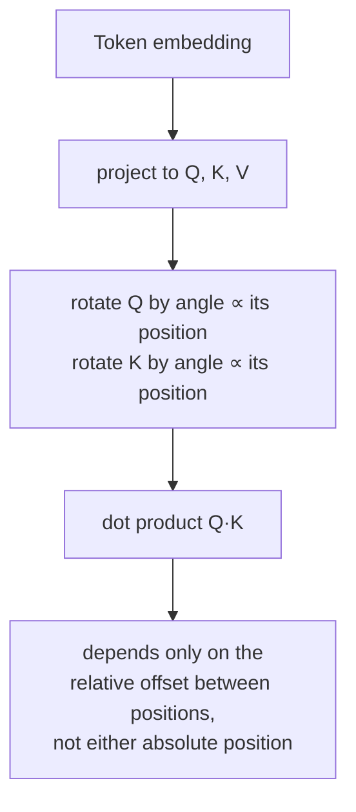

# Lição 14. Rotary position embeddings

**Ligação com a missão:** A lição 4 estabeleceu que a posição precisa entrar pelos vetores que produzem `Q`, `K` e `V`, já que a equação da atenção não tem outro canal para ela, e ensinou a única forma como o artigo original faz isso: somar um vetor sinusoidal fixo ao embedding do token antes de a atenção sequer rodar. Os **rotary position embeddings (RoPE)** são o mecanismo que quase todo modelo aberto atual de fato usa no lugar, e injetam a posição pelo mesmo canal que a lição 4 identificou, mas por uma operação genuinamente diferente: rotacionar o próprio `Q` e o próprio `K`, dentro do cálculo de atenção, em vez de somar qualquer coisa ao embedding antes.
**Fonte principal:** [Artigo científico: "RoFormer: Enhanced Transformer with Rotary Position Embedding", Su et al., 2021](https://arxiv.org/abs/2104.09864)
**Pré-requisitos:** [Lição 4](0004-positional-encoding.md), [Codificação posicional](../GLOSSARY.md)

## Aquecimento

1. ▢ Por que a posição precisa ser codificada nos vetores que produzem `Q`, `K` e `V`, em vez de ser passada à atenção como algum sinal separado?

Verificação

A equação da atenção só opera sobre `Q`, `K` e `V`; não há nenhuma entrada adicional por onde a posição possa entrar. A única forma de o cálculo se tornar sensível à posição é se a posição já estiver embutida nos vetores que os produzem.

2. ▢ Por que a codificação posicional sinusoidal pode ser avaliada em um comprimento de sequência maior do que qualquer um visto no treinamento, enquanto uma tabela de embeddings de posição aprendida não pode?

Verificação

A codificação sinusoidal é uma fórmula, avaliável em qualquer valor de posição. Uma tabela de embeddings aprendida só tem linhas para as posições para as quais foi dimensionada e treinada, sem nada para consultar além desse intervalo.

## Saiba isto

### O RoPE rotaciona Q e K em vez de somar qualquer coisa ao embedding

Enquanto a codificação sinusoidal soma um vetor fixo ao embedding de um token uma única vez, antes de ele ser projetado em `Q`, `K` ou `V`, o **RoPE**, em vez disso, pega os vetores de query e key já projetados de um token na posição `pos` e aplica a eles uma **rotação**, por um ângulo proporcional a `pos`. Dividindo um vetor em pares de 2 dimensões (o mesmo pareamento que a codificação sinusoidal usava para as suas frequências de seno e cosseno), cada par é rotacionado por um ângulo que escala com a posição e com a frequência do próprio par, os pares de índice mais baixo rotacionando lentamente ao longo das posições e os de índice mais alto rapidamente, espelhando a estrutura de frequências que a lição 4 já introduziu.

### Um produto escalar rotacionado depende apenas da posição relativa, e não de nenhuma das posições absolutas

Esse é o ganho real do RoPE, e é uma propriedade da própria rotação: rotacionar um vetor de query por um ângulo proporcional à posição `m` e um vetor de key por um ângulo proporcional à posição `n`, e então tomar o seu produto escalar, produz um valor que depende apenas de `m − n`, o deslocamento relativo entre eles, e não de `m` ou de `n` individualmente. Duas rotações se compõem somando os seus ângulos, então comparar um vetor rotacionado pelo ângulo de `m` com um rotacionado pelo ângulo de `n` é matematicamente equivalente a comparar os vetores originais, não rotacionados, depois de rotacionar apenas pela *diferença* `m − n`. O enquadramento do próprio artigo captura exatamente isso: o RoPE codifica a posição *absoluta* (cada vetor é rotacionado de acordo com a sua própria posição), mas o efeito sobre a atenção é uma dependência *explícita de posição relativa*, já que só o deslocamento entre as posições sobrevive ao score de atenção.

### Este é um mecanismo diferente do da lição 4, e não um remendo por cima dele

A codificação sinusoidal é aditiva e acontece uma vez, antes da atenção, permanentemente misturada ao embedding daí em diante. O RoPE é multiplicativo (uma rotação) e acontece dentro do próprio cálculo de atenção, aplicado de novo a `Q` e `K` em toda camada que calcula atenção, em vez de embutido no embedding uma única vez na entrada. Os dois satisfazem o requisito da lição 4 de que a posição entre pelos vetores sobre os quais a atenção de fato opera, mas são duas formas estruturalmente diferentes de fazê-lo, e a propriedade de posição relativa do RoPE não é algo que o esquema aditivo da codificação sinusoidal produza por conta própria.

### Por que essa propriedade específica importa para modelos reais

Um modelo cujo score de atenção depende do deslocamento relativo, e não da posição absoluta, lida com um caso prático que o artigo da própria codificação sinusoidal só argumentou de modo informal: a relação entre um token e outro 5 posições antes dele parece a mesma estando esse par no início de uma sequência curta ou no meio de uma sequência muito longa. Essa propriedade de posição relativa, derivada diretamente de como a rotação se compõe, é uma das principais razões de o RoPE ter deslocado a codificação sinusoidal na prática, junto com a flexibilidade de lidar com comprimentos de sequência não fixados no momento do treinamento, do mesmo modo que a abordagem baseada em fórmula (e não em tabela) da lição 4 conseguia.

## Prática

1. ▢ O RoPE rotaciona um vetor de query de acordo com a sua posição absoluta e um vetor de key de acordo com a sua própria posição absoluta. Por que o artigo ainda descreve o efeito resultante sobre a atenção como uma dependência de posição *relativa*?

Dica

Considere o que acontece com dois ângulos de rotação quando você compara os vetores aos quais cada um foi aplicado.

Verificação

Como duas rotações se compõem somando os seus ângulos, comparar um vetor rotacionado pelo ângulo da posição `m` com um rotacionado pelo ângulo da posição `n` equivale a comparar os vetores não rotacionados depois de uma única rotação pela diferença `m − n`. Embora cada vetor tenha sido rotacionado de acordo com a sua própria posição absoluta, só o deslocamento relativo entre as duas posições sobrevive ao produto escalar resultante.

2. ▢ Como o mecanismo do RoPE para injetar a posição difere estruturalmente do da codificação sinusoidal, embora ambos satisfaçam o requisito da lição 4 de que a posição entre por Q, K e V?

Verificação

A codificação sinusoidal soma um vetor fixo ao embedding do token uma única vez, antes de a atenção ou qualquer projeção acontecer, permanentemente misturado à representação daí em diante. O RoPE, em vez disso, rotaciona os vetores `Q` e `K` já projetados, aplicado de novo dentro do cálculo de atenção em toda camada, uma operação multiplicativa e não aditiva realizada de antemão.

3. ▢ Dois tokens estão a 5 posições de distância perto do início de uma sequência, e outros dois tokens também estão a 5 posições de distância bem mais adiante em uma sequência longa. Sob o RoPE, como os seus scores de atenção se relacionam, mantido o restante igual?

Verificação

Eles dependem do mesmo deslocamento relativo (5 posições), então a propriedade de composição de rotações do RoPE faz o score de atenção resultante tratar os dois pares de forma consistente com base nesse deslocamento compartilhado, em vez de ser sensível a onde na sequência cada par por acaso está.

4. ▢ O RoPE contradiz a afirmação da lição 4 de que a posição precisa ser codificada nos vetores que produzem Q, K e V, já que o RoPE opera diretamente sobre Q e K e não sobre o embedding?

Verificação

Não. O RoPE rotaciona os vetores de query e key que a equação da atenção de fato usa, que ainda são os vetores pelos quais a lição 4 disse que a posição precisa entrar; o RoPE é um mecanismo diferente para injetar a posição nesses mesmos vetores (rotação multiplicativa, aplicada depois da projeção), e não uma exceção ao próprio requisito.

5. ▢ Qual afirmação distingue corretamente o RoPE da codificação posicional sinusoidal?

    - a) O RoPE soma um vetor fixo ao embedding do token, exatamente como a codificação sinusoidal, só que calculado com uma fórmula diferente
    - b) O RoPE rotaciona os vetores Q e K projetados por um ângulo proporcional à posição, o que faz um produto escalar resultante depender apenas da posição relativa, uma propriedade que o esquema aditivo da codificação sinusoidal não produz
    - c) O RoPE e a codificação sinusoidal operam ambos sobre o embedding do token antes de qualquer projeção em Q, K ou V
    - d) O RoPE exige que a posição seja passada à atenção como um sinal separado de Q e K

Verificação

**b)** É o mecanismo e o ganho precisos que esta lição estabelece. (a) é falsa: o RoPE é uma rotação aplicada a Q e K já projetados, e não um vetor aditivo sobre o embedding. (c) é falsa: a codificação sinusoidal opera sobre o embedding antes da projeção; o RoPE opera sobre Q e K depois da projeção. (d) é falsa: o RoPE ainda respeita o requisito da lição 4, injetando a posição no próprio Q e no próprio K, o mesmo canal que a equação da atenção de fato usa.

## Prática no mundo real

- [ ] Implemente a rotação do RoPE para uma dimensão de vetor pequena e algumas posições inteiras e confirme numericamente que o produto escalar entre uma query rotacionada na posição `m` e uma key rotacionada na posição `n` depende apenas de `m - n`, e não de `m` ou de `n` individualmente.
- [ ] Compare lado a lado a sua implementação sinusoidal da lição 4 e a implementação de RoPE desta lição: quais vetores cada uma modifica e em que ponto do forward pass cada uma roda?
- [ ] Amanhã: leia a seção da fonte principal sobre como a propriedade de posição relativa do RoPE afeta o comportamento da atenção à medida que a distância cresce e anote o que ela afirma sobre scores que decaem com a distância.

## Para ir além

- [Artigo científico: "RoFormer: Enhanced Transformer with Rotary Position Embedding", Su et al., 2021](https://arxiv.org/abs/2104.09864)
- [Artigo científico: "Attention Is All You Need", Vaswani et al., 2017](https://arxiv.org/abs/1706.03762)
- [Recursos](../RESOURCES.md)

---

Não ficou claro? Releia a fonte principal no topo, já que esta lição a comprime e é na compressão que o entendimento escapa. Consulte o [glossário](../GLOSSARY.md) para qualquer termo que pareceu escorregadio.

Se o problema é a lição em si, e não o material, isso é um defeito: [abra uma issue](https://github.com/TokenCemetery/teach/issues).
