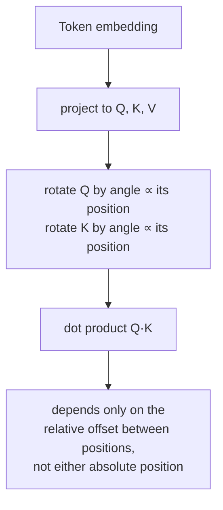

# Урок 14. Ротационные позиционные эмбеддинги

**Связь с целью курса:** Урок 4 установил, что позиция должна входить через векторы, которые порождают `Q`, `K` и `V`, поскольку в уравнении внимания для неё нет другого канала, и показал единственный способ, которым это делает оригинальная статья: прибавление фиксированного синусоидального вектора к эмбеддингу токена до того, как внимание вообще запускается. **Ротационные позиционные эмбеддинги** (rotary position embeddings, RoPE) это механизм, который почти каждая современная открытая модель на самом деле использует вместо этого, и они вносят позицию через тот же канал, который определил урок 4, но совершенно другой операцией: поворотом самих `Q` и `K` внутри вычисления внимания, а не прибавлением чего-либо к эмбеддингу заранее.
**Первоисточник:** [Научная статья: "RoFormer: Enhanced Transformer with Rotary Position Embedding", Su et al., 2021](https://arxiv.org/abs/2104.09864)
**Предварительные требования:** [Урок 4](0004-positional-encoding.md), [Позиционное кодирование](../GLOSSARY.md)

## Разминка

1. ▢ Почему позицию нужно кодировать в векторах, порождающих `Q`, `K` и `V`, а не передавать вниманию отдельным сигналом?

Проверка

Уравнение внимания работает только с `Q`, `K` и `V`; дополнительного входа, через который могла бы поступить позиция, нет. Вычисление становится чувствительным к позиции, только если позиция уже вшита в векторы, которые их порождают.

2. ▢ Почему синусоидальное позиционное кодирование можно вычислить для длины последовательности больше любой, виденной при обучении, а таблицу обучаемых позиционных эмбеддингов нельзя?

Проверка

Синусоидальное кодирование это формула, которую можно вычислить для любого значения позиции вообще. В обучаемой таблице эмбеддингов есть строки только для тех позиций, под которые её рассчитали и обучили, и за пределами этого диапазона искать нечего.

## Что нужно знать

### RoPE поворачивает Q и K, а не прибавляет что-либо к эмбеддингу

Там, где синусоидальное кодирование один раз прибавляет фиксированный вектор к эмбеддингу токена, ещё до проецирования в `Q`, `K` или `V`, **RoPE** берёт уже спроецированные векторы запроса и ключа для токена в позиции `pos` и применяет к ним **поворот** на угол, пропорциональный `pos`. Вектор разбивается на двумерные пары (то же разбиение на пары, которое синусоидальное кодирование использовало для своих частот синуса и косинуса), и каждая пара поворачивается на угол, который масштабируется вместе с позицией и с собственной частотой этой пары: пары с меньшим индексом поворачиваются по позициям медленно, пары с большим индексом быстро, повторяя частотную структуру, которую уже ввёл урок 4.

### Повёрнутое скалярное произведение зависит только от относительной позиции, а не от абсолютной позиции любого из векторов

В этом и состоит настоящая выгода RoPE, и это свойство самого поворота: если повернуть вектор запроса на угол, пропорциональный позиции `m`, и вектор ключа на угол, пропорциональный позиции `n`, а затем взять их скалярное произведение, получится значение, зависящее только от `m − n`, относительного смещения между ними, а не от `m` или `n` по отдельности. Два поворота складываются сложением углов, поэтому сравнение вектора, повёрнутого на угол `m`, с вектором, повёрнутым на угол `n`, математически эквивалентно сравнению исходных, неповёрнутых векторов после поворота лишь на *разность* `m − n`. Именно это и фиксирует формулировка самой статьи: RoPE кодирует *абсолютную* позицию (каждый вектор поворачивается в соответствии с собственной позицией), но эффект на внимание это *явная относительная* зависимость от позиции, потому что в оценку внимания доходит только смещение между позициями.

### Это другой механизм, а не заплатка поверх механизма из урока 4

Синусоидальное кодирование аддитивно и срабатывает один раз, до внимания, и с этого момента навсегда смешано с эмбеддингом. RoPE мультипликативен (поворот) и срабатывает внутри самого вычисления внимания, применяясь заново к `Q` и `K` на каждом слое, который вычисляет внимание, а не вшивается в эмбеддинг один раз на входе. Оба удовлетворяют требованию из урока 4, что позиция должна входить через векторы, с которыми внимание на самом деле работает, но это два структурно разных способа это сделать, а свойство относительной позиции у RoPE не получается само собой из аддитивной схемы синусоидального кодирования.

### Почему именно это свойство важно для реальных моделей

Модель, оценка внимания которой зависит от относительного смещения, а не от абсолютной позиции, справляется с практическим случаем, который в статье про синусоидальное кодирование лишь неформально обосновывался: связь между токеном и токеном на 5 позиций раньше выглядит одинаково, стоит ли эта пара в начале короткой последовательности или в середине очень длинной. Это свойство относительной позиции, выведенное прямо из того, как складываются повороты, это важная причина, по которой RoPE на практике вытеснил синусоидальное кодирование, наряду с гибкостью в работе с длинами последовательностей, не зафиксированными при обучении, так же как это мог подход из урока 4 на основе формулы (а не таблицы).

## Практика

1. ▢ RoPE поворачивает вектор запроса в соответствии с его абсолютной позицией, а вектор ключа в соответствии с его собственной абсолютной позицией. Почему статья всё же описывает получающийся эффект на внимание как *относительную* зависимость от позиции?

Подсказка

Подумайте, что происходит с двумя углами поворота, когда вы сравниваете векторы, к которым каждый из них применён.

Проверка

Поскольку два поворота складываются сложением углов, сравнение вектора, повёрнутого на угол позиции `m`, с вектором, повёрнутым на угол позиции `n`, эквивалентно сравнению неповёрнутых векторов после одного поворота на разность `m − n`. Хотя каждый вектор был повёрнут в соответствии с собственной абсолютной позицией, в получающееся скалярное произведение доходит только относительное смещение между двумя позициями.

2. ▢ Чем механизм внесения позиции в RoPE структурно отличается от синусоидального кодирования, хотя оба удовлетворяют требованию из урока 4, что позиция должна входить через Q, K и V?

Проверка

Синусоидальное кодирование один раз прибавляет фиксированный вектор к эмбеддингу токена, до внимания и до любой проекции, и с этого момента оно навсегда смешано с представлением. RoPE же поворачивает уже спроецированные векторы `Q` и `K`, применяясь заново внутри вычисления внимания на каждом слое: это мультипликативная операция, а не аддитивная, выполненная заранее.

3. ▢ Два токена находятся на расстоянии 5 позиций друг от друга около начала последовательности, а два других токена тоже на расстоянии 5 позиций, но намного позже в длинной последовательности. Как при RoPE соотносятся их оценки внимания, при прочих равных?

Проверка

Они зависят от одного и того же относительного смещения (5 позиций), поэтому свойство композиции поворотов в RoPE заставляет получающуюся оценку внимания обращаться с обеими парами согласованно, по этому общему смещению, а не быть чувствительной к тому, где в последовательности каждая пара оказалась.

4. ▢ Противоречит ли RoPE утверждению из урока 4, что позицию нужно кодировать в векторах, порождающих Q, K и V, раз RoPE работает прямо с Q и K, а не с эмбеддингом?

Проверка

Нет. RoPE поворачивает векторы запроса и ключа, которые уравнение внимания на самом деле использует, а это по-прежнему те векторы, через которые, по словам урока 4, должна входить позиция; RoPE это другой механизм внесения позиции в те же самые векторы (мультипликативный поворот, применяемый после проекции), а не исключение из самого требования.

5. ▢ Какое утверждение правильно отличает RoPE от синусоидального позиционного кодирования?

    - a) RoPE прибавляет фиксированный вектор к эмбеддингу токена, в точности как синусоидальное кодирование, только по другой формуле
    - b) RoPE поворачивает спроецированные векторы Q и K на угол, пропорциональный позиции, из-за чего получающееся скалярное произведение зависит только от относительной позиции, а аддитивная схема синусоидального кодирования такого свойства не даёт
    - c) И RoPE, и синусоидальное кодирование работают с эмбеддингом токена до любой проекции в Q, K или V
    - d) RoPE требует передавать позицию вниманию сигналом, отдельным от Q и K

Проверка

**b)** Это точный механизм и выгода, которые устанавливает этот урок. Вариант (a) неверен: RoPE это поворот, применяемый к уже спроецированным Q и K, а не аддитивный вектор на эмбеддинге. Вариант (c) неверен: синусоидальное кодирование работает с эмбеддингом до проекции; RoPE работает с Q и K после проекции. Вариант (d) неверен: RoPE по-прежнему соблюдает требование из урока 4, внося позицию в сами Q и K, тот же канал, который на самом деле использует уравнение внимания.

## Практика в реальной работе

- [ ] Реализуйте поворот RoPE для небольшой размерности вектора и нескольких целых позиций и убедитесь численно, что скалярное произведение повёрнутого запроса в позиции `m` и повёрнутого ключа в позиции `n` зависит только от `m - n`, а не от `m` или `n` по отдельности.
- [ ] Сравните рядом свою синусоидальную реализацию из урока 4 и реализацию RoPE из этого урока: какие векторы изменяет каждая и в какой точке прямого прохода работает каждая?
- [ ] Завтра: прочитайте раздел первоисточника о том, как свойство относительной позиции у RoPE влияет на поведение внимания с ростом расстояния, и отметьте, что в нём утверждается про затухание оценок с расстоянием.

## Что почитать дальше

- [Научная статья: "RoFormer: Enhanced Transformer with Rotary Position Embedding", Su et al., 2021](https://arxiv.org/abs/2104.09864)
- [Научная статья: "Attention Is All You Need", Vaswani et al., 2017](https://arxiv.org/abs/1706.03762)
- [Ресурсы](../RESOURCES.md)

---

Не доходит? Перечитайте первоисточник в начале: этот урок его сжимает, а при сжатии понимание как раз и теряется. Загляните в [глоссарий](../GLOSSARY.md), если какой-то термин показался скользким.

Если неясен сам урок, а не материал, это дефект: [откройте issue](https://github.com/TokenCemetery/teach/issues).
