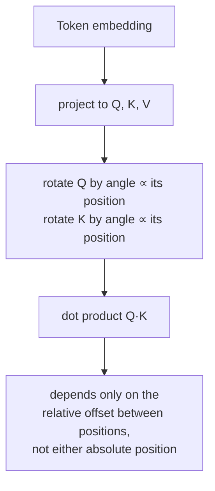

# 第 14 课：旋转位置嵌入

**使命关联:** 第 4 课确立了位置必须通过产生 `Q`、`K` 和 `V` 的那些向量进入，因为注意力的方程没有别的渠道，它还讲了原始论文做这件事的唯一办法：在注意力运行之前，给 token 嵌入加上一个固定的正弦向量。**旋转位置嵌入**（RoPE）则是当前几乎所有开源模型实际使用的替代机制，它通过第 4 课指出的同一个渠道注入位置，但用的是一种真正不同的运算：旋转 `Q` 和 `K` 本身，发生在注意力计算内部，而不是事先给嵌入加上任何东西。
**主要来源:** [论文：“RoFormer: Enhanced Transformer with Rotary Position Embedding”，Su 等，2021](https://arxiv.org/abs/2104.09864)
**前置知识:** [第 4 课](0004-positional-encoding.md)、[位置编码](../GLOSSARY.md)

## 热身

1. ▢ 为什么位置必须编码进产生 `Q`、`K` 和 `V` 的那些向量里，而不是作为某个单独的信号传给注意力？

检查

注意力的方程只对 `Q`、`K` 和 `V` 运算；没有额外的输入可供位置进入。计算要变得对位置敏感，唯一的办法是位置已经写进了产生它们的那些向量里。

2. ▢ 为什么正弦位置编码可以对比训练时见过的任何长度都更长的序列求值，而学习得到的位置嵌入表不行？

检查

正弦编码是一个公式，在任何位置值上都可以求值。学习得到的嵌入表只有它被设定大小并训练过的那些位置的行，超出这个范围就没有东西可查。

## 要点

### RoPE 旋转 Q 和 K，而不是给嵌入加任何东西

正弦编码是在 token 的嵌入被投影成 `Q`、`K` 或 `V` 之前，一次性给它加上一个固定向量；而 **RoPE** 取的是位置 `pos` 处 token 已经投影好的查询向量和键向量，对它们施加一个**旋转**，旋转的角度与 `pos` 成正比。把一个向量拆成二维的对（与正弦编码为它的正弦/余弦频率所用的配对方式相同），每一对都按一个角度旋转，这个角度随位置、也随该对自己的频率而缩放，低索引的对随位置转得慢，高索引的对转得快，这与第 4 课已经介绍过的频率结构一脉相承。

### 旋转后的点积只取决于相对位置，而不取决于任何一个绝对位置

这是 RoPE 真正的回报，它是旋转本身的一个性质：把一个查询向量按与位置 `m` 成正比的角度旋转，把一个键向量按与位置 `n` 成正比的角度旋转，再取它们的点积，得到的值只取决于 `m − n`，也就是它们之间的相对偏移，而不单独取决于 `m` 或 `n`。两次旋转的复合就是角度相加，所以把一个按 `m` 的角度旋转的向量，与一个按 `n` 的角度旋转的向量做比较，在数学上等价于先把原来未旋转的向量只旋转*差值* `m − n`，再做比较。论文自己的表述正好抓住了这一点：RoPE 编码的是*绝对*位置（每个向量都按它自己的位置旋转），但它对注意力的效果是*显式的相对*位置依赖，因为只有位置之间的偏移，才会留存到注意力分数里。

### 这是与第 4 课不同的机制，而不是在它之上打的补丁

正弦编码是加性的，只发生一次，在注意力之前，从那一刻起就永久地混进了嵌入里。RoPE 是乘性的（一个旋转），发生在注意力计算内部，在每个计算注意力的层里，都重新施加到 `Q` 和 `K` 上，而不是在输入处一次性写进嵌入里。两者都满足第 4 课的要求，即位置要通过注意力实际运算的那些向量进入，但它们是两种结构上不同的做法，而 RoPE 的相对位置性质，并不是正弦编码的加性方案自己就能产生的。

### 为什么这个特定的性质对真实的模型很重要

注意力分数取决于相对偏移而不是绝对位置的模型，能处理正弦编码的论文自己只是非正式地论证过的一种实际情形：一个 token 与它前面 5 个位置的那个 token 之间的关系，不论这一对处在短序列的开头，还是很长序列的中间，看起来都是一样的。这种相对位置的性质，直接源自旋转如何复合，是 RoPE 在实践中取代正弦编码的一个主要原因，另外还有一点，就是它能灵活处理训练时没有固定的序列长度，这与第 4 课基于公式（而不是基于表）的做法所能做到的相同。

## 练习

1. ▢ RoPE 按绝对位置旋转查询向量，也按它自己的绝对位置旋转键向量。为什么论文仍然把它对注意力的效果描述为*相对*位置依赖？

提示

想一想，当你比较两个旋转角度各自作用过的向量时，这两个角度会发生什么。

检查

因为两次旋转的复合是角度相加，所以把一个按位置 `m` 的角度旋转的向量，与一个按位置 `n` 的角度旋转的向量做比较，等价于把未旋转的向量只旋转差值 `m − n` 一次再比较。尽管每个向量都按它自己的绝对位置旋转，但只有两个位置之间的相对偏移，才会留存到得出的点积里。

2. ▢ 尽管两者都满足第 4 课所要求的位置要通过 Q、K 和 V 进入，RoPE 注入位置的机制与正弦编码的在结构上有什么不同？

检查

正弦编码是在注意力或任何投影发生之前，一次性给 token 嵌入加上一个固定向量，从那一刻起就永久地混进了表示里。RoPE 则是旋转已经投影好的 `Q` 和 `K` 向量，在每一层的注意力计算内部重新施加，是一种乘性运算，而不是事先完成的加性运算。

3. ▢ 序列开头附近有两个 token 相距 5 个位置，一个很长序列的靠后位置也有另外两个 token 相距 5 个位置。在 RoPE 下，在其他条件相同的情况下，它们的注意力分数有什么关系？

检查

它们取决于同样的相对偏移（5 个位置），所以 RoPE 的旋转复合性质让得出的注意力分数，基于这个共同的偏移，一致地对待这两对，而不是对每一对碰巧处在序列中的什么位置敏感。

4. ▢ RoPE 直接作用于 Q 和 K，而不是嵌入，那它是否与第 4 课所说的位置必须编码进产生 Q、K 和 V 的向量里相矛盾？

检查

不矛盾。RoPE 旋转的是注意力方程实际使用的查询向量和键向量，它们仍然是第 4 课所说位置必须通过其进入的向量；RoPE 是向这同样的向量注入位置的另一种机制（乘性的旋转，在投影之后施加），而不是对这一要求本身的例外。

5. ▢ 下面哪一项说法正确区分了 RoPE 与正弦位置编码？

    - a) RoPE 像正弦编码一样给 token 嵌入加上一个固定向量，只是用不同的公式计算
    - b) RoPE 把投影后的 Q 和 K 向量按与位置成正比的角度旋转，这使得得出的点积只取决于相对位置，这是正弦编码的加性方案不具备的性质
    - c) RoPE 和正弦编码都是在投影成 Q、K 或 V 之前，作用于 token 嵌入
    - d) RoPE 要求把位置作为与 Q 和 K 分开的信号传给注意力

检查

**b)** 这正是本课确立的精确机制和回报。(a) 是错的：RoPE 是施加在已经投影好的 Q 和 K 上的旋转，而不是加在嵌入上的加性向量。(c) 是错的：正弦编码作用于投影之前的嵌入；RoPE 作用于投影之后的 Q 和 K。(d) 是错的：RoPE 仍然遵守第 4 课的要求，把位置注入 Q 和 K 本身，也就是注意力方程实际使用的同一个渠道。

## 实战练习

- [ ] 对一个较小的向量维度和几个整数位置，实现 RoPE 的旋转，并用数值验证，位置 `m` 处旋转后的查询与位置 `n` 处旋转后的键之间的点积，只取决于 `m - n`，而不单独取决于 `m` 或 `n`。
- [ ] 把你第 4 课的正弦编码实现，与本课的 RoPE 实现并排比较：它们各自修改哪些向量，各自在前向传播的哪个时刻运行？
- [ ] 明天：阅读主要来源中讲 RoPE 的相对位置性质如何在距离增大时影响注意力行为的那一节，并记下它关于分数随距离衰减是怎么说的。

## 延伸阅读

- [论文：“RoFormer: Enhanced Transformer with Rotary Position Embedding”，Su 等，2021](https://arxiv.org/abs/2104.09864)
- [论文：“Attention Is All You Need”，Vaswani 等，2017](https://arxiv.org/abs/1706.03762)
- [资源](../RESOURCES.md)

---

没学明白？请重读顶部的主要来源，因为本课是对它的压缩，而理解正是在压缩中流失的。如果有哪个术语觉得含糊，可以查看[术语表](../GLOSSARY.md)。

如果问题出在课程本身，而不是学习材料，那就是一个缺陷：[提交 issue](https://github.com/TokenCemetery/teach/issues)。
