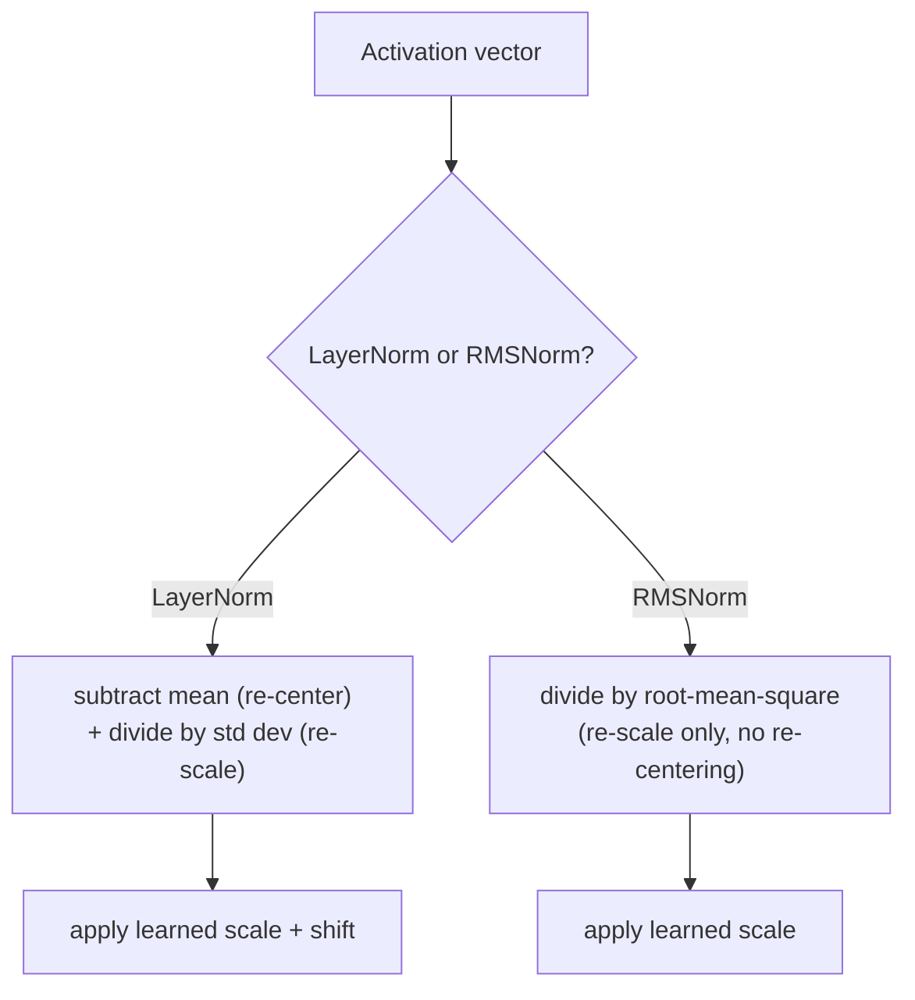

# Lección 15. RMSNorm

**Vínculo con la misión:** La lección 5 derivó por qué una pila profunda necesita layer normalization, y por qué la colocación pre-norm (la norm dentro de la rama residual) entrena con más estabilidad que la post-norm del paper original. Esa lección usó la layer norm ordinaria para argumentarlo. **RMSNorm** es lo que los modelos actuales colocan en realidad dentro de esa misma rama pre-norm, y existe porque una de las dos operaciones de la layer norm resulta no hacer demasiado trabajo.
**Fuente principal:** [Paper: "Root Mean Square Layer Normalization", Zhang and Sennrich, 2019](https://arxiv.org/abs/1910.07467)
**Requisitos previos:** [Lección 5](0005-layer-norm-and-residuals.md), [Lección 14](0014-rotary-position-embeddings.md)

## Calentamiento

1. ▢ ¿Por qué importa el cálculo por ejemplo de la layer norm (y no a lo largo del batch, como la batch norm) específicamente para un modelo de secuencias que hace generación autorregresiva?

Comprobación

La generación autorregresiva suele ejecutarse con un batch pequeño, a menudo de batch size 1, donde las estadísticas a lo largo del batch de la batch normalization carecerían de sentido o serían inestables. La layer norm calcula sus estadísticas a partir de las features de un único ejemplo, así que funciona de forma idéntica sin importar el batch size.

2. ▢ Contrasta la colocación post-norm y pre-norm, y explica por qué la pre-norm se prefiere en general para los modelos muy profundos.

Comprobación

La post-norm aplica la layer norm después de sumar el residual, `LayerNorm(x + Sublayer(x))`; la pre-norm la aplica antes de la subcapa, dentro de la rama residual, `x + Sublayer(LayerNorm(x))`. La pre-norm deja el propio camino residual completamente limpio y sin normalizar de punta a punta, mientras que la post-norm normaliza la suma residual en cada capa, lo que perturba ese camino limpio para el gradiente, y por eso la pre-norm entrena con más estabilidad a medida que aumenta la profundidad.

## Qué debes saber

### La layer norm hace en realidad dos cosas distintas

La layer norm de la lección 5 calcula una media y una desviación estándar a lo largo de las features de un único ejemplo, y luego usa ambas: restar la media **recentra** las activaciones en cero, y dividir por la desviación estándar las **reescala** a un rango consistente. Son dos operaciones distintas agrupadas en un solo cálculo, y nada en la derivación de la lección 5 preguntó si ambas son realmente necesarias para lo que hace la layer norm por la estabilidad del entrenamiento.

### La premisa de RMSNorm: el recentrado es prescindible, el reescalado no

El propio paper de RMSNorm enuncia su hipótesis con claridad: la invarianza al recentrado que aporta la layer norm es prescindible, y el reescalado por sí solo es lo que realmente hace el trabajo útil. **RMSNorm** conserva solo la operación de reescalado, y divide un vector de activación por su **raíz cuadrática media** (la raíz cuadrada de la media de sus valores al cuadrado) en lugar de por la desviación estándar de sus valores tras restar la media, y aplica luego la misma clase de escala aprendida que usa la layer norm. La media nunca se calcula ni se resta; RMSNorm nunca recentra.

### Eliminar una operación es exactamente lo que la hace más barata

Como RMSNorm se salta por completo el cálculo y la resta de la media, tiene menos aritmética que hacer por normalización que la layer norm, y el propio planteamiento del paper es directo sobre por qué esto importa: la sobrecarga computacional de la layer norm hacía que su beneficio estabilizador fuera caro de comprar, y ralentizaba las mismas redes a las que pretendía ayudar a entrenar. Los propios experimentos de RMSNorm encontraron que logra un rendimiento comparable al de la layer norm en una gama de tareas y arquitecturas, que es el respaldo empírico de la hipótesis del paper de que el recentrado no se estaba ganando su costo computacional.

### RMSNorm sustituye a la layer norm dentro de la misma rama pre-norm que la lección 5 ya derivó

Cambiar de layer norm a RMSNorm no modifica en absoluto el argumento de la lección 5 sobre los residuales ni sobre pre-norm frente a post-norm: un bloque moderno sigue envolviendo su subcapa en una conexión residual, y sigue colocando su normalización dentro de esa rama residual por la misma razón de camino limpio para el gradiente que dio la lección 5. Lo único que cambia es qué cálculo de normalización ocupa ese hueco, `x + Sublayer(RMSNorm(x))` en lugar de `x + Sublayer(LayerNorm(x))`, una operación más barata colocada en una decisión de colocación que este espacio de trabajo ya tomó.

## Práctica

1. ▢ Un equipo implementa una capa de normalización que solo divide un vector de activación por su raíz cuadrática media, sin calcular ni restar nunca una media. ¿Cuál de las dos operaciones de la layer norm conserva esto, y cuál elimina?

Pista

Considera qué operación recentra las activaciones en cero y cuál las reescala.

Comprobación

Conserva el reescalado (dividir por una medida de la magnitud del vector) y elimina por completo el recentrado (nunca resta la media). Ese es exactamente el diseño de RMSNorm: solo reescalado, nada del paso de resta de la media de la layer norm.

2. ▢ ¿Por qué argumenta el propio paper de RMSNorm que debería ser computacionalmente más barata que la layer norm, en concreto?

Comprobación

Como se salta por completo calcular y restar la media, RMSNorm tiene menos aritmética que realizar por normalización que la layer norm; el paper presenta la sobrecarga de la layer norm como lo que hace que su beneficio sea caro de comprar, y RMSNorm elimina una de las dos operaciones que contribuyen a ese costo.

3. ▢ Un modelo cambia la layer norm por RMSNorm dentro de su rama residual pre-norm. ¿Cambia esto si el bloque usa colocación pre-norm o post-norm?

Comprobación

No. La decisión de colocación (la norm dentro de la rama residual, manteniendo limpio el propio camino residual) no cambia; solo cambia el cálculo de normalización que ocupa ese hueco, de la normalización basada en media y varianza de la layer norm a la versión solo de raíz cuadrática media de RMSNorm.

4. ▢ RMSNorm logra un rendimiento en las tareas comparable al de la layer norm en los propios experimentos del paper, pese a eliminar el recentrado. ¿Qué sugiere esto sobre la contribución real del recentrado al efecto estabilizador de la layer norm?

Comprobación

Sugiere que el recentrado no aportaba gran parte del beneficio real de la layer norm, lo que respalda la hipótesis del paper de que el reescalado por sí solo explica la mayor parte de lo que hacía eficaz a la layer norm, y que el paso de resta de la media podía eliminarse sin un costo significativo de rendimiento.

5. ▢ ¿Qué afirmación describe correctamente la relación entre layer norm, RMSNorm y la colocación pre-norm?

    - a) RMSNorm sustituye por completo la colocación pre-norm por una nueva regla de colocación
    - b) RMSNorm conserva la operación de reescalado de la layer norm pero elimina su operación de recentrado (resta de la media), lo que la hace más barata y encaja en la misma rama pre-norm que la lección 5 ya derivó
    - c) La layer norm y RMSNorm calculan y restan ambas una media antes de dividir por una medida de escala
    - d) Se encontró que eliminar el recentrado perjudica sustancialmente el rendimiento en las tareas en comparación con la layer norm completa

Comprobación

**b)** Esa es la relación precisa que establece esta lección. (a) es falsa: pre-norm frente a post-norm es una decisión de colocación que la lección 5 ya resolvió; RMSNorm solo cambia qué cálculo de normalización ocupa ese hueco. (c) es falsa: RMSNorm específicamente nunca calcula ni resta una media. (d) es falsa: los propios experimentos del paper encontraron un rendimiento comparable pese a eliminar el recentrado.

## Prácticas en el mundo real

- [ ] Implementa RMSNorm a partir de operaciones de tensores en bruto (raíz cuadrática media, división, escala aprendida) para un vector de activación pequeño, y compara su salida con un cálculo completo de layer norm sobre el mismo vector.
- [ ] Mide el tiempo (aunque sea de forma aproximada) de un cálculo de layer norm frente a uno de RMSNorm sobre un tensor razonablemente grande, y comprueba si la diferencia coincide con lo que predeciría eliminar el paso de resta de la media.
- [ ] Mañana: lee la sección de experimentos de la fuente principal y anota con qué tareas y arquitecturas probó RMSNorm, y si alguna mostró una brecha mayor que otras respecto de la layer norm.

## Para profundizar

- [Paper: "Root Mean Square Layer Normalization", Zhang and Sennrich, 2019](https://arxiv.org/abs/1910.07467)
- [Paper: "Layer Normalization", Ba, Kiros, and Hinton, 2016](https://arxiv.org/abs/1607.06450)
- [Recursos](../RESOURCES.md)

---

¿No termina de quedar claro? Vuelve a leer la fuente primaria de arriba, ya que esta lección la comprime y en la compresión es donde se escapa la comprensión. Consulta el [glosario](../GLOSSARY.md) por si algún término te resultó resbaladizo.

Si lo poco claro es la propia lección y no el material, eso es un defecto: [abre un issue](https://github.com/TokenCemetery/teach/issues).
