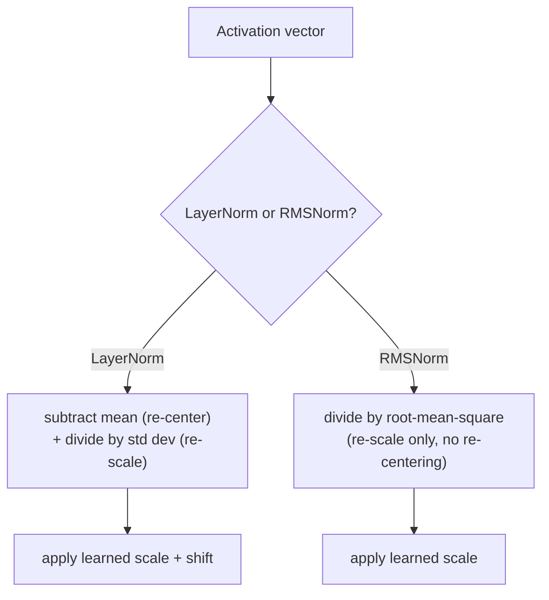

# Leçon 15. RMSNorm

**Lien avec la mission :** La leçon 5 a dérivé pourquoi une pile profonde a besoin de la layer normalization, et pourquoi le placement pre-norm (la norme à l'intérieur de la branche résiduelle) s'entraîne de façon plus stable que le post-norm de l'article d'origine. Cette leçon utilisait la layer norm ordinaire pour illustrer le propos. **RMSNorm** est ce que les modèles actuels placent réellement à la place dans cette même branche pre-norm, et elle existe parce que l'une des deux opérations de la layer norm se révèle ne pas faire grand-chose.
**Source primaire :** [Article : "Root Mean Square Layer Normalization", Zhang et Sennrich, 2019](https://arxiv.org/abs/1910.07467)
**Prérequis :** [Leçon 5](0005-layer-norm-and-residuals.md), [Leçon 14](0014-rotary-position-embeddings.md)

## Échauffement

1. ▢ Pourquoi le calcul par exemple de la layer norm (plutôt que sur le batch, comme la batch norm) compte-t-il précisément pour un modèle de séquences qui fait de la génération autorégressive ?

Vérifier

La génération autorégressive s'exécute couramment avec un petit batch, souvent de taille 1, où les statistiques sur le batch de la batch normalization n'auraient aucun sens ou seraient instables. La layer norm calcule ses statistiques à partir des features d'un seul exemple, donc elle fonctionne de façon identique quelle que soit la taille du batch.

2. ▢ Comparez le placement post-norm et le placement pre-norm, et expliquez pourquoi le pre-norm est généralement préféré pour les modèles très profonds.

Vérifier

Le post-norm applique la layer norm après l'ajout du résiduel, `LayerNorm(x + Sublayer(x))` ; le pre-norm l'applique avant la sous-couche, à l'intérieur de la branche résiduelle, `x + Sublayer(LayerNorm(x))`. Le pre-norm laisse le chemin résiduel lui-même parfaitement propre et non normalisé de bout en bout, alors que le post-norm normalise la somme résiduelle à chaque couche, ce qui perturbe ce chemin de gradient propre, d'où l'entraînement plus stable du pre-norm quand la profondeur augmente.

## À savoir

### La layer norm fait en réalité deux choses distinctes

La layer norm de la leçon 5 calcule une moyenne et un écart type sur les features d'un seul exemple, puis utilise les deux : soustraire la moyenne **recentre** les activations sur zéro, et diviser par l'écart type les **remet à l'échelle** dans une plage cohérente. Ce sont deux opérations distinctes regroupées en un seul calcul, et rien dans la dérivation de la leçon 5 ne demandait si les deux sont réellement nécessaires à ce que la layer norm apporte à la stabilité de l'entraînement.

### La prémisse de RMSNorm : le recentrage est superflu, la remise à l'échelle ne l'est pas

L'article de RMSNorm énonce clairement son hypothèse : l'invariance au recentrage que fournit la layer norm est superflue, et c'est la remise à l'échelle seule qui fait le travail utile. **RMSNorm** ne garde que l'opération de remise à l'échelle, en divisant un vecteur d'activation par sa **racine carrée de la moyenne des carrés** (root mean square, la racine carrée de la moyenne de ses valeurs au carré) au lieu de l'écart type de ses valeurs centrées, puis applique le même genre d'échelle apprise que la layer norm. La moyenne n'est jamais calculée ni soustraite ; RMSNorm ne recentre jamais.

### Supprimer une opération est précisément ce qui la rend moins coûteuse

Comme RMSNorm saute entièrement le calcul et la soustraction de la moyenne, elle a moins d'arithmétique à effectuer par normalisation que la layer norm, et la formulation de l'article est directe sur la raison pour laquelle cela compte : le surcoût de calcul de la layer norm rendait son bénéfice de stabilisation coûteux à acheter, en ralentissant les réseaux mêmes qu'elle devait aider à entraîner. Les expériences de RMSNorm ont trouvé qu'elle atteint des performances comparables à celles de la layer norm sur une série de tâches et d'architectures, ce qui est le soutien empirique de l'hypothèse de l'article selon laquelle le recentrage ne méritait pas son coût de calcul au départ.

### RMSNorm remplace la layer norm dans la même branche pre-norm que la leçon 5 a déjà dérivée

Passer de la layer norm à RMSNorm ne change rien à l'argument de la leçon 5 sur le résiduel ni sur pre-norm contre post-norm : un bloc moderne enveloppe toujours sa sous-couche dans une connexion résiduelle, et place toujours sa normalisation à l'intérieur de cette branche résiduelle pour la même raison de chemin de gradient propre que celle donnée à la leçon 5. Seul change le calcul de normalisation qui occupe cet emplacement, `x + Sublayer(RMSNorm(x))` au lieu de `x + Sublayer(LayerNorm(x))`, une opération moins coûteuse insérée dans une décision de placement que cet espace de travail a déjà prise.

## Pratique

1. ▢ Une équipe implémente une couche de normalisation qui se contente de diviser un vecteur d'activation par sa racine carrée de la moyenne des carrés, sans jamais calculer ni soustraire de moyenne. Laquelle des deux opérations de la layer norm cela conserve-t-il, et laquelle supprime-t-il ?

Indice

Demandez-vous quelle opération recentre les activations sur zéro et laquelle les remet à l'échelle.

Vérifier

Cela conserve la remise à l'échelle (diviser par une mesure de la grandeur du vecteur) et supprime entièrement le recentrage (ne jamais soustraire la moyenne). C'est exactement la conception de RMSNorm : seulement la remise à l'échelle, sans l'étape de soustraction de la moyenne de la layer norm.

2. ▢ Pourquoi l'article de RMSNorm soutient-il qu'elle devrait être moins coûteuse en calcul que la layer norm, précisément ?

Vérifier

Parce qu'elle saute entièrement le calcul et la soustraction de la moyenne, RMSNorm a moins d'arithmétique à effectuer par normalisation que la layer norm ; l'article présente le surcoût de la layer norm comme ce qui rend son bénéfice coûteux à acheter, et RMSNorm supprime l'une des deux opérations qui contribuent à ce coût.

3. ▢ Un modèle remplace la layer norm par RMSNorm dans sa branche résiduelle pre-norm. Cela change-t-il le fait que le bloc utilise un placement pre-norm ou post-norm ?

Vérifier

Non. La décision de placement (la norme à l'intérieur de la branche résiduelle, ce qui garde le chemin résiduel lui-même propre) est inchangée ; seul change le calcul de normalisation qui occupe cet emplacement, passant de la normalisation de la layer norm, fondée sur la moyenne et la variance, à la version de RMSNorm fondée seulement sur la racine carrée de la moyenne des carrés.

4. ▢ RMSNorm atteint des performances comparables à celles de la layer norm dans les propres expériences de l'article, malgré la suppression du recentrage. Que suggère cela sur la contribution réelle du recentrage à l'effet stabilisateur de la layer norm ?

Vérifier

Cela suggère que le recentrage ne contribuait pas beaucoup au bénéfice réel de la layer norm, ce qui soutient l'hypothèse de l'article selon laquelle la remise à l'échelle seule explique l'essentiel de ce qui rendait la layer norm efficace, et que l'étape de soustraction de la moyenne pouvait être supprimée sans coût significatif en performance.

5. ▢ Quelle affirmation décrit correctement la relation entre la layer norm, RMSNorm et le placement pre-norm ?

    - a) RMSNorm remplace entièrement le placement pre-norm par une nouvelle règle de placement
    - b) RMSNorm conserve l'opération de remise à l'échelle de la layer norm mais supprime son opération de recentrage (soustraction de la moyenne), ce qui la rend moins coûteuse tout en s'insérant dans la même branche pre-norm que la leçon 5 a déjà dérivée
    - c) La layer norm et RMSNorm calculent et soustraient toutes deux une moyenne avant de diviser par une mesure d'échelle
    - d) On a constaté que supprimer le recentrage nuit substantiellement à la performance sur les tâches par rapport à la layer norm complète

Vérifier

**b)** C'est la relation précise qu'établit cette leçon. (a) est faux : pre-norm contre post-norm est une décision de placement que la leçon 5 a déjà tranchée ; RMSNorm change seulement le calcul de normalisation qui occupe cet emplacement. (c) est faux : RMSNorm ne calcule ni ne soustrait jamais de moyenne. (d) est faux : les propres expériences de l'article ont trouvé des performances comparables malgré la suppression du recentrage.

## Exercices en situation réelle

- [ ] Implémentez RMSNorm à partir d'opérations brutes sur les tenseurs (racine carrée de la moyenne des carrés, division, échelle apprise) pour un petit vecteur d'activation, et comparez sa sortie à un calcul de layer norm complète sur le même vecteur.
- [ ] Chronométrez (même grossièrement) un calcul de layer norm contre un calcul de RMSNorm sur un tenseur assez grand, et vérifiez si l'écart correspond à ce que prédirait la suppression de l'étape de soustraction de la moyenne.
- [ ] Demain : lisez la section d'expériences de la source primaire et notez contre quelles tâches et architectures elle a testé RMSNorm, et si certaines montraient un écart plus grand avec la layer norm que d'autres.

## Pour aller plus loin

- [Article : "Root Mean Square Layer Normalization", Zhang et Sennrich, 2019](https://arxiv.org/abs/1910.07467)
- [Article : "Layer Normalization", Ba, Kiros et Hinton, 2016](https://arxiv.org/abs/1607.06450)
- [Ressources](../RESOURCES.md)

---

Ça ne passe pas ? Relisez la source primaire en haut de page, car cette leçon la condense et c'est dans la condensation que la compréhension s'échappe. Consultez le [glossaire](../GLOSSARY.md) pour tout terme qui vous a paru glissant.

Si c'est la leçon elle-même qui n'est pas claire plutôt que la matière, c'est un défaut : [ouvrez une issue](https://github.com/TokenCemetery/teach/issues).
