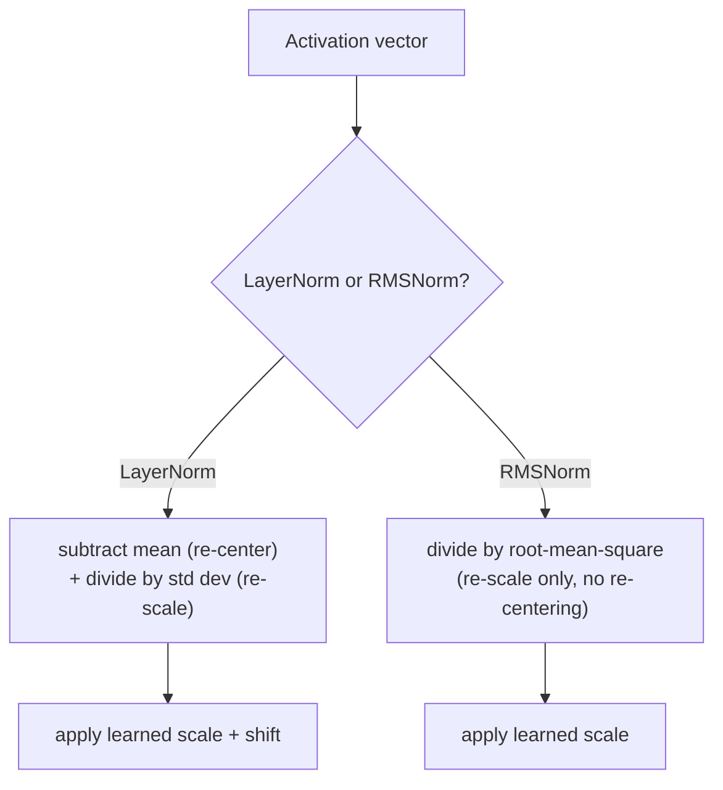

# पाठ 15. RMSNorm

**मिशन से संबंध:** पाठ 5 ने निकाला कि गहरे stack को layer normalization की ज़रूरत ही क्यों है, और pre-norm की जगह (norm residual शाखा के भीतर) मूल पेपर के post-norm से ज़्यादा स्थिरता से train क्यों होती है। उस पाठ ने अपनी बात रखने के लिए सामान्य layer norm इस्तेमाल किया। **RMSNorm** वह है जो मौजूदा models असल में उसी pre-norm शाखा के भीतर उसकी जगह रखते हैं, और वह इसलिए है कि layer norm के दो operations में से एक ज़्यादा काम करता नहीं निकला।
**मुख्य स्रोत:** [पेपर: "Root Mean Square Layer Normalization", Zhang and Sennrich, 2019](https://arxiv.org/abs/1910.07467)
**पूर्व-आवश्यकताएँ:** [पाठ 5](0005-layer-norm-and-residuals.md), [पाठ 14](0014-rotary-position-embeddings.md)

## वार्म-अप

1. ▢ Layer norm की प्रति-example गणना (batch norm की तरह batch के आर-पार नहीं) autoregressive generation करने वाले sequence model के लिए ख़ास तौर पर क्यों मायने रखती है?

जाँचें

Autoregressive generation आम तौर पर छोटे batch के साथ चलती है, अक्सर batch size 1, जहाँ batch normalization के batch-आर-पार वाले आँकड़े निरर्थक या अस्थिर होते। Layer norm अपने आँकड़े एक अकेले example की अपनी features से compute करता है, इसलिए वह batch size से परे एक जैसा काम करता है।

2. ▢ Post-norm और pre-norm की जगह की तुलना करें, और समझाएँ कि बहुत गहरे models के लिए आम तौर पर pre-norm क्यों पसंद किया जाता है।

जाँचें

Post-norm layer norm को residual जोड़ने के बाद लगाता है, `LayerNorm(x + Sublayer(x))`; pre-norm उसे sublayer से पहले, residual शाखा के भीतर लगाता है, `x + Sublayer(LayerNorm(x))`। Pre-norm residual path को सिरे से सिरे तक बिल्कुल साफ़ और बिना normalize किए छोड़ता है, जबकि post-norm हर layer पर residual योग को normalize करता है और उस साफ़ gradient path में बाधा डालता है, इसीलिए गहराई बढ़ने पर pre-norm ज़्यादा स्थिरता से train होता है।

## यह जानें

### Layer norm असल में दो अलग काम करता है

पाठ 5 का layer norm एक अकेले example की अपनी features पर mean और standard deviation compute करता है, फिर दोनों इस्तेमाल करता है: mean घटाने से activations शून्य पर **re-center** होते हैं, और standard deviation से भाग देने से वे एकसमान दायरे में **re-scale** होते हैं। ये एक ही computation में बँधे दो अलग operations हैं, और पाठ 5 की derivation ने यह नहीं पूछा कि training की स्थिरता के लिए layer norm जो कर रहा है उसके लिए दोनों सचमुच ज़रूरी हैं या नहीं।

### RMSNorm की मान्यता: re-centering ग़ैर-ज़रूरी है, re-scaling नहीं

RMSNorm का अपना पेपर अपनी परिकल्पना साफ़ कहता है: layer norm जो re-centering invariance देता है वह ग़ैर-ज़रूरी है, और असली काम का काम अकेली re-scaling कर रही है। **RMSNorm** सिर्फ़ re-scaling operation रखता है, activation vector को उसके **root mean square** (उसके वर्ग मानों के mean का वर्गमूल) से भाग देता है, mean घटाए गए मानों के standard deviation से नहीं, और फिर उसी तरह का सीखा हुआ scale लगाता है जैसा layer norm इस्तेमाल करता है। Mean कभी compute या subtract ही नहीं होता; RMSNorm कभी re-center नहीं करता।

### एक operation छोड़ना ही इसे सस्ता बनाता है

चूँकि RMSNorm mean की गणना और घटाने का चरण पूरी तरह छोड़ देता है, उसे हर normalization में layer norm से कम arithmetic करना पड़ता है, और पेपर का अपना कथन साफ़ बताता है कि यह क्यों मायने रखता है: layer norm का computational बोझ उसके स्थिर करने वाले फ़ायदे को ख़रीदने में महँगा बना रहा था, और उन्हीं networks को धीमा कर रहा था जिन्हें train करने में उसे मदद करनी थी। RMSNorm के अपने experiments ने पाया कि वह कई तरह के tasks और architectures पर layer norm के बराबर performance पाता है, और यही पेपर की इस परिकल्पना का प्रायोगिक समर्थन है कि re-centering अपनी computational लागत के लायक़ पहले से ही नहीं थी।

### RMSNorm पाठ 5 की निकाली उसी pre-norm शाखा के भीतर layer norm की जगह लेता है

Layer norm से RMSNorm पर जाने से पाठ 5 का residual या pre-norm-बनाम-post-norm वाला तर्क बिल्कुल नहीं बदलता: आधुनिक block अब भी अपनी sublayer को residual connection में लपेटता है, और अब भी अपना normalization उसी residual शाखा के भीतर रखता है, उसी साफ़-gradient-path वाले कारण से जो पाठ 5 ने दिया था। जो बदलता है वह सिर्फ़ इतना कि उस जगह कौन-सी normalization गणना बैठी है, `x + Sublayer(LayerNorm(x))` की जगह `x + Sublayer(RMSNorm(x))`, यानी इस workspace में पहले से तय हो चुके जगह के फ़ैसले में डाला गया एक सस्ता operation।

## अभ्यास

1. ▢ एक टीम ऐसी normalization layer लागू करती है जो activation vector को सिर्फ़ उसके root mean square से भाग देती है, कभी mean compute या subtract किए बिना। यह layer norm के दो operations में से कौन-सा रखता है, और कौन-सा छोड़ता है?

संकेत

सोचें कि कौन-सा operation activations को शून्य पर re-center करता है और कौन-सा उन्हें re-scale करता है।

जाँचें

वह re-scaling रखता है (vector के परिमाण के किसी माप से भाग देना) और re-centering पूरी तरह छोड़ देता है (mean कभी नहीं घटाता)। यही RMSNorm का design है: सिर्फ़ re-scaling, layer norm का mean घटाने वाला चरण बिल्कुल नहीं।

2. ▢ RMSNorm का अपना पेपर यह तर्क क्यों देता है कि वह layer norm से ख़ास तौर पर computationally सस्ता होना चाहिए?

जाँचें

क्योंकि वह mean की गणना और घटाना पूरी तरह छोड़ देता है, RMSNorm को हर normalization में layer norm से कम arithmetic करना पड़ता है; पेपर layer norm के बोझ को इस तरह रखता है कि उसका फ़ायदा ख़रीदना महँगा पड़ता है, और RMSNorm उस लागत में योगदान देने वाले दो operations में से एक हटा देता है।

3. ▢ एक model अपनी pre-norm residual शाखा के भीतर layer norm की जगह RMSNorm लगाता है। क्या इससे यह बदलता है कि block pre-norm या post-norm जगह इस्तेमाल करता है?

जाँचें

नहीं। जगह का फ़ैसला (norm residual शाखा के भीतर, residual path को साफ़ रखते हुए) वही रहता है; सिर्फ़ उस जगह बैठी normalization की गणना बदलती है, layer norm के mean-और-variance वाले normalization से RMSNorm के सिर्फ़-root-mean-square वाले संस्करण तक।

4. ▢ RMSNorm पेपर के अपने experiments में re-centering छोड़ने के बावजूद layer norm जैसा ही task performance पाता है। यह layer norm के स्थिर करने वाले असर में re-centering के असली योगदान के बारे में क्या सुझाता है?

जाँचें

यह सुझाता है कि layer norm के असली फ़ायदे का ज़्यादा हिस्सा re-centering से नहीं आ रहा था, जो पेपर की इस परिकल्पना का समर्थन करता है कि layer norm को असरदार बनाने वाली ज़्यादातर चीज़ अकेली re-scaling है, और mean घटाने वाला चरण बिना किसी ठोस performance क़ीमत के छोड़ा जा सकता है।

5. ▢ कौन-सा दावा layer norm, RMSNorm और pre-norm की जगह के संबंध को सही ढंग से बताता है?

    - a) RMSNorm pre-norm की जगह को पूरी तरह एक नए जगह-नियम से बदल देता है
    - b) RMSNorm layer norm का re-scaling operation रखता है पर उसका re-centering (mean घटाने वाला) operation छोड़ देता है, जिससे वह सस्ता हो जाता है और पाठ 5 की निकाली उसी pre-norm शाखा में बैठ जाता है
    - c) Layer norm और RMSNorm दोनों पैमाने के किसी माप से भाग देने से पहले mean compute करके घटाते हैं
    - d) Re-centering छोड़ने से पूरे layer norm की तुलना में task performance काफ़ी बिगड़ती पाई गई

जाँचें

**b)** यही वह सटीक संबंध है जो यह पाठ स्थापित करता है। (a) ग़लत है: pre-norm बनाम post-norm जगह का फ़ैसला है जिसे पाठ 5 पहले तय कर चुका है; RMSNorm सिर्फ़ यह बदलता है कि उस जगह कौन-सी normalization गणना बैठी है। (c) ग़लत है: RMSNorm ख़ास तौर पर कभी mean compute या subtract नहीं करता। (d) ग़लत है: पेपर के अपने experiments ने re-centering छोड़ने के बावजूद तुलनीय performance पाई।

## असली दुनिया का अभ्यास

- [ ] छोटे activation vector के लिए RMSNorm को raw tensor operations (root mean square, भाग, सीखा हुआ scale) से लागू करें, और उसके output की तुलना उसी vector पर पूरे layer norm की गणना से करें।
- [ ] एक ठीक-ठाक बड़े tensor पर layer norm की गणना और RMSNorm की गणना का समय (मोटे तौर पर भी) नापें, और जाँचें कि अंतर वैसा ही है जैसा mean घटाने वाला चरण छोड़ने से अनुमान लगता।
- [ ] कल: मुख्य स्रोत का experiments वाला खंड पढ़ें और ध्यान दें कि RMSNorm को किन tasks और architectures पर परखा गया, और क्या किसी में layer norm से ज़्यादा बड़ा अंतर दिखा।

## आगे बढ़ने के लिए

- [पेपर: "Root Mean Square Layer Normalization", Zhang and Sennrich, 2019](https://arxiv.org/abs/1910.07467)
- [पेपर: "Layer Normalization", Ba, Kiros, and Hinton, 2016](https://arxiv.org/abs/1607.06450)
- [संसाधन](../RESOURCES.md)

---

बात नहीं बन रही? ऊपर दिए मुख्य स्रोत को दोबारा पढ़ें, क्योंकि यह पाठ उसे संक्षिप्त करता है और समझ संक्षेप में ही रिसती है। जो शब्द फिसलन भरा लगे, उसके लिए [शब्दावली](../GLOSSARY.md) देखें।

अगर दिक़्क़त सामग्री की नहीं बल्कि पाठ की ही है, तो वह एक खोट है: [issue खोलें](https://github.com/TokenCemetery/teach/issues)।
