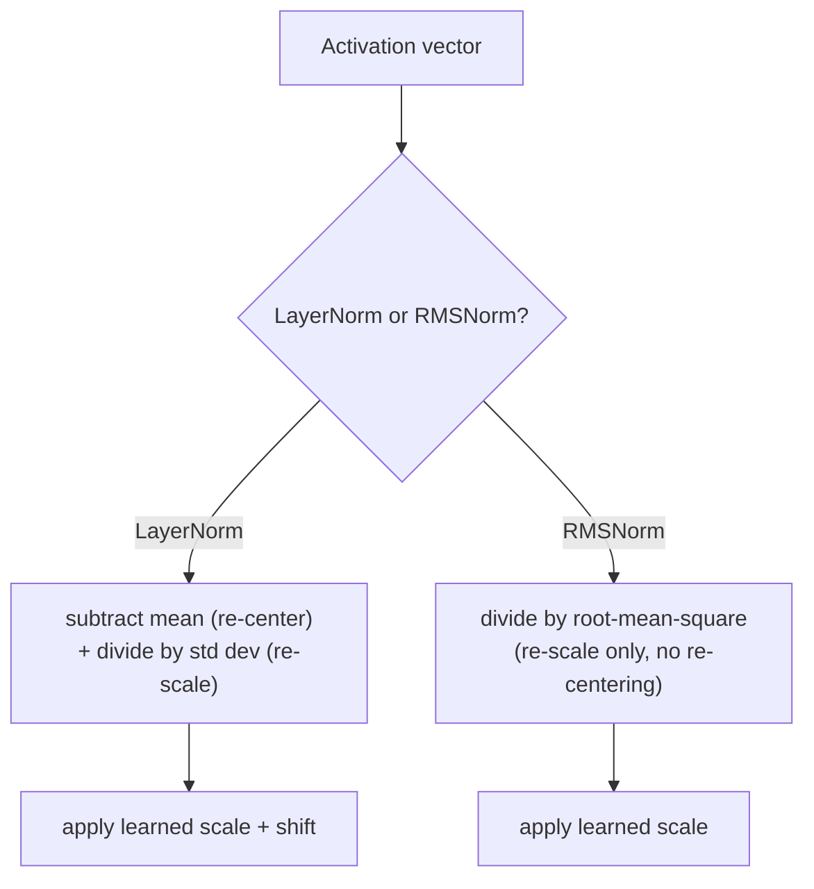

# Lição 15. RMSNorm

**Ligação com a missão:** A lição 5 derivou por que uma pilha profunda precisa de layer normalization, e por que a posição pre-norm (norma dentro do ramo residual) treina de forma mais estável que a post-norm do artigo original. Aquela lição usou a layer norm comum para fazer o argumento. A **RMSNorm** é o que os modelos atuais de fato colocam dentro desse mesmo ramo pre-norm, e existe porque uma das duas operações da layer norm se mostra não fazer muito trabalho.
**Fonte principal:** [Artigo científico: "Root Mean Square Layer Normalization", Zhang e Sennrich, 2019](https://arxiv.org/abs/1910.07467)
**Pré-requisitos:** [Lição 5](0005-layer-norm-and-residuals.md), [Lição 14](0014-rotary-position-embeddings.md)

## Aquecimento

1. ▢ Por que o cálculo por exemplo da layer norm (em vez de ao longo do batch, como a batch norm) importa especificamente para um modelo de sequência que faz geração autorregressiva?

Verificação

A geração autorregressiva costuma rodar com um batch pequeno, muitas vezes batch size 1, em que as estatísticas ao longo do batch da batch normalization seriam sem sentido ou instáveis. A layer norm calcula as suas estatísticas a partir das features de um único exemplo, então funciona de forma idêntica seja qual for o batch size.

2. ▢ Contraste a posição da post-norm com a da pre-norm e explique por que a pre-norm costuma ser preferida em modelos muito profundos.

Verificação

A post-norm aplica a layer norm depois de somar a residual, `LayerNorm(x + Sublayer(x))`; a pre-norm a aplica antes da subcamada, dentro do ramo residual, `x + Sublayer(LayerNorm(x))`. A pre-norm deixa o próprio caminho residual completamente limpo e sem normalização de ponta a ponta, enquanto a post-norm normaliza a soma residual em cada camada, perturbando esse caminho limpo de gradiente, e é por isso que a pre-norm treina de forma mais estável à medida que a profundidade aumenta.

## Saiba isto

### A layer norm na verdade faz duas coisas separadas

A layer norm da lição 5 calcula uma média e um desvio padrão ao longo das features de um único exemplo e depois usa os dois: subtrair a média **recentraliza** as ativações em zero, e dividir pelo desvio padrão as **reescala** para uma faixa consistente. São duas operações distintas empacotadas em um só cálculo, e nada na derivação da lição 5 perguntou se ambas são de fato necessárias para o que a layer norm faz pela estabilidade do treinamento.

### A premissa da RMSNorm: a recentralização é dispensável, o reescalonamento não

O próprio artigo da RMSNorm declara a sua hipótese com clareza: a invariância à recentralização que a layer norm oferece é dispensável, e o reescalonamento sozinho é o que de fato faz o trabalho útil. A **RMSNorm** mantém apenas a operação de reescalonamento, dividindo um vetor de ativação pela sua **raiz do valor quadrático médio** (root mean square, a raiz quadrada da média dos seus valores ao quadrado) em vez do desvio padrão dos seus valores com a média subtraída, e então aplicando o mesmo tipo de escala aprendida que a layer norm usa. A média nunca é calculada nem subtraída; a RMSNorm nunca recentraliza.

### Abandonar uma operação é exatamente o que a torna mais barata

Como a RMSNorm pula por completo o cálculo e a subtração da média, ela tem menos aritmética a fazer por normalização do que a layer norm, e o enquadramento do próprio artigo é direto sobre por que isso importa: o overhead computacional da layer norm vinha tornando o seu benefício de estabilização caro de comprar, deixando mais lentas as próprias redes que ela deveria ajudar a treinar. Os próprios experimentos da RMSNorm constataram que ela alcança desempenho comparável ao da layer norm em uma variedade de tarefas e arquiteturas, o que é o respaldo empírico para a hipótese do artigo de que a recentralização não estava merecendo o seu custo computacional desde o início.

### A RMSNorm substitui a layer norm dentro do mesmo ramo pre-norm que a lição 5 já derivou

Nada na troca da layer norm pela RMSNorm muda o argumento da lição 5 sobre residuais ou sobre pre-norm versus post-norm: um bloco moderno ainda envolve a sua subcamada em uma conexão residual e ainda coloca a sua normalização dentro desse ramo residual, pela mesma razão de caminho limpo de gradiente que a lição 5 deu. O que muda é apenas qual cálculo de normalização ocupa esse espaço, `x + Sublayer(RMSNorm(x))` em vez de `x + Sublayer(LayerNorm(x))`, uma operação mais barata encaixada em uma decisão de posição que este workspace já tomou.

## Prática

1. ▢ Uma equipe implementa uma camada de normalização que apenas divide um vetor de ativação pela sua raiz do valor quadrático médio, sem nunca calcular nem subtrair uma média. Qual das duas operações da layer norm isso mantém e qual abandona?

Dica

Considere qual operação recentraliza as ativações em zero e qual as reescala.

Verificação

Mantém o reescalonamento (dividir por uma medida da magnitude do vetor) e abandona por completo a recentralização (nunca subtrai a média). Esse é exatamente o desenho da RMSNorm: apenas reescalonamento, nada da etapa de subtração da média da layer norm.

2. ▢ Por que o próprio artigo da RMSNorm argumenta que ela deve ser computacionalmente mais barata que a layer norm, especificamente?

Verificação

Como ela pula por completo o cálculo e a subtração da média, a RMSNorm tem menos aritmética a executar por normalização do que a layer norm; o artigo enquadra o overhead da layer norm como o que torna o seu benefício caro de comprar, e a RMSNorm remove uma das duas operações que contribuem para esse custo.

3. ▢ Um modelo troca a layer norm pela RMSNorm dentro do seu ramo residual pre-norm. Isso muda se o bloco usa a posição pre-norm ou post-norm?

Verificação

Não. A decisão de posição (norma dentro do ramo residual, mantendo limpo o próprio caminho residual) permanece a mesma; muda apenas o cálculo de normalização que ocupa esse espaço, da normalização baseada em média e variância da layer norm para a versão só de raiz do valor quadrático médio da RMSNorm.

4. ▢ A RMSNorm alcança desempenho comparável ao da layer norm nos próprios experimentos do artigo, apesar de abandonar a recentralização. O que isso sugere sobre a contribuição real da recentralização para o efeito estabilizador da layer norm?

Verificação

Sugere que a recentralização não contribuía com muito do benefício real da layer norm, respaldando a hipótese do artigo de que o reescalonamento sozinho responde pela maior parte do que tornava a layer norm eficaz, e de que a etapa de subtração da média poderia ser abandonada sem um custo significativo de desempenho.

5. ▢ Qual afirmação descreve corretamente a relação entre layer norm, RMSNorm e posição pre-norm?

    - a) A RMSNorm substitui por completo a posição pre-norm por uma nova regra de posição
    - b) A RMSNorm mantém a operação de reescalonamento da layer norm mas abandona a sua operação de recentralização (subtração da média), tornando-se mais barata e ainda se encaixando no mesmo ramo pre-norm que a lição 5 já derivou
    - c) A layer norm e a RMSNorm calculam e subtraem ambas uma média antes de dividir por uma medida de escala
    - d) Constatou-se que abandonar a recentralização prejudica substancialmente o desempenho nas tarefas em comparação com a layer norm completa

Verificação

**b)** É a relação precisa que esta lição estabelece. (a) é falsa: pre-norm versus post-norm é uma decisão de posição que a lição 5 já resolveu; a RMSNorm apenas muda qual cálculo de normalização ocupa esse espaço. (c) é falsa: a RMSNorm especificamente nunca calcula nem subtrai uma média. (d) é falsa: os próprios experimentos do artigo constataram desempenho comparável apesar de abandonar a recentralização.

## Prática no mundo real

- [ ] Implemente a RMSNorm a partir de operações com tensores brutos (raiz do valor quadrático médio, divisão, escala aprendida) para um vetor de ativação pequeno e compare a sua saída com um cálculo de layer norm completo sobre o mesmo vetor.
- [ ] Meça o tempo (mesmo que de forma grosseira) de um cálculo de layer norm contra o de uma RMSNorm em um tensor razoavelmente grande e confira se a diferença bate com o que abandonar a etapa de subtração da média preveria.
- [ ] Amanhã: leia a seção de experimentos da fonte principal e anote contra quais tarefas e arquiteturas ela testou a RMSNorm e se alguma mostrou uma diferença maior em relação à layer norm do que as outras.

## Para ir além

- [Artigo científico: "Root Mean Square Layer Normalization", Zhang e Sennrich, 2019](https://arxiv.org/abs/1910.07467)
- [Artigo científico: "Layer Normalization", Ba, Kiros e Hinton, 2016](https://arxiv.org/abs/1607.06450)
- [Recursos](../RESOURCES.md)

---

Não ficou claro? Releia a fonte principal no topo, já que esta lição a comprime e é na compressão que o entendimento escapa. Consulte o [glossário](../GLOSSARY.md) para qualquer termo que pareceu escorregadio.

Se o problema é a lição em si, e não o material, isso é um defeito: [abra uma issue](https://github.com/TokenCemetery/teach/issues).
