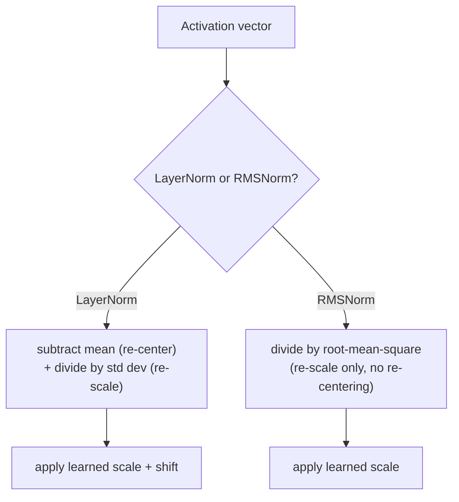

# Урок 15. RMSNorm

**Связь с целью курса:** Урок 5 вывел, зачем глубокому стеку вообще нужна нормализация слоя и почему размещение пре-нормализации (нормализация внутри остаточной ветви) обучается стабильнее, чем пост-нормализация оригинальной статьи. Чтобы это показать, тот урок использовал обычную нормализацию слоя. **RMSNorm** это то, что современные модели на самом деле помещают внутрь той же самой ветви пре-нормализации вместо неё, и она существует потому, что одна из двух операций нормализации слоя, как выяснилось, выполняет не так уж много работы.
**Первоисточник:** [Научная статья: "Root Mean Square Layer Normalization", Zhang and Sennrich, 2019](https://arxiv.org/abs/1910.07467)
**Предварительные требования:** [Урок 5](0005-layer-norm-and-residuals.md), [Урок 14](0014-rotary-position-embeddings.md)

## Разминка

1. ▢ Почему то, что нормализация слоя вычисляется отдельно для каждого примера (а не по батчу, как пакетная нормализация), важно именно для модели последовательностей, выполняющей авторегрессивную генерацию?

Проверка

Авторегрессивная генерация обычно идёт с малым батчем, часто с размером батча 1, где статистики по батчу в пакетной нормализации были бы бессмысленными или нестабильными. Нормализация слоя вычисляет статистики по собственным признакам одного примера, поэтому работает одинаково при любом размере батча.

2. ▢ Сопоставьте размещение пост-нормализации и пре-нормализации и объясните, почему для очень глубоких моделей обычно предпочитают пре-нормализацию.

Проверка

Пост-нормализация применяет нормализацию слоя после прибавления остаточной связи, `LayerNorm(x + Sublayer(x))`; пре-нормализация применяет её перед подслоем, внутри остаточной ветви, `x + Sublayer(LayerNorm(x))`. Пре-нормализация оставляет сам остаточный путь совершенно чистым и ненормализованным от начала до конца, а при пост-нормализации остаточная сумма нормализуется на каждом слое, и этот чистый путь градиента нарушается, поэтому пре-нормализация обучается стабильнее с ростом глубины.

## Что нужно знать

### Нормализация слоя на самом деле делает две отдельные вещи

Нормализация слоя из урока 5 вычисляет среднее и стандартное отклонение по собственным признакам одного примера, а затем использует оба: вычитание среднего **центрирует** активации к нулю, а деление на стандартное отклонение **масштабирует** их к единообразному диапазону. Это две различные операции, объединённые в одно вычисление, и вывод в уроке 5 не спрашивал, обе ли они на самом деле необходимы для того, что нормализация слоя делает ради стабильности обучения.

### Посылка RMSNorm: центрирование необязательно, масштабирование обязательно

Статья про RMSNorm прямо формулирует свою гипотезу: инвариантность к центрированию, которую даёт нормализация слоя, необязательна, а полезную работу на самом деле выполняет одно масштабирование. **RMSNorm** сохраняет только операцию масштабирования, деля вектор активаций на его **среднеквадратичное значение** (root mean square: квадратный корень из среднего его квадратов) вместо стандартного отклонения его значений с вычтенным средним, а затем применяя тот же вид обучаемого масштаба, что и нормализация слоя. Среднее не вычисляется и не вычитается вообще; RMSNorm никогда не центрирует.

### Отказ от одной операции как раз и делает её дешевле

Поскольку RMSNorm полностью пропускает вычисление среднего и шаг вычитания, ей нужно меньше арифметики на одну нормализацию, чем нормализации слоя, и формулировка самой статьи прямо объясняет, почему это важно: вычислительные накладные расходы нормализации слоя делали её стабилизирующую пользу дорогой, замедляя те самые сети, которым она должна была помогать обучаться. Собственные эксперименты RMSNorm показали, что она достигает сопоставимого с нормализацией слоя качества на ряде задач и архитектур, и это эмпирическая поддержка гипотезы статьи о том, что центрирование изначально не окупало своей вычислительной стоимости.

### RMSNorm заменяет нормализацию слоя внутри той же ветви пре-нормализации, которая выведена в уроке 5

Переход от нормализации слоя к RMSNorm вообще не меняет довод об остаточной связи и сравнении пре- и пост-нормализации из урока 5: современный блок по-прежнему оборачивает подслой остаточной связью и по-прежнему помещает нормализацию внутрь этой остаточной ветви по той же причине чистого пути градиента, которую дал урок 5. Меняется только то, какое вычисление нормализации занимает это место: `x + Sublayer(RMSNorm(x))` вместо `x + Sublayer(LayerNorm(x))`, то есть более дешёвая операция, вставленная в решение о размещении, которое это рабочее пространство уже приняло.

## Практика

1. ▢ Команда реализует слой нормализации, который лишь делит вектор активаций на его среднеквадратичное значение, ни разу не вычисляя и не вычитая среднее. Какую из двух операций нормализации слоя он сохраняет, а какую отбрасывает?

Подсказка

Подумайте, какая операция центрирует активации к нулю, а какая масштабирует их.

Проверка

Он сохраняет масштабирование (деление на меру величины вектора) и полностью отбрасывает центрирование (никогда не вычитает среднее). Это в точности замысел RMSNorm: только масштабирование, без шага вычитания среднего из нормализации слоя.

2. ▢ Почему статья про RMSNorm утверждает, что она должна быть вычислительно дешевле нормализации слоя, именно?

Проверка

Поскольку она полностью пропускает вычисление и вычитание среднего, RMSNorm выполняет меньше арифметики на одну нормализацию, чем нормализация слоя; статья описывает накладные расходы нормализации слоя как то, что делает её пользу дорогой, а RMSNorm убирает одну из двух операций, вносящих вклад в эту стоимость.

3. ▢ Модель заменяет нормализацию слоя на RMSNorm внутри своей остаточной ветви пре-нормализации. Меняет ли это то, использует блок пре-нормализацию или пост-нормализацию?

Проверка

Нет. Решение о размещении (нормализация внутри остаточной ветви, сохраняющая сам остаточный путь чистым) не меняется; меняется только вычисление нормализации, занимающее это место: от нормализации слоя на основе среднего и дисперсии к версии RMSNorm только со среднеквадратичным значением.

4. ▢ В собственных экспериментах статьи RMSNorm достигает сопоставимого с нормализацией слоя качества на задачах, хотя отбрасывает центрирование. О чём это говорит относительно реального вклада центрирования в стабилизирующий эффект нормализации слоя?

Проверка

Это говорит о том, что центрирование вносило не так много в реальную пользу нормализации слоя, и поддерживает гипотезу статьи, что одно масштабирование объясняет большую часть того, что делало нормализацию слоя эффективной, а шаг вычитания среднего можно отбросить без существенной потери качества.

5. ▢ Какое утверждение правильно описывает отношения между нормализацией слоя, RMSNorm и размещением пре-нормализации?

    - a) RMSNorm полностью заменяет размещение пре-нормализации новым правилом размещения
    - b) RMSNorm сохраняет операцию масштабирования нормализации слоя, но отбрасывает её операцию центрирования (вычитание среднего), что делает её дешевле, и при этом она вписывается в ту же ветвь пре-нормализации, которая выведена в уроке 5
    - c) И нормализация слоя, и RMSNorm вычисляют и вычитают среднее перед делением на меру масштаба
    - d) Выяснилось, что отказ от центрирования существенно ухудшает качество на задачах по сравнению с полной нормализацией слоя

Проверка

**b)** Это точное соотношение, которое устанавливает этот урок. Вариант (a) неверен: выбор между пре- и пост-нормализацией это решение о размещении, которое урок 5 уже закрыл; RMSNorm меняет лишь то, какое вычисление нормализации занимает это место. Вариант (c) неверен: RMSNorm именно что никогда не вычисляет и не вычитает среднее. Вариант (d) неверен: собственные эксперименты статьи показали сопоставимое качество, несмотря на отказ от центрирования.

## Практика в реальной работе

- [ ] Реализуйте RMSNorm из «сырых» тензорных операций (среднеквадратичное значение, деление, обучаемый масштаб) для небольшого вектора активаций и сравните её выход с полным вычислением нормализации слоя на том же векторе.
- [ ] Замерьте время (хотя бы грубо) вычисления нормализации слоя и вычисления RMSNorm на достаточно большом тензоре и проверьте, соответствует ли разница тому, что предсказывал бы отказ от шага вычитания среднего.
- [ ] Завтра: прочитайте раздел с экспериментами в первоисточнике и отметьте, на каких задачах и архитектурах RMSNorm проверяли и показал ли какой-то из случаев больший разрыв с нормализацией слоя, чем остальные.

## Что почитать дальше

- [Научная статья: "Root Mean Square Layer Normalization", Zhang and Sennrich, 2019](https://arxiv.org/abs/1910.07467)
- [Научная статья: "Layer Normalization", Ba, Kiros, and Hinton, 2016](https://arxiv.org/abs/1607.06450)
- [Ресурсы](../RESOURCES.md)

---

Не доходит? Перечитайте первоисточник в начале: этот урок его сжимает, а при сжатии понимание как раз и теряется. Загляните в [глоссарий](../GLOSSARY.md), если какой-то термин показался скользким.

Если неясен сам урок, а не материал, это дефект: [откройте issue](https://github.com/TokenCemetery/teach/issues).
