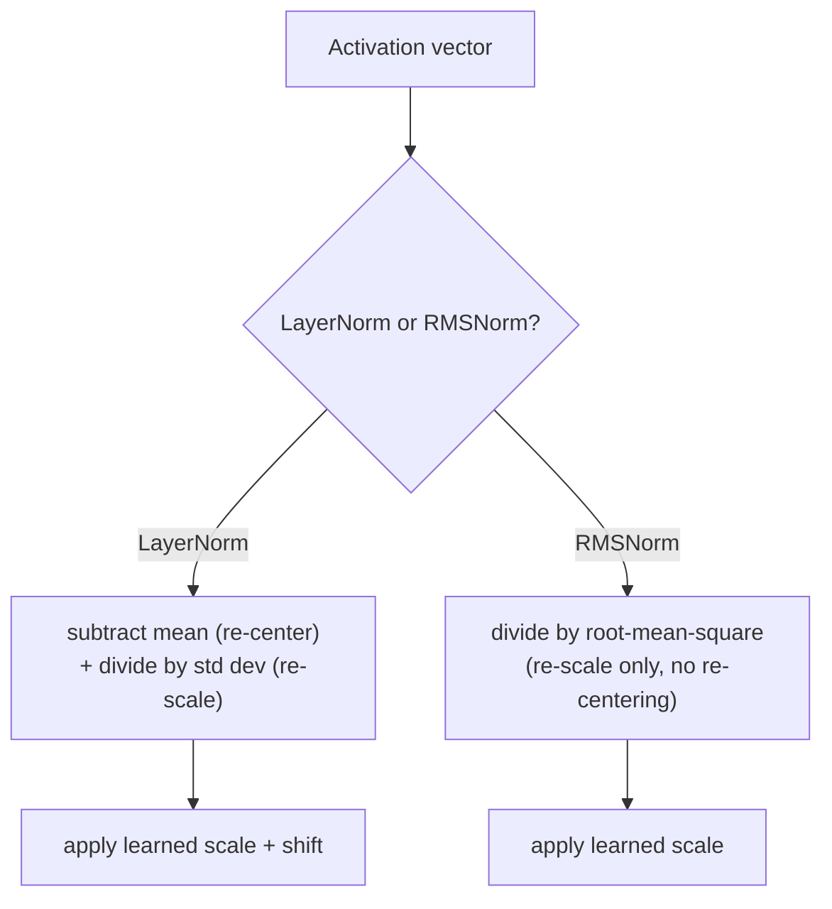

# 第 15 课：RMSNorm

**使命关联:** 第 5 课推导了为什么深层堆叠根本上需要层归一化，以及为什么前归一化的放置方式（归一化放在残差分支内部）比原始论文的后归一化训练得更稳定。那一课用的是普通的层归一化来说明这个道理。**RMSNorm** 才是当前模型实际放在同一个前归一化分支里的东西，它之所以存在，是因为层归一化的两个运算之一，原来并没有起多大作用。
**主要来源:** [论文：“Root Mean Square Layer Normalization”，Zhang 和 Sennrich，2019](https://arxiv.org/abs/1910.07467)
**前置知识:** [第 5 课](0005-layer-norm-and-residuals.md)、[第 14 课](0014-rotary-position-embeddings.md)

## 热身

1. ▢ 层归一化逐样本的计算（而不是像批归一化那样跨批次），为什么对做自回归生成的序列模型尤其重要？

检查

自回归生成通常以很小的批运行，常常批大小为 1，那时批归一化跨批次的统计量要么毫无意义，要么不稳定。层归一化用单个样本自己的特征来计算统计量，所以不论批大小是多少，它的工作方式都完全相同。

2. ▢ 对比后归一化与前归一化的放置方式，并解释为什么对很深的模型，通常更偏好前归一化。

检查

后归一化在加上残差之后才做层归一化，即 `LayerNorm(x + Sublayer(x))`；前归一化在子层之前、也就是残差分支内部做层归一化，即 `x + Sublayer(LayerNorm(x))`。前归一化让残差路径本身端到端完全干净、未经归一化，而后归一化则在每一层都对残差之和做归一化，破坏了那条干净的梯度通路，这就是随着深度增加，前归一化训练得更稳定的原因。

## 要点

### 层归一化实际上做了两件独立的事

第 5 课的层归一化，在单个样本自己的特征上计算一个均值和一个标准差，然后两者都用上：减去均值，是把激活值**重新中心化**到零，除以标准差，则是把它们**重新缩放**到一致的范围。这是捆绑在一次计算里的两个不同的运算，而第 5 课的推导并没有追问，对于层归一化为训练稳定性所做的事，这两个是否真的都是必要的。

### RMSNorm 的前提：重新中心化可有可无，重新缩放不可或缺

RMSNorm 自己的论文清楚地陈述了它的假设：层归一化所提供的重新中心化不变性是可有可无的，真正起有用作用的只是重新缩放。**RMSNorm** 只保留重新缩放这一个运算，用激活向量的**均方根**（它各个值的平方的均值的平方根）去除它，而不是用减去均值之后的值的标准差去除，然后施加与层归一化同类的学习得到的缩放。均值根本不会被计算，也不会被减去；RMSNorm 从不重新中心化。

### 去掉一个运算，正是它更便宜的原因

由于 RMSNorm 完全跳过了计算均值和减去均值这一步，它每次归一化要做的算术比层归一化少，而论文自己的表述很直接地说明了这为什么重要：层归一化的计算开销，使它带来的稳定化好处买起来很贵，拖慢了它本该帮助训练的网络。RMSNorm 自己的实验发现，在一系列任务和架构上，它取得的性能与层归一化相当，这正是论文关于重新中心化本来就不值它所花的计算成本这一假设的实证支持。

### RMSNorm 取代的是第 5 课已经推导过的同一个前归一化分支里的层归一化

从层归一化换成 RMSNorm，丝毫没有改变第 5 课关于残差或前归一化对比后归一化的论证：现代的块仍然把它的子层包在一个残差连接里，仍然把归一化放在那个残差分支内部，原因也仍然是第 5 课给出的那个干净的梯度通路。改变的只是哪一种归一化计算占着这个位置，是 `x + Sublayer(RMSNorm(x))`，而不是 `x + Sublayer(LayerNorm(x))`，一个更便宜的运算，放进了这个工作区早已做出的放置决定里。

## 练习

1. ▢ 一个团队实现了一个归一化层，它只用激活向量的均方根去除这个向量，从不计算或减去均值。层归一化的两个运算中，它保留了哪一个，去掉了哪一个？

提示

想一想哪个运算把激活值重新中心化到零，哪个运算把它们重新缩放。

检查

它保留了重新缩放（除以向量大小的某种度量），完全去掉了重新中心化（从不减去均值）。这正是 RMSNorm 的设计：只有重新缩放，没有层归一化的减均值那一步。

2. ▢ 为什么 RMSNorm 自己的论文论证它应当比层归一化在计算上更便宜？

检查

因为它完全跳过了计算和减去均值，RMSNorm 每次归一化要做的算术比层归一化少；论文把层归一化的开销，描述成让它的好处买起来很贵，而 RMSNorm 去掉了造成这一成本的两个运算之一。

3. ▢ 一个模型在它的前归一化残差分支里，把层归一化换成了 RMSNorm。这会改变这个块使用的是前归一化还是后归一化的放置吗？

检查

不会。放置的决定（归一化放在残差分支内部，保持残差路径本身干净）没有改变；改变的只是占着这个位置的归一化计算，从层归一化基于均值和方差的归一化，换成了 RMSNorm 只用均方根的版本。

4. ▢ 在论文自己的实验里，尽管去掉了重新中心化，RMSNorm 取得的任务性能仍与层归一化相当。这说明重新中心化对层归一化的稳定化作用，实际贡献如何？

检查

这说明重新中心化对层归一化实际的好处没有多大贡献，支持了论文的假设，即层归一化之所以有效，主要是重新缩放的功劳，减均值这一步可以去掉，而不会有明显的性能代价。

5. ▢ 下面哪一项说法正确描述了层归一化、RMSNorm 和前归一化放置之间的关系？

    - a) RMSNorm 用一条全新的放置规则完全取代了前归一化放置
    - b) RMSNorm 保留了层归一化的重新缩放运算，但去掉了它的重新中心化（减均值）运算，使它更便宜，同时装进第 5 课已经推导过的同一个前归一化分支里
    - c) 层归一化和 RMSNorm 都先计算并减去均值，再除以某种尺度的度量
    - d) 人们发现，与完整的层归一化相比，去掉重新中心化会大幅损害任务性能

检查

**b)** 这正是本课确立的精确关系。(a) 是错的：前归一化对比后归一化是第 5 课已经定下的放置决定；RMSNorm 只改变占着这个位置的归一化计算。(c) 是错的：RMSNorm 恰恰从不计算也不减去均值。(d) 是错的：论文自己的实验发现，尽管去掉了重新中心化，性能仍然相当。

## 实战练习

- [ ] 对一个较小的激活向量，用原始张量运算（均方根、相除、学习得到的缩放）实现 RMSNorm，并把它的输出与同一个向量上完整的层归一化计算的结果做比较。
- [ ] 在一个相当大的张量上，给层归一化的计算和 RMSNorm 的计算计时（哪怕只是粗略的），并检查差距是否符合去掉减均值那一步所预测的。
- [ ] 明天：阅读主要来源的实验部分，并记下它拿 RMSNorm 在哪些任务和架构上做了测试，其中有没有哪一个与层归一化的差距比其他更大。

## 延伸阅读

- [论文：“Root Mean Square Layer Normalization”，Zhang 和 Sennrich，2019](https://arxiv.org/abs/1910.07467)
- [论文：“Layer Normalization”，Ba、Kiros 和 Hinton，2016](https://arxiv.org/abs/1607.06450)
- [资源](../RESOURCES.md)

---

没学明白？请重读顶部的主要来源，因为本课是对它的压缩，而理解正是在压缩中流失的。如果有哪个术语觉得含糊，可以查看[术语表](../GLOSSARY.md)。

如果问题出在课程本身，而不是学习材料，那就是一个缺陷：[提交 issue](https://github.com/TokenCemetery/teach/issues)。
