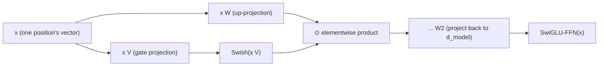

# Lección 16. SwiGLU y el bloque feed-forward con puerta

**Vínculo con la misión:** La lección 6 nombró el shape que comparte todo bloque feed-forward, expandir, aplicar una no linealidad y proyectar de vuelta hacia abajo, y mencionó de pasada que arquitecturas posteriores cambian variantes como SwiGLU sin cambiar ese shape. Esta lección deriva qué cambia en realidad: no el shape, sino cuántas proyecciones calcula el bloque y cómo se combinan antes de que la segunda proyección devuelva el resultado hacia abajo.
**Fuente principal:** [Paper: "GLU Variants Improve Transformer", Shazeer, 2020](https://arxiv.org/abs/2002.05202)
**Requisitos previos:** [Lección 6](0006-feed-forward-block.md), [Lección 15](0015-rmsnorm.md)

## Calentamiento

1. ▢ ¿Por qué se considera lineal el paso de mezcla de values de la atención, y por qué eso hace necesario el bloque feed-forward?

Comprobación

Una vez que el softmax ha producido los pesos, la salida es una suma ponderada (una combinación lineal) de los vectores value; la no linealidad vive por completo en cómo se calcularon los pesos, no en cómo se aplican. La atención por sí sola nunca da a la red una manera genuinamente no lineal de remodelar la representación propia de una sola posición, que es exactamente lo que aporta en su lugar la no linealidad del bloque feed-forward.

2. ▢ ¿Qué conserva RMSNorm de la layer norm, y qué elimina?

Comprobación

Conserva el reescalado (dividir por una medida de la magnitud del vector, aquí la raíz cuadrática media) y elimina por completo el recentrado, sin calcular ni restar nunca una media.

## Qué debes saber

### Una gated linear unit calcula dos proyecciones y las multiplica entre sí

Una **gated linear unit (GLU)** es el producto elemento a elemento de dos proyecciones lineales distintas de la misma entrada, con una no linealidad aplicada solo a una de ellas antes de la multiplicación: `GLU(x) = (x W) ⊙ σ(x V)`, donde `⊙` es la multiplicación elemento a elemento y `σ` era originalmente una sigmoide. La proyección que pasa por la no linealidad actúa como una **puerta** (gate): su salida, aplastada hacia 0 o hacia 1 por la sigmoide, escala elemento a elemento la salida de la otra proyección, de modo que la red aprende cuánto de cada feature dejar pasar en lugar de comprometerse con una única transformación no lineal fija de una sola proyección.

### El bloque feed-forward de la lección 6 usaba una proyección y una no linealidad fija; uno con puerta usa dos

El `FFN(x) = max(0, x W1 + b1) W2 + b2` de la lección 6 calcula una proyección hacia arriba hasta `d_ff`, aplica ReLU y luego proyecta de vuelta hacia abajo. Un bloque feed-forward con puerta, en cambio, calcula dos proyecciones distintas hacia arriba hasta una dimensión oculta (típicamente algo menor), las combina con un producto elemento a elemento de estilo GLU, y solo entonces aplica la segunda matriz, la de contracción. El propio planteamiento del paper es una generalización directa: las **variantes de GLU** cambian la puerta sigmoide por otras funciones, y probar varias de estas variantes justo en la subcapa feed-forward del transformer es el experimento real del paper, y encuentra que algunas superan a la no linealidad simple ReLU o GELU que describió la lección 6.

### SwiGLU: la variante con puerta de Swish que usan realmente los modelos actuales

**SwiGLU** es la variante de GLU que pone la puerta con la activación **Swish** (también llamada SiLU) en lugar de una sigmoide simple, y es la variante concreta que acabó desplazando a la ReLU en el bloque feed-forward de la mayoría de los modelos abiertos actuales, igual que RoPE (lección 14) desplazó a la codificación sinusoidal y RMSNorm (lección 15) desplazó a la layer norm. Un bloque feed-forward SwiGLU calcula `SwiGLU(x) = (x W) ⊙ Swish(x V)`, y luego proyecta el resultado de vuelta hacia abajo a `d_model` con una tercera matriz de pesos, tres matrices de pesos en total donde la versión simple de la lección 6 usaba dos.

### Tres matrices en lugar de dos cambian el presupuesto de parámetros y de cómputo, no el papel del bloque en la arquitectura

Añadir una segunda proyección de expansión es un costo real: un bloque feed-forward SwiGLU tiene tres matrices de pesos haciendo el trabajo que antes hacían dos, que es por lo que las implementaciones suelen reducir algo la dimensión oculta para mantener el número total de parámetros comparable al de un bloque feed-forward simple con el mismo `d_model`. Nada de esto cambia para *qué* sirve el bloque feed-forward: sigue siendo la subcapa por posición de la lección 6, sigue aplicándose de forma idéntica e independiente al vector propio de cada posición, sigue siendo la única fuente de la red de cómputo por posición genuinamente no lineal. Lo que cambió es puramente el cómputo interno que realiza ese bloque, exactamente la clase de "desviación pequeña y común" que la lección 12 nombra sin derivar.

## Práctica

1. ▢ ¿Qué le hace realmente a la salida de la otra proyección la rama sigmoide (o Swish) de una gated linear unit?

Pista

Considera qué logra un producto elemento a elemento con una señal aplastada hacia 0 o hacia 1.

Comprobación

Actúa como una puerta, que escala elemento a elemento la salida de la otra proyección; la red aprende cuánto de cada feature de esa proyección dejar pasar, en lugar de aplicar una única no linealidad fija a una sola proyección de manera uniforme.

2. ▢ ¿Cuántas matrices de pesos usa un bloque feed-forward SwiGLU, en comparación con el bloque feed-forward simple de la lección 6, y por qué esto suele llevar en la práctica a una dimensión oculta menor?

Comprobación

Tres, frente a las dos de la lección 6 (una proyección de expansión y una de contracción): SwiGLU añade una segunda proyección de expansión para la puerta. Como tres matrices a la misma dimensión oculta costarían más parámetros que dos, las implementaciones suelen reducir la dimensión oculta para mantener el número total de parámetros comparable al de un bloque feed-forward simple con el mismo `d_model`.

3. ▢ ¿Cambia el papel de la subcapa feed-forward dentro de un bloque transformer sustituir un bloque feed-forward simple por uno SwiGLU?

Comprobación

No. Sigue aplicándose de forma idéntica e independiente al vector propio de cada posición, sin mezcla entre posiciones, y sigue siendo la única fuente del bloque de cómputo por posición genuinamente no lineal. Solo cambió el cómputo interno dentro de esa subcapa, no para qué sirve la subcapa.

4. ▢ ¿Qué probó específicamente el paper de las variantes de GLU, y qué encontró?

Comprobación

Probó varias variantes de GLU (distintas no linealidades de puerta en lugar de la sigmoide) dentro de la subcapa feed-forward del modelo transformer de secuencia a secuencia, y encontró que algunas de ellas producen mejoras de calidad frente a las activaciones ReLU o GELU que se usan habitualmente.

5. ▢ ¿Qué afirmación describe correctamente un bloque feed-forward con puerta como SwiGLU?

    - a) Sustituye el bloque feed-forward por un segundo mecanismo de atención
    - b) Calcula dos proyecciones lineales de la entrada, aplica una no linealidad (como Swish) a una, las multiplica elemento a elemento como una puerta y luego proyecta el resultado de vuelta hacia abajo, usando tres matrices de pesos en lugar de las dos de la lección 6
    - c) Mezcla información entre posiciones, a diferencia del bloque feed-forward de la lección 6
    - d) Requiere quitar RMSNorm o cualquier otra normalización del bloque

Comprobación

**b)** Ese es el mecanismo preciso, y su costo, que establece esta lección. (a) es falsa: sigue siendo la subcapa feed-forward por posición, sin relación con el papel de mezcla de la atención. (c) es falsa: sigue siendo estrictamente por posición, exactamente igual que la versión de la lección 6. (d) es falsa: el bloque feed-forward con puerta y la normalización (RMSNorm u otra) son decisiones de diseño independientes que coexisten en el mismo bloque.

## Prácticas en el mundo real

- [ ] Implementa un bloque feed-forward SwiGLU a partir de operaciones de tensores en bruto (dos proyecciones de expansión, una puerta Swish, producto elemento a elemento, una proyección de contracción), y confirma que el shape de su salida coincide con el de la versión simple de la lección 6 con el mismo `d_model`.
- [ ] Compara el número de parámetros de tu implementación SwiGLU con el del bloque feed-forward simple de la lección 6 con el mismo `d_ff`, y luego reduce `d_ff` y vuelve a comprobar hasta que las cuentas sean aproximadamente comparables.
- [ ] Mañana: lee completa la tabla de resultados de la fuente principal, y anota qué variante de GLU encontró que rindió mejor, y por cuánto, frente a la línea base simple de ReLU.

## Para profundizar

- [Paper: "GLU Variants Improve Transformer", Shazeer, 2020](https://arxiv.org/abs/2002.05202)
- [Paper: "Attention Is All You Need", Vaswani et al., 2017](https://arxiv.org/abs/1706.03762)
- [Recursos](../RESOURCES.md)

---

¿No termina de quedar claro? Vuelve a leer la fuente primaria de arriba, ya que esta lección la comprime y en la compresión es donde se escapa la comprensión. Consulta el [glosario](../GLOSSARY.md) por si algún término te resultó resbaladizo.

Si lo poco claro es la propia lección y no el material, eso es un defecto: [abre un issue](https://github.com/TokenCemetery/teach/issues).
