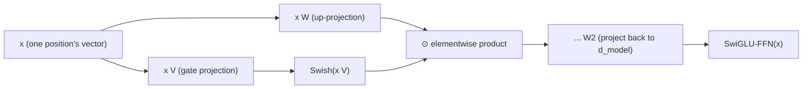

# Leçon 16. SwiGLU et le bloc feed-forward à porte

**Lien avec la mission :** La leçon 6 a nommé la forme que partagent tous les blocs feed-forward, étendre, appliquer une non-linéarité, reprojeter vers le bas, et a mentionné en passant que des architectures ultérieures y substituent des variantes comme SwiGLU sans changer cette forme. Cette leçon dérive ce qui change réellement : non pas la forme, mais le nombre de projections que le bloc calcule et la façon dont elles se combinent avant que la seconde projection renvoie le résultat vers le bas.
**Source primaire :** [Article : "GLU Variants Improve Transformer", Shazeer, 2020](https://arxiv.org/abs/2002.05202)
**Prérequis :** [Leçon 6](0006-feed-forward-block.md), [Leçon 15](0015-rmsnorm.md)

## Échauffement

1. ▢ Pourquoi considère-t-on l'étape de mélange des valeurs de l'attention comme linéaire, et pourquoi cela rend-il le bloc feed-forward nécessaire ?

Vérifier

Une fois que le softmax a produit les poids, la sortie est une somme pondérée (une combinaison linéaire) des vecteurs valeurs ; la non-linéarité réside entièrement dans la façon dont les poids ont été calculés, pas dans la façon dont ils sont appliqués. L'attention seule ne donne jamais au réseau un moyen réellement non linéaire de remodeler la représentation propre d'une seule position, ce que fournit précisément à la place la non-linéarité du bloc feed-forward.

2. ▢ Que conserve RMSNorm de la layer norm, et que supprime-t-elle ?

Vérifier

Elle conserve la remise à l'échelle (diviser par une mesure de la grandeur du vecteur, ici la racine carrée de la moyenne des carrés) et supprime entièrement le recentrage, sans jamais calculer ni soustraire de moyenne.

## À savoir

### Une gated linear unit calcule deux projections et les multiplie

Une **gated linear unit (GLU, unité linéaire à porte)** est le produit élément par élément de deux projections linéaires distinctes de la même entrée, avec une non-linéarité appliquée à une seule d'entre elles avant la multiplication : `GLU(x) = (x W) ⊙ σ(x V)`, où `⊙` est la multiplication élément par élément et `σ` était à l'origine une sigmoïde. La projection qui passe par la non-linéarité joue le rôle de **porte** (gate) : sa sortie, écrasée vers 0 ou 1 par la sigmoïde, met à l'échelle la sortie de l'autre projection élément par élément, ce qui laisse le réseau apprendre quelle part de chaque feature laisser passer plutôt que de s'en tenir à une seule transformation non linéaire fixe d'une seule projection.

### Le bloc feed-forward de la leçon 6 utilisait une projection et une non-linéarité fixe ; une version à porte en utilise deux

Le `FFN(x) = max(0, x W1 + b1) W2 + b2` de la leçon 6 calcule une projection vers `d_ff`, applique ReLU, puis reprojette vers le bas. Un bloc feed-forward à porte calcule à la place deux projections distinctes vers une dimension cachée (généralement un peu plus petite), les combine par un produit élément par élément de style GLU, et n'applique qu'ensuite la seconde matrice, de projection vers le bas. La formulation de l'article est une généralisation directe : les **variantes de GLU** remplacent la porte sigmoïde par d'autres fonctions, et tester plusieurs de ces variantes précisément dans la sous-couche feed-forward du transformer est l'expérience même de l'article, qui trouve que certaines surpassent la non-linéarité ReLU ou GELU simple que la leçon 6 a décrite.

### SwiGLU : la variante à porte Swish que les modèles actuels utilisent réellement

**SwiGLU** est la variante de GLU qui fait office de porte avec l'activation **Swish** (aussi appelée SiLU) à la place d'une sigmoïde simple, et c'est la variante précise qui a fini par supplanter ReLU dans le bloc feed-forward de la plupart des modèles ouverts actuels, comme RoPE (leçon 14) a supplanté l'encodage sinusoïdal et RMSNorm (leçon 15) la layer norm. Un bloc feed-forward SwiGLU calcule `SwiGLU(x) = (x W) ⊙ Swish(x V)`, puis reprojette le résultat vers le bas jusqu'à `d_model` avec une troisième matrice de poids, trois matrices de poids au total là où la version simple de la leçon 6 en utilisait deux.

### Trois matrices au lieu de deux changent le budget de paramètres et de calcul, pas le rôle du bloc dans l'architecture

Ajouter une seconde projection vers le haut a un vrai coût : un bloc feed-forward SwiGLU a trois matrices de poids qui font le travail que deux faisaient avant, ce qui explique pourquoi les implémentations réduisent couramment un peu la dimension cachée pour que le nombre total de paramètres reste comparable à celui d'un bloc feed-forward simple au même `d_model`. Rien de cela ne change ce *à quoi sert* le bloc feed-forward : c'est toujours la sous-couche position par position de la leçon 6, toujours appliquée de façon identique et indépendante au vecteur propre de chaque position, toujours la seule source du réseau de calcul réellement non linéaire par position. Ce qui a changé, c'est uniquement le calcul interne que ce bloc effectue, exactement le genre de « petit écart courant » que la leçon 12 nomme sans le dériver.

## Pratique

1. ▢ Que fait réellement la branche sigmoïde (ou Swish) d'une gated linear unit à la sortie de l'autre projection ?

Indice

Réfléchissez à ce qu'accomplit un produit élément par élément avec un signal écrasé vers 0 ou 1.

Vérifier

Elle joue le rôle de porte et met à l'échelle la sortie de l'autre projection élément par élément ; le réseau apprend quelle part de chaque feature de cette projection laisser passer, au lieu d'appliquer uniformément une seule non-linéarité fixe à une seule projection.

2. ▢ Combien de matrices de poids un bloc feed-forward SwiGLU utilise-t-il, comparé au bloc feed-forward simple de la leçon 6, et pourquoi cela conduit-il couramment à une dimension cachée plus petite en pratique ?

Vérifier

Trois, contre deux à la leçon 6 (une projection vers le haut, une projection vers le bas) : SwiGLU ajoute une seconde projection vers le haut pour la porte. Comme trois matrices à la même dimension cachée coûteraient plus de paramètres que deux, les implémentations réduisent couramment la dimension cachée pour que le nombre total de paramètres reste comparable à celui d'un bloc feed-forward simple au même `d_model`.

3. ▢ Remplacer un bloc feed-forward simple par un bloc SwiGLU change-t-il le rôle de la sous-couche feed-forward au sein d'un bloc transformer ?

Vérifier

Non. Elle est toujours appliquée de façon identique et indépendante au vecteur propre de chaque position, sans mélange entre positions, et reste la seule source de calcul réellement non linéaire par position du bloc. Seul a changé le calcul interne de cette sous-couche, pas ce à quoi elle sert.

4. ▢ Qu'a précisément testé l'article « GLU Variants », et qu'a-t-il trouvé ?

Vérifier

Il a testé plusieurs variantes de GLU (différentes non-linéarités de porte à la place de la sigmoïde) dans la sous-couche feed-forward du modèle transformer séquence à séquence, et a trouvé que certaines de ces variantes améliorent la qualité par rapport aux activations ReLU ou GELU habituellement utilisées.

5. ▢ Quelle affirmation décrit correctement un bloc feed-forward à porte comme SwiGLU ?

    - a) Il remplace le bloc feed-forward par un second mécanisme d'attention
    - b) Il calcule deux projections linéaires de l'entrée, applique une non-linéarité (comme Swish) à l'une, les multiplie élément par élément comme une porte, puis reprojette le résultat vers le bas, avec trois matrices de poids au lieu des deux de la leçon 6
    - c) Il mélange l'information entre les positions, contrairement au bloc feed-forward de la leçon 6
    - d) Il exige de supprimer RMSNorm ou toute autre normalisation du bloc

Vérifier

**b)** C'est le mécanisme précis et son coût qu'établit cette leçon. (a) est faux : c'est toujours la sous-couche feed-forward position par position, sans rapport avec le rôle de mélange de l'attention. (c) est faux : il reste strictement position par position, exactement comme la version de la leçon 6. (d) est faux : le bloc feed-forward à porte et la normalisation (RMSNorm ou autre) sont des choix de conception indépendants qui coexistent dans le même bloc.

## Exercices en situation réelle

- [ ] Implémentez un bloc feed-forward SwiGLU à partir d'opérations brutes sur les tenseurs (deux projections vers le haut, une porte Swish, un produit élément par élément, une projection vers le bas), et vérifiez que la forme de sa sortie correspond à celle de la version simple de la leçon 6 au même `d_model`.
- [ ] Comparez le nombre de paramètres de votre implémentation SwiGLU à celui du bloc feed-forward simple de la leçon 6 au même `d_ff`, puis réduisez `d_ff` et revérifiez jusqu'à ce que les nombres soient à peu près comparables.
- [ ] Demain : lisez en entier le tableau de résultats de la source primaire, et notez quelle variante de GLU elle a trouvée la plus performante, et de combien, par rapport à la référence ReLU simple.

## Pour aller plus loin

- [Article : "GLU Variants Improve Transformer", Shazeer, 2020](https://arxiv.org/abs/2002.05202)
- [Article : "Attention Is All You Need", Vaswani et al., 2017](https://arxiv.org/abs/1706.03762)
- [Ressources](../RESOURCES.md)

---

Ça ne passe pas ? Relisez la source primaire en haut de page, car cette leçon la condense et c'est dans la condensation que la compréhension s'échappe. Consultez le [glossaire](../GLOSSARY.md) pour tout terme qui vous a paru glissant.

Si c'est la leçon elle-même qui n'est pas claire plutôt que la matière, c'est un défaut : [ouvrez une issue](https://github.com/TokenCemetery/teach/issues).
