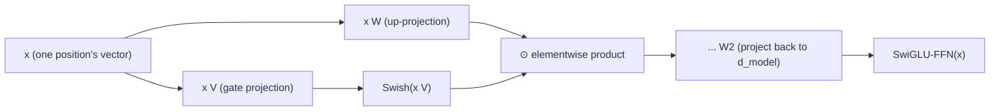

# पाठ 16. SwiGLU और Gated Feed-Forward Block

**मिशन से संबंध:** पाठ 6 ने वह आकार बताया जो हर feed-forward block में साझा है, फैलाना, nonlinearity लगाना, वापस project करना, और बस ज़िक्र भर किया कि बाद के architectures उस आकार को बदले बिना SwiGLU जैसे variants लगा देते हैं। यह पाठ निकालता है कि असल में क्या बदलता है: आकार नहीं, बल्कि यह कि block कितने projections compute करता है और दूसरा projection नतीजे को वापस नीचे भेजे उससे पहले वे कैसे मिलते हैं।
**मुख्य स्रोत:** [पेपर: "GLU Variants Improve Transformer", Shazeer, 2020](https://arxiv.org/abs/2002.05202)
**पूर्व-आवश्यकताएँ:** [पाठ 6](0006-feed-forward-block.md), [पाठ 15](0015-rmsnorm.md)

## वार्म-अप

1. ▢ Attention का value मिलाने वाला चरण linear क्यों माना जाता है, और यह feed-forward block को ज़रूरी क्यों बनाता है?

जाँचें

Softmax के weights बना देने के बाद output value vectors का भारित योग (linear संयोजन) होता है; nonlinearity पूरी तरह इसमें है कि weights कैसे compute हुए, इसमें नहीं कि वे कैसे लगे। अकेला attention network को किसी एक position की अपनी representation को नया आकार देने का सचमुच nonlinear तरीक़ा कभी नहीं देता, और यही feed-forward block की nonlinearity इसके बजाय देती है।

2. ▢ RMSNorm layer norm से क्या रखता है, और क्या छोड़ता है?

जाँचें

वह re-scaling रखता है (vector के परिमाण के किसी माप से भाग देना, यहाँ root mean square) और re-centering पूरी तरह छोड़ देता है, कभी mean compute या subtract नहीं करता।

## यह जानें

### Gated linear unit दो projections compute करके उन्हें आपस में गुणा करता है

**Gated linear unit (GLU)** एक ही input के दो अलग linear projections का elementwise गुणनफल है, जिसमें गुणा से पहले उनमें से सिर्फ़ एक पर nonlinearity लगाई जाती है: `GLU(x) = (x W) ⊙ σ(x V)`, जहाँ `⊙` elementwise गुणा है और `σ` शुरुआत में sigmoid था। Nonlinearity से गुज़ारा गया projection **gate** का काम करता है: उसका output, sigmoid से 0 या 1 की ओर दबा हुआ, दूसरे projection के output को element-दर-element scale करता है, जिससे network सीखता है कि हर feature का कितना हिस्सा आगे जाने दे, अकेले एक projection के किसी एक, तय nonlinear रूपांतरण पर अटके रहने के बजाय।

### पाठ 6 का feed-forward block एक projection और तय nonlinearity इस्तेमाल करता था; gated संस्करण दो

पाठ 6 का `FFN(x) = max(0, x W1 + b1) W2 + b2` `d_ff` तक एक projection compute करता है, ReLU लगाता है, फिर वापस नीचे project करता है। इसके बजाय gated feed-forward block (आम तौर पर कुछ छोटे) hidden आयाम तक दो अलग projections compute करता है, उन्हें GLU-शैली के elementwise गुणनफल से मिलाता है, और तभी दूसरा, नीचे project करने वाला matrix लगाता है। पेपर का अपना कथन सीधा सामान्यीकरण है: **GLU variants** sigmoid gate की जगह दूसरे functions लगाते हैं, और इनमें से कई variants को ठीक transformer की feed-forward sublayer में परखना ही पेपर का असली experiment है, जिसमें पाया गया कि कुछ उस सादे ReLU या GELU nonlinearity से बेहतर हैं जिसे पाठ 6 ने बताया था।

### SwiGLU: Swish से gated variant जिसे मौजूदा models असल में इस्तेमाल करते हैं

**SwiGLU** वह GLU variant है जो सादे sigmoid की जगह **Swish** (जिसे SiLU भी कहते हैं) activation से gating करता है, और यही वह ख़ास variant है जिसने ज़्यादातर मौजूदा open models के feed-forward block में ReLU की जगह ले ली, उसी तरह जैसे RoPE (पाठ 14) ने sinusoidal encoding की और RMSNorm (पाठ 15) ने layer norm की जगह ली। SwiGLU feed-forward block `SwiGLU(x) = (x W) ⊙ Swish(x V)` compute करता है, फिर नतीजे को तीसरे weight matrix से वापस `d_model` तक project करता है, यानी कुल तीन weight matrices जहाँ पाठ 6 के सादे संस्करण में दो थे।

### दो की जगह तीन matrices parameter और compute बजट बदलते हैं, architecture में block की भूमिका नहीं

दूसरा up-projection जोड़ना असली लागत है: SwiGLU feed-forward block में वही काम तीन weight matrices करते हैं जो पहले दो करते थे, इसीलिए implementations आम तौर पर hidden आयाम कुछ छोटा कर देते हैं ताकि कुल parameter count उसी `d_model` पर सादे feed-forward block के बराबर रहे। इनमें से कुछ भी यह नहीं बदलता कि feed-forward block *किसलिए* है: वह अब भी पाठ 6 की position-wise sublayer है, अब भी हर position के अपने vector पर एकसमान और स्वतंत्र रूप से लगती है, अब भी network में सचमुच nonlinear प्रति-position गणना का इकलौता स्रोत है। जो बदला वह सिर्फ़ उस block की भीतरी गणना है, ठीक उसी तरह का "छोटा, आम अंतर" जिसका पाठ 12 बिना निकाले नाम लेता है।

## अभ्यास

1. ▢ Gated linear unit की sigmoid (या Swish) शाखा दूसरे projection के output के साथ असल में क्या करती है?

संकेत

सोचें कि 0 या 1 की ओर दबे signal के साथ elementwise गुणा क्या हासिल करता है।

जाँचें

वह gate का काम करती है और दूसरे projection के output को element-दर-element scale करती है; network सीखता है कि उस projection की हर feature का कितना हिस्सा आगे जाने दे, एक तय nonlinearity को एक projection पर एकसमान लगाने के बजाय।

2. ▢ SwiGLU feed-forward block पाठ 6 के सादे feed-forward block की तुलना में कितने weight matrices इस्तेमाल करता है, और यह व्यवहार में आम तौर पर छोटे hidden आयाम की ओर क्यों ले जाता है?

जाँचें

तीन, पाठ 6 के दो (एक up-projection, एक down-projection) के मुक़ाबले: SwiGLU gate के लिए दूसरा up-projection जोड़ता है। चूँकि उसी hidden आयाम पर तीन matrices दो से ज़्यादा parameters लेते, implementations आम तौर पर hidden आयाम छोटा कर देते हैं ताकि कुल parameter count उसी `d_model` पर सादे feed-forward block के बराबर रहे।

3. ▢ क्या सादे feed-forward block की जगह SwiGLU वाला block लगाने से transformer block में feed-forward sublayer की भूमिका बदलती है?

जाँचें

नहीं। वह अब भी हर position के अपने vector पर एकसमान और स्वतंत्र रूप से लगती है, positions के बीच कोई मिलावट नहीं, और अब भी block में सचमुच nonlinear प्रति-position गणना का इकलौता स्रोत है। सिर्फ़ उस sublayer के भीतर की गणना बदली, यह नहीं कि sublayer किसलिए है।

4. ▢ GLU Variants पेपर ने ख़ास तौर पर क्या परखा, और क्या पाया?

जाँचें

उसने transformer sequence-to-sequence model की feed-forward sublayer के भीतर कई GLU variants (sigmoid की जगह अलग gating nonlinearities) परखे, और पाया कि इनमें से कुछ आम तौर पर इस्तेमाल होने वाले ReLU या GELU activations से बेहतर गुणवत्ता देते हैं।

5. ▢ कौन-सा दावा SwiGLU जैसे gated feed-forward block का सही वर्णन करता है?

    - a) वह feed-forward block को दूसरे attention तंत्र से बदल देता है
    - b) वह input के दो linear projections compute करता है, उनमें से एक पर nonlinearity (जैसे Swish) लगाता है, उन्हें gate के रूप में elementwise गुणा करता है, फिर नतीजे को वापस नीचे project करता है, पाठ 6 के दो की जगह तीन weight matrices इस्तेमाल करते हुए
    - c) वह पाठ 6 के feed-forward block के उलट positions के बीच जानकारी मिलाता है
    - d) उसके लिए block से RMSNorm या कोई भी दूसरा normalization हटाना ज़रूरी है

जाँचें

**b)** यही वह सटीक तंत्र और उसकी लागत है जो यह पाठ स्थापित करता है। (a) ग़लत है: वह अब भी position-wise feed-forward sublayer है, attention की मिलाने वाली भूमिका से असंबंधित। (c) ग़लत है: वह पाठ 6 के संस्करण की तरह सख़्ती से position-wise ही रहता है। (d) ग़लत है: gated feed-forward block और normalization (RMSNorm या कोई और) स्वतंत्र design चुनाव हैं जो एक ही block में साथ रहते हैं।

## असली दुनिया का अभ्यास

- [ ] SwiGLU feed-forward block को raw tensor operations (दो up-projections, एक Swish gate, elementwise गुणनफल, एक down-projection) से लागू करें, और पक्का करें कि उसके output का shape उसी `d_model` पर पाठ 6 के सादे संस्करण से मेल खाता है।
- [ ] अपने SwiGLU implementation का parameter count उसी `d_ff` पर पाठ 6 के सादे feed-forward block से तुलना करें, फिर `d_ff` को घटाएँ और तब तक दोबारा जाँचें जब तक गिनतियाँ लगभग बराबर न हो जाएँ।
- [ ] कल: मुख्य स्रोत की नतीजों वाली table पूरी पढ़ें, और ध्यान दें कि किस GLU variant ने सबसे अच्छा प्रदर्शन किया, और सादे ReLU baseline से कितना ज़्यादा।

## आगे बढ़ने के लिए

- [पेपर: "GLU Variants Improve Transformer", Shazeer, 2020](https://arxiv.org/abs/2002.05202)
- [पेपर: "Attention Is All You Need", Vaswani et al., 2017](https://arxiv.org/abs/1706.03762)
- [संसाधन](../RESOURCES.md)

---

बात नहीं बन रही? ऊपर दिए मुख्य स्रोत को दोबारा पढ़ें, क्योंकि यह पाठ उसे संक्षिप्त करता है और समझ संक्षेप में ही रिसती है। जो शब्द फिसलन भरा लगे, उसके लिए [शब्दावली](../GLOSSARY.md) देखें।

अगर दिक़्क़त सामग्री की नहीं बल्कि पाठ की ही है, तो वह एक खोट है: [issue खोलें](https://github.com/TokenCemetery/teach/issues)।
