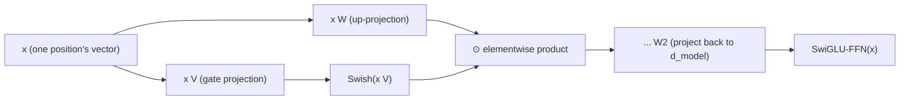

# Lição 16. SwiGLU e o bloco feed-forward com gate

**Ligação com a missão:** A lição 6 nomeou o formato que todo bloco feed-forward compartilha, expandir, aplicar uma não linearidade e projetar de volta para baixo, e mencionou de passagem que arquiteturas posteriores trocam variantes como o SwiGLU sem mudar esse formato. Esta lição deriva o que de fato muda: não o formato, mas quantas projeções o bloco calcula e como elas se combinam antes de a segunda projeção mandar o resultado de volta para baixo.
**Fonte principal:** [Artigo científico: "GLU Variants Improve Transformer", Shazeer, 2020](https://arxiv.org/abs/2002.05202)
**Pré-requisitos:** [Lição 6](0006-feed-forward-block.md), [Lição 15](0015-rmsnorm.md)

## Aquecimento

1. ▢ Por que a etapa de mistura de values da atenção é considerada linear e por que isso torna o bloco feed-forward necessário?

Verificação

Depois que o softmax produz os pesos, a saída é uma soma ponderada (uma combinação linear) dos vetores de value; a não linearidade está inteiramente em como os pesos foram calculados, e não em como são aplicados. A atenção sozinha nunca dá à rede uma forma genuinamente não linear de remodelar a representação de uma única posição, que é exatamente o que a não linearidade do bloco feed-forward fornece.

2. ▢ O que a RMSNorm mantém da layer norm e o que ela abandona?

Verificação

Mantém o reescalonamento (dividir por uma medida da magnitude do vetor, aqui a raiz do valor quadrático médio) e abandona por completo a recentralização, nunca calculando nem subtraindo uma média.

## Saiba isto

### Uma gated linear unit calcula duas projeções e as multiplica

Uma **gated linear unit (GLU)** é o produto elemento a elemento de duas projeções lineares separadas da mesma entrada, com uma não linearidade aplicada a apenas uma delas antes da multiplicação: `GLU(x) = (x W) ⊙ σ(x V)`, em que `⊙` é a multiplicação elemento a elemento e `σ` era originalmente uma sigmoide. A projeção que passa pela não linearidade atua como um **gate**: a sua saída, comprimida em direção a 0 ou 1 pela sigmoide, escala a saída da outra projeção elemento a elemento, permitindo que a rede aprenda quanto de cada feature deixar passar, em vez de se comprometer com uma única transformação não linear fixa de uma só projeção.

### O bloco feed-forward da lição 6 usava uma projeção e uma não linearidade fixa; uma versão com gate usa duas

A `FFN(x) = max(0, x W1 + b1) W2 + b2` da lição 6 calcula uma projeção até `d_ff`, aplica a ReLU e depois projeta de volta para baixo. Um bloco feed-forward com gate, em vez disso, calcula duas projeções separadas até uma dimensão oculta (em geral um pouco menor), combina-as com um produto elemento a elemento no estilo GLU e só então aplica a segunda matriz, de projeção para baixo. O enquadramento do próprio artigo é uma generalização direta: as **variantes de GLU** trocam a sigmoide do gate por outras funções, e testar várias dessas variantes exatamente na subcamada feed-forward do transformer é o experimento de fato do artigo, constatando que algumas superam a não linearidade simples de ReLU ou GELU que a lição 6 descreveu.

### SwiGLU: a variante com gate de Swish que os modelos atuais de fato usam

O **SwiGLU** é a variante de GLU que faz o gate com a ativação **Swish** (também chamada de SiLU) no lugar de uma sigmoide simples, e é a variante específica que acabou deslocando a ReLU no bloco feed-forward da maioria dos modelos abertos atuais, do mesmo modo que o RoPE (lição 14) deslocou a codificação sinusoidal e a RMSNorm (lição 15) deslocou a layer norm. Um bloco feed-forward SwiGLU calcula `SwiGLU(x) = (x W) ⊙ Swish(x V)` e depois projeta o resultado de volta para `d_model` com uma terceira matriz de pesos, três matrizes de pesos no total onde a versão simples da lição 6 usava duas.

### Três matrizes em vez de duas mudam o orçamento de parâmetros e de compute, e não o papel do bloco na arquitetura

Acrescentar uma segunda projeção de expansão é um custo real: um bloco feed-forward SwiGLU tem três matrizes de pesos fazendo o trabalho que antes duas faziam, e por isso as implementações costumam reduzir um pouco a dimensão oculta para manter a contagem total de parâmetros comparável à de um bloco feed-forward simples com o mesmo `d_model`. Nada disso muda para que o bloco feed-forward *serve*: ele continua sendo a subcamada por posição da lição 6, ainda aplicada de forma idêntica e independente ao vetor de cada posição, ainda a única fonte de computação genuinamente não linear por posição da rede. O que mudou foi puramente a computação interna que esse bloco realiza, exatamente o tipo de "pequeno desvio comum" que a lição 12 nomeia sem derivar.

## Prática

1. ▢ O que o ramo de sigmoide (ou Swish) de uma gated linear unit de fato faz com a saída da outra projeção?

Dica

Considere o que um produto elemento a elemento com um sinal comprimido em direção a 0 ou 1 realiza.

Verificação

Ele atua como um gate, escalando a saída da outra projeção elemento a elemento; a rede aprende quanto de cada feature dessa projeção deixar passar, em vez de aplicar uma única não linearidade fixa a uma só projeção de modo uniforme.

2. ▢ Quantas matrizes de pesos um bloco feed-forward SwiGLU usa, em comparação com o bloco feed-forward simples da lição 6, e por que isso costuma levar a uma dimensão oculta menor na prática?

Verificação

Três, contra as duas da lição 6 (uma projeção de expansão, uma de contração): o SwiGLU acrescenta uma segunda projeção de expansão para o gate. Como três matrizes na mesma dimensão oculta custariam mais parâmetros do que duas, as implementações costumam reduzir a dimensão oculta para manter a contagem total de parâmetros comparável à de um bloco feed-forward simples com o mesmo `d_model`.

3. ▢ Trocar um bloco feed-forward simples por um SwiGLU muda o papel da subcamada feed-forward dentro de um bloco transformer?

Verificação

Não. Ela continua sendo aplicada de forma idêntica e independente ao vetor de cada posição, sem mistura entre posições, e continua sendo a única fonte de computação genuinamente não linear por posição do bloco. Mudou apenas a computação interna dessa subcamada, e não para que ela serve.

4. ▢ O que exatamente o artigo GLU Variants testou e o que ele constatou?

Verificação

Testou várias variantes de GLU (diferentes não linearidades de gate no lugar da sigmoide) dentro da subcamada feed-forward do modelo transformer sequência a sequência, constatando que algumas dessas variantes trazem melhorias de qualidade em relação às ativações ReLU ou GELU normalmente usadas.

5. ▢ Qual afirmação descreve corretamente um bloco feed-forward com gate como o SwiGLU?

    - a) Ele substitui o bloco feed-forward por um segundo mecanismo de atenção
    - b) Ele calcula duas projeções lineares da entrada, aplica uma não linearidade (como a Swish) a uma, as multiplica elemento a elemento como um gate e então projeta o resultado de volta para baixo, usando três matrizes de pesos em vez das duas da lição 6
    - c) Ele mistura informação entre posições, ao contrário do bloco feed-forward da lição 6
    - d) Ele exige remover a RMSNorm ou qualquer outra normalização do bloco

Verificação

**b)** É o mecanismo preciso e o seu custo que esta lição estabelece. (a) é falsa: ele continua sendo a subcamada feed-forward por posição, sem relação com o papel de mistura da atenção. (c) é falsa: ele permanece estritamente por posição, exatamente como a versão da lição 6. (d) é falsa: o bloco feed-forward com gate e a normalização (RMSNorm ou outra) são escolhas de design independentes que coexistem no mesmo bloco.

## Prática no mundo real

- [ ] Implemente um bloco feed-forward SwiGLU a partir de operações com tensores brutos (duas projeções de expansão, um gate de Swish, produto elemento a elemento, uma projeção de contração) e confirme que o formato da sua saída bate com o da versão simples da lição 6 no mesmo `d_model`.
- [ ] Compare a contagem de parâmetros da sua implementação SwiGLU com a do bloco feed-forward simples da lição 6 no mesmo `d_ff`, depois reduza `d_ff` e confira de novo até que as contagens sejam aproximadamente comparáveis.
- [ ] Amanhã: leia por inteiro a tabela de resultados da fonte principal e anote qual variante de GLU ela constatou ter o melhor desempenho e por quanto, em relação à linha de base de ReLU simples.

## Para ir além

- [Artigo científico: "GLU Variants Improve Transformer", Shazeer, 2020](https://arxiv.org/abs/2002.05202)
- [Artigo científico: "Attention Is All You Need", Vaswani et al., 2017](https://arxiv.org/abs/1706.03762)
- [Recursos](../RESOURCES.md)

---

Não ficou claro? Releia a fonte principal no topo, já que esta lição a comprime e é na compressão que o entendimento escapa. Consulte o [glossário](../GLOSSARY.md) para qualquer termo que pareceu escorregadio.

Se o problema é a lição em si, e não o material, isso é um defeito: [abra uma issue](https://github.com/TokenCemetery/teach/issues).
