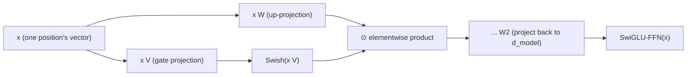

# Урок 16. SwiGLU и feed-forward-блок с вентилем

**Связь с целью курса:** Урок 6 назвал форму, общую для каждого feed-forward-блока: расширить, применить нелинейность, спроецировать обратно вниз, и мимоходом упомянул, что более поздние архитектуры подставляют варианты вроде SwiGLU, не меняя эту форму. Этот урок выводит, что на самом деле меняется: не форма, а то, сколько проекций вычисляет блок и как они объединяются до того, как вторая проекция отправит результат обратно вниз.
**Первоисточник:** [Научная статья: "GLU Variants Improve Transformer", Shazeer, 2020](https://arxiv.org/abs/2002.05202)
**Предварительные требования:** [Урок 6](0006-feed-forward-block.md), [Урок 15](0015-rmsnorm.md)

## Разминка

1. ▢ Почему шаг смешивания значений во внимании считается линейным и почему из-за этого необходим feed-forward-блок?

Проверка

После того как softmax выдал веса, выход это взвешенная сумма (линейная комбинация) векторов значений; нелинейность целиком заключена в том, как вычислены веса, а не в том, как они применяются. Одно внимание никогда не даёт сети по-настоящему нелинейного способа перестроить представление отдельной позиции, а именно это вместо него обеспечивает нелинейность feed-forward-блока.

2. ▢ Что RMSNorm сохраняет от нормализации слоя и что отбрасывает?

Проверка

Она сохраняет масштабирование (деление на меру величины вектора, здесь среднеквадратичное значение) и полностью отбрасывает центрирование, никогда не вычисляя и не вычитая среднее.

## Что нужно знать

### Вентильный линейный блок вычисляет две проекции и перемножает их

**Вентильный линейный блок** (gated linear unit, GLU) это поэлементное произведение двух отдельных линейных проекций одного и того же входа, где нелинейность применена только к одной из них до умножения: `GLU(x) = (x W) ⊙ σ(x V)`, где `⊙` это поэлементное умножение, а `σ` изначально была сигмоидой. Проекция, прошедшая через нелинейность, работает как **вентиль** (gate): её выход, сжатый сигмоидой к 0 или 1, поэлементно масштабирует выход другой проекции, позволяя сети научиться тому, какую часть каждого признака пропустить, а не ограничиваться единственным фиксированным нелинейным преобразованием одной проекции.

### Feed-forward-блок из урока 6 использовал одну проекцию и фиксированную нелинейность; версия с вентилем использует две

`FFN(x) = max(0, x W1 + b1) W2 + b2` из урока 6 вычисляет одну проекцию вверх до `d_ff`, применяет ReLU, а затем проецирует обратно вниз. Feed-forward-блок с вентилем вместо этого вычисляет две отдельные проекции вверх до (обычно несколько меньшей) скрытой размерности, объединяет их поэлементным произведением в стиле GLU и только затем применяет вторую, понижающую матрицу. Формулировка самой статьи это прямое обобщение: **варианты GLU** заменяют сигмоидальный вентиль другими функциями, и проверка нескольких таких вариантов именно в feed-forward-подслое трансформера составляет настоящий эксперимент статьи, который обнаружил, что некоторые превосходят обычную нелинейность ReLU или GELU, описанную в уроке 6.

### SwiGLU: вариант с вентилем на основе Swish, который современные модели на самом деле используют

**SwiGLU** это вариант GLU, где вентиль строится на активации **Swish** (она же SiLU) вместо обычной сигмоиды, и именно этот вариант в итоге вытеснил ReLU в feed-forward-блоке большинства современных открытых моделей, так же как RoPE (урок 14) вытеснил синусоидальное кодирование, а RMSNorm (урок 15) вытеснила нормализацию слоя. Feed-forward-блок SwiGLU вычисляет `SwiGLU(x) = (x W) ⊙ Swish(x V)`, а затем проецирует результат обратно вниз в `d_model` третьей матрицей весов, то есть всего три матрицы весов там, где обычная версия из урока 6 использовала две.

### Три матрицы вместо двух меняют бюджет параметров и вычислений, но не роль блока в архитектуре

Добавление второй повышающей проекции это реальная стоимость: у feed-forward-блока SwiGLU три матрицы весов делают работу, которую раньше делали две, и поэтому реализации обычно несколько уменьшают скрытую размерность, чтобы общее число параметров оставалось сопоставимым с обычным feed-forward-блоком при том же `d_model`. Ничто из этого не меняет того, *для чего* нужен feed-forward-блок: это по-прежнему позиционный подслой из урока 6, по-прежнему применяемый одинаково и независимо к вектору каждой позиции, по-прежнему единственный источник по-настоящему нелинейных вычислений на позицию в сети. Изменилось исключительно внутреннее вычисление, которое выполняет этот блок, и это в точности тот вид «небольшого распространённого отклонения», который урок 12 называет, не выводя.

## Практика

1. ▢ Что на самом деле делает ветвь с сигмоидой (или Swish) вентильного линейного блока с выходом другой проекции?

Подсказка

Подумайте, чего достигает поэлементное произведение с сигналом, сжатым к 0 или 1.

Проверка

Она работает как вентиль и поэлементно масштабирует выход другой проекции; сеть учится тому, какую часть каждого признака в этой проекции пропустить, а не применяет одну фиксированную нелинейность к единственной проекции равномерно.

2. ▢ Сколько матриц весов использует feed-forward-блок SwiGLU по сравнению с обычным feed-forward-блоком из урока 6 и почему это обычно приводит к меньшей скрытой размерности на практике?

Проверка

Три против двух в уроке 6 (одна повышающая проекция, одна понижающая): SwiGLU добавляет вторую повышающую проекцию для вентиля. Поскольку три матрицы при той же скрытой размерности стоили бы больше параметров, чем две, реализации обычно уменьшают скрытую размерность, чтобы общее число параметров оставалось сопоставимым с обычным feed-forward-блоком при том же `d_model`.

3. ▢ Меняет ли замена обычного feed-forward-блока на SwiGLU роль feed-forward-подслоя внутри блока трансформера?

Проверка

Нет. Он по-прежнему применяется одинаково и независимо к вектору каждой позиции, без смешивания между позициями, и по-прежнему остаётся единственным источником по-настоящему нелинейных вычислений на позицию в блоке. Изменилось только внутреннее вычисление внутри этого подслоя, а не то, для чего подслой нужен.

4. ▢ Что именно проверяла статья про варианты GLU и что она обнаружила?

Проверка

Она проверила несколько вариантов GLU (разные вентильные нелинейности вместо сигмоиды) внутри feed-forward-подслоя трансформерной модели «последовательность в последовательность» и обнаружила, что некоторые из этих вариантов дают улучшение качества по сравнению с обычно используемыми активациями ReLU или GELU.

5. ▢ Какое утверждение правильно описывает feed-forward-блок с вентилем вроде SwiGLU?

    - a) Он заменяет feed-forward-блок вторым механизмом внимания
    - b) Он вычисляет две линейные проекции входа, применяет нелинейность (вроде Swish) к одной, перемножает их поэлементно как вентиль, а затем проецирует результат обратно вниз, используя три матрицы весов вместо двух из урока 6
    - c) Он смешивает информацию между позициями, в отличие от feed-forward-блока из урока 6
    - d) Он требует убрать из блока RMSNorm или любую другую нормализацию

Проверка

**b)** Это точный механизм и его стоимость, которые устанавливает этот урок. Вариант (a) неверен: это по-прежнему позиционный feed-forward-подслой, не связанный с ролью внимания по смешиванию. Вариант (c) неверен: он остаётся строго позиционным, в точности как версия из урока 6. Вариант (d) неверен: feed-forward-блок с вентилем и нормализация (RMSNorm или другая) это независимые проектные решения, которые сосуществуют в одном блоке.

## Практика в реальной работе

- [ ] Реализуйте feed-forward-блок SwiGLU из «сырых» тензорных операций (две повышающие проекции, вентиль Swish, поэлементное произведение, одна понижающая проекция) и убедитесь, что форма его выхода совпадает с обычной версией из урока 6 при том же `d_model`.
- [ ] Сравните число параметров своей реализации SwiGLU с обычным feed-forward-блоком из урока 6 при том же `d_ff`, затем уменьшайте `d_ff` и перепроверяйте, пока числа не станут примерно сопоставимыми.
- [ ] Завтра: прочитайте целиком таблицу результатов первоисточника и отметьте, какой вариант GLU показал лучший результат и насколько он превзошёл обычную базовую линию с ReLU.

## Что почитать дальше

- [Научная статья: "GLU Variants Improve Transformer", Shazeer, 2020](https://arxiv.org/abs/2002.05202)
- [Научная статья: "Attention Is All You Need", Vaswani et al., 2017](https://arxiv.org/abs/1706.03762)
- [Ресурсы](../RESOURCES.md)

---

Не доходит? Перечитайте первоисточник в начале: этот урок его сжимает, а при сжатии понимание как раз и теряется. Загляните в [глоссарий](../GLOSSARY.md), если какой-то термин показался скользким.

Если неясен сам урок, а не материал, это дефект: [откройте issue](https://github.com/TokenCemetery/teach/issues).
