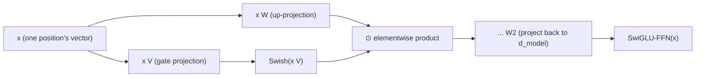

# 第 16 课：SwiGLU 与门控前馈块

**使命关联:** 第 6 课指出了每个前馈块共有的形态：先扩张，施加一个非线性，再投影回去，并顺带提到后来的架构会换上 SwiGLU 这样的变体，而不改变这个形态。本课推导实际改变的是什么：不是形态，而是这个块计算多少个投影，以及它们在第二个投影把结果送回去之前如何组合。
**主要来源:** [论文：“GLU Variants Improve Transformer”，Shazeer，2020](https://arxiv.org/abs/2002.05202)
**前置知识:** [第 6 课](0006-feed-forward-block.md)、[第 15 课](0015-rmsnorm.md)

## 热身

1. ▢ 为什么注意力的值混合步骤被认为是线性的？这又为什么使前馈块成为必需？

检查

softmax 产生权重之后，输出是值向量的加权和（一个线性组合）；非线性完全存在于权重是怎么算出来的，而不在于它们如何被应用。仅靠注意力，网络永远没有真正非线性的办法去重塑单个位置自己的表示，而这恰恰是前馈块的非线性所提供的。

2. ▢ RMSNorm 保留了层归一化的什么，去掉了什么？

检查

它保留了重新缩放（除以向量大小的某种度量，这里是均方根），完全去掉了重新中心化，从不计算也不减去均值。

## 要点

### 门控线性单元计算两个投影，并把它们相乘

**门控线性单元（GLU）**是同一个输入的两个独立线性投影的逐元素乘积，在相乘之前，只对其中一个施加非线性：`GLU(x) = (x W) ⊙ σ(x V)`，其中 `⊙` 是逐元素乘法，`σ` 最初是 sigmoid。经过非线性的那个投影充当**门**：它的输出被 sigmoid 压向 0 或 1，逐个元素地缩放另一个投影的输出，让网络学会每个特征让多少通过，而不是只对一个投影做一种固定的非线性变换。

### 第 6 课的前馈块用一个投影和一个固定的非线性；门控的版本用两个

第 6 课的 `FFN(x) = max(0, x W1 + b1) W2 + b2` 计算一次向上到 `d_ff` 的投影，施加 ReLU，再投影回去。门控的前馈块则计算两个独立的向上投影，到（通常稍小一些的）隐藏维度，用 GLU 式的逐元素乘积把它们组合起来，然后才施加第二个向下投影的矩阵。论文自己的表述是一种直接的推广：**GLU 变体**把 sigmoid 门换成其他函数，而在 Transformer 的前馈子层里恰好测试其中的几种变体，就是论文真正做的实验，结果发现其中一些优于第 6 课所描述的朴素的 ReLU 或 GELU 非线性。

### SwiGLU：当前模型实际使用的 Swish 门控变体

**SwiGLU** 是用 **Swish**（也叫 SiLU）激活取代朴素 sigmoid 来做门控的 GLU 变体，它正是最终在大多数当前开源模型的前馈块里取代了 ReLU 的那个具体变体，就像 RoPE（第 14 课）取代了正弦编码、RMSNorm（第 15 课）取代了层归一化一样。SwiGLU 前馈块计算 `SwiGLU(x) = (x W) ⊙ Swish(x V)`，然后用第三个权重矩阵把结果投影回 `d_model`，一共三个权重矩阵，而第 6 课的朴素版本用的是两个。

### 用三个矩阵代替两个，改变的是参数和计算预算，而不是这个块在架构中的角色

增加第二个向上投影是一笔实在的成本：SwiGLU 前馈块有三个权重矩阵来干原来两个干的活，这就是为什么实现里通常会把隐藏维度稍微缩小一些，让总参数量与同样 `d_model` 下的朴素前馈块大致相当。这一切都没有改变前馈块*是用来做什么的*：它仍然是第 6 课的逐位置子层，仍然相同而独立地作用于每个位置自己的向量，仍然是网络里真正非线性的逐位置计算的唯一来源。改变的纯粹是这个块内部所做的计算，恰恰属于第 12 课只点出名字而没有推导的那种“细小而常见的偏离”。

## 练习

1. ▢ 门控线性单元的 sigmoid（或 Swish）分支，实际上对另一个投影的输出做了什么？

提示

想一想，与一个被压向 0 或 1 的信号做逐元素乘积，起到了什么作用。

检查

它充当一道门，逐个元素地缩放另一个投影的输出；网络学会那个投影里每个特征让多少通过，而不是对单个投影统一施加一个固定的非线性。

2. ▢ 与第 6 课的朴素前馈块相比，SwiGLU 前馈块用了多少个权重矩阵？为什么这在实践中通常会导致隐藏维度更小？

检查

三个，而第 6 课是两个（一个向上投影，一个向下投影）：SwiGLU 为门多加了第二个向上投影。由于三个矩阵在同样的隐藏维度下，花费的参数比两个多，实现里通常把隐藏维度缩小，让总参数量与同样 `d_model` 下的朴素前馈块大致相当。

3. ▢ 把朴素前馈块换成 SwiGLU 的，会改变前馈子层在 Transformer 块中的角色吗？

检查

不会。它仍然相同而独立地作用于每个位置自己的向量，没有跨位置的混合，仍然是这个块里真正非线性的逐位置计算的唯一来源。改变的只是这个子层内部的计算，而不是这个子层是用来做什么的。

4. ▢ GLU Variants 这篇论文具体测试了什么，发现了什么？

检查

它在 Transformer 序列到序列模型的前馈子层里，测试了几种 GLU 变体（用不同的门控非线性取代 sigmoid），发现其中一些变体比通常使用的 ReLU 或 GELU 激活带来质量上的提升。

5. ▢ 下面哪一项说法正确描述了像 SwiGLU 这样的门控前馈块？

    - a) 它用第二种注意力机制取代前馈块
    - b) 它计算输入的两个线性投影，对其中一个施加非线性（如 Swish），把它们当作门做逐元素相乘，再把结果投影回去，用三个权重矩阵，而不是第 6 课的两个
    - c) 与第 6 课的前馈块不同，它会在位置之间混合信息
    - d) 它要求把 RMSNorm 或任何其他归一化从这个块里去掉

检查

**b)** 这正是本课确立的精确机制和它的成本。(a) 是错的：它仍然是逐位置的前馈子层，与注意力的混合角色无关。(c) 是错的：它仍然严格地是逐位置的，与第 6 课的版本完全一样。(d) 是错的：门控前馈块与归一化（RMSNorm 或别的）是相互独立的设计选择，共存于同一个块里。

## 实战练习

- [ ] 用原始张量运算（两个向上投影、一个 Swish 门、逐元素乘积、一个向下投影）实现一个 SwiGLU 前馈块，并确认它在同样的 `d_model` 下，输出形状与第 6 课的朴素版本一致。
- [ ] 在同样的 `d_ff` 下，比较你的 SwiGLU 实现与第 6 课的朴素前馈块的参数量，然后把 `d_ff` 调小并重新检查，直到两者的参数量大致相当。
- [ ] 明天：完整阅读主要来源的结果表，并记下它发现哪种 GLU 变体表现最好，以及比朴素的 ReLU 基线好多少。

## 延伸阅读

- [论文：“GLU Variants Improve Transformer”，Shazeer，2020](https://arxiv.org/abs/2002.05202)
- [论文：“Attention Is All You Need”，Vaswani 等，2017](https://arxiv.org/abs/1706.03762)
- [资源](../RESOURCES.md)

---

没学明白？请重读顶部的主要来源，因为本课是对它的压缩，而理解正是在压缩中流失的。如果有哪个术语觉得含糊，可以查看[术语表](../GLOSSARY.md)。

如果问题出在课程本身，而不是学习材料，那就是一个缺陷：[提交 issue](https://github.com/TokenCemetery/teach/issues)。
