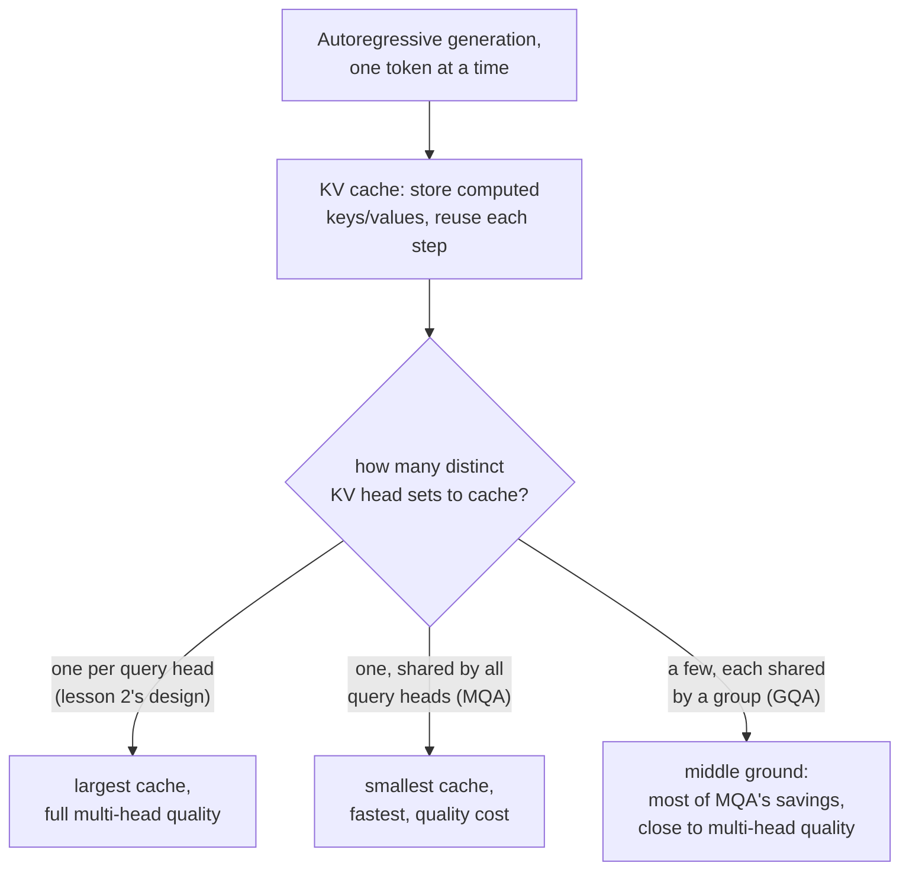

# Lección 17. Grouped-Query Attention y KV caching

**Vínculo con la misión:** La lección 2 dio a cada head sus propias proyecciones de query, key y value, sin motivo todavía para tratarlas de forma distinta. Ese motivo aparece en cuanto el modelo empieza a generar texto un token cada vez: recalcular la key y el value de cada token anterior en cada paso de generación es trabajo desperdiciado, y cuando guardarlos en caché se vuelve la solución obvia, el tamaño de la propia caché es lo que hace que la **grouped-query attention** y la **multi-query attention** merezcan derivarse como un cambio arquitectónico por derecho propio, y no como una simple curiosidad.
**Fuente principal:** [Paper: "GQA: Training Generalized Multi-Query Transformer Models from Multi-Head Checkpoints", Ainslie et al., 2023](https://arxiv.org/abs/2305.13245)
**Requisitos previos:** [Lección 2](0002-multi-head-attention.md), [Lección 16](0016-swiglu-and-the-gated-feed-forward.md)

## Calentamiento

1. ▢ ¿Por qué pueden acabar los distintos heads de atención especializándose en distintas clases de relaciones entre posiciones, si todos aplican exactamente la misma ecuación de atención?

Comprobación

Cada head tiene sus propias matrices de proyección, aprendidas de forma independiente; aplicar la misma ecuación a versiones proyectadas de forma distinta de la misma entrada permite que distintos heads atiendan a aspectos totalmente distintos de ella.

2. ▢ ¿Por qué se aplica una proyección lineal final (`W_O`) después de concatenar los heads de la multi-head attention, en lugar de usar directamente el vector concatenado?

Comprobación

La concatenación por sí sola coloca la salida de cada head una junto a otra sin ninguna interacción entre ellas; `W_O` permite al modelo aprender a combinar la información de los distintos heads en una representación unificada.

## Qué debes saber

### Generar un token cada vez recalcula trabajo que nunca cambió

Un modelo que produce texto de forma autorregresiva genera un token, lo añade a la secuencia y genera el siguiente, y repite hasta terminar. En cada nuevo paso, calcular la atención del token más reciente necesita comparar la query de ese token con la key y el value de cada token anterior, exactamente las mismas keys y values que ya se calcularon en cada paso anterior. Recalcularlas desde cero en cada paso de generación, cuando los tokens que las producen no han cambiado, es puro desperdicio.

### La KV cache: guardar lo que no cambiará, calcular solo lo nuevo

Una **KV cache** guarda los vectores key y value de cada posición anterior una vez calculados, de modo que cada nuevo paso de generación solo tiene que calcular la key y el value del token más reciente y añadirlos a la caché, en lugar de recalcular desde cero las keys y los values de toda la secuencia. Esto convierte el costo por paso de la atención durante la generación, que crecería con el cálculo de keys y values de toda la longitud de la secuencia, en uno que crece solo con el de un token nuevo, a costa de que la propia caché ocupe una memoria que crece con la longitud de la secuencia.

### La multi-query y la grouped-query attention reducen exactamente lo que tiene que contener la caché

El tamaño de la KV cache escala con cuántos conjuntos distintos de vectores key y value tiene que almacenar, lo que viene determinado por cuántas proyecciones de key/value separadas tiene el modelo, una por head de atención en el diseño de la lección 2. La **multi-query attention (MQA)** lo reduce a un único head de key/value compartido que usan todos los heads de query, lo que encoge drásticamente la caché (y el ancho de banda de memoria necesario para volver a leerla en cada paso), a un costo que el propio planteamiento del paper enuncia con claridad: la MQA puede llevar a una degradación de la calidad en comparación con dar a cada head sus propias keys y values. La **grouped-query attention (GQA)** es el punto medio que propone el paper: un número intermedio de heads de key/value, más de uno y menos que el número de heads de query, con grupos de heads de query que comparten cada uno un head de key/value. Esto conserva la mayor parte del ahorro de tamaño de caché y de ancho de banda de la MQA y da al modelo más representaciones distintas de key/value con las que trabajar de las que permitiría un único head compartido.

### El uptraining convierte de forma barata un modelo multi-head existente en uno GQA

En lugar de entrenar desde cero un modelo GQA (o MQA), la contribución propia del paper es una receta para convertir un checkpoint multi-head ordinario ya entrenado en uno que use grouped o multi-query attention, usando una pequeña fracción, de en torno al 5 por ciento, del cómputo que costó la ejecución original de preentrenamiento. El paper informa de que un modelo GQA tras uptraining alcanza una calidad cercana a la del modelo multi-head original mientras se acerca a la velocidad de inferencia de la MQA, que es exactamente la razón práctica por la que la GQA desplazó a entrenar un modelo multi-query aparte, desde cero: el costo de calidad de llegar hasta un único head de key/value compartido puede evitarse sin descartar la inversión de entrenamiento de un modelo multi-head existente.

## Práctica

1. ▢ Un modelo genera texto un token cada vez. ¿Por qué es un desperdicio recalcular los vectores key y value de cada token anterior en cada nuevo paso de generación?

Pista

Considera si algo de la key y el value de un token anterior, ya generado, cambia realmente en un paso posterior.

Comprobación

Los vectores key y value de un token anterior no cambian una vez calculados; recalcularlos en cada paso posterior repite un trabajo cuya respuesta ya se conoce, que es exactamente lo que una KV cache existe para evitar, guardándolos una vez y reutilizándolos.

2. ▢ ¿Qué determina lo grande que tiene que ser una KV cache, y por qué la multi-query attention la reduce tanto en comparación con el diseño multi-head ordinario de la lección 2?

Comprobación

El tamaño de la caché escala con cuántos conjuntos distintos de heads de key/value hay que almacenar. El diseño de la lección 2 da a cada head de atención sus propias proyecciones de key/value, así que la caché tiene que contener un conjunto por head; la MQA lo reduce a un único head de key/value compartido que usan todos los heads de query, lo que reduce drásticamente lo que hay que guardar en caché y volver a leer en cada paso.

3. ▢ ¿Por qué describe el paper de GQA la grouped-query attention como un punto medio, en lugar de recomendar sin más la multi-query attention?

Comprobación

El único head de key/value compartido de la multi-query attention puede llevar a una degradación de la calidad; la grouped-query attention usa un número intermedio de heads de key/value (más de uno y menos que el número de heads de query), y conserva la mayor parte de los beneficios de tamaño de caché y de velocidad de la MQA mientras da al modelo más representaciones distintas de key/value, más cercanas a la calidad de la multi-head attention.

4. ▢ ¿Por qué propone el paper el "uptraining" de un checkpoint multi-head existente para convertirlo en un modelo GQA, en lugar de entrenar siempre un modelo GQA desde cero?

Comprobación

El uptraining convierte un modelo multi-head ya entrenado usando solo una pequeña fracción (en torno al 5 por ciento) del cómputo de preentrenamiento original, y alcanza una calidad cercana a la original mientras se acerca a la velocidad de la MQA. Esto evita descartar la inversión de entrenamiento de un modelo existente solo para obtener los beneficios de inferencia de la grouped o la multi-query attention.

5. ▢ ¿Qué afirmación describe correctamente la relación entre el KV caching, la MQA y la GQA?

    - a) Una KV cache existe para guardar vectores query, no vectores key y value
    - b) Una KV cache evita recalcular keys y values sin cambios en cada paso de generación; su tamaño escala con el número de conjuntos distintos de heads de key/value, que es exactamente lo que reducen la MQA (un head compartido) y la GQA (unos pocos heads compartidos), cambiando algo de calidad por tamaño de caché y velocidad
    - c) La grouped-query attention siempre iguala exactamente la calidad de la multi-head attention, sin ninguna contrapartida
    - d) El uptraining requiere entrenar un modelo nuevo desde cero con el costo completo del preentrenamiento

Comprobación

**b)** Esa es la cadena de razonamiento precisa que establece esta lección, desde el propósito de la caché hasta por qué menos heads de key/value la reducen. (a) es falsa: una KV cache guarda vectores key y value, no queries, ya que las queries solo se necesitan en el paso actual. (c) es falsa: la GQA es explícitamente una contrapartida, más cercana a la calidad de la multi-head que la MQA pero no idéntica a ella. (d) es falsa: todo el sentido del uptraining es convertir un checkpoint existente usando una pequeña fracción del cómputo de preentrenamiento original.

## Prácticas en el mundo real

- [ ] Para un modelo al que tengas acceso (o sus detalles de arquitectura publicados), comprueba si usa multi-head attention ordinaria, MQA o GQA, y si es GQA, cuántos heads de key/value usa en relación con sus heads de query.
- [ ] Estima la diferencia de tamaño de KV cache entre un modelo multi-head hipotético de 32 heads de query y el mismo modelo usando GQA con 8 heads de key/value, en términos de cuántos conjuntos distintos de heads tiene que almacenar cada uno.
- [ ] Mañana: lee completa la sección de resultados de la fuente principal, y anota cuán cerca estuvo la calidad de la GQA tras uptraining de la del checkpoint multi-head original, y con qué fracción de la velocidad de la MQA.

## Para profundizar

- [Paper: "GQA: Training Generalized Multi-Query Transformer Models from Multi-Head Checkpoints", Ainslie et al., 2023](https://arxiv.org/abs/2305.13245)
- [Paper: "Attention Is All You Need", Vaswani et al., 2017](https://arxiv.org/abs/1706.03762)
- [Recursos](../RESOURCES.md)

---

¿No termina de quedar claro? Vuelve a leer la fuente primaria de arriba, ya que esta lección la comprime y en la compresión es donde se escapa la comprensión. Consulta el [glosario](../GLOSSARY.md) por si algún término te resultó resbaladizo.

Si lo poco claro es la propia lección y no el material, eso es un defecto: [abre un issue](https://github.com/TokenCemetery/teach/issues).
