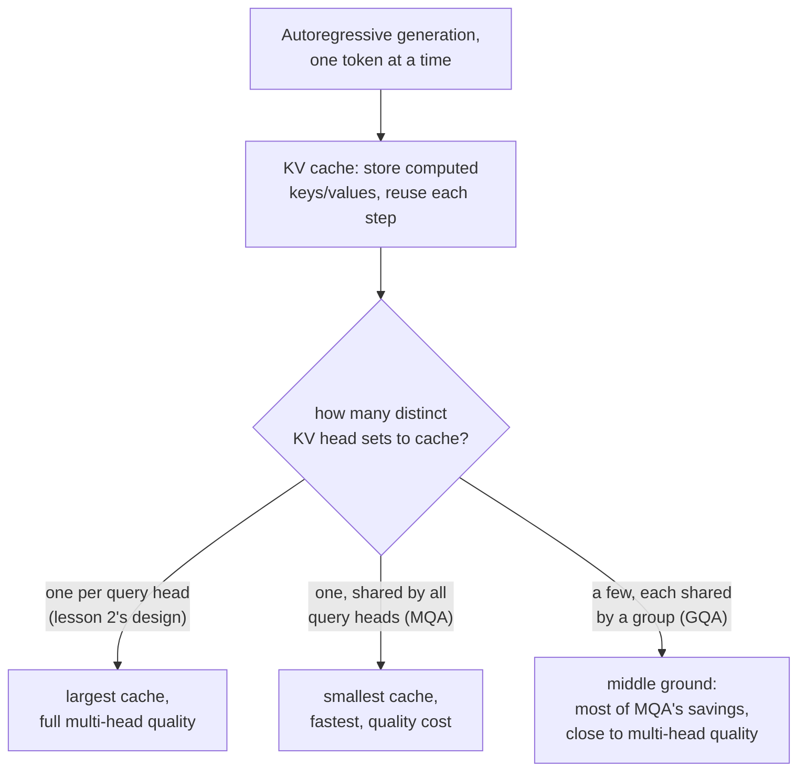

# Leçon 17. Grouped-query attention et KV caching

**Lien avec la mission :** La leçon 2 a donné à chaque tête ses propres projections de requête, de clé et de valeur, sans raison encore de les traiter différemment. Cette raison apparaît dès que le modèle se met à générer du texte un token à la fois : recalculer la clé et la valeur de chaque token précédent à chaque étape de génération est du travail gaspillé, et une fois que les mettre en cache devient la correction évidente, c'est la taille du cache lui-même qui fait de la **grouped-query attention** et de la **multi-query attention** un changement d'architecture à dériver en tant que tel, et pas une simple curiosité.
**Source primaire :** [Article : "GQA: Training Generalized Multi-Query Transformer Models from Multi-Head Checkpoints", Ainslie et al., 2023](https://arxiv.org/abs/2305.13245)
**Prérequis :** [Leçon 2](0002-multi-head-attention.md), [Leçon 16](0016-swiglu-and-the-gated-feed-forward.md)

## Échauffement

1. ▢ Pourquoi des têtes d'attention différentes peuvent-elles finir par se spécialiser dans différents types de relations entre positions, alors que toutes appliquent exactement la même équation d'attention ?

Vérifier

Chaque tête a ses propres matrices de projection, apprises indépendamment ; appliquer la même équation à des versions projetées différemment de la même entrée permet à des têtes différentes de porter leur attention sur des aspects entièrement différents de l'entrée.

2. ▢ Pourquoi applique-t-on une projection linéaire finale (`W_O`) après la concaténation des têtes de la multi-head attention, plutôt que d'utiliser directement le vecteur concaténé ?

Vérifier

La concaténation seule place la sortie de chaque tête côte à côte sans aucune interaction entre elles ; `W_O` permet au modèle d'apprendre à combiner l'information des différentes têtes en une représentation unifiée.

## À savoir

### Générer un token à la fois recalcule du travail qui n'a jamais changé

Un modèle qui produit du texte de façon autorégressive génère un token, l'ajoute à la séquence, puis génère le suivant, et ainsi de suite jusqu'à la fin. À chaque nouvelle étape, calculer l'attention pour le token le plus récent demande de comparer la requête de ce token à la clé et à la valeur de chaque token précédent, exactement les mêmes clés et valeurs qui ont déjà été calculées à chaque étape antérieure. Les recalculer de zéro à chaque étape de génération, alors que les tokens qui les produisent n'ont pas changé, est un pur gaspillage.

### Le KV cache : stocker ce qui ne changera pas, ne calculer que ce qui est nouveau

Un **KV cache** stocke les vecteurs de clés et de valeurs de chaque position précédente une fois calculés, de sorte que chaque nouvelle étape de génération n'a qu'à calculer la clé et la valeur du token le plus récent et à les ajouter au cache, au lieu de recalculer de zéro les clés et les valeurs de toute la séquence. Le coût par étape de l'attention pendant la génération passe ainsi d'une croissance proportionnelle au calcul de clés et de valeurs pour toute la longueur de la séquence à une croissance proportionnelle à un seul nouveau token, au prix d'un cache qui occupe lui-même une mémoire croissant avec la longueur de la séquence.

### La multi-query et la grouped-query attention réduisent exactement ce que le cache doit contenir

La taille du KV cache dépend du nombre d'ensembles distincts de vecteurs de clés et de valeurs qu'il doit stocker, ce qui est déterminé par le nombre de projections de clés et de valeurs distinctes que le modèle possède, une par tête d'attention dans la conception de la leçon 2. La **multi-query attention (MQA)** réduit cela à une seule tête de clés et de valeurs, partagée par toutes les têtes de requêtes, ce qui réduit drastiquement le cache (et la bande passante mémoire nécessaire pour le relire à chaque étape), à un coût que la formulation de l'article énonce clairement : la MQA peut entraîner une dégradation de la qualité par rapport au fait de donner à chaque tête ses propres clés et valeurs. La **grouped-query attention (GQA)** est le compromis que propose l'article : un nombre intermédiaire de têtes de clés et de valeurs, plus d'une et moins que le nombre de têtes de requêtes, chaque groupe de têtes de requêtes partageant une tête de clés et de valeurs. Cela conserve l'essentiel des économies de taille de cache et de bande passante de la MQA tout en donnant au modèle plus de représentations distinctes de clés et de valeurs qu'une seule tête partagée n'en permettrait.

### L'uptraining transforme à peu de frais un modèle multi-head existant en modèle GQA

Plutôt que d'entraîner un modèle GQA (ou MQA) à partir de zéro, la contribution propre de l'article est une recette pour convertir un checkpoint multi-head ordinaire, déjà entraîné, en un modèle qui utilise la grouped-query ou la multi-query attention, avec une petite fraction, environ 5 %, du calcul qu'avait demandé le run de pré-entraînement d'origine. L'article indique qu'un modèle GQA obtenu par uptraining atteint une qualité proche de celle du modèle multi-head d'origine tout en approchant la vitesse d'inférence de la MQA, ce qui est précisément la raison pratique pour laquelle la GQA a supplanté l'entraînement d'un modèle multi-query distinct à partir de zéro : le coût en qualité d'aller jusqu'à une seule tête de clés et de valeurs partagée peut être évité sans jeter l'investissement d'entraînement d'un modèle multi-head existant.

## Pratique

1. ▢ Un modèle génère du texte un token à la fois. Pourquoi recalculer à chaque nouvelle étape de génération les vecteurs de clés et de valeurs de chaque token précédent est-il un gaspillage ?

Indice

Demandez-vous si quoi que ce soit dans la clé et la valeur d'un token précédent, déjà généré, change réellement à une étape ultérieure.

Vérifier

Les vecteurs de clé et de valeur d'un token précédent ne changent pas une fois calculés ; les recalculer à chaque étape ultérieure répète un travail dont la réponse est déjà connue, ce qu'un KV cache existe précisément pour éviter en les stockant une fois et en les réutilisant.

2. ▢ Qu'est-ce qui détermine la taille nécessaire d'un KV cache, et pourquoi la multi-query attention la réduit-elle autant par rapport à la conception multi-head ordinaire de la leçon 2 ?

Vérifier

La taille du cache dépend du nombre d'ensembles distincts de têtes de clés et de valeurs à stocker. La conception de la leçon 2 donne à chaque tête d'attention ses propres projections de clés et de valeurs, donc le cache doit contenir un ensemble par tête ; la MQA réduit cela à une seule tête de clés et de valeurs partagée par toutes les têtes de requêtes, ce qui réduit drastiquement ce qu'il faut mettre en cache et relire à chaque étape.

3. ▢ Pourquoi l'article sur la GQA décrit-il la grouped-query attention comme un compromis, plutôt que de recommander tout simplement la multi-query attention ?

Vérifier

La tête unique de clés et de valeurs partagée de la multi-query attention peut entraîner une dégradation de la qualité ; la grouped-query attention utilise un nombre intermédiaire de têtes de clés et de valeurs (plus d'une, moins que le nombre de têtes de requêtes), ce qui conserve l'essentiel des bénéfices de la MQA en taille de cache et en vitesse tout en donnant au modèle plus de représentations distinctes de clés et de valeurs, plus proches de la qualité de la multi-head attention.

4. ▢ Pourquoi l'article propose-t-il l'« uptraining » d'un checkpoint multi-head existant en modèle GQA, plutôt que de toujours entraîner un modèle GQA à partir de zéro ?

Vérifier

L'uptraining convertit un modèle multi-head déjà entraîné avec seulement une petite fraction (environ 5 %) du calcul de pré-entraînement d'origine, en atteignant une qualité proche de l'original tout en approchant la vitesse de la MQA. Cela évite de jeter l'investissement d'entraînement d'un modèle existant juste pour obtenir les bénéfices d'inférence de la grouped-query ou de la multi-query attention.

5. ▢ Quelle affirmation décrit correctement la relation entre le KV caching, la MQA et la GQA ?

    - a) Un KV cache existe pour stocker les vecteurs de requêtes, pas les vecteurs de clés et de valeurs
    - b) Un KV cache évite de recalculer à chaque étape de génération des clés et des valeurs inchangées ; sa taille dépend du nombre d'ensembles distincts de têtes de clés et de valeurs, ce que réduisent précisément la MQA (une tête partagée) et la GQA (quelques têtes partagées), en échangeant un peu de qualité contre de la taille de cache et de la vitesse
    - c) La grouped-query attention égale toujours exactement la qualité de la multi-head attention, sans aucun compromis
    - d) L'uptraining exige d'entraîner un nouveau modèle à partir de zéro au coût complet du pré-entraînement

Vérifier

**b)** C'est l'enchaînement de raisonnement précis qu'établit cette leçon, de l'objet du cache jusqu'à la raison pour laquelle moins de têtes de clés et de valeurs le réduisent. (a) est faux : un KV cache stocke des vecteurs de clés et de valeurs, pas des requêtes, puisque les requêtes ne sont nécessaires que pour l'étape en cours. (c) est faux : la GQA est explicitement un compromis, plus proche de la qualité de la multi-head que la MQA mais pas identique à elle. (d) est faux : tout l'intérêt de l'uptraining est de convertir un checkpoint existant avec une petite fraction du calcul de pré-entraînement d'origine.

## Exercices en situation réelle

- [ ] Pour un modèle auquel vous avez accès (ou dont vous avez les détails d'architecture publiés), vérifiez s'il utilise la multi-head attention ordinaire, la MQA ou la GQA, et dans le cas de la GQA, combien de têtes de clés et de valeurs il utilise par rapport à ses têtes de requêtes.
- [ ] Estimez la différence de taille de KV cache entre un modèle multi-head hypothétique à 32 têtes de requêtes et le même modèle utilisant la GQA avec 8 têtes de clés et de valeurs, en nombre d'ensembles distincts de têtes que chacun doit stocker.
- [ ] Demain : lisez en entier la section de résultats de la source primaire, et notez à quel point la qualité de la GQA obtenue par uptraining s'est approchée de celle du checkpoint multi-head d'origine, et à quelle fraction de la vitesse de la MQA.

## Pour aller plus loin

- [Article : "GQA: Training Generalized Multi-Query Transformer Models from Multi-Head Checkpoints", Ainslie et al., 2023](https://arxiv.org/abs/2305.13245)
- [Article : "Attention Is All You Need", Vaswani et al., 2017](https://arxiv.org/abs/1706.03762)
- [Ressources](../RESOURCES.md)

---

Ça ne passe pas ? Relisez la source primaire en haut de page, car cette leçon la condense et c'est dans la condensation que la compréhension s'échappe. Consultez le [glossaire](../GLOSSARY.md) pour tout terme qui vous a paru glissant.

Si c'est la leçon elle-même qui n'est pas claire plutôt que la matière, c'est un défaut : [ouvrez une issue](https://github.com/TokenCemetery/teach/issues).
