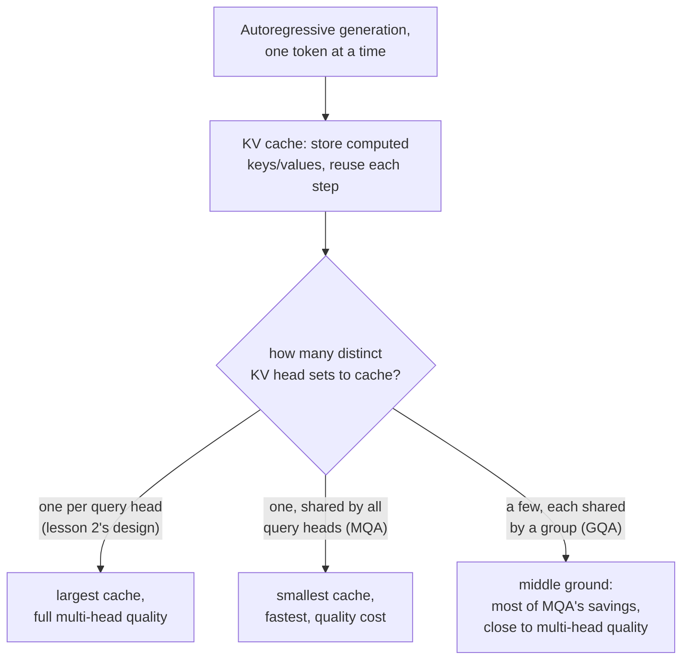

# पाठ 17. Grouped-Query Attention और KV Caching

**मिशन से संबंध:** पाठ 2 ने हर head को अपने query, key और value projections दिए, और उन्हें अलग तरह बरतने का अभी तक कोई कारण नहीं था। वह कारण उसी क्षण दिखता है जब model text को एक बार में एक token generate करना शुरू करता है: हर generation step पर हर पिछले token की key और value दोबारा compute करना बेकार का काम है, और उन्हें cache करना जब साफ़ हल बन जाता है, तो cache का अपना आकार ही **grouped-query** और **multi-query attention** को अपने-आप में एक architectural बदलाव के रूप में निकालने लायक़ बनाता है, महज़ कौतूहल नहीं।
**मुख्य स्रोत:** [पेपर: "GQA: Training Generalized Multi-Query Transformer Models from Multi-Head Checkpoints", Ainslie et al., 2023](https://arxiv.org/abs/2305.13245)
**पूर्व-आवश्यकताएँ:** [पाठ 2](0002-multi-head-attention.md), [पाठ 16](0016-swiglu-and-the-gated-feed-forward.md)

## वार्म-अप

1. ▢ अलग-अलग attention heads positions के बीच के अलग-अलग तरह के संबंधों में विशेषज्ञ क्यों बन सकते हैं, जबकि वे सब ठीक वही attention समीकरण लगाते हैं?

जाँचें

हर head के अपने, स्वतंत्र रूप से सीखे हुए projection matrices होते हैं; एक ही input के अलग-अलग projected रूपों पर वही समीकरण लगाने से अलग-अलग heads input के बिल्कुल अलग पहलुओं पर attend कर पाते हैं।

2. ▢ Multi-head attention के heads को concatenate करने के बाद अंतिम linear projection (`W_O`) क्यों लगाया जाता है, concatenated vector को सीधे इस्तेमाल करने के बजाय?

जाँचें

अकेला concatenation हर head के output को अगल-बगल रख देता है, और उनके बीच कोई आपसी क्रिया नहीं होती; `W_O` model को यह सीखने देता है कि अलग-अलग heads की जानकारी को कैसे मिलाकर एक एकीकृत representation बनाया जाए।

## यह जानें

### एक बार में एक token generate करना वह काम दोहराता है जो कभी बदला ही नहीं

Text को autoregressively बनाने वाला model एक token generate करता है, उसे sequence में जोड़ता है, और अगला generate करता है, यह तब तक दोहराते हुए जब तक पूरा न हो जाए। हर नए step पर सबसे नए token के लिए attention compute करने में उस token की query की तुलना हर पिछले token की key और value से करनी पड़ती है, ठीक वही keys और values जो हर पहले के step पर पहले ही compute हो चुकी थीं। उन्हें हर generation step पर शुरू से दोबारा compute करना, जबकि उन्हें बनाने वाले tokens बदले ही नहीं, निरा बेकार का काम है।

### KV cache: जो नहीं बदलेगा उसे सहेजें, सिर्फ़ जो नया है उसे compute करें

**KV cache** हर पिछली position के key और value vectors को compute होने के बाद सहेजकर रखता है, इसलिए हर नए generation step को सिर्फ़ सबसे नए token की key और value compute करके cache में जोड़नी होती है, पूरी sequence की keys और values को शुरू से दोबारा compute करने के बजाय। इससे generation के दौरान attention की प्रति-step लागत, जो पूरी sequence की लंबाई जितनी key/value गणना के साथ बढ़ती थी, अब सिर्फ़ एक नए token जितनी गणना के साथ बढ़ती है, इस क़ीमत पर कि cache ख़ुद ऐसी memory घेरता है जो sequence length के साथ बढ़ती है।

### Multi-query और grouped-query attention ठीक वही घटाते हैं जो cache को रखना पड़ता है

KV cache का आकार इस पर निर्भर करता है कि उसे key और value vectors के कितने अलग सेट सहेजने पड़ते हैं, जो इससे तय होता है कि model में कितने अलग key/value projections हैं, पाठ 2 के design में हर attention head के लिए एक। **Multi-query attention (MQA)** इसे एक अकेले, साझा key/value head तक घटा देता है जो हर query head इस्तेमाल करता है, जिससे cache (और हर step पर उसे वापस पढ़ने के लिए ज़रूरी memory bandwidth) बहुत छोटा हो जाता है, उस क़ीमत पर जो पेपर का अपना कथन साफ़ कहता है: हर head को उसकी अपनी keys और values देने की तुलना में MQA गुणवत्ता में गिरावट ला सकता है। **Grouped-query attention (GQA)** पेपर का सुझाया बीच का रास्ता है: key/value heads की बीच की संख्या, एक से ज़्यादा पर query heads की संख्या से कम, और query heads के समूह हर एक key/value head को आपस में बाँटते हैं। इससे MQA की ज़्यादातर cache-आकार और bandwidth की बचत बनी रहती है, जबकि model को एक अकेले साझा head से ज़्यादा अलग key/value representations मिलते हैं।

### Uptraining मौजूदा multi-head model को सस्ते में GQA वाला बना देता है

GQA (या MQA) model को शुरू से train करने के बजाय, पेपर का अपना योगदान पहले से train हुए, सामान्य multi-head checkpoint को grouped या multi-query attention वाले model में बदलने की विधि है, जिसमें मूल pretraining run के compute का एक छोटा हिस्सा, लगभग 5 प्रतिशत, लगता है। पेपर बताता है कि uptrain किया हुआ GQA model गुणवत्ता में मूल multi-head model के क़रीब पहुँचता है जबकि inference की गति में MQA के पास पहुँचता है, और यही वह व्यावहारिक कारण है कि GQA ने अलग से, शुरू से train किए multi-query model की जगह ले ली: एक अकेले साझा key/value head तक पूरा जाने की गुणवत्ता-क़ीमत से बचा जा सकता है, मौजूदा multi-head model के training निवेश को फेंके बिना।

## अभ्यास

1. ▢ एक model text को एक बार में एक token generate करता है। हर नए generation step पर हर पिछले token के key और value vectors दोबारा compute करना बेकार क्यों है?

संकेत

सोचें कि क्या किसी पिछले, पहले से generate हुए token की key और value में बाद के किसी step पर सचमुच कुछ बदलता है।

जाँचें

पिछले token के key और value vectors एक बार compute होने के बाद बदलते नहीं; उन्हें हर बाद के step पर दोबारा compute करना ऐसा काम दोहराना है जिसका जवाब पहले से पता है, और KV cache इसी से बचने के लिए है, उन्हें एक बार सहेजकर और दोबारा इस्तेमाल करके।

2. ▢ KV cache को कितना बड़ा होना पड़ता है यह क्या तय करता है, और multi-query attention पाठ 2 के सामान्य multi-head design की तुलना में उसे इतना क्यों घटा देता है?

जाँचें

Cache का आकार इससे तय होता है कि key/value head के कितने अलग सेट सहेजने पड़ते हैं। पाठ 2 का design हर attention head को उसके अपने key/value projections देता है, इसलिए cache को हर head के लिए एक सेट रखना पड़ता है; MQA इसे हर query head द्वारा इस्तेमाल होने वाले एक अकेले साझा key/value head तक घटा देता है, जिससे जो cache करना और हर step पर वापस पढ़ना पड़ता है वह बहुत घट जाता है।

3. ▢ GQA पेपर grouped-query attention को बीच का रास्ता क्यों कहता है, सीधे multi-query attention की सिफ़ारिश करने के बजाय?

जाँचें

Multi-query attention का अकेला साझा key/value head गुणवत्ता में गिरावट ला सकता है; grouped-query attention key/value heads की बीच की संख्या (एक से ज़्यादा, query heads की संख्या से कम) इस्तेमाल करता है, और MQA के ज़्यादातर cache-आकार और गति के फ़ायदे रखते हुए model को ज़्यादा अलग key/value representations देता है, जो multi-head attention की गुणवत्ता के ज़्यादा क़रीब हैं।

4. ▢ पेपर मौजूदा multi-head checkpoint को GQA model में "uptrain" करने का प्रस्ताव क्यों देता है, हमेशा GQA model को शुरू से train करने के बजाय?

जाँचें

Uptraining पहले से train हुए multi-head model को मूल pretraining compute के सिर्फ़ छोटे हिस्से (लगभग 5 प्रतिशत) से बदल देता है, गुणवत्ता में मूल के क़रीब पहुँचते हुए और गति में MQA के पास पहुँचते हुए। इससे मौजूदा model का training निवेश सिर्फ़ grouped या multi-query attention के inference फ़ायदे पाने के लिए फेंकना नहीं पड़ता।

5. ▢ कौन-सा दावा KV caching, MQA और GQA के संबंध का सही वर्णन करता है?

    - a) KV cache query vectors सहेजने के लिए है, key और value vectors के लिए नहीं
    - b) KV cache हर generation step पर न बदली हुई keys और values को दोबारा compute करने से बचाता है; उसका आकार key/value head के अलग सेटों की संख्या के साथ बढ़ता है, और ठीक यही MQA (एक साझा head) और GQA (कुछ साझा heads) घटाते हैं, cache के आकार और गति के लिए कुछ गुणवत्ता का सौदा करते हुए
    - c) Grouped-query attention हमेशा multi-head attention की गुणवत्ता से ठीक बराबर रहता है, बिना किसी सौदे के
    - d) Uptraining के लिए पूरी pretraining लागत पर शुरू से नया model train करना पड़ता है

जाँचें

**b)** यही तर्क की वह सटीक कड़ी है जो यह पाठ स्थापित करता है, cache के मक़सद से लेकर इस तक कि कम key/value heads उसे क्यों घटाते हैं। (a) ग़लत है: KV cache key और value vectors सहेजता है, queries नहीं, क्योंकि queries सिर्फ़ मौजूदा step के लिए चाहिए। (c) ग़लत है: GQA साफ़ तौर पर एक सौदा है, MQA से multi-head गुणवत्ता के ज़्यादा क़रीब पर उसके बराबर नहीं। (d) ग़लत है: uptraining का पूरा मक़सद ही मौजूदा checkpoint को मूल pretraining compute के छोटे हिस्से से बदलना है।

## असली दुनिया का अभ्यास

- [ ] अपनी पहुँच वाले किसी model के लिए (या उसके प्रकाशित architecture ब्योरों से), जाँचें कि वह सामान्य multi-head attention, MQA या GQA इस्तेमाल करता है, और अगर GQA, तो अपने query heads के मुक़ाबले कितने key/value heads।
- [ ] 32-query-head वाले काल्पनिक multi-head model और 8 key/value heads वाले GQA इस्तेमाल करने वाले उसी model के बीच KV cache आकार के अंतर का अनुमान लगाएँ, इस लिहाज़ से कि हर एक को head के कितने अलग सेट सहेजने पड़ते हैं।
- [ ] कल: मुख्य स्रोत का नतीजों वाला खंड पूरा पढ़ें, और ध्यान दें कि uptrain किए GQA की गुणवत्ता मूल multi-head checkpoint की गुणवत्ता के कितने क़रीब आई, और MQA की गति के किस हिस्से पर।

## आगे बढ़ने के लिए

- [पेपर: "GQA: Training Generalized Multi-Query Transformer Models from Multi-Head Checkpoints", Ainslie et al., 2023](https://arxiv.org/abs/2305.13245)
- [पेपर: "Attention Is All You Need", Vaswani et al., 2017](https://arxiv.org/abs/1706.03762)
- [संसाधन](../RESOURCES.md)

---

बात नहीं बन रही? ऊपर दिए मुख्य स्रोत को दोबारा पढ़ें, क्योंकि यह पाठ उसे संक्षिप्त करता है और समझ संक्षेप में ही रिसती है। जो शब्द फिसलन भरा लगे, उसके लिए [शब्दावली](../GLOSSARY.md) देखें।

अगर दिक़्क़त सामग्री की नहीं बल्कि पाठ की ही है, तो वह एक खोट है: [issue खोलें](https://github.com/TokenCemetery/teach/issues)।
