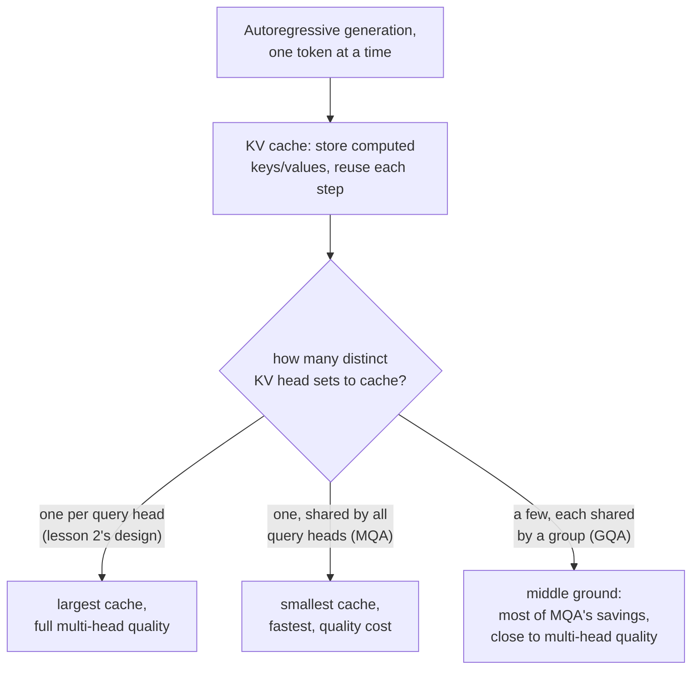

# Lição 17. Grouped-query attention e KV caching

**Ligação com a missão:** A lição 2 deu a cada head as suas próprias projeções de query, key e value, sem ainda nenhuma razão para tratá-las de modo diferente. Essa razão aparece no momento em que o modelo começa a gerar texto um token por vez: recalcular a key e o value de todo token anterior a cada passo de geração é trabalho desperdiçado, e, uma vez que armazená-los em cache se torna a correção óbvia, o próprio tamanho do cache é o que faz da **grouped-query** e da **multi-query attention** uma mudança arquitetural que vale derivar por si só, e não uma mera curiosidade.
**Fonte principal:** [Artigo científico: "GQA: Training Generalized Multi-Query Transformer Models from Multi-Head Checkpoints", Ainslie et al., 2023](https://arxiv.org/abs/2305.13245)
**Pré-requisitos:** [Lição 2](0002-multi-head-attention.md), [Lição 16](0016-swiglu-and-the-gated-feed-forward.md)

## Aquecimento

1. ▢ Por que heads de atenção diferentes podem acabar se especializando em tipos diferentes de relações entre posições, quando todos aplicam exatamente a mesma equação de atenção?

Verificação

Cada head tem as suas próprias matrizes de projeção, aprendidas de forma independente; aplicar a equação idêntica a versões projetadas de maneira diferente da mesma entrada permite que heads diferentes atendam a aspectos inteiramente diferentes da entrada.

2. ▢ Por que uma projeção linear final (`W_O`) é aplicada depois de concatenar os heads da multi-head attention, em vez de usar direto o vetor concatenado?

Verificação

A concatenação sozinha coloca a saída de cada head lado a lado, sem interação entre elas; a `W_O` permite que o modelo aprenda a combinar a informação dos heads separados em uma única representação unificada.

## Saiba isto

### Gerar um token por vez recalcula trabalho que nunca mudou

Um modelo que produz texto de forma autorregressiva gera um token, o acrescenta à sequência e gera o seguinte, repetindo até terminar. A cada novo passo, calcular a atenção do token mais recente exige a query desse token comparada com a key e o value de todo token anterior, exatamente as mesmas keys e values que já tinham sido calculados em cada passo anterior. Recalculá-los do zero a cada passo de geração, quando os tokens que os produzem não mudaram, é puro desperdício.

### O KV cache: armazenar o que não vai mudar, calcular apenas o que é novo

Um **KV cache** armazena os vetores de key e value de toda posição anterior depois de calculados, de modo que cada novo passo de geração só precisa calcular a key e o value do token mais recente e acrescentá-los ao cache, em vez de recalcular do zero as keys e values da sequência inteira. Isso transforma o custo por passo da atenção durante a geração, que crescia com o cálculo de key/value do comprimento total da sequência, em um custo que cresce com o de apenas um token novo, ao custo de o próprio cache ocupar memória que cresce com o comprimento da sequência.

### A multi-query e a grouped-query attention encolhem exatamente o que o cache precisa guardar

O tamanho do KV cache escala com quantos conjuntos distintos de vetores de key e value ele precisa armazenar, o que é determinado por quantas projeções separadas de key/value o modelo tem, uma por head de atenção no design da lição 2. A **multi-query attention (MQA)** reduz isso a um único head de key/value compartilhado, usado por todo head de query, encolhendo drasticamente o cache (e a largura de banda de memória necessária para lê-lo de volta a cada passo), a um custo que o enquadramento do próprio artigo declara com clareza: a MQA pode levar a degradação de qualidade em comparação com dar a cada head as suas próprias keys e values. A **grouped-query attention (GQA)** é o meio-termo proposto pelo artigo: um número intermediário de heads de key/value, mais de um e menos do que o número de heads de query, com grupos de heads de query compartilhando cada um um head de key/value. Isso mantém a maior parte da economia de tamanho de cache e de largura de banda da MQA, dando ao modelo mais representações distintas de key/value com que trabalhar do que um único head compartilhado permitiria.

### O uptraining transforma de forma barata um modelo multi-head existente em um modelo GQA

Em vez de treinar do zero um modelo GQA (ou MQA), a contribuição do próprio artigo é uma receita para converter um checkpoint multi-head comum, já treinado, em um que use grouped ou multi-query attention, usando uma pequena fração, cerca de 5 por cento, do compute que a execução original de pré-treinamento levou. O artigo relata que um modelo GQA com uptraining alcança uma qualidade próxima à do modelo multi-head original ao se aproximar da velocidade de inferência da MQA, que é exatamente a razão prática de a GQA ter deslocado o treinamento de um modelo multi-query separado, feito do zero: o custo de qualidade de ir até um único head de key/value compartilhado pode ser evitado sem descartar o investimento de treinamento de um modelo multi-head existente.

## Prática

1. ▢ Um modelo gera texto um token por vez. Por que recalcular os vetores de key e value de todo token anterior a cada novo passo de geração é um desperdício?

Dica

Considere se algo na key e no value de um token anterior, já gerado, de fato muda em um passo posterior.

Verificação

Os vetores de key e value de um token anterior não mudam depois de calculados; recalculá-los a cada passo posterior repete um trabalho cuja resposta já é conhecida, que é exatamente o que um KV cache existe para evitar, armazenando-os uma vez e reutilizando-os.

2. ▢ O que determina o tamanho que um KV cache precisa ter e por que a multi-query attention o reduz tanto em comparação com o design multi-head comum da lição 2?

Verificação

O tamanho do cache escala com quantos conjuntos distintos de heads de key/value precisam ser armazenados. O design da lição 2 dá a cada head de atenção as suas próprias projeções de key/value, então o cache precisa guardar um conjunto por head; a MQA reduz isso a um único head de key/value compartilhado, usado por todo head de query, reduzindo drasticamente o que precisa ser armazenado em cache e lido de volta a cada passo.

3. ▢ Por que o artigo da GQA descreve a grouped-query attention como um meio-termo, em vez de simplesmente recomendar a multi-query attention de uma vez?

Verificação

O único head de key/value compartilhado da multi-query attention pode levar a degradação de qualidade; a grouped-query attention usa um número intermediário de heads de key/value (mais de um, menos do que o número de heads de query), mantendo a maior parte dos benefícios de tamanho de cache e velocidade da MQA e dando ao modelo mais representações distintas de key/value, mais próximas da qualidade da multi-head attention.

4. ▢ Por que o artigo propõe fazer o "uptraining" de um checkpoint multi-head existente até um modelo GQA, em vez de sempre treinar um modelo GQA do zero?

Verificação

O uptraining converte um modelo multi-head já treinado usando apenas uma pequena fração (cerca de 5 por cento) do compute do pré-treinamento original, alcançando qualidade próxima à do original ao se aproximar da velocidade da MQA. Isso evita descartar o investimento de treinamento de um modelo existente só para obter os benefícios de inferência da grouped ou multi-query attention.

5. ▢ Qual afirmação descreve corretamente a relação entre KV caching, MQA e GQA?

    - a) Um KV cache existe para armazenar vetores de query, e não vetores de key e value
    - b) Um KV cache evita recalcular keys e values inalteradas a cada passo de geração; o seu tamanho escala com o número de conjuntos distintos de heads de key/value, que é exatamente o que a MQA (um head compartilhado) e a GQA (alguns heads compartilhados) reduzem, trocando alguma qualidade por tamanho de cache e velocidade
    - c) A grouped-query attention sempre iguala exatamente a qualidade da multi-head attention, sem nenhuma troca
    - d) O uptraining exige treinar um modelo novo do zero ao custo total de um pré-treinamento

Verificação

**b)** É a cadeia precisa de raciocínio que esta lição estabelece, do propósito do cache até o motivo de menos heads de key/value o encolherem. (a) é falsa: um KV cache armazena vetores de key e value, e não de query, já que as queries só são necessárias para o passo atual. (c) é falsa: a GQA é explicitamente uma troca, mais próxima da qualidade da multi-head do que a MQA, mas não idêntica a ela. (d) é falsa: todo o objetivo do uptraining é converter um checkpoint existente usando uma pequena fração do compute do pré-treinamento original.

## Prática no mundo real

- [ ] Para um modelo a que você tenha acesso (ou os detalhes de arquitetura publicados dele), confira se ele usa multi-head attention comum, MQA ou GQA e, se for GQA, quantos heads de key/value ele usa em relação aos seus heads de query.
- [ ] Estime a diferença de tamanho de KV cache entre um modelo multi-head hipotético de 32 heads de query e o mesmo modelo usando GQA com 8 heads de key/value, em termos de quantos conjuntos distintos de heads cada um precisa armazenar.
- [ ] Amanhã: leia por inteiro a seção de resultados da fonte principal e anote o quão perto a qualidade da GQA com uptraining chegou da do checkpoint multi-head original, e a que fração da velocidade da MQA.

## Para ir além

- [Artigo científico: "GQA: Training Generalized Multi-Query Transformer Models from Multi-Head Checkpoints", Ainslie et al., 2023](https://arxiv.org/abs/2305.13245)
- [Artigo científico: "Attention Is All You Need", Vaswani et al., 2017](https://arxiv.org/abs/1706.03762)
- [Recursos](../RESOURCES.md)

---

Não ficou claro? Releia a fonte principal no topo, já que esta lição a comprime e é na compressão que o entendimento escapa. Consulte o [glossário](../GLOSSARY.md) para qualquer termo que pareceu escorregadio.

Se o problema é a lição em si, e não o material, isso é um defeito: [abra uma issue](https://github.com/TokenCemetery/teach/issues).
