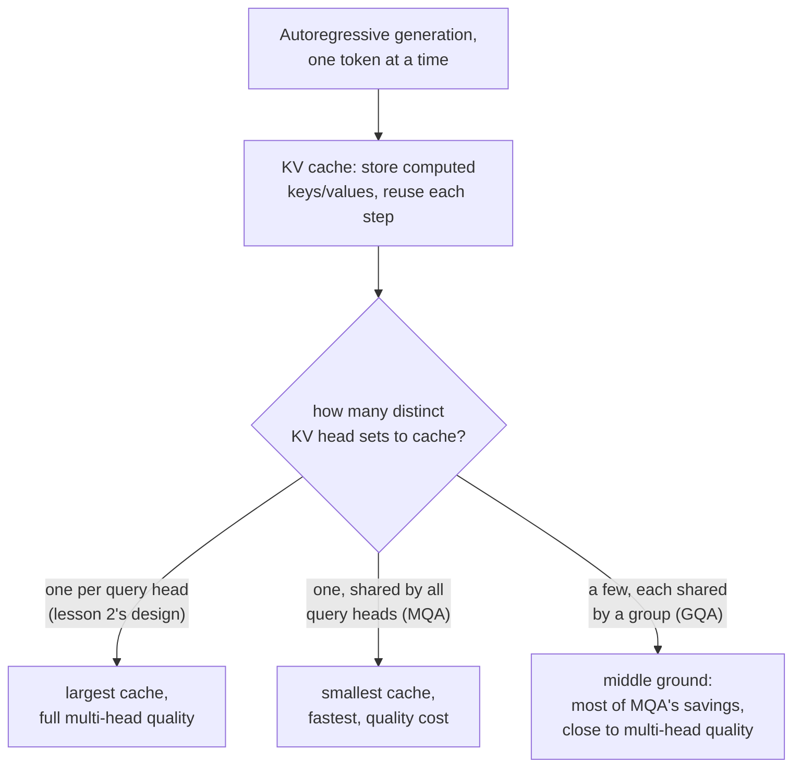

# Урок 17. Внимание с группировкой запросов и KV-кеширование

**Связь с целью курса:** Урок 2 дал каждой голове собственные проекции запроса, ключа и значения, и пока не было причин относиться к ним по-разному. Эта причина появляется, как только модель начинает генерировать текст по одному токену: пересчёт ключа и значения каждого предыдущего токена на каждом отдельном шаге генерации это напрасная работа, и когда их кеширование становится очевидным решением, именно размер самого кеша делает **внимание с группировкой запросов** (grouped-query attention) и **внимание с множественными запросами** (multi-query attention) достойными вывода как самостоятельное архитектурное изменение, а не просто любопытство.
**Первоисточник:** [Научная статья: "GQA: Training Generalized Multi-Query Transformer Models from Multi-Head Checkpoints", Ainslie et al., 2023](https://arxiv.org/abs/2305.13245)
**Предварительные требования:** [Урок 2](0002-multi-head-attention.md), [Урок 16](0016-swiglu-and-the-gated-feed-forward.md)

## Разминка

1. ▢ Почему разные головы внимания могут специализироваться на разных видах связей между позициями, хотя все они применяют одно и то же уравнение внимания?

Проверка

У каждой головы свои, независимо обученные матрицы проекций; применение одного и того же уравнения к по-разному спроецированным версиям одного входа позволяет разным головам обращать внимание на совершенно разные аспекты входа.

2. ▢ Почему после конкатенации голов многоголового внимания применяется финальная линейная проекция (`W_O`), а не используется сразу склеенный вектор?

Проверка

Одна конкатенация кладёт выходы голов рядом без какого-либо взаимодействия между ними; `W_O` позволяет модели научиться объединять информацию из разных голов в единое представление.

## Что нужно знать

### Генерация по одному токену пересчитывает работу, которая не менялась

Модель, порождающая текст авторегрессивно, генерирует один токен, добавляет его в последовательность и генерирует следующий, повторяя это до конца. На каждом новом шаге вычисление внимания для самого нового токена требует сравнить запрос этого токена с ключом и значением каждого предыдущего токена, а это в точности те же ключи и значения, которые уже были вычислены на каждом более раннем шаге. Заново вычислять их с нуля на каждом отдельном шаге генерации, когда токены, которые их порождают, не изменились, это чистая трата.

### KV-кеш: хранить то, что не изменится, вычислять только новое

**KV-кеш** (KV cache) хранит векторы ключей и значений каждой предыдущей позиции, как только они вычислены, так что на каждом новом шаге генерации нужно вычислить ключ и значение только для самого нового токена и добавить их в кеш, а не пересчитывать ключи и значения всей последовательности с нуля. Из-за этого стоимость внимания на шаг при генерации перестаёт расти вместе с вычислением ключей и значений для всей длины последовательности и растёт лишь на один новый токен, ценой того, что сам кеш занимает память, которая растёт вместе с длиной последовательности.

### Внимание с множественными запросами и с группировкой запросов сокращают именно то, что должен хранить кеш

Размер KV-кеша растёт вместе с тем, сколько различных наборов векторов ключей и значений ему приходится хранить, а это определяется тем, сколько у модели отдельных проекций ключей и значений, по одной на голову внимания в конструкции из урока 2. **Внимание с множественными запросами** (multi-query attention, MQA) сводит это к единственной общей голове ключей и значений, которую используют все головы запросов, резко сокращая кеш (и пропускную способность памяти, нужную для его чтения на каждом шаге), ценой, которую прямо называет формулировка самой статьи: MQA может приводить к ухудшению качества по сравнению с тем, чтобы дать каждой голове свои ключи и значения. **Внимание с группировкой запросов** (grouped-query attention, GQA) это предложенная статьёй золотая середина: промежуточное число голов ключей и значений, больше одной, но меньше числа голов запросов, причём группы голов запросов делят одну голову ключей и значений на группу. Это сохраняет большую часть выигрыша MQA по размеру кеша и пропускной способности, давая модели больше различных представлений ключей и значений, чем позволяла бы единственная общая голова.

### Дообучение по рецепту uptraining дёшево превращает существующую многоголовую модель в GQA-модель

Вместо обучения GQA-модели (или MQA-модели) с нуля вклад самой статьи это рецепт преобразования уже обученного обычного многоголового чекпоинта в модель с группировкой или множественными запросами, с использованием небольшой доли, около 5 процентов, вычислений, которые потребовал исходный запуск предобучения. Статья сообщает, что модель GQA после такого дообучения (uptraining) достигает качества, близкого к исходной многоголовой модели, и приближается к скорости инференса MQA, а это и есть практическая причина, по которой GQA вытеснила обучение отдельной MQA-модели с нуля: качественную цену перехода до одной общей головы ключей и значений можно не платить, не выбрасывая вложения в обучение существующей многоголовой модели.

## Практика

1. ▢ Модель генерирует текст по одному токену. Почему пересчёт векторов ключей и значений каждого предыдущего токена на каждом новом шаге генерации расточителен?

Подсказка

Подумайте, меняется ли на более позднем шаге хоть что-то в ключе и значении предыдущего, уже сгенерированного токена.

Проверка

Векторы ключа и значения предыдущего токена после вычисления не меняются; пересчёт их на каждом следующем шаге повторяет работу, ответ которой уже известен, и именно этого избегает KV-кеш, сохраняя их один раз и используя повторно.

2. ▢ Чем определяется, насколько большим должен быть KV-кеш, и почему внимание с множественными запросами сокращает его так сильно по сравнению с обычной многоголовой конструкцией из урока 2?

Проверка

Размер кеша растёт вместе с тем, сколько различных наборов голов ключей и значений нужно хранить. Конструкция из урока 2 даёт каждой голове внимания собственные проекции ключей и значений, поэтому кеш должен хранить по одному набору на голову; MQA сводит это к единственной общей голове ключей и значений, которую используют все головы запросов, резко сокращая то, что нужно кешировать и читать на каждом шаге.

3. ▢ Почему статья про GQA описывает внимание с группировкой запросов как золотую середину, а не просто рекомендует внимание с множественными запросами безоговорочно?

Проверка

Единственная общая голова ключей и значений в внимании с множественными запросами может приводить к ухудшению качества; внимание с группировкой запросов использует промежуточное число голов ключей и значений (больше одной, но меньше числа голов запросов), сохраняя большую часть выигрыша MQA по размеру кеша и скорости и давая модели больше различных представлений ключей и значений, ближе к качеству многоголового внимания.

4. ▢ Почему статья предлагает «uptraining» существующего многоголового чекпоинта в GQA-модель, а не всегда обучать GQA-модель с нуля?

Проверка

Uptraining преобразует уже обученную многоголовую модель, используя лишь небольшую долю (около 5 процентов) исходных вычислений на предобучение, и достигает качества, близкого к исходному, приближаясь к скорости MQA. Это позволяет не выбрасывать вложения в обучение существующей модели только ради преимуществ внимания с группировкой или множественными запросами на инференсе.

5. ▢ Какое утверждение правильно описывает отношения между KV-кешированием, MQA и GQA?

    - a) KV-кеш существует для хранения векторов запросов, а не векторов ключей и значений
    - b) KV-кеш позволяет не пересчитывать неизменившиеся ключи и значения на каждом шаге генерации; его размер растёт вместе с числом различных наборов голов ключей и значений, и именно его сокращают MQA (одна общая голова) и GQA (несколько общих голов), меняя часть качества на размер кеша и скорость
    - c) Внимание с группировкой запросов всегда в точности совпадает по качеству с многоголовым вниманием, без какого-либо компромисса
    - d) Uptraining требует обучать новую модель с нуля по полной стоимости предобучения

Проверка

**b)** Это точная цепочка рассуждений, которую устанавливает этот урок: от назначения кеша до того, почему меньшее число голов ключей и значений его сокращает. Вариант (a) неверен: KV-кеш хранит векторы ключей и значений, а не запросов, поскольку запросы нужны только на текущем шаге. Вариант (c) неверен: GQA это явный компромисс, ближе к качеству многоголового внимания, чем MQA, но не идентичный ему. Вариант (d) неверен: весь смысл uptraining в преобразовании существующего чекпоинта с использованием небольшой доли исходных вычислений на предобучение.

## Практика в реальной работе

- [ ] Для модели, к которой у вас есть доступ (или по опубликованным деталям её архитектуры), проверьте, использует ли она обычное многоголовое внимание, MQA или GQA, и если GQA, то сколько голов ключей и значений она использует относительно числа голов запросов.
- [ ] Оцените разницу в размере KV-кеша между гипотетической многоголовой моделью с 32 головами запросов и той же моделью с GQA и 8 головами ключей и значений в терминах того, сколько различных наборов голов приходится хранить каждой.
- [ ] Завтра: прочитайте целиком раздел с результатами первоисточника и отметьте, насколько близко качество GQA после uptraining подошло к исходному многоголовому чекпоинту и какой доли скорости MQA это достигло.

## Что почитать дальше

- [Научная статья: "GQA: Training Generalized Multi-Query Transformer Models from Multi-Head Checkpoints", Ainslie et al., 2023](https://arxiv.org/abs/2305.13245)
- [Научная статья: "Attention Is All You Need", Vaswani et al., 2017](https://arxiv.org/abs/1706.03762)
- [Ресурсы](../RESOURCES.md)

---

Не доходит? Перечитайте первоисточник в начале: этот урок его сжимает, а при сжатии понимание как раз и теряется. Загляните в [глоссарий](../GLOSSARY.md), если какой-то термин показался скользким.

Если неясен сам урок, а не материал, это дефект: [откройте issue](https://github.com/TokenCemetery/teach/issues).
