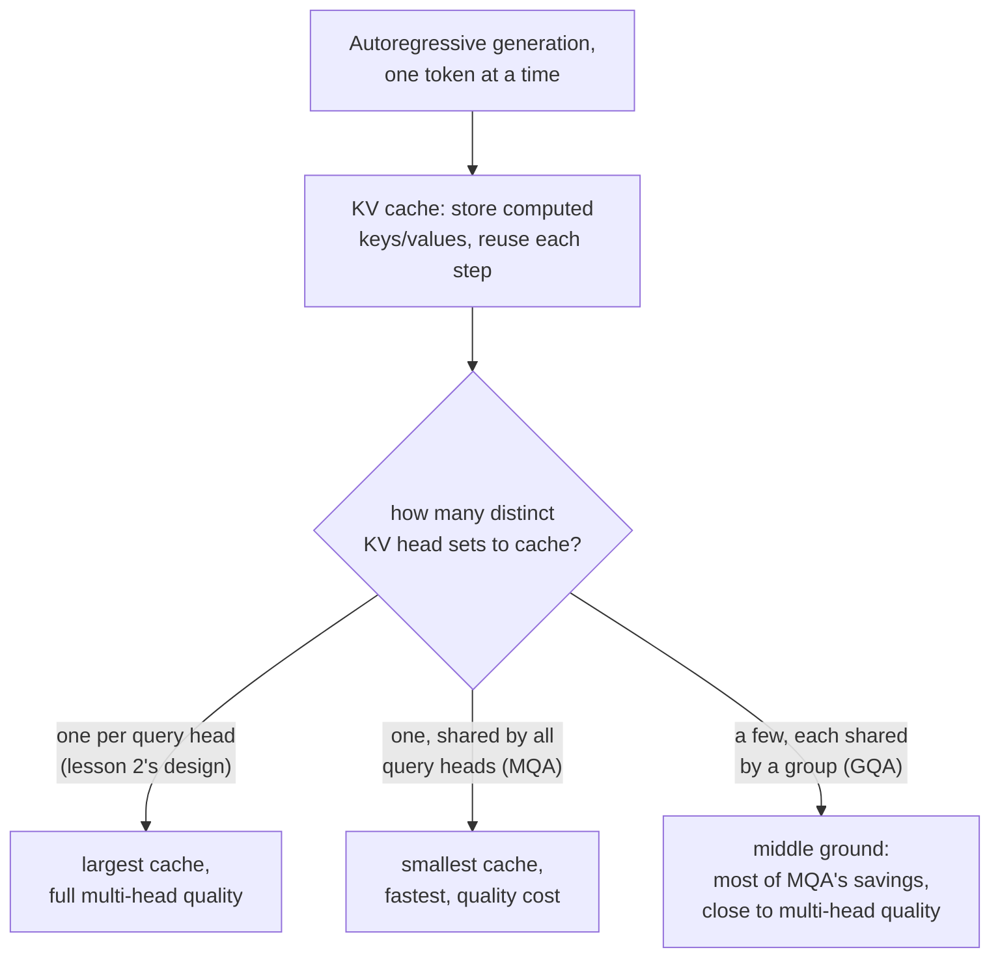

# 第 17 课：分组查询注意力与 KV 缓存

**使命关联:** 第 2 课给每个头都配了各自的查询、键和值投影，那时还没有理由区别对待它们。这个理由在模型开始一次生成一个 token 的那一刻就出现了：在每一个生成步骤里，重新计算之前每个 token 的键和值，是白白浪费的工作，而一旦缓存它们成为显而易见的修补办法，缓存本身的大小，就使得**分组查询注意力**和**多查询注意力**值得作为一种独立的架构改变来推导，而不只是一桩奇闻。
**主要来源:** [论文：“GQA: Training Generalized Multi-Query Transformer Models from Multi-Head Checkpoints”，Ainslie 等，2023](https://arxiv.org/abs/2305.13245)
**前置知识:** [第 2 课](0002-multi-head-attention.md)、[第 16 课](0016-swiglu-and-the-gated-feed-forward.md)

## 热身

1. ▢ 所有的头应用的都是完全相同的注意力方程，为什么不同的头最终还是会专门负责位置之间不同类型的关系？

检查

每个头都有自己独立学习得到的投影矩阵；把同一个方程应用在同一个输入的不同投影版本上，让不同的头可以关注输入的完全不同的方面。

2. ▢ 为什么在拼接多头注意力的各个头之后，还要再施加一个最终的线性投影（`W_O`），而不是直接使用拼接后的向量？

检查

单靠拼接，只是把每个头的输出并排放在一起，它们之间没有任何交互；`W_O` 让模型能够学会如何把各个独立的头的信息组合成一个统一的表示。

## 要点

### 一次生成一个 token，会重新计算从未改变过的工作

以自回归方式产生文本的模型，生成一个 token，把它追加到序列后面，再生成下一个，如此重复直到结束。在每个新的步骤里，为最新的 token 计算注意力，需要把这个 token 的查询与之前每个 token 的键和值做比较，而这些键和值，正是在之前每一步里已经算过的完全相同的那些。当产生它们的 token 没有改变时，在每一个生成步骤里都从头重新计算它们，纯属浪费。

### KV 缓存：存下不会变的，只计算新的

**KV 缓存**把之前每个位置的键向量和值向量，在算出来之后存起来，这样每个新的生成步骤，只需为最新的 token 计算键和值，并把它们追加到缓存里，而不必从头重新计算整个序列的键和值。这让生成期间注意力每一步的成本，从随整个序列长度的键/值计算量增长，变成只随一个新 token 的计算量增长，代价是缓存本身要占用随序列长度增长的内存。

### 多查询注意力和分组查询注意力恰恰缩小了缓存必须保存的东西

KV 缓存的大小，随它必须存储多少组不同的键向量和值向量而增长，这取决于模型有多少个独立的键/值投影，在第 2 课的设计里，每个注意力头一个。**多查询注意力**（MQA）把它减少到每个查询头共用的单个共享键/值头，极大地缩小了缓存（以及每一步把它读回来所需的内存带宽），代价是论文自己的表述直截了当地指出的：与让每个头都有自己的键和值相比，MQA 可能导致质量下降。**分组查询注意力**（GQA）是论文提出的折中方案：居中数量的键/值头，多于一个，少于查询头的数量，每组查询头共用一个键/值头。这保留了 MQA 在缓存大小和带宽上的大部分节省，同时让模型拥有比单个共享头所允许的更多不同的键/值表示可用。

### 追加训练（uptraining）能廉价地把现有的多头模型变成 GQA 模型

论文自己的贡献，不是从头训练 GQA（或 MQA）模型，而是给出一个配方，把一个已经训练好的、普通的多头检查点，转换成使用分组查询或多查询注意力的模型，只用原始预训练运行所需算力的一小部分，大约 5%。论文报告说，经过追加训练的 GQA 模型，质量接近原来的多头模型，同时接近 MQA 的推理速度，这恰恰是 GQA 取代单独从头训练一个多查询模型的实际理由：一路走到只有一个共享键/值头所付出的质量代价，可以避免，而不必抛弃现有多头模型的训练投入。

## 练习

1. ▢ 一个模型一次生成一个 token。为什么在每个新的生成步骤里，重新计算之前每个 token 的键向量和值向量是浪费的？

提示

想一想，之前已经生成的 token 的键和值，在后面的步骤里是否真的会发生变化。

检查

之前某个 token 的键向量和值向量，一旦算出来就不会变；在之后的每一步里重新计算它们，是在重复答案已知的工作，而 KV 缓存的存在，正是为了通过把它们存一次、反复使用，来避免这件事。

2. ▢ 是什么决定了 KV 缓存需要多大？为什么与第 2 课普通的多头设计相比，多查询注意力能把它缩小这么多？

检查

缓存的大小随必须存储多少组不同的键/值头集合而增长。第 2 课的设计给每个注意力头都配了它自己的键/值投影，所以缓存必须为每个头保存一组；MQA 把它缩减成每个查询头共用的单个共享键/值头，极大地减少了必须缓存、并在每一步读回的东西。

3. ▢ 为什么 GQA 论文把分组查询注意力描述为一种折中，而不是干脆直接推荐多查询注意力？

检查

多查询注意力的单个共享键/值头可能导致质量下降；分组查询注意力使用居中数量的键/值头（多于一个，少于查询头的数量），保留了 MQA 在缓存大小和速度上的大部分好处，同时让模型拥有更多不同的键/值表示，更接近多头注意力的质量。

4. ▢ 为什么论文提议把现有的多头检查点“追加训练”成 GQA 模型，而不是总是从头训练 GQA 模型？

检查

追加训练只用原始预训练算力的一小部分（大约 5%），就转换了一个已经训练好的多头模型，质量接近原来的，同时接近 MQA 的速度。这避免了仅仅为了获得分组查询或多查询注意力在推理上的好处，就抛弃现有模型的训练投入。

5. ▢ 下面哪一项说法正确描述了 KV 缓存、MQA 和 GQA 之间的关系？

    - a) KV 缓存是用来存储查询向量的，而不是键向量和值向量
    - b) KV 缓存避免在每个生成步骤里重新计算没有变化的键和值；它的大小随不同的键/值头集合的数量而增长，而这正是 MQA（一个共享头）和 GQA（少数几个共享头）所减少的，用一些质量换取缓存大小和速度
    - c) 分组查询注意力总是与多头注意力的质量完全一样，毫无取舍
    - d) 追加训练需要以完整的预训练成本，从头训练一个新模型

检查

**b)** 这正是本课确立的精确的推理链条，从缓存的目的，一直到为什么更少的键/值头会缩小它。(a) 是错的：KV 缓存存储的是键向量和值向量，而不是查询，因为查询只在当前这一步才需要。(c) 是错的：GQA 明确是一种取舍，比 MQA 更接近多头的质量，但并不与之相同。(d) 是错的：追加训练的全部意义，就是只用原始预训练算力的一小部分去转换一个现有的检查点。

## 实战练习

- [ ] 对一个你能接触到的模型（或它公布的架构细节），检查它用的是普通的多头注意力、MQA 还是 GQA，如果是 GQA，它相对于查询头使用了多少个键/值头。
- [ ] 就各自必须存储多少组不同的头集合来说，估计一个假设的 32 个查询头的多头模型，与使用 8 个键/值头的 GQA 的同一个模型，二者的 KV 缓存大小相差多少。
- [ ] 明天：完整阅读主要来源的结果部分，并记下经过追加训练的 GQA 的质量，离原来的多头检查点有多接近，速度又达到了 MQA 的多大比例。

## 延伸阅读

- [论文：“GQA: Training Generalized Multi-Query Transformer Models from Multi-Head Checkpoints”，Ainslie 等，2023](https://arxiv.org/abs/2305.13245)
- [论文：“Attention Is All You Need”，Vaswani 等，2017](https://arxiv.org/abs/1706.03762)
- [资源](../RESOURCES.md)

---

没学明白？请重读顶部的主要来源，因为本课是对它的压缩，而理解正是在压缩中流失的。如果有哪个术语觉得含糊，可以查看[术语表](../GLOSSARY.md)。

如果问题出在课程本身，而不是学习材料，那就是一个缺陷：[提交 issue](https://github.com/TokenCemetery/teach/issues)。
