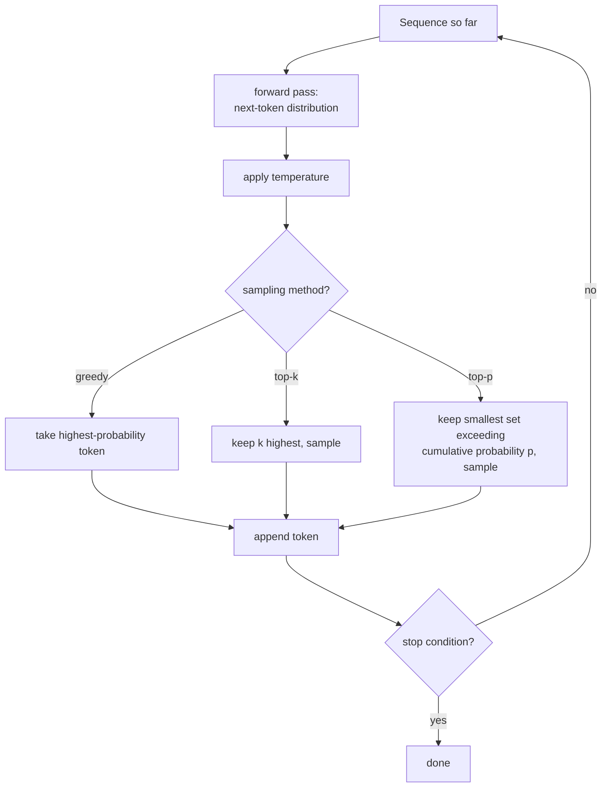

# Lección 18. Generación y muestreo

**Vínculo con la misión:** Cada lección hasta la etapa 4 construyó y entrenó un modelo que predice una distribución de probabilidad sobre el siguiente token. Ninguna preguntó qué hacer realmente con esa distribución para producir texto. Esta lección cierra esa brecha: ejecutar repetidamente el forward pass hecho a mano y elegir, en cada paso, qué token de la distribución predicha se añade realmente a la secuencia.
**Fuente principal:** [Paper: "The Curious Case of Neural Text Degeneration", Holtzman et al., 2019](https://arxiv.org/abs/1904.09751)
**Requisitos previos:** [Lección 9](0009-cross-entropy-loss.md), [Lección 17](0017-grouped-query-attention-and-kv-caching.md)

## Calentamiento

1. ▢ ¿Qué determina lo grande que tiene que ser una KV cache, y por qué la multi-query attention la reduce tanto?

Comprobación

El tamaño de la caché escala con cuántos conjuntos distintos de heads de key/value hay que almacenar; la multi-query attention lo reduce a un único head de key/value compartido que usan todos los heads de query, lo que reduce drásticamente lo que hay que guardar en caché y volver a leer en cada paso.

2. ▢ ¿De qué es el logaritmo negativo de la probabilidad la pérdida de entropía cruzada, durante el entrenamiento?

Comprobación

Del siguiente token real de los datos de entrenamiento, dado todo lo que lo precede; minimizar esta pérdida es lo que empuja al modelo a asignar mayor probabilidad al token que de verdad vino después.

## Qué debes saber

### El entrenamiento pregunta "qué probabilidad tenía la respuesta correcta"; la generación pregunta "qué token viene ahora"

La función de pérdida del entrenamiento puntúa al modelo según cuánta probabilidad asignó al token que *realmente estaba ahí* en los datos. La generación es una tarea completamente distinta: todavía no hay un token "realmente ahí", solo la distribución predicha por el modelo sobre cada siguiente token posible, y algo tiene que convertir esa distribución en una elección concreta antes de que la secuencia pueda ampliarse y volver a pasar por el modelo para el siguiente paso.

### Decodificación voraz: tomar siempre el token más probable

La **decodificación voraz** (greedy decoding) es la elección más simple posible: en cada paso, elegir el token al que la distribución del modelo asigna la mayor probabilidad, añadirlo y repetir. Es determinista, y produce siempre la misma salida para la misma entrada, y suena a la elección obviamente correcta, ya que el propio modelo dice que ese token es el más probable. El propio planteamiento del paper enuncia con claridad el resultado contraintuitivo: aunque la verosimilitud sea un buen objetivo de *entrenamiento*, usar la verosimilitud como objetivo de *decodificación* (tomar siempre el token más probable) lleva a un texto soso y extrañamente repetitivo, y no a la salida de alta calidad que sugeriría el éxito del objetivo de entrenamiento.

### La temperatura remodela la distribución antes de que ocurra nada más

La **temperatura** reescala los logits antes del softmax final que produce la distribución del siguiente token, y divide cada logit por un valor de temperatura `T` antes de aplicar el softmax. Una temperatura por debajo de 1 afila la distribución, haciendo que los tokens ya probables dominen aún más y acercando la generación al comportamiento de la decodificación voraz; una temperatura por encima de 1 la aplana, repartiendo la probabilidad de forma más pareja entre más tokens y haciendo más probable que se elijan opciones improbables. La temperatura no decide *qué* tokens son elegibles, solo lo picudas o planas que son sus probabilidades relativas antes de que corra el método de muestreo que venga después.

### Top-k y top-p truncan ambos la distribución, pero con reglas distintas

El **top-k sampling** conserva solo los `k` tokens de mayor probabilidad, descarta todo lo demás, renormaliza las probabilidades restantes y muestrea de ese conjunto de tamaño fijo. El **top-p (nucleus) sampling**, en cambio, conserva el conjunto más pequeño de tokens de mayor probabilidad cuya probabilidad acumulada supera un umbral `p`, cuantos tokens haga falta para ello, y muestrea de ese conjunto. La propia descripción del nucleus sampling en el paper recoge exactamente por qué varía el tamaño: muestrear de este "núcleo dinámico" permite diversidad mientras trunca de forma efectiva la cola poco fiable de la distribución, y se encontró que el texto resultante se ajustaba mejor a la calidad del texto humano, con una diversidad mejorada sin sacrificar fluidez ni coherencia, en comparación con tomar siempre el único token más probable.

### Un k fijo es el tamaño equivocado para una distribución que no tiene siempre la misma forma

La cantidad fija del top-k es exactamente lo que se construyó el top-p para corregir: en un paso donde el modelo está genuinamente seguro (solo dos o tres tokens son remotamente plausibles), un `k` fijo de 40 fuerza al muestreo a incluir decenas de tokens implausibles; en un paso donde el modelo está genuinamente indeciso (muchos tokens son todos más o menos plausibles), el mismo `k` fijo podría cortar tokens que merecían una oportunidad real. El umbral del top-p se adapta automáticamente a lo picuda o plana que es realmente la distribución en cada paso individual, que es la parte "dinámica" del núcleo que nombra el paper, en lugar de comprometerse con un único tamaño de corte fijo sin importar lo seguro que esté el modelo en ese momento concreto.

### Ejecutar el modelo hacia delante, un token cada vez, es lo que realmente es la generación

Producir texto con el modelo hecho a mano significa repetir un bucle: ejecutar el forward pass sobre la secuencia hasta ahora, tomar la distribución resultante sobre el siguiente token, aplicar la combinación de temperatura y muestreo top-k/top-p que esté configurada, muestrear (o elegir de forma voraz) un token, añadirlo a la secuencia y volver a pasar la secuencia ampliada por el modelo para el siguiente paso, hasta alcanzar una condición de parada (un token de fin de secuencia, o una longitud máxima). Cada lección anterior, la atención, el bloque, la pérdida, el optimizador, existe para que el forward pass de este único bucle produzca una distribución de la que valga la pena muestrear.

## Práctica

1. ▢ ¿Por qué describe el paper como contraintuitivo que la decodificación voraz produzca texto soso y repetitivo, dado que el modelo se entrenó específicamente para maximizar la verosimilitud?

Pista

Considera si el entrenamiento y la generación le están haciendo realmente al modelo la misma pregunta.

Comprobación

Que la verosimilitud sea un buen objetivo de entrenamiento (premiar al modelo por asignar alta probabilidad al siguiente token real de los datos reales) no implica que elegir siempre el único token de mayor probabilidad durante la generación produzca una buena salida; el hallazgo del paper es exactamente que son preguntas distintas, y maximizar siempre la verosimilitud en el momento de decodificar lleva a un texto soso y repetitivo a pesar de que el modelo esté bien entrenado.

2. ▢ Un equipo fija la temperatura en 0.5, muy por debajo de 1. ¿Qué efecto tiene esto sobre la distribución del siguiente token, y cambia qué tokens son elegibles para muestrearse?

Comprobación

Afila la distribución, haciendo que los tokens ya probables dominen aún más frente a los menos probables. Por sí sola no cambia qué tokens son elegibles; eso es trabajo del método de muestreo que sea (top-k, top-p o ninguno) que corre después de que la temperatura haya remodelado la distribución.

3. ▢ En un paso de generación, solo dos tokens son genuinamente plausibles; en otro paso, treinta tokens son todos más o menos plausibles. Usando un top-k fijo de 10 en ambos pasos, ¿qué sale mal en cada uno?

Comprobación

En el paso con dos tokens plausibles, un top-k de 10 fuerza la inclusión de 8 tokens implausibles que no deberían ser candidatos reales. En el paso con treinta tokens plausibles, un top-k de 10 corta 20 tokens que merecían genuinamente una oportunidad. Un k fijo no puede adaptarse a lo picuda o plana que es realmente la distribución en cada paso individual.

4. ▢ ¿Cómo evita el top-p (nucleus) sampling el problema concreto de la pregunta anterior?

Comprobación

El top-p conserva el conjunto más pequeño de tokens de mayor probabilidad cuya probabilidad acumulada supera un umbral `p`, cuantos tokens haga falta en ese paso concreto, en lugar de comprometerse con una cantidad fija. Esto deja que el conjunto elegible se encoja automáticamente cuando el modelo está seguro y crezca automáticamente cuando está indeciso, adaptándose a la forma real de la distribución en cada paso.

5. ▢ ¿Qué afirmación describe correctamente la relación entre la decodificación voraz, la temperatura, el top-k y el top-p?

    - a) La decodificación voraz produce el texto de mayor calidad, ya que elige siempre la predicción más probable del propio modelo
    - b) El determinismo de la decodificación voraz lleva a un texto soso y repetitivo; la temperatura remodela la agudeza de la distribución; el top-k trunca a una cantidad fija mientras que el top-p trunca a un conjunto dinámico, basado en la probabilidad acumulada, que se adapta a lo picuda que es la distribución en cada paso
    - c) La temperatura y el top-p deciden ambos qué tokens concretos son elegibles, y funcionan de forma idéntica
    - d) El top-k y el top-p producen siempre conjuntos elegibles idénticos, y difieren solo en la implementación

Comprobación

**b)** Ese es el papel preciso y distinto que cumple cada mecanismo. (a) es falsa: el propio hallazgo del paper es que la decodificación voraz lleva a un texto degenerado y repetitivo a pesar de que el modelo esté bien entrenado. (c) es falsa: la temperatura remodela la agudeza de las probabilidades sin decidir la elegibilidad; el top-k y el top-p son lo que decide el conjunto elegible. (d) es falsa: un top-k fijo y un top-p de probabilidad acumulada producen conjuntos elegibles de tamaño genuinamente distinto según la forma de la distribución en cada paso.

## Prácticas en el mundo real

- [ ] Implementa la decodificación voraz para tu modelo hecho a mano y genera una continuación corta a partir de un prompt; anota cualquier repetición o sosería en la salida.
- [ ] Implementa el muestreo top-k y top-p, genera a partir del mismo prompt con cada uno y compara la diversidad y la coherencia de las salidas con el resultado voraz.
- [ ] Mañana: lee la sección de la fuente principal que compara el nucleus sampling con el top-k y el beam search en la calidad del texto evaluada por humanos, y anota qué métrica usa para detectar la repetición.

## Para profundizar

- [Paper: "The Curious Case of Neural Text Degeneration", Holtzman et al., 2019](https://arxiv.org/abs/1904.09751)
- [Repo: nanoGPT, Karpathy](https://github.com/karpathy/nanoGPT)
- [Recursos](../RESOURCES.md)

---

¿No termina de quedar claro? Vuelve a leer la fuente primaria de arriba, ya que esta lección la comprime y en la compresión es donde se escapa la comprensión. Consulta el [glosario](../GLOSSARY.md) por si algún término te resultó resbaladizo.

Si lo poco claro es la propia lección y no el material, eso es un defecto: [abre un issue](https://github.com/TokenCemetery/teach/issues).
