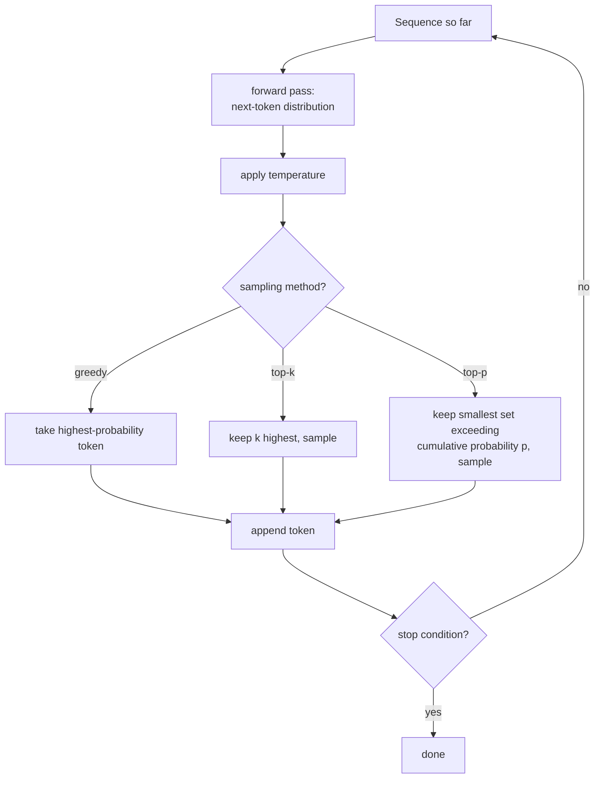

# Leçon 18. Génération et échantillonnage

**Lien avec la mission :** Chaque leçon jusqu'à l'étape 4 a construit et entraîné un modèle qui prédit une distribution de probabilité sur le token suivant. Aucune ne demandait ce qu'il faut réellement faire de cette distribution pour produire du texte. Cette leçon comble ce vide : exécuter à répétition la passe avant construite à la main, et choisir, à chaque étape, quel token de la distribution prédite est réellement ajouté à la séquence.
**Source primaire :** [Article : "The Curious Case of Neural Text Degeneration", Holtzman et al., 2019](https://arxiv.org/abs/1904.09751)
**Prérequis :** [Leçon 9](0009-cross-entropy-loss.md), [Leçon 17](0017-grouped-query-attention-and-kv-caching.md)

## Échauffement

1. ▢ Qu'est-ce qui détermine la taille nécessaire d'un KV cache, et pourquoi la multi-query attention la réduit-elle autant ?

Vérifier

La taille du cache dépend du nombre d'ensembles distincts de têtes de clés et de valeurs à stocker ; la multi-query attention réduit cela à une seule tête de clés et de valeurs partagée par toutes les têtes de requêtes, ce qui réduit drastiquement ce qu'il faut mettre en cache et relire à chaque étape.

2. ▢ De quoi la loss d'entropie croisée est-elle le logarithme négatif de la probabilité, pendant l'entraînement ?

Vérifier

Du token suivant réel des données d'entraînement, étant donné tout ce qui le précède ; minimiser cette loss est ce qui pousse le modèle à attribuer une probabilité plus élevée au token qui est effectivement venu ensuite.

## À savoir

### L'entraînement demande « quelle était la probabilité de la bonne réponse » ; la génération demande « quel token vient ensuite »

La fonction de loss de l'entraînement note le modèle selon la probabilité qu'il a attribuée au token qui était *réellement là* dans les données. La génération est une tâche entièrement différente : il n'existe pas encore de token « réellement là », seulement la distribution prédite par le modèle sur chaque token suivant possible, et il faut que quelque chose transforme cette distribution en un choix concret avant que la séquence puisse être prolongée et renvoyée dans le modèle pour l'étape suivante.

### Le décodage glouton : toujours prendre le token le plus probable

Le **décodage glouton** (greedy decoding) est le choix le plus simple possible : à chaque étape, prendre le token auquel la distribution du modèle attribue la plus forte probabilité, l'ajouter, et recommencer. Il est déterministe, produisant toujours la même sortie pour la même entrée, et il semble être le choix manifestement correct, puisque le modèle lui-même dit que ce token est le plus probable. La formulation de l'article énonce clairement le résultat contre-intuitif : même si la vraisemblance est un bon objectif d'*entraînement*, utiliser la vraisemblance comme objectif de *décodage* (toujours prendre le token le plus probable) mène à un texte fade et étrangement répétitif, et non à la sortie de grande qualité que le succès de l'objectif d'entraînement laisserait attendre.

### La température remodèle la distribution avant que quoi que ce soit d'autre se passe

La **température** met à l'échelle les logits avant le softmax final qui produit la distribution du token suivant, en divisant chaque logit par une valeur de température `T` avant d'appliquer le softmax. Une température inférieure à 1 accentue la distribution, ce qui rend les tokens déjà probables encore plus dominants et rapproche la génération du comportement du décodage glouton ; une température supérieure à 1 l'aplatit, ce qui répartit la probabilité plus uniformément sur davantage de tokens et rend les choix improbables plus susceptibles d'être retenus. La température ne décide pas *quels* tokens sont éligibles, seulement à quel point leurs probabilités relatives sont piquées ou plates avant que la méthode d'échantillonnage qui suit s'exécute.

### Top-k et top-p tronquent tous deux la distribution, mais selon des règles différentes

L'**échantillonnage top-k** ne garde que les `k` tokens de plus forte probabilité, écarte tout le reste, renormalise les probabilités restantes et échantillonne dans cet ensemble de taille fixe. L'**échantillonnage top-p (nucleus)** garde au contraire le plus petit ensemble de tokens de plus forte probabilité dont la probabilité cumulée dépasse un seuil `p`, quel que soit le nombre de tokens que cela demande, et échantillonne dans cet ensemble. La description que l'article donne de l'échantillonnage nucleus saisit exactement pourquoi la taille varie : échantillonner dans ce « nucleus dynamique » permet la diversité tout en tronquant efficacement la queue peu fiable de la distribution, et l'on a constaté que le texte obtenu correspondait mieux à la qualité du texte humain, avec une diversité accrue sans sacrifier la fluidité ni la cohérence, comparé au fait de toujours prendre le token le plus probable.

### Un k fixe est la mauvaise taille pour une distribution qui n'a pas toujours la même forme

Le nombre fixe du top-k est exactement ce que le top-p a été conçu pour corriger : à une étape où le modèle est réellement confiant (seuls deux ou trois tokens sont à peu près plausibles), un `k` fixe de 40 force l'échantillonnage à inclure des dizaines de tokens invraisemblables ; à une étape où le modèle est réellement incertain (beaucoup de tokens sont tous à peu près plausibles), le même `k` fixe pourrait écarter des tokens qui méritaient une vraie chance. Le seuil du top-p s'adapte automatiquement à la forme plus ou moins piquée ou plate de la distribution à chaque étape, ce qui est la partie « dynamique » du nucleus que nomme l'article, au lieu de s'engager sur une seule taille de coupure fixe quelle que soit la confiance du modèle à ce moment précis.

### Exécuter le modèle vers l'avant, un token à la fois, c'est ce qu'est réellement la génération

Produire du texte avec le modèle construit à la main revient à répéter une seule boucle : exécuter la passe avant sur la séquence jusqu'ici, prendre la distribution obtenue sur le token suivant, appliquer la combinaison de température et d'échantillonnage top-k/top-p configurée, échantillonner (ou choisir gloutonnement) un token, l'ajouter à la séquence, et renvoyer la séquence prolongée dans le modèle pour l'étape suivante, jusqu'à ce qu'une condition d'arrêt (un token de fin de séquence, ou une longueur maximale) soit atteinte. Toutes les leçons précédentes, l'attention, le bloc, la loss, l'optimiseur, existent pour que la passe avant de cette unique boucle produise une distribution qui vaille la peine d'être échantillonnée.

## Pratique

1. ▢ Pourquoi l'article juge-t-il contre-intuitif que le décodage glouton produise un texte fade et répétitif, étant donné que le modèle a été entraîné précisément à maximiser la vraisemblance ?

Indice

Demandez-vous si l'entraînement et la génération posent réellement la même question au modèle.

Vérifier

Le fait que la vraisemblance soit un bon objectif d'entraînement (récompenser le modèle pour avoir attribué une forte probabilité au token suivant réel dans des données réelles) n'implique pas que choisir toujours le token de plus forte probabilité pendant la génération produise une bonne sortie ; la conclusion de l'article est précisément que ce sont des questions différentes, et que maximiser toujours la vraisemblance au moment du décodage mène à un texte fade et répétitif bien que le modèle soit bien entraîné.

2. ▢ Une équipe règle la température à 0.5, bien en dessous de 1. Quel effet cela a-t-il sur la distribution du token suivant, et cela change-t-il quels tokens sont éligibles à l'échantillonnage ?

Vérifier

Cela accentue la distribution, ce qui rend les tokens déjà probables encore plus dominants par rapport aux moins probables. Cela ne change pas à lui seul quels tokens sont éligibles ; c'est le rôle de la méthode d'échantillonnage (top-k, top-p, ou aucune) qui s'exécute une fois que la température a remodelé la distribution.

3. ▢ À une étape de génération, seuls deux tokens sont réellement plausibles ; à une autre, trente tokens sont tous à peu près plausibles. Avec un top-k fixe de 10 aux deux étapes, qu'est-ce qui ne va pas à chacune ?

Vérifier

À l'étape à deux tokens plausibles, un top-k de 10 force l'inclusion de 8 tokens invraisemblables qui ne devraient pas être de vrais candidats. À l'étape à trente tokens plausibles, un top-k de 10 écarte 20 tokens qui méritaient réellement une chance. Un k fixe ne peut pas s'adapter à la forme plus ou moins piquée ou plate de la distribution à chaque étape.

4. ▢ Comment l'échantillonnage top-p (nucleus) évite-t-il le problème précis de la question précédente ?

Vérifier

Le top-p garde le plus petit ensemble de tokens de plus forte probabilité dont la probabilité cumulée dépasse un seuil `p`, quel que soit le nombre de tokens que cela demande à cette étape précise, au lieu de s'engager sur un nombre fixe. Cela permet à l'ensemble éligible de se réduire automatiquement quand le modèle est confiant et de s'élargir automatiquement quand il est incertain, en s'adaptant à la forme réelle de la distribution à chaque étape.

5. ▢ Quelle affirmation décrit correctement la relation entre le décodage glouton, la température, le top-k et le top-p ?

    - a) Le décodage glouton produit le texte de la meilleure qualité, puisqu'il choisit toujours la prédiction la plus probable du modèle lui-même
    - b) Le déterminisme du décodage glouton mène à un texte fade et répétitif ; la température remodèle l'acuité de la distribution ; le top-k tronque à un nombre fixe tandis que le top-p tronque à un ensemble dynamique, fondé sur la probabilité cumulée, qui s'adapte au caractère plus ou moins piqué de la distribution à chaque étape
    - c) La température et le top-p décident tous deux quels tokens précis sont éligibles, en fonctionnant de façon identique
    - d) Le top-k et le top-p produisent toujours des ensembles éligibles identiques, ne différant que par l'implémentation

Vérifier

**b)** C'est le rôle précis et distinct de chaque mécanisme. (a) est faux : la conclusion de l'article est que le décodage glouton mène à un texte dégénéré et répétitif bien que le modèle soit bien entraîné. (c) est faux : la température remodèle l'acuité des probabilités sans décider de l'éligibilité ; ce sont le top-k et le top-p qui décident de l'ensemble éligible. (d) est faux : un top-k fixe et un top-p fondé sur la probabilité cumulée produisent des ensembles éligibles de tailles réellement différentes selon la forme de la distribution à chaque étape.

## Exercices en situation réelle

- [ ] Implémentez le décodage glouton pour votre modèle construit à la main et générez une courte suite à partir d'un prompt ; notez toute répétition ou fadeur dans la sortie.
- [ ] Implémentez l'échantillonnage top-k et top-p, générez à partir du même prompt avec chacun, et comparez la diversité et la cohérence des sorties au résultat glouton.
- [ ] Demain : lisez la section de la source primaire qui compare l'échantillonnage nucleus au top-k et à la beam search sur la qualité d'un texte évaluée par des humains, et notez quelle métrique elle utilise pour détecter la répétition.

## Pour aller plus loin

- [Article : "The Curious Case of Neural Text Degeneration", Holtzman et al., 2019](https://arxiv.org/abs/1904.09751)
- [Dépôt : nanoGPT, Karpathy](https://github.com/karpathy/nanoGPT)
- [Ressources](../RESOURCES.md)

---

Ça ne passe pas ? Relisez la source primaire en haut de page, car cette leçon la condense et c'est dans la condensation que la compréhension s'échappe. Consultez le [glossaire](../GLOSSARY.md) pour tout terme qui vous a paru glissant.

Si c'est la leçon elle-même qui n'est pas claire plutôt que la matière, c'est un défaut : [ouvrez une issue](https://github.com/TokenCemetery/teach/issues).
