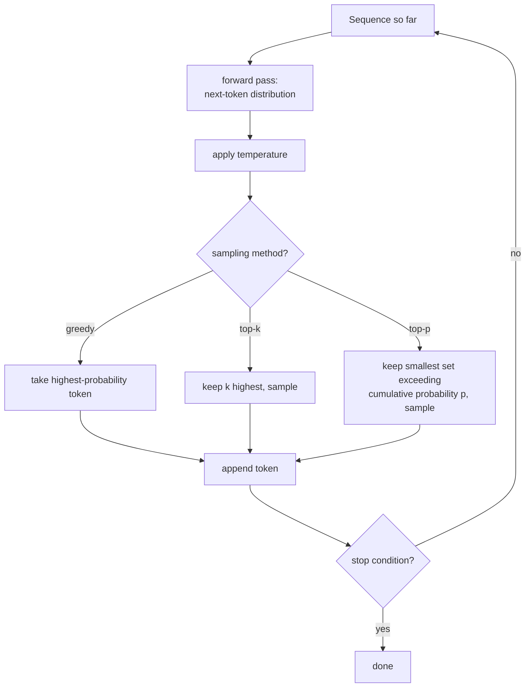

# पाठ 18. Generation और Sampling

**मिशन से संबंध:** चरण 4 तक का हर पाठ ऐसा model बनाता और train करता रहा जो अगले token पर probability distribution predict करता है। किसी ने यह नहीं पूछा कि text बनाने के लिए उस distribution का असल में क्या करना है। यह पाठ वह खाई पाटता है: हाथ से बने forward pass को बार-बार चलाना, और हर step पर चुनना कि predicted distribution का कौन-सा token असल में sequence में जुड़ेगा।
**मुख्य स्रोत:** [पेपर: "The Curious Case of Neural Text Degeneration", Holtzman et al., 2019](https://arxiv.org/abs/1904.09751)
**पूर्व-आवश्यकताएँ:** [पाठ 9](0009-cross-entropy-loss.md), [पाठ 17](0017-grouped-query-attention-and-kv-caching.md)

## वार्म-अप

1. ▢ KV cache को कितना बड़ा होना पड़ता है यह क्या तय करता है, और multi-query attention उसे इतना क्यों घटा देता है?

जाँचें

Cache का आकार इससे तय होता है कि key/value head के कितने अलग सेट सहेजने पड़ते हैं; multi-query attention इसे हर query head द्वारा इस्तेमाल होने वाले एक अकेले साझा key/value head तक घटा देता है, जिससे जो cache करना और हर step पर वापस पढ़ना पड़ता है वह बहुत घट जाता है।

2. ▢ Training के दौरान cross-entropy loss किसकी ऋणात्मक log probability है?

जाँचें

Training data के असली अगले token की, उससे पहले की हर चीज़ को देखते हुए; इस loss को घटाना ही model को उस token को ज़्यादा probability देने के लिए धकेलता है जो असल में अगला आया।

## यह जानें

### Training पूछती है "सही उत्तर कितना संभावित था"; generation पूछती है "अगला कौन-सा token आए"

Training का loss function model को इस आधार पर आँकता है कि उसने उस token को कितनी probability दी जो data में *असल में मौजूद* था। Generation बिल्कुल अलग काम है: वहाँ अभी कोई "असल में मौजूद" token नहीं है, सिर्फ़ model का हर संभव अगले token पर predicted distribution है, और sequence को बढ़ाकर अगले step के लिए model से दोबारा गुज़ारने से पहले किसी चीज़ को उस distribution को एक ठोस चुनाव में बदलना होता है।

### Greedy decoding: हमेशा सबसे संभावित token लें

**Greedy decoding** सबसे सरल संभव चुनाव है: हर step पर model का distribution जिस token को सबसे ज़्यादा probability दे उसे चुनें, जोड़ें, और दोहराएँ। यह deterministic है, एक ही input पर हमेशा एक ही output देता है, और साफ़ तौर पर सही चुनाव जैसा लगता है, क्योंकि model ख़ुद कहता है कि वह token सबसे संभावित है। पेपर का अपना कथन उलटे लगने वाले नतीजे को साफ़ कहता है: भले ही likelihood अच्छा *training* objective है, likelihood को *decoding* objective बनाने (हमेशा सबसे संभावित token लेने) से ऐसा text मिलता है जो फीका और अजीब ढंग से दोहराव वाला है, उस ऊँची गुणवत्ता वाले output जैसा नहीं जिसकी उम्मीद training objective की सफलता से होती।

### Temperature बाक़ी सब से पहले distribution का आकार बदल देता है

**Temperature** अगले-token distribution बनाने वाले अंतिम softmax से पहले logits को rescale करता है, softmax लगाने से पहले हर logit को temperature मान `T` से भाग देकर। 1 से कम temperature distribution को नुकीला करता है, पहले से संभावित tokens को और हावी बनाता है और generation को greedy के व्यवहार के पास ले जाता है; 1 से ऊपर temperature उसे चपटा करता है, probability को ज़्यादा tokens में ज़्यादा बराबरी से फैलाता है और असंभावित चुनावों के चुने जाने की संभावना बढ़ाता है। Temperature यह तय नहीं करता कि *कौन-से* tokens चुने जाने के योग्य हैं, सिर्फ़ यह कि उनकी सापेक्ष probabilities कितनी नुकीली या चपटी हैं, उससे पहले कि अगली sampling विधि चले।

### Top-k और top-p दोनों distribution को छाँटते हैं, पर अलग नियमों से

**Top-k sampling** सिर्फ़ `k` सबसे ज़्यादा probability वाले tokens रखती है, बाक़ी सब हटा देती है, बची हुई probabilities को दोबारा normalize करती है, और उस तय आकार के सेट से sample करती है। **Top-p (nucleus) sampling** इसके बजाय सबसे ज़्यादा probability वाले tokens का वह सबसे छोटा सेट रखती है जिनकी संचयी probability एक threshold `p` से ऊपर निकल जाए, चाहे उसमें जितने भी tokens लगें, और उस सेट से sample करती है। Nucleus sampling का पेपर का अपना वर्णन ठीक यही पकड़ता है कि आकार क्यों बदलता है: इस "गतिशील nucleus" से sample करना distribution की अविश्वसनीय पूँछ को असरदार रूप से छाँटते हुए विविधता की गुंजाइश देता है, और नतीजे वाला text मानव text की गुणवत्ता से बेहतर मेल खाता पाया गया, यानी fluency और सुसंगति की क़ीमत पर नहीं बल्कि बढ़ी हुई विविधता के साथ, हमेशा अकेला सबसे संभावित token लेने की तुलना में।

### तय k उस distribution के लिए ग़लत आकार है जो हमेशा एक ही शक्ल का नहीं होता

Top-k की तय गिनती ठीक वही है जिसे ठीक करने के लिए top-p बनाया गया: जिस step पर model सचमुच आश्वस्त है (सिर्फ़ दो-तीन tokens थोड़े भी संभावित हैं), वहाँ 40 का तय `k` sampling में दर्जनों असंभावित tokens शामिल करवा देता है; जिस step पर model सचमुच अनिश्चित है (कई tokens लगभग बराबर संभावित हैं), वहाँ वही तय `k` उन tokens को काट सकता है जो असली मौक़े के हक़दार थे। Top-p का threshold अपने-आप इसके हिसाब से ढल जाता है कि हर अलग step पर distribution असल में कितना नुकीला या चपटा है, और यही nucleus का वह "गतिशील" हिस्सा है जिसका पेपर नाम लेता है, बजाय इसके कि model उस ख़ास क्षण में कितना आश्वस्त है इसकी परवाह किए बिना एक तय cutoff आकार पर अड़े रहा जाए।

### Model को एक बार में एक token आगे चलाना ही असल में generation है

हाथ से बने model से text बनाने का मतलब एक loop दोहराना है: अब तक की sequence पर forward pass चलाएँ, अगले token पर नतीजे वाला distribution लें, temperature और top-k/top-p sampling का जो भी संयोजन configure है वह लगाएँ, एक token sample करें (या greedy चुनें), उसे sequence में जोड़ें, और बढ़ी हुई sequence को अगले step के लिए model से दोबारा गुज़ारें, जब तक कोई रुकने की शर्त (end-of-sequence token, या अधिकतम लंबाई) न आ जाए। पहले के हर पाठ, attention, block, loss, optimizer, का होना इसी एक loop के forward pass को ऐसा distribution बनाने लायक़ बनाने के लिए है जिससे sample करना सार्थक हो।

## अभ्यास

1. ▢ पेपर यह उलटा क्यों बताता है कि greedy decoding फीका, दोहराव वाला text बनाता है, जबकि model को ख़ास तौर पर likelihood बढ़ाने के लिए train किया गया था?

संकेत

सोचें कि क्या training और generation असल में model से एक ही सवाल पूछ रहे हैं।

जाँचें

Likelihood का अच्छा training objective होना (model को असली data के असली अगले token को ऊँची probability देने पर इनाम देना) यह नहीं बताता कि generation के दौरान हमेशा अकेला सबसे ज़्यादा probability वाला token चुनने से अच्छा output बनता है; पेपर का नतीजा ठीक यही है कि ये अलग सवाल हैं, और decoding के समय हमेशा likelihood को maximize करना, model के अच्छी तरह train होने के बावजूद, फीके, दोहराव वाले text की ओर ले जाता है।

2. ▢ एक टीम temperature 0.5 पर सेट करती है, 1 से काफ़ी नीचे। इसका अगले-token distribution पर क्या असर होता है, और क्या यह बदलता है कि कौन-से tokens sample होने के योग्य हैं?

जाँचें

वह distribution को नुकीला करता है, पहले से संभावित tokens को कम संभावित वालों के मुक़ाबले और हावी बनाता है। वह अपने-आप यह नहीं बदलता कि कौन-से tokens योग्य हैं; यह उस sampling विधि (top-k, top-p, या कोई नहीं) का काम है जो temperature द्वारा distribution का आकार बदलने के बाद चलती है।

3. ▢ एक generation step पर सिर्फ़ दो tokens सचमुच संभावित हैं; दूसरे step पर तीस tokens लगभग बराबर संभावित हैं। दोनों steps पर 10 का तय top-k इस्तेमाल करने पर हर एक पर क्या गड़बड़ होती है?

जाँचें

दो-संभावित-tokens वाले step पर 10 का top-k 8 असंभावित tokens को शामिल करवा देता है जो असली उम्मीदवार नहीं होने चाहिए। तीस-संभावित-tokens वाले step पर 10 का top-k 20 ऐसे tokens को काट देता है जो असली मौक़े के हक़दार थे। तय k इसके हिसाब से ढल नहीं सकता कि हर अलग step पर distribution असल में कितना नुकीला या चपटा है।

4. ▢ Top-p (nucleus) sampling पिछले सवाल की ख़ास समस्या से कैसे बचती है?

जाँचें

Top-p सबसे ज़्यादा probability वाले tokens का वह सबसे छोटा सेट रखती है जिनकी संचयी probability threshold `p` से ऊपर निकल जाए, उस ख़ास step पर चाहे जितने tokens लगें, एक तय गिनती पर अड़े रहने के बजाय। इससे योग्य सेट model के आश्वस्त होने पर अपने-आप सिकुड़ जाता है और अनिश्चित होने पर अपने-आप बढ़ जाता है, हर step पर distribution के असली आकार के हिसाब से ढलते हुए।

5. ▢ कौन-सा दावा greedy decoding, temperature, top-k और top-p के संबंध का सही वर्णन करता है?

    - a) Greedy decoding सबसे ऊँची गुणवत्ता का text बनाता है, क्योंकि वह हमेशा model की अपनी सबसे संभावित prediction चुनता है
    - b) Greedy decoding की determinism फीके, दोहराव वाले text की ओर ले जाती है; temperature distribution की तीक्ष्णता का आकार बदलता है; top-k तय गिनती तक छाँटता है जबकि top-p गतिशील, संचयी-probability-आधारित सेट तक छाँटता है जो हर step पर distribution के नुकीलेपन के हिसाब से ढलता है
    - c) Temperature और top-p दोनों तय करते हैं कि कौन-से ख़ास tokens योग्य हैं, और बिल्कुल एक जैसे काम करते हैं
    - d) Top-k और top-p हमेशा एक जैसे योग्य सेट बनाते हैं, बस implementation में अलग हैं

जाँचें

**b)** हर तंत्र की यही सटीक, अलग भूमिका है। (a) ग़लत है: पेपर का अपना नतीजा है कि model के अच्छी तरह train होने के बावजूद greedy decoding बिगड़े, दोहराव वाले text की ओर ले जाता है। (c) ग़लत है: temperature योग्यता तय किए बिना probability की तीक्ष्णता का आकार बदलता है; योग्य सेट top-k और top-p तय करते हैं। (d) ग़लत है: तय top-k और संचयी-probability वाला top-p हर step पर distribution के आकार के हिसाब से सचमुच अलग आकार के योग्य सेट बनाते हैं।

## असली दुनिया का अभ्यास

- [ ] अपने हाथ से बने model के लिए greedy decoding लागू करें और किसी prompt से छोटा continuation generate करें; output में किसी दोहराव या फीकेपन पर ध्यान दें।
- [ ] Top-k और top-p sampling लागू करें, उसी prompt से हर एक के साथ generate करें, और outputs की विविधता और सुसंगति की तुलना greedy नतीजे से करें।
- [ ] कल: मुख्य स्रोत का वह खंड पढ़ें जो मानव-मूल्यांकित text गुणवत्ता पर nucleus sampling की तुलना top-k और beam search से करता है, और ध्यान दें कि दोहराव पकड़ने के लिए वह कौन-सा metric इस्तेमाल करता है।

## आगे बढ़ने के लिए

- [पेपर: "The Curious Case of Neural Text Degeneration", Holtzman et al., 2019](https://arxiv.org/abs/1904.09751)
- [Repo: nanoGPT, Karpathy](https://github.com/karpathy/nanoGPT)
- [संसाधन](../RESOURCES.md)

---

बात नहीं बन रही? ऊपर दिए मुख्य स्रोत को दोबारा पढ़ें, क्योंकि यह पाठ उसे संक्षिप्त करता है और समझ संक्षेप में ही रिसती है। जो शब्द फिसलन भरा लगे, उसके लिए [शब्दावली](../GLOSSARY.md) देखें।

अगर दिक़्क़त सामग्री की नहीं बल्कि पाठ की ही है, तो वह एक खोट है: [issue खोलें](https://github.com/TokenCemetery/teach/issues)।
