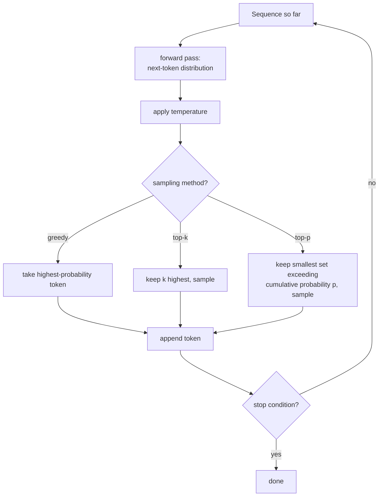

# Lição 18. Geração e amostragem

**Ligação com a missão:** Toda lição até a etapa 4 construiu e treinou um modelo que prevê uma distribuição de probabilidade sobre o próximo token. Nenhuma delas perguntou o que de fato fazer com essa distribuição para produzir texto. Esta lição fecha essa lacuna: rodar o forward pass construído à mão repetidamente e escolher, a cada passo, qual token da distribuição prevista de fato é acrescentado à sequência.
**Fonte principal:** [Artigo científico: "The Curious Case of Neural Text Degeneration", Holtzman et al., 2019](https://arxiv.org/abs/1904.09751)
**Pré-requisitos:** [Lição 9](0009-cross-entropy-loss.md), [Lição 17](0017-grouped-query-attention-and-kv-caching.md)

## Aquecimento

1. ▢ O que determina o tamanho que um KV cache precisa ter e por que a multi-query attention o reduz tanto?

Verificação

O tamanho do cache escala com quantos conjuntos distintos de heads de key/value precisam ser armazenados; a multi-query attention reduz isso a um único head de key/value compartilhado, usado por todo head de query, reduzindo drasticamente o que precisa ser armazenado em cache e lido de volta a cada passo.

2. ▢ De que a loss de cross-entropy é o log de probabilidade negativo, durante o treinamento?

Verificação

Do próximo token real nos dados de treinamento, dado tudo o que veio antes dele; minimizar essa loss é o que leva o modelo a atribuir maior probabilidade ao token que de fato veio a seguir.

## Saiba isto

### O treinamento pergunta "quão provável era a resposta certa"; a geração pergunta "que token vem a seguir"

A função de loss do treinamento avalia o modelo pela probabilidade que ele atribuiu ao token que *de fato estava lá* nos dados. A geração é uma tarefa completamente diferente: ainda não existe um token "que de fato esteja lá", apenas a distribuição prevista pelo modelo sobre todo próximo token possível, e algo precisa transformar essa distribuição em uma escolha concreta antes que a sequência possa ser estendida e realimentada no modelo para o passo seguinte.

### Greedy decoding: sempre pegar o token mais provável

O **greedy decoding** é a escolha mais simples possível: a cada passo, pegar o token a que a distribuição do modelo atribui a maior probabilidade, acrescentá-lo e repetir. É determinístico, produzindo sempre a mesma saída para a mesma entrada, e soa como a escolha obviamente correta, já que o próprio modelo diz que aquele token é o mais provável. O enquadramento do próprio artigo declara com clareza o resultado contraintuitivo: embora a likelihood seja um bom objetivo de *treinamento*, usar a likelihood como objetivo de *decodificação* (sempre pegar o token mais provável) leva a um texto insípido e estranhamente repetitivo, e não à saída de alta qualidade que o sucesso do objetivo de treinamento sugeriria.

### A temperatura remodela a distribuição antes de qualquer outra coisa acontecer

A **temperatura** reescala os logits antes do softmax final que produz a distribuição de próximo token, dividindo cada logit por um valor de temperatura `T` antes de aplicar o softmax. Uma temperatura abaixo de 1 afia a distribuição, tornando os tokens já prováveis ainda mais dominantes e levando a geração para mais perto do comportamento do greedy; uma temperatura acima de 1 a achata, espalhando a probabilidade de modo mais uniforme por mais tokens e tornando mais provável que escolhas improváveis sejam sorteadas. A temperatura não decide *quais* tokens são elegíveis para escolha, apenas o quão concentradas ou planas estão as suas probabilidades relativas antes de qualquer método de amostragem que rode em seguida.

### Top-k e top-p truncam ambos a distribuição, mas por regras diferentes

O **top-k sampling** mantém apenas os `k` tokens de maior probabilidade, descarta todo o resto, renormaliza as probabilidades restantes e amostra desse conjunto de tamanho fixo. O **top-p (nucleus) sampling**, em vez disso, mantém o menor conjunto de tokens de maior probabilidade cuja probabilidade acumulada ultrapassa um limiar `p`, quantos tokens isso acabe exigindo, e amostra desse conjunto. A descrição do próprio artigo sobre o nucleus sampling captura exatamente por que o tamanho varia: amostrar desse "núcleo dinâmico" permite diversidade enquanto trunca de forma eficaz a cauda não confiável da distribuição, e constatou-se que o texto resultante correspondia melhor à qualidade do texto humano, com diversidade ampliada sem sacrificar fluência e coerência, em comparação com sempre pegar o único token mais provável.

### Um k fixo é o tamanho errado para uma distribuição que nem sempre tem o mesmo formato

A contagem fixa do top-k é exatamente o que o top-p foi construído para corrigir: em um passo em que o modelo está genuinamente confiante (apenas dois ou três tokens são minimamente plausíveis), um `k` fixo de 40 força a amostragem a incluir dezenas de tokens implausíveis; em um passo em que o modelo está genuinamente incerto (muitos tokens são todos aproximadamente plausíveis), o mesmo `k` fixo pode cortar tokens que mereciam uma chance real. O limiar do top-p se adapta automaticamente ao quão concentrada ou plana a distribuição de fato é em cada passo individual, que é a parte "dinâmica" do núcleo que o artigo nomeia, em vez de se comprometer com um único tamanho de corte fixo, não importa quão confiante o modelo esteja naquele momento específico.

### Rodar o modelo para a frente, um token por vez, é o que a geração de fato é

Produzir texto com o modelo construído à mão significa repetir um loop: rodar o forward pass sobre a sequência até ali, pegar a distribuição resultante sobre o próximo token, aplicar qualquer combinação de temperatura e amostragem top-k/top-p que esteja configurada, amostrar (ou escolher de forma greedy) um token, acrescentá-lo à sequência e realimentar a sequência estendida no modelo para o passo seguinte, até que uma condição de parada (um token de fim de sequência, ou um comprimento máximo) seja atingida. Todas as lições anteriores, atenção, o bloco, a loss, o otimizador, existem para fazer o forward pass desse único loop produzir, antes de mais nada, uma distribuição que valha a pena amostrar.

## Prática

1. ▢ Por que o artigo descreve como contraintuitivo que o greedy decoding produza texto insípido e repetitivo, dado que o modelo foi treinado especificamente para maximizar a likelihood?

Dica

Considere se o treinamento e a geração estão de fato fazendo ao modelo a mesma pergunta.

Verificação

A likelihood ser um bom objetivo de treinamento (recompensar o modelo por atribuir alta probabilidade ao próximo token real nos dados reais) não implica que sempre escolher o único token de maior probabilidade durante a geração produza boa saída; a constatação do artigo é exatamente que essas são perguntas diferentes, e maximizar sempre a likelihood no momento da decodificação leva a um texto insípido e repetitivo apesar de o modelo estar bem treinado.

2. ▢ Uma equipe define a temperatura como 0,5, bem abaixo de 1. Que efeito isso tem sobre a distribuição de próximo token e isso muda quais tokens são elegíveis para amostragem?

Verificação

Afia a distribuição, tornando os tokens já prováveis ainda mais dominantes em relação aos menos prováveis. Por si só, não muda quais tokens são elegíveis; isso é trabalho do método de amostragem (top-k, top-p ou nenhum) que roda depois de a temperatura ter remodelado a distribuição.

3. ▢ Em um passo de geração, apenas dois tokens são genuinamente plausíveis; em outro passo, trinta tokens são todos aproximadamente plausíveis. Usando um top-k fixo de 10 nos dois passos, o que dá errado em cada um?

Verificação

No passo de dois tokens plausíveis, um top-k de 10 força a inclusão de 8 tokens implausíveis que não deveriam ser candidatos reais. No passo de trinta tokens plausíveis, um top-k de 10 corta 20 tokens que genuinamente mereciam uma chance. Um k fixo não consegue se adaptar ao quão concentrada ou plana a distribuição de fato é em cada passo individual.

4. ▢ Como o top-p (nucleus) sampling evita o problema específico da pergunta anterior?

Verificação

O top-p mantém o menor conjunto de tokens de maior probabilidade cuja probabilidade acumulada ultrapassa um limiar `p`, quantos tokens isso exija naquele passo específico, em vez de se comprometer com uma única contagem fixa. Isso permite que o conjunto elegível encolha automaticamente quando o modelo está confiante e cresça automaticamente quando ele está incerto, adaptando-se ao formato real da distribuição em cada passo.

5. ▢ Qual afirmação descreve corretamente a relação entre greedy decoding, temperatura, top-k e top-p?

    - a) O greedy decoding produz o texto de maior qualidade, já que sempre escolhe a previsão mais provável do próprio modelo
    - b) O determinismo do greedy decoding leva a um texto insípido e repetitivo; a temperatura remodela a nitidez da distribuição; o top-k trunca para uma contagem fixa, enquanto o top-p trunca para um conjunto dinâmico, baseado em probabilidade acumulada, que se adapta ao quão concentrada a distribuição é em cada passo
    - c) A temperatura e o top-p decidem ambos quais tokens específicos são elegíveis, funcionando de forma idêntica
    - d) O top-k e o top-p sempre produzem conjuntos elegíveis idênticos, diferindo apenas na implementação

Verificação

**b)** É o papel preciso e distinto que cada mecanismo desempenha. (a) é falsa: a constatação do próprio artigo é que o greedy decoding leva a texto degenerado e repetitivo apesar de o modelo estar bem treinado. (c) é falsa: a temperatura remodela a nitidez das probabilidades sem decidir a elegibilidade; o top-k e o top-p é que decidem o conjunto elegível. (d) é falsa: um top-k fixo e um top-p de probabilidade acumulada produzem conjuntos elegíveis genuinamente de tamanhos diferentes conforme o formato da distribuição em cada passo.

## Prática no mundo real

- [ ] Implemente o greedy decoding para o seu modelo construído à mão e gere uma continuação curta a partir de um prompt; anote qualquer repetição ou insipidez na saída.
- [ ] Implemente o top-k e o top-p sampling, gere a partir do mesmo prompt com cada um e compare a diversidade e a coerência das saídas com o resultado do greedy.
- [ ] Amanhã: leia a seção da fonte principal que compara o nucleus sampling com o top-k e o beam search na qualidade de texto avaliada por humanos e anote qual métrica ela usa para detectar repetição.

## Para ir além

- [Artigo científico: "The Curious Case of Neural Text Degeneration", Holtzman et al., 2019](https://arxiv.org/abs/1904.09751)
- [Repositório: nanoGPT, Karpathy](https://github.com/karpathy/nanoGPT)
- [Recursos](../RESOURCES.md)

---

Não ficou claro? Releia a fonte principal no topo, já que esta lição a comprime e é na compressão que o entendimento escapa. Consulte o [glossário](../GLOSSARY.md) para qualquer termo que pareceu escorregadio.

Se o problema é a lição em si, e não o material, isso é um defeito: [abra uma issue](https://github.com/TokenCemetery/teach/issues).
