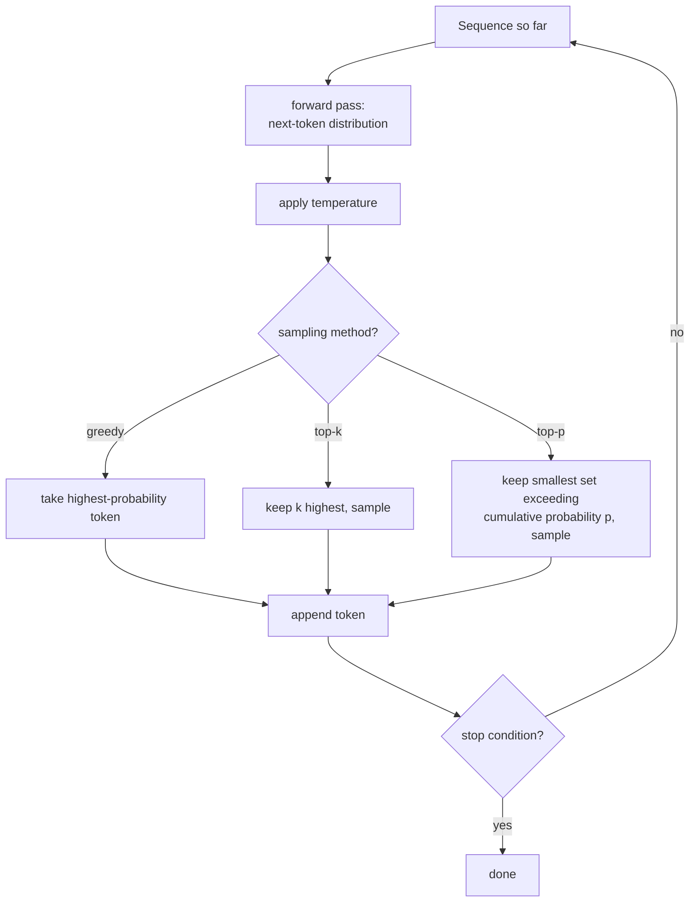

# Урок 18. Генерация и сэмплирование

**Связь с целью курса:** Каждый урок до этапа 4 включительно строил и обучал модель, которая предсказывает распределение вероятностей по следующему токену. Ни один из них не спрашивал, что на самом деле делать с этим распределением, чтобы получить текст. Этот урок закрывает этот пробел: многократный запуск вручную построенного прямого прохода и выбор на каждом шаге того, какой токен из предсказанного распределения на самом деле будет добавлен в последовательность.
**Первоисточник:** [Научная статья: "The Curious Case of Neural Text Degeneration", Holtzman et al., 2019](https://arxiv.org/abs/1904.09751)
**Предварительные требования:** [Урок 9](0009-cross-entropy-loss.md), [Урок 17](0017-grouped-query-attention-and-kv-caching.md)

## Разминка

1. ▢ Чем определяется, насколько большим должен быть KV-кеш, и почему внимание с множественными запросами сокращает его так сильно?

Проверка

Размер кеша растёт вместе с тем, сколько различных наборов голов ключей и значений нужно хранить; внимание с множественными запросами сводит это к единственной общей голове ключей и значений, которую используют все головы запросов, резко сокращая то, что нужно кешировать и читать на каждом шаге.

2. ▢ Отрицательным логарифмом какой вероятности являются кросс-энтропийные потери во время обучения?

Проверка

Вероятности настоящего следующего токена в обучающих данных при всём, что шло перед ним; минимизация этих потерь и подталкивает модель присваивать более высокую вероятность токену, который на самом деле шёл следующим.

## Что нужно знать

### Обучение спрашивает «насколько вероятен был верный ответ»; генерация спрашивает «какой токен идёт следующим»

Функция потерь при обучении оценивает модель по тому, сколько вероятности она присвоила токену, который *на самом деле был* в данных. Генерация это совершенно другая задача: никакого «на самом деле был» токена ещё нет, есть только предсказанное моделью распределение по всем возможным следующим токенам, и что-то должно превратить это распределение в один конкретный выбор, прежде чем последовательность можно будет продлить и снова пропустить через модель для следующего шага.

### Жадное декодирование: всегда брать самый вероятный токен

**Жадное декодирование** (greedy decoding) это простейший из возможных выборов: на каждом шаге брать тот токен, которому распределение модели присваивает наибольшую вероятность, добавлять его и повторять. Оно детерминировано, всегда даёт один и тот же выход для одного и того же входа и звучит как очевидно верный выбор, ведь сама модель говорит, что этот токен самый вероятный. Формулировка самой статьи прямо называет контринтуитивный результат: хотя правдоподобие хорошо подходит как цель *обучения*, использование правдоподобия как цели *декодирования* (всегда брать самый вероятный токен) приводит к тексту, который пресен и странно повторяется, а не к высококачественному выходу, на который намекал бы успех цели обучения.

### Температура перестраивает распределение до всего остального

**Температура** (temperature) масштабирует логиты перед финальным softmax, дающим распределение следующего токена: каждый логит делится на значение температуры `T` до применения softmax. Температура ниже 1 заостряет распределение, делая уже вероятные токены ещё более доминирующими и приближая генерацию к поведению жадного декодирования; температура выше 1 сглаживает его, распределяя вероятность равномернее по большему числу токенов и делая выбор маловероятных токенов более возможным. Температура не решает, *какие* токены допустимы для выбора, а лишь то, насколько остры или плоски их относительные вероятности до того, как сработает следующий метод сэмплирования.

### Top-k и top-p оба усекают распределение, но по разным правилам

**Сэмплирование top-k** оставляет только `k` токенов с наибольшими вероятностями, отбрасывает всё остальное, перенормирует оставшиеся вероятности и сэмплирует из этого набора фиксированного размера. **Сэмплирование top-p (ядерное)** вместо этого оставляет наименьший набор токенов с наибольшими вероятностями, чья суммарная вероятность превышает порог `p`, сколько бы токенов для этого ни потребовалось, и сэмплирует из этого набора. Описание ядерного сэмплирования в самой статье в точности объясняет, почему размер меняется: сэмплирование из этого «динамического ядра» допускает разнообразие, эффективно усекая ненадёжный хвост распределения, и получающийся текст, как выяснилось, лучше соответствует качеству человеческого текста, с большим разнообразием без потери беглости и связности, чем при постоянном выборе единственного самого вероятного токена.

### Фиксированное k это неверный размер для распределения, форма которого не всегда одна и та же

Фиксированное число в top-k это как раз то, что top-p был создан исправить: на шаге, где модель по-настоящему уверена (лишь два-три токена хоть сколько-то правдоподобны), фиксированное `k` равное 40 заставляет сэмплирование включать десятки неправдоподобных токенов; на шаге, где модель по-настоящему не уверена (много токенов примерно одинаково правдоподобны), то же фиксированное `k` может отсечь токены, заслуживавшие реального шанса. Порог top-p подстраивается автоматически под то, насколько распределение на каждом отдельном шаге острое или плоское, и это та самая «динамика» ядра, которую называет статья, вместо приверженности одному фиксированному размеру отсечения независимо от того, насколько уверена модель в этот конкретный момент.

### Прогон модели вперёд по одному токену это и есть генерация

Получение текста с помощью вручную построенной модели означает повторение одного цикла: запустить прямой проход по последовательности на данный момент, взять получившееся распределение по следующему токену, применить заданную комбинацию температуры и сэмплирования top-k/top-p, сэмплировать (или жадно выбрать) один токен, добавить его в последовательность и снова пропустить расширенную последовательность через модель для следующего шага, пока не будет достигнуто условие остановки (токен конца последовательности или максимальная длина). Каждый предыдущий урок, внимание, блок, потери, оптимизатор, существует для того, чтобы прямой проход этого одного цикла вообще давал распределение, из которого стоит сэмплировать.

## Практика

1. ▢ Почему статья называет контринтуитивным то, что жадное декодирование даёт пресный, повторяющийся текст, учитывая, что модель обучали именно максимизировать правдоподобие?

Подсказка

Подумайте, задают ли обучение и генерация модели на самом деле один и тот же вопрос.

Проверка

Тот факт, что правдоподобие хорошо подходит как цель обучения (награждает модель за присвоение высокой вероятности настоящему следующему токену в реальных данных), не означает, что постоянный выбор единственного токена с наибольшей вероятностью при генерации даёт хороший выход; вывод статьи как раз в том, что это разные вопросы, и постоянная максимизация правдоподобия при декодировании приводит к пресному, повторяющемуся тексту, хотя модель обучена хорошо.

2. ▢ Команда задаёт температуру 0.5, заметно ниже 1. Как это влияет на распределение следующего токена и меняет ли это то, какие токены допустимы для сэмплирования?

Проверка

Она заостряет распределение, делая уже вероятные токены ещё более доминирующими относительно менее вероятных. Сама по себе она не меняет, какие токены допустимы; это задача того метода сэмплирования (top-k, top-p или никакого), который срабатывает после того, как температура перестроила распределение.

3. ▢ На одном шаге генерации по-настоящему правдоподобны только два токена; на другом шаге правдоподобны примерно одинаково тридцать токенов. При фиксированном top-k, равном 10, на обоих шагах, что идёт не так на каждом из них?

Проверка

На шаге с двумя правдоподобными токенами top-k, равный 10, заставляет включить 8 неправдоподобных токенов, которые не должны быть настоящими кандидатами. На шаге с тридцатью правдоподобными токенами top-k, равный 10, отсекает 20 токенов, которые по-настоящему заслуживали шанса. Фиксированное k не может подстроиться под то, насколько распределение на каждом отдельном шаге острое или плоское.

4. ▢ Как сэмплирование top-p (ядерное) избегает конкретной проблемы из предыдущего вопроса?

Проверка

Top-p оставляет наименьший набор токенов с наибольшими вероятностями, чья суммарная вероятность превышает порог `p`, сколько бы токенов для этого ни потребовалось на данном шаге, вместо приверженности одному фиксированному числу. Это позволяет допустимому набору автоматически сжиматься, когда модель уверена, и автоматически расти, когда она не уверена, подстраиваясь под реальную форму распределения на каждом шаге.

5. ▢ Какое утверждение правильно описывает отношения между жадным декодированием, температурой, top-k и top-p?

    - a) Жадное декодирование даёт текст высочайшего качества, поскольку всегда выбирает самое вероятное предсказание самой модели
    - b) Детерминированность жадного декодирования приводит к пресному, повторяющемуся тексту; температура меняет остроту распределения; top-k усекает до фиксированного числа, а top-p усекает до динамического набора по накопленной вероятности, который подстраивается под то, насколько остро распределение на каждом шаге
    - c) Температура и top-p оба решают, какие конкретно токены допустимы, и работают одинаково
    - d) Top-k и top-p всегда дают одинаковые допустимые наборы и отличаются лишь реализацией

Проверка

**b)** Это точные, различные роли, которые играет каждый механизм. Вариант (a) неверен: вывод самой статьи в том, что жадное декодирование приводит к вырожденному, повторяющемуся тексту, хотя модель хорошо обучена. Вариант (c) неверен: температура меняет остроту вероятностей, не решая допустимости; допустимый набор определяют top-k и top-p. Вариант (d) неверен: фиксированный top-k и top-p по накопленной вероятности дают по-настоящему разные по размеру допустимые наборы в зависимости от формы распределения на каждом шаге.

## Практика в реальной работе

- [ ] Реализуйте жадное декодирование для своей модели, построенной вручную, и сгенерируйте короткое продолжение по промпту; отметьте повторы или пресность выхода.
- [ ] Реализуйте сэмплирование top-k и top-p, сгенерируйте по тому же промпту с каждым и сравните разнообразие и связность выходов с результатом жадного декодирования.
- [ ] Завтра: прочитайте раздел первоисточника, где ядерное сэмплирование сравнивается с top-k и лучевым поиском по качеству текста, оценённому людьми, и отметьте, какую метрику он использует для обнаружения повторов.

## Что почитать дальше

- [Научная статья: "The Curious Case of Neural Text Degeneration", Holtzman et al., 2019](https://arxiv.org/abs/1904.09751)
- [Репозиторий: nanoGPT, Karpathy](https://github.com/karpathy/nanoGPT)
- [Ресурсы](../RESOURCES.md)

---

Не доходит? Перечитайте первоисточник в начале: этот урок его сжимает, а при сжатии понимание как раз и теряется. Загляните в [глоссарий](../GLOSSARY.md), если какой-то термин показался скользким.

Если неясен сам урок, а не материал, это дефект: [откройте issue](https://github.com/TokenCemetery/teach/issues).
