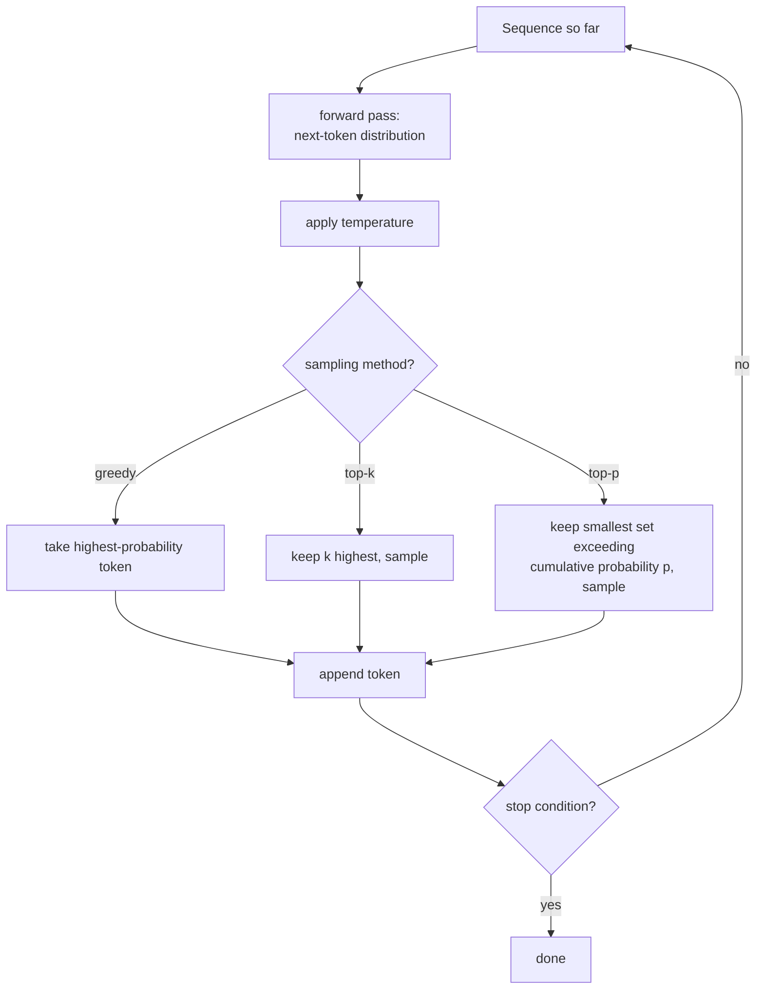

# 第 18 课：生成与采样

**使命关联:** 到第 4 阶段为止的每一课，都在搭建并训练一个预测下一个 token 的概率分布的模型。没有一课问过，该拿这个分布实际做些什么，才能产生文本。本课补上这个缺口：反复运行手工搭建的前向传播，并在每一步选择预测分布里的哪个 token，真正被追加到序列后面。
**主要来源:** [论文：“The Curious Case of Neural Text Degeneration”，Holtzman 等，2019](https://arxiv.org/abs/1904.09751)
**前置知识:** [第 9 课](0009-cross-entropy-loss.md)、[第 17 课](0017-grouped-query-attention-and-kv-caching.md)

## 热身

1. ▢ 是什么决定了 KV 缓存需要多大？为什么多查询注意力能把它缩小这么多？

检查

缓存的大小随必须存储多少组不同的键/值头集合而增长；多查询注意力把它缩减成每个查询头共用的单个共享键/值头，极大地减少了必须缓存、并在每一步读回的东西。

2. ▢ 在训练期间，交叉熵损失是什么的负对数概率？

检查

是训练数据里实际的下一个 token 的负对数概率，条件是它之前的一切；最小化这个损失，就是在推动模型给真正出现的那个下一个 token 赋予更高的概率。

## 要点

### 训练问的是“正确答案有多大可能”；生成问的是“下一个 token 是什么”

训练的损失函数，按模型给数据里*实际存在*的那个 token 赋了多少概率来给它打分。生成是一项完全不同的任务：这时还没有“实际存在”的 token，只有模型对每个可能的下一个 token 的预测分布，必须有东西把这个分布变成一个具体的选择，序列才能被延长，并送回模型去做下一步。

### 贪心解码：总是取最可能的 token

**贪心解码**是最简单的选择：每一步都选模型的分布里概率最高的那个 token，追加，然后重复。它是确定性的，同样的输入总是产生同样的输出，而且听起来显然是正确的选择，因为模型自己说那个 token 是最可能的。论文自己的表述直截了当地陈述了这个反直觉的结果：尽管似然是一个好的*训练*目标，把似然用作*解码*目标（总是取最可能的 token），却会导致平淡而奇怪地重复的文本，而不是训练目标的成功所暗示的那种高质量输出。

### 温度在其他一切发生之前，先重塑分布

**温度**在产生下一个 token 分布的最后那个 softmax 之前，重新缩放 logits，也就是在应用 softmax 之前，把每个 logit 除以一个温度值 `T`。温度小于 1，会让分布更尖锐，使本来就可能的 token 更占主导，把生成推向更接近贪心的行为；温度大于 1，会让它更平坦，把概率更均匀地分散到更多的 token 上，使不太可能的选择更有可能被选中。温度并不决定*哪些* token 有资格被选，只决定在接下来运行的任何采样方法之前，它们的相对概率有多尖锐或多平坦。

### top-k 和 top-p 都会截断分布，但规则不同

**top-k 采样**只保留概率最高的 `k` 个 token，丢弃其余所有的，把剩下的概率重新归一化，并从这个大小固定的集合里采样。**top-p（核）采样**则是保留累积概率超过阈值 `p` 的最小的高概率 token 集合，不论这要用多少个 token，并从这个集合里采样。论文自己对核采样的描述，恰好抓住了大小为什么会变化：从这个“动态核”里采样，既允许多样性，又有效地截断了分布里不可靠的尾部，而且人们发现，与总是取单个最可能的 token 相比，得到的文本在质量上更符合人类文本，增强了多样性，又没有牺牲流畅性和连贯性。

### 固定的 k，对于形状并不总是相同的分布来说，大小是错的

top-k 的固定个数，正是 top-p 要修正的东西：在模型确实很有把握的那一步（只有两三个 token 勉强说得上合理），固定的 `k` 取 40，会强迫采样包含几十个不合理的 token；在模型确实很不确定的那一步（许多 token 都大致合理），同样固定的 `k` 却可能把本该有真正机会的 token 截掉。top-p 的阈值会自动适应每一个单独步骤里分布实际有多尖锐或多平坦，这就是论文所说的核的“动态”之处，而不是不管模型在那个具体时刻有多大把握，都固守一个固定的截断大小。

### 一次一个 token 地向前运行模型，就是生成的实际含义

用手工搭建的模型产生文本，意味着重复一个循环：对目前为止的序列运行前向传播，取得下一个 token 的分布，应用配置好的温度与 top-k/top-p 采样的任何组合，采样（或贪心地选）一个 token，把它追加到序列后面，再把延长后的序列送回模型做下一步，直到遇到停止条件（一个序列结束 token，或者最大长度）。之前的每一课，注意力、块、损失、优化器，存在的意义，都是让这一个循环的前向传播，能产生一个值得采样的分布。

## 练习

1. ▢ 既然模型是专门为最大化似然而训练的，为什么论文把贪心解码产生平淡而重复的文本，描述为反直觉的？

提示

想一想，训练和生成实际上是不是在问模型同一个问题。

检查

似然是一个好的训练目标（奖励模型给真实数据里实际的下一个 token 赋予高概率），并不意味着在生成时总是选择概率最高的那一个 token 就会产生好的输出；论文的发现恰恰是，这是不同的问题，在解码时总是最大化似然，尽管模型训练得很好，仍会导致平淡而重复的文本。

2. ▢ 一个团队把温度设为 0.5，远低于 1。这对下一个 token 的分布有什么影响？它会改变哪些 token 有资格被采样吗？

检查

它让分布更尖锐，使本来就可能的 token 相对于不太可能的更占主导。它本身并不改变哪些 token 有资格被采样；那是在温度重塑了分布之后运行的采样方法（top-k、top-p 或者没有）的工作。

3. ▢ 在某一个生成步骤里，只有两个 token 确实合理；在另一个步骤里，有三十个 token 都大致合理。在这两步都用固定的 top-k 为 10，各自会出什么问题？

检查

在只有两个合理 token 的那一步，top-k 取 10 会强迫包含 8 个本不该成为真正候选的不合理 token。在有三十个合理 token 的那一步，top-k 取 10 会截掉 20 个确实该有机会的 token。固定的 k 无法适应每一个单独步骤里分布实际有多尖锐或多平坦。

4. ▢ top-p（核）采样如何避免上一题里的那个具体问题？

检查

top-p 保留累积概率超过阈值 `p` 的最小的高概率 token 集合，不论在那一具体步骤里这需要多少个 token，而不是固守一个固定的个数。这让有资格的集合在模型有把握时自动缩小，在它不确定时自动扩大，适应每一步里分布的实际形状。

5. ▢ 下面哪一项说法正确描述了贪心解码、温度、top-k 和 top-p 之间的关系？

    - a) 贪心解码产生质量最高的文本，因为它总是选择模型自己最可能的预测
    - b) 贪心解码的确定性导致平淡而重复的文本；温度重塑分布的尖锐程度；top-k 截断到固定的个数，而 top-p 截断到一个动态的、基于累积概率的集合，它会适应每一步里分布有多尖锐
    - c) 温度和 top-p 都决定哪些具体的 token 有资格，作用完全相同
    - d) top-k 和 top-p 总是产生相同的有资格的集合，只是实现不同

检查

**b)** 这正是每种机制所扮演的、各不相同的精确角色。(a) 是错的：论文自己的发现是，尽管模型训练得很好，贪心解码仍会导致退化的、重复的文本。(c) 是错的：温度重塑概率的尖锐程度，并不决定资格；决定有资格的集合的是 top-k 和 top-p。(d) 是错的：固定的 top-k 与基于累积概率的 top-p，根据每一步里分布的形状，会产生大小确实不同的有资格的集合。

## 实战练习

- [ ] 为你手工搭建的模型实现贪心解码，并从一个提示词生成一小段续写；留意输出里的任何重复或平淡。
- [ ] 实现 top-k 和 top-p 采样，用同一个提示词分别生成，并把输出的多样性和连贯性与贪心的结果做比较。
- [ ] 明天：阅读主要来源中，在人工评估的文本质量上，把核采样与 top-k 和束搜索做比较的那一节，并记下它用什么指标来检测重复。

## 延伸阅读

- [论文：“The Curious Case of Neural Text Degeneration”，Holtzman 等，2019](https://arxiv.org/abs/1904.09751)
- [仓库：nanoGPT，Karpathy](https://github.com/karpathy/nanoGPT)
- [资源](../RESOURCES.md)

---

没学明白？请重读顶部的主要来源，因为本课是对它的压缩，而理解正是在压缩中流失的。如果有哪个术语觉得含糊，可以查看[术语表](../GLOSSARY.md)。

如果问题出在课程本身，而不是学习材料，那就是一个缺陷：[提交 issue](https://github.com/TokenCemetery/teach/issues)。
