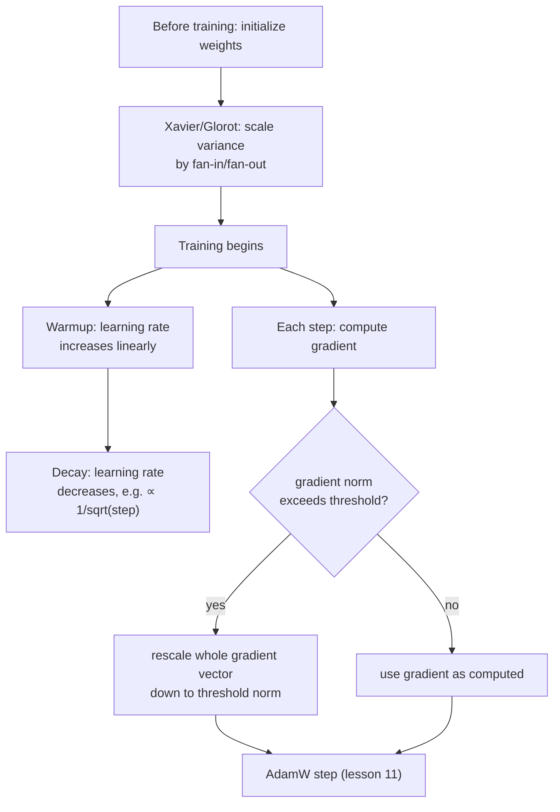

# Lección 19. Inicialización, warmup y gradient clipping

**Vínculo con la misión:** La lección 11 cerró la etapa 4 con un paso de optimizador funcional. Una ejecución de entrenamiento real necesita tres cosas más alrededor de ese paso para funcionar de verdad en la práctica: empezar los pesos a una escala que no sabotee el primerísimo forward pass, introducir el learning rate de forma gradual en lugar de aplicarlo a plena fuerza de inmediato, y limitar lo grande que se permite que sea una sola actualización. Ninguna de ellas cambia la matemática que derivaron las lecciones 9 a 11; son lo que evita que esa matemática reviente en la práctica.
**Fuente principal:** [Paper: "On the difficulty of training Recurrent Neural Networks", Pascanu, Mikolov, and Bengio, 2013](https://arxiv.org/abs/1211.5063)
**Requisitos previos:** [Lección 5](0005-layer-norm-and-residuals.md), [Lección 11](0011-adamw-optimizer.md)

## Calentamiento

1. ▢ ¿Por qué ayuda dividir la actualización de Adam por `sqrt(v)`, su segundo momento, a parámetros con magnitudes de gradiente típicas distintas?

Comprobación

`v` estima la magnitud típica del gradiente al cuadrado de cada parámetro; dividir por su raíz cuadrada da un paso efectivo relativamente mayor a un parámetro con gradientes normalmente pequeños y relativamente menor a uno con gradientes normalmente grandes, adaptándose por parámetro en lugar de usar un único tamaño de paso fijo para todo.

2. ▢ ¿Por qué ayuda una conexión residual a entrenar una pila profunda de bloques transformer?

Comprobación

Da a los gradientes un camino directo a través de la conexión identidad `+ x` en cada capa, sin importar lo que haga la transformación de cada subcapa, lo que mantiene una señal de entrenamiento utilizable llegando incluso a las primeras capas de una pila profunda.

## Qué debes saber

### La inicialización decide si las activaciones sobreviven siquiera al primer forward pass

Antes de que ocurra ningún entrenamiento, los pesos de una red empiezan a una escala elegida al azar, y esa escala por sí sola puede determinar si la red es entrenable. Si los pesos iniciales son demasiado grandes, las activaciones (y, más tarde, los gradientes que fluyen hacia atrás a través de ellas) pueden crecer capa tras capa; si son demasiado pequeños, se encogen hacia cero de la misma manera. La **inicialización de Xavier (Glorot)** aborda esto directamente: en lugar de elegir una única varianza fija para cada peso sin importar el tamaño de la capa, escala la varianza inicial de los pesos de una capa según el fan-in y el fan-out de esa capa (el número de entradas y de salidas que conecta), específicamente para que la varianza de las activaciones y de los gradientes se mantenga más o menos constante entre capas en lugar de hacerse cada vez menor o mayor en cada una. Es el mismo problema de fondo que abordan las conexiones residuales y la normalización de la lección 5, la magnitud inestable de la señal a lo largo de una pila profunda, pero es una corrección aparte que opera justo al inicio del entrenamiento, antes de dar un solo paso de gradiente.

### Warmup: el learning rate empieza bajo porque las propias estimaciones del optimizador empiezan siendo poco fiables

Un calendario de **learning rate warmup** no aplica el learning rate objetivo desde el primer paso; aumenta el learning rate de forma lineal (o con alguna otra curva simple) durante un número fijo de pasos de warmup, y solo alcanza la plena fuerza cuando el warmup termina. Esto resuelve un problema específico del inicio mismo del entrenamiento: las estimaciones de momentos de Adam (los `m` y `v` de la lección 11) empiezan en cero y todavía se están calibrando con muy pocos datos en los primeros pasos, exactamente la misma inestabilidad que la propia corrección de sesgo de la lección 11 (`m_hat`, `v_hat`) existe para contrarrestar. Aplicar un learning rate grande a actualizaciones calculadas a partir de estas estimaciones tempranas, todavía poco fiables, arriesga un paso grande en una dirección mal informada, antes de que el optimizador haya visto suficientes gradientes para saber hacia dónde debería ir realmente.

### Decaimiento: el learning rate vuelve a reducirse cuando el entrenamiento ya tiene adónde ir

Después del warmup, el learning rate tampoco se queda fijo; el propio calendario del paper original del transformer lo reduce a continuación, de forma proporcional a la inversa de la raíz cuadrada del número de paso, así que la tasa sube durante el warmup y luego cae gradualmente durante el resto del entrenamiento. Un learning rate menor más adelante en el entrenamiento permite actualizaciones más finas y precisas una vez que el modelo ya está en una región razonable del espacio de pesos, en lugar de seguir dando pasos dimensionados para el progreso temprano y grueso del entrenamiento.

### Gradient clipping: limitar el tamaño de una actualización, no su dirección

Incluso con una inicialización razonable y un learning rate con warmup, un solo batch puede producir de vez en cuando un gradiente inusualmente grande, un **gradiente explosivo**, que de otro modo causaría una única actualización destructivamente grande. El **gradient norm clipping** es la solución estándar: calcular la norma global del vector de gradiente (su magnitud global, tratando el gradiente de todos los parámetros juntos como un único vector) y, si esa norma supera un umbral elegido, reescalar todo el vector de gradiente a la baja para que su norma sea exactamente igual al umbral, dejando su dirección completamente intacta. Es una decisión de diseño deliberada: recortar el gradiente de cada parámetro de forma independiente distorsionaría la dirección hacia la que apunta realmente el gradiente combinado; reducir todo el vector de manera uniforme limita el tamaño de la actualización y conserva la dirección que calculó el optimizador.

## Práctica

1. ▢ ¿Por qué escala la inicialización de Xavier la varianza inicial de los pesos de una capa según su fan-in y su fan-out, en lugar de usar una única varianza fija para cada capa de la red?

Pista

Considera qué pasa con la varianza de las activaciones a lo largo de las capas si cada capa usara la misma escala inicial de pesos fija sin importar su tamaño.

Comprobación

Una varianza fija sin importar el tamaño de la capa deja que la varianza de las activaciones (y de los gradientes) se haga cada vez menor o mayor en cada capa, ya que el efecto de una capa sobre la varianza depende de cuántas entradas y salidas tiene. Escalar por fan-in y fan-out está diseñado específicamente para mantener esa varianza más o menos constante entre capas.

2. ▢ ¿Por qué aplicar el learning rate objetivo completo desde el primerísimo paso de entrenamiento arriesga una actualización grande y mal dirigida, específicamente por cómo funcionan los momentos de Adam?

Comprobación

Las estimaciones de momentos de Adam (`m` y `v`) empiezan en cero y todavía se están calibrando con muy pocos datos en los primeros pasos; un learning rate grande aplicado a actualizaciones calculadas a partir de estas estimaciones tempranas, todavía poco fiables, arriesga un paso grande antes de que el optimizador haya acumulado suficiente historial de gradientes para conocer una buena dirección.

3. ▢ Un equipo recorta los gradientes limitando de forma independiente el valor del gradiente de cada parámetro individual, en lugar de reescalar todo el vector de gradiente según su norma global. ¿Qué arriesga esto que evita el clipping basado en la norma?

Comprobación

Recortar el gradiente de cada parámetro de forma independiente puede distorsionar la dirección hacia la que apunta realmente el vector de gradiente combinado, ya que distintos parámetros quedan limitados en cantidades distintas respecto de sus propios valores. El clipping basado en la norma reescala todo el vector de manera uniforme, limitando el tamaño global de la actualización y dejando su dirección completamente sin cambios.

4. ▢ ¿Por qué vuelve a reducirse un calendario de learning rate después del warmup, en lugar de quedarse en su valor máximo durante el resto del entrenamiento?

Comprobación

Un learning rate menor más adelante en el entrenamiento permite actualizaciones más finas y precisas una vez que el modelo ya está en una región razonable del espacio de pesos, en lugar de seguir dando pasos dimensionados para el progreso temprano y grueso del entrenamiento, lo que arriesga pasarse de largo a medida que el modelo se acerca a una buena solución.

5. ▢ ¿Qué afirmación describe correctamente la relación entre inicialización, warmup, decaimiento y gradient clipping?

    - a) Las cuatro técnicas cambian cómo se calcula matemáticamente la propia actualización de AdamW
    - b) La inicialización fija una escala inicial estable antes de que empiece el entrenamiento; el warmup y el decaimiento dan forma al learning rate a lo largo del entrenamiento para ajustarse a la fiabilidad del propio optimizador en cada etapa; el gradient clipping limita el tamaño de una actualización conservando su dirección, y las cuatro operan alrededor del paso del optimizador sin cambiar su fórmula
    - c) El gradient clipping y la inicialización de Xavier resuelven el mismo problema en el mismo momento del entrenamiento
    - d) Un calendario de warmup existe para contrarrestar los gradientes explosivos, el mismo problema que aborda el gradient clipping

Comprobación

**b)** Ese es el papel preciso y complementario que cumple cada pieza alrededor del paso del optimizador de la lección 11. (a) es falsa: ninguna de estas cuatro cambia la fórmula de actualización propia de AdamW; operan alrededor de ella. (c) es falsa: la inicialización de Xavier actúa una vez, antes de que empiece el entrenamiento; el gradient clipping actúa sobre el gradiente de cada paso a lo largo de todo el entrenamiento. (d) es falsa: el warmup aborda la falta de fiabilidad propia del optimizador al inicio del entrenamiento, un problema distinto del gradiente ocasionalmente grande que limita el gradient clipping.

## Prácticas en el mundo real

- [ ] Implementa la inicialización de Xavier para una capa lineal pequeña a partir de operaciones de tensores en bruto, y compara la varianza de sus activaciones de salida con la de una capa inicializada con una varianza fija, independiente del tamaño de la capa.
- [ ] Añade al learning rate de tu bucle de entrenamiento un warmup lineal seguido de un decaimiento con la inversa de la raíz cuadrada, y dibuja el learning rate resultante frente al paso de entrenamiento para confirmar que coincide con la forma que describe esta lección.
- [ ] Mañana: lee completo el análisis de la fuente principal sobre el problema del gradiente explosivo, y anota qué intuición geométrica da de por qué los gradientes pueden crecer de forma descontrolada a lo largo de un cálculo profundo o recurrente.

## Para profundizar

- [Paper: "On the difficulty of training Recurrent Neural Networks", Pascanu, Mikolov, and Bengio, 2013](https://arxiv.org/abs/1211.5063)
- [Paper: "Attention Is All You Need", Vaswani et al., 2017](https://arxiv.org/abs/1706.03762)
- [Recursos](../RESOURCES.md)

---

¿No termina de quedar claro? Vuelve a leer la fuente primaria de arriba, ya que esta lección la comprime y en la compresión es donde se escapa la comprensión. Consulta el [glosario](../GLOSSARY.md) por si algún término te resultó resbaladizo.

Si lo poco claro es la propia lección y no el material, eso es un defecto: [abre un issue](https://github.com/TokenCemetery/teach/issues).
