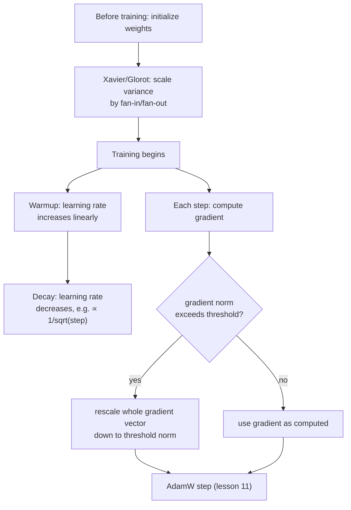

# Leçon 19. Initialisation, warmup et écrêtage du gradient

**Lien avec la mission :** La leçon 11 a clos l'étape 4 avec un pas d'optimiseur fonctionnel. Un vrai run d'entraînement a besoin de trois choses de plus autour de ce pas pour fonctionner en pratique : démarrer les poids à une échelle qui ne sabote pas dès la première passe avant, faire monter le learning rate progressivement au lieu de l'appliquer à pleine force d'emblée, et plafonner l'ampleur qu'une seule mise à jour a le droit d'avoir. Aucune de ces choses ne change les mathématiques que les leçons 9 à 11 ont dérivées ; elles empêchent ces mathématiques d'exploser en pratique.
**Source primaire :** [Article : "On the difficulty of training Recurrent Neural Networks", Pascanu, Mikolov et Bengio, 2013](https://arxiv.org/abs/1211.5063)
**Prérequis :** [Leçon 5](0005-layer-norm-and-residuals.md), [Leçon 11](0011-adamw-optimizer.md)

## Échauffement

1. ▢ Pourquoi diviser la mise à jour d'Adam par `sqrt(v)`, son second moment, aide-t-il les paramètres dont les amplitudes de gradient typiques diffèrent ?

Vérifier

`v` estime l'amplitude typique du carré du gradient de chaque paramètre ; diviser par sa racine carrée donne un pas effectif relativement plus grand à un paramètre dont les gradients sont habituellement petits et relativement plus petit à un paramètre dont les gradients sont habituellement grands, en s'adaptant par paramètre au lieu d'utiliser une seule taille de pas fixe pour tout.

2. ▢ Pourquoi une connexion résiduelle aide-t-elle à entraîner une pile profonde de blocs transformer ?

Vérifier

Elle donne aux gradients un chemin direct à travers la connexion identité `+ x` à chaque couche, quoi que fasse la transformation de chaque sous-couche, ce qui garde un signal d'entraînement exploitable jusqu'aux toutes premières couches d'une pile profonde.

## À savoir

### L'initialisation décide si les activations survivent à la première passe avant

Avant tout entraînement, les poids d'un réseau démarrent à une échelle choisie au hasard, et cette échelle suffit à elle seule à déterminer si le réseau est entraînable. Si les poids initiaux sont trop grands, les activations (et plus tard les gradients qui les traversent en sens inverse) peuvent croître couche après couche ; trop petits, ils diminuent de la même façon vers zéro. L'**initialisation de Xavier (Glorot)** traite cela directement : au lieu de choisir une seule variance fixe pour chaque poids quelle que soit la taille de la couche, elle met à l'échelle la variance initiale des poids d'une couche selon le fan-in et le fan-out de cette couche (le nombre d'entrées et de sorties auxquelles elle est reliée), précisément pour que la variance des activations et des gradients reste à peu près constante d'une couche à l'autre, au lieu de diminuer ou de croître de façon cumulative à chaque couche. C'est le même problème de fond que celui que traitent les connexions résiduelles et la normalisation de la leçon 5, une amplitude de signal instable à travers une pile profonde, mais c'est une correction distincte qui agit tout au début de l'entraînement, avant qu'un seul pas de gradient ait été fait.

### Le warmup : le learning rate démarre bas parce que les estimations de l'optimiseur démarrent peu fiables

Un calendrier de **warmup du learning rate** n'applique pas le learning rate cible dès le premier pas ; il augmente le learning rate linéairement (ou selon une autre courbe simple) pendant un nombre fixe de pas de warmup, et n'atteint la pleine force qu'une fois le warmup terminé. Cela répond à un problème propre au tout début de l'entraînement : les estimations de moments d'Adam (le `m` et le `v` de la leçon 11) démarrent à zéro et sont encore calibrées à partir de très peu de données dans les premiers pas, exactement la même instabilité que la propre correction de biais de la leçon 11 (`m_hat`, `v_hat`) existe pour compenser. Appliquer un grand learning rate à des mises à jour calculées à partir de ces estimations précoces encore peu fiables risque un grand pas dans une direction mal informée, avant que l'optimiseur ait vu assez de gradients pour savoir où il devrait réellement aller.

### La décroissance : le learning rate diminue de nouveau une fois que l'entraînement a un endroit où aller

Après le warmup, le learning rate ne reste pas fixe non plus ; le calendrier de l'article du transformer d'origine le fait diminuer ensuite, proportionnellement à l'inverse de la racine carrée du numéro de pas, de sorte que le taux monte pendant le warmup puis retombe progressivement pour le reste de l'entraînement. Un learning rate plus petit plus tard dans l'entraînement permet des mises à jour plus fines et plus précises une fois que le modèle est déjà dans une région raisonnable de l'espace des poids, au lieu de continuer à faire des pas dimensionnés pour la progression grossière du début de l'entraînement.

### L'écrêtage du gradient : plafonner l'ampleur d'une mise à jour, pas sa direction

Même avec une initialisation raisonnable et un learning rate échauffé, un seul batch peut parfois produire un gradient d'une ampleur inhabituelle, un **gradient explosif** (exploding gradient), qui causerait sinon une mise à jour destructrice d'ampleur excessive. L'**écrêtage de la norme du gradient** (gradient norm clipping) est la correction standard : calculer la norme globale du vecteur gradient (sa grandeur d'ensemble, en traitant ensemble le gradient de chaque paramètre comme un seul vecteur) et, si cette norme dépasse un seuil choisi, remettre à l'échelle tout le vecteur gradient vers le bas pour que sa norme soit exactement égale au seuil, en laissant sa direction complètement inchangée. C'est un choix de conception délibéré : écrêter indépendamment le gradient de chaque paramètre déformerait la direction vers laquelle pointe réellement le gradient combiné ; réduire uniformément tout le vecteur plafonne l'ampleur de la mise à jour tout en préservant la direction que l'optimiseur a calculée.

## Pratique

1. ▢ Pourquoi l'initialisation de Xavier met-elle à l'échelle la variance initiale des poids d'une couche selon son fan-in et son fan-out, plutôt que d'utiliser une seule variance fixe pour chaque couche du réseau ?

Indice

Réfléchissez à ce qui arrive à la variance des activations d'une couche à l'autre si chaque couche utilisait la même échelle initiale fixe des poids, quelle que soit sa taille.

Vérifier

Une variance fixe, quelle que soit la taille de la couche, laisse la variance des activations (et des gradients) diminuer ou croître de façon cumulative à chaque couche, puisque l'effet d'une couche sur la variance dépend de son nombre d'entrées et de sorties. Mettre à l'échelle selon le fan-in et le fan-out est conçu précisément pour garder cette variance à peu près constante d'une couche à l'autre.

2. ▢ Pourquoi appliquer le learning rate cible complet dès le tout premier pas d'entraînement risque-t-il une grande mise à jour mal orientée, précisément à cause du fonctionnement des moments d'Adam ?

Vérifier

Les estimations de moments d'Adam (`m` et `v`) démarrent à zéro et sont encore calibrées à partir de très peu de données dans les premiers pas ; un grand learning rate appliqué à des mises à jour calculées à partir de ces estimations précoces encore peu fiables risque un grand pas avant que l'optimiseur ait accumulé assez d'historique de gradients pour connaître une bonne direction.

3. ▢ Une équipe écrête les gradients en plafonnant indépendamment la valeur du gradient de chaque paramètre, au lieu de remettre à l'échelle tout le vecteur gradient par sa norme globale. Que cela risque-t-il que l'écrêtage par la norme évite ?

Vérifier

Écrêter indépendamment le gradient de chaque paramètre peut déformer la direction vers laquelle pointe réellement le vecteur gradient combiné, puisque des paramètres différents sont plafonnés de quantités différentes par rapport à leurs propres valeurs. L'écrêtage par la norme remet à l'échelle tout le vecteur de façon uniforme, ce qui plafonne l'ampleur globale de la mise à jour tout en laissant sa direction complètement inchangée.

4. ▢ Pourquoi un calendrier de learning rate diminue-t-il de nouveau après le warmup, plutôt que de rester à sa valeur de pic pour le reste de l'entraînement ?

Vérifier

Un learning rate plus petit plus tard dans l'entraînement permet des mises à jour plus fines et plus précises une fois que le modèle est déjà dans une région raisonnable de l'espace des poids, au lieu de continuer à faire des pas dimensionnés pour la progression grossière du début de l'entraînement, ce qui risque de dépasser la cible à mesure que le modèle s'approche d'une bonne solution.

5. ▢ Quelle affirmation décrit correctement la relation entre l'initialisation, le warmup, la décroissance et l'écrêtage du gradient ?

    - a) Les quatre techniques changent la façon dont la mise à jour d'AdamW elle-même est calculée mathématiquement
    - b) L'initialisation fixe une échelle de départ stable avant le début de l'entraînement ; le warmup et la décroissance façonnent le learning rate au cours de l'entraînement pour correspondre à la fiabilité de l'optimiseur à chaque étape ; l'écrêtage du gradient plafonne l'ampleur d'une mise à jour tout en préservant sa direction, et les quatre opèrent autour du pas d'optimiseur sans changer sa formule
    - c) L'écrêtage du gradient et l'initialisation de Xavier résolvent le même problème au même moment de l'entraînement
    - d) Un calendrier de warmup existe pour contrer les gradients explosifs, le même problème que traite l'écrêtage du gradient

Vérifier

**b)** C'est le rôle précis et complémentaire de chaque pièce autour du pas d'optimiseur de la leçon 11. (a) est faux : aucune de ces quatre techniques ne change la formule de mise à jour d'AdamW elle-même ; elles opèrent autour d'elle. (c) est faux : l'initialisation de Xavier agit une seule fois, avant le début de l'entraînement ; l'écrêtage du gradient agit sur le gradient de chaque pas tout au long de l'entraînement. (d) est faux : le warmup répond au manque de fiabilité de l'optimiseur en début d'entraînement, un problème différent du gradient occasionnellement très grand que plafonne l'écrêtage du gradient.

## Exercices en situation réelle

- [ ] Implémentez l'initialisation de Xavier pour une petite couche linéaire à partir d'opérations brutes sur les tenseurs, et comparez la variance de ses activations de sortie à celle d'une couche initialisée avec une variance fixe indépendante de la taille de la couche.
- [ ] Ajoutez à votre boucle d'entraînement un warmup linéaire suivi d'une décroissance en inverse de la racine carrée pour le learning rate, et tracez le learning rate obtenu en fonction du pas d'entraînement pour confirmer qu'il correspond à la forme que décrit cette leçon.
- [ ] Demain : lisez en entier l'analyse du problème du gradient explosif dans la source primaire, et notez quelle intuition géométrique elle donne de la raison pour laquelle les gradients peuvent croître de façon incontrôlée à travers un calcul profond ou récurrent.

## Pour aller plus loin

- [Article : "On the difficulty of training Recurrent Neural Networks", Pascanu, Mikolov et Bengio, 2013](https://arxiv.org/abs/1211.5063)
- [Article : "Attention Is All You Need", Vaswani et al., 2017](https://arxiv.org/abs/1706.03762)
- [Ressources](../RESOURCES.md)

---

Ça ne passe pas ? Relisez la source primaire en haut de page, car cette leçon la condense et c'est dans la condensation que la compréhension s'échappe. Consultez le [glossaire](../GLOSSARY.md) pour tout terme qui vous a paru glissant.

Si c'est la leçon elle-même qui n'est pas claire plutôt que la matière, c'est un défaut : [ouvrez une issue](https://github.com/TokenCemetery/teach/issues).
