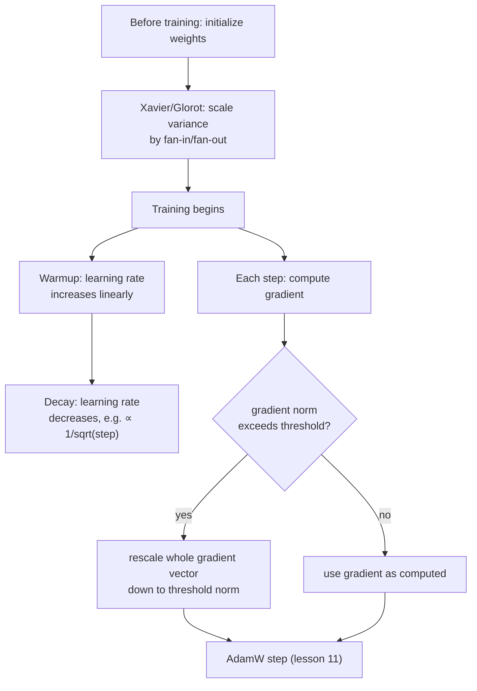

# पाठ 19. Initialization, Warmup और Gradient Clipping

**मिशन से संबंध:** पाठ 11 ने चरण 4 को एक चलते हुए optimizer step के साथ पूरा किया। असली training run को व्यावहारिक रूप से चलने के लिए उस step के आसपास तीन चीज़ें और चाहिए: weights को ऐसे scale पर शुरू करना जो बिल्कुल पहले forward pass को ही बिगाड़ न दे, learning rate को पूरी ताक़त से एकदम लगाने के बजाय धीरे-धीरे लाना, और यह सीमित करना कि एक अकेला update कितना बड़ा हो सकता है। इनमें से कुछ भी उस गणित को नहीं बदलता जो पाठ 9 से 11 ने निकाला; ये वही हैं जो उस गणित को व्यवहार में फटने से बचाते हैं।
**मुख्य स्रोत:** [पेपर: "On the difficulty of training Recurrent Neural Networks", Pascanu, Mikolov, and Bengio, 2013](https://arxiv.org/abs/1211.5063)
**पूर्व-आवश्यकताएँ:** [पाठ 5](0005-layer-norm-and-residuals.md), [पाठ 11](0011-adamw-optimizer.md)

## वार्म-अप

1. ▢ Adam के update को `sqrt(v)`, उसके second moment, से भाग देना उन parameters की मदद क्यों करता है जिनके सामान्य gradient परिमाण अलग-अलग हैं?

जाँचें

`v` हर parameter के सामान्य gradient-वर्ग परिमाण का अनुमान देता है; उसके वर्गमूल से भाग देने पर आम तौर पर छोटे gradients वाले parameter को अपेक्षाकृत बड़ा असरदार क़दम और आम तौर पर बड़े gradients वाले को अपेक्षाकृत छोटा क़दम मिलता है, यानी सबके लिए एक तय क़दम के आकार की जगह प्रति parameter ढलना।

2. ▢ Residual connection transformer blocks के गहरे stack को train करने में कैसे मदद करता है?

जाँचें

वह gradients को हर layer पर identity `+ x` connection से सीधा रास्ता देता है, चाहे हर sublayer का रूपांतरण कुछ भी करे, जिससे गहरे stack की सबसे शुरुआती layers तक भी काम का training signal पहुँचता रहता है।

## यह जानें

### Initialization तय करता है कि activations पहले forward pass से बच भी पाते हैं या नहीं

कोई भी training होने से पहले, network की weights किसी बेतरतीब चुने scale पर शुरू होती हैं, और अकेला वह scale तय कर सकता है कि network train हो सकता है या नहीं। अगर शुरुआती weights बहुत बड़ी हैं, तो activations (और बाद में उनसे पीछे बहते gradients) layer-दर-layer बढ़ सकते हैं; बहुत छोटी हों तो वे उसी तरह शून्य की ओर सिकुड़ते हैं। **Xavier (Glorot) initialization** इसे सीधे सँभालता है: layer के आकार की परवाह किए बिना हर weight के लिए एक तय variance चुनने के बजाय, वह layer के शुरुआती weight variance को उस layer के fan-in और fan-out (layer जितने inputs और outputs से जुड़ती है) से scale करता है, ख़ास तौर पर इसलिए कि activation और gradient का variance layers के आर-पार लगभग एक-सा बना रहे, हर layer के साथ छोटा या बड़ा होता जाने के बजाय। यह वही बुनियादी समस्या है जिसे पाठ 5 के residual connections और normalization सँभालते हैं, गहरे stack में अस्थिर signal परिमाण, पर यह अलग सुधार है जो training की बिल्कुल शुरुआत में, एक भी gradient step लिए जाने से पहले काम करता है।

### Warmup: learning rate नीचे से इसलिए शुरू होता है क्योंकि optimizer के अपने अनुमान अविश्वसनीय होकर शुरू होते हैं

**Learning rate warmup** schedule लक्ष्य learning rate को पहले step से नहीं लगाता; वह तय संख्या के warmup steps में learning rate को linearly (या किसी और सरल वक्र से) बढ़ाता है, और warmup पूरा होने पर ही पूरी ताक़त तक पहुँचता है। यह training की बिल्कुल शुरुआत की ख़ास समस्या को सँभालता है: Adam के moment estimates (पाठ 11 के `m` और `v`) शून्य से शुरू होते हैं और सबसे शुरुआती steps में बहुत कम data से calibrate हो रहे होते हैं, ठीक वही अस्थिरता जिसे काटने के लिए पाठ 11 की अपनी bias correction (`m_hat`, `v_hat`) है। इन अब भी अविश्वसनीय शुरुआती अनुमानों से compute हुए updates पर बड़ा learning rate लगाना ग़लत जानकारी वाली दिशा में बड़े क़दम का जोखिम है, इससे पहले कि optimizer ने इतने gradients देखे हों कि जान सके कि उसे असल में किस ओर जाना चाहिए।

### Decay: training के पास जाने की जगह होते ही learning rate फिर घटता है

Warmup के बाद learning rate भी तय नहीं रहता; मूल transformer पेपर की अपनी schedule उसे बाद में step संख्या के उलटे वर्गमूल के अनुपात में घटाती है, इसलिए rate warmup के दौरान चढ़ता है और फिर बाक़ी training में धीरे-धीरे गिरता है। Training में बाद में छोटा learning rate तब बारीक, ज़्यादा सटीक updates की गुंजाइश देता है जब model पहले से weight-space के ठीक-ठाक इलाक़े में है, बजाय इसके कि training की शुरुआती, मोटी प्रगति के आकार वाले क़दम चलते रहें।

### Gradient clipping: update का आकार सीमित करें, उसकी दिशा नहीं

ठीक-ठाक initialization और warm-up किए learning rate के बावजूद, कभी-कभार एक अकेला batch असामान्य रूप से बड़ा gradient, एक **exploding gradient**, बना सकता है जो वरना एक विनाशकारी रूप से बड़े update का कारण बनता। **Gradient norm clipping** मानक सुधार है: gradient vector का कुल norm (उसका कुल परिमाण, हर parameter के gradient को एक साथ एक vector मानकर) compute करें, और अगर वह norm चुनी हुई सीमा से बड़ा है, तो पूरे gradient vector को इतना छोटा scale करें कि उसका norm ठीक सीमा के बराबर हो जाए, और उसकी दिशा बिल्कुल न बदले। यह सोचा-समझा design चुनाव है: हर parameter का gradient अलग-अलग clip करने से जुड़े हुए gradient की असल दिशा बिगड़ती; पूरे vector को एकसमान रूप से छोटा करना update का आकार सीमित करता है और optimizer की निकाली दिशा सुरक्षित रखता है।

## अभ्यास

1. ▢ Xavier initialization layer के शुरुआती weight variance को उसके fan-in और fan-out से scale क्यों करता है, network की हर layer के लिए एक तय variance इस्तेमाल करने के बजाय?

संकेत

सोचें कि अगर हर layer अपने आकार की परवाह किए बिना वही तय शुरुआती weight scale इस्तेमाल करे तो layers के आर-पार activation variance का क्या होता है।

जाँचें

Layer के आकार की परवाह किए बिना तय variance activation (और gradient) variance को हर layer के साथ छोटा या बड़ा होकर जमा होने देता है, क्योंकि variance पर layer का असर इस पर निर्भर करता है कि उसके कितने inputs और outputs हैं। Fan-in और fan-out से scaling ख़ास तौर पर इसीलिए बनी है कि वह variance को layers के आर-पार लगभग एक-सा बनाए रखे।

2. ▢ बिल्कुल पहले training step से पूरा लक्ष्य learning rate लगाने में ग़लत दिशा वाले बड़े update का जोखिम क्यों है, ख़ास तौर पर Adam के moments के काम करने के तरीक़े की वजह से?

जाँचें

Adam के moment estimates (`m` और `v`) शून्य से शुरू होते हैं और सबसे शुरुआती steps में बहुत कम data से calibrate हो रहे होते हैं; इन अब भी अविश्वसनीय शुरुआती अनुमानों से compute हुए updates पर बड़ा learning rate लगाना, इससे पहले कि optimizer ने अच्छी दिशा जानने लायक़ gradient इतिहास जमा किया हो, बड़े क़दम का जोखिम है।

3. ▢ एक टीम gradients को पूरे gradient vector को उसके कुल norm से scale करने की जगह हर अलग parameter के gradient मान की सीमा तय करके clip करती है। इसमें किसका जोखिम है जिससे norm-आधारित clipping बचती है?

जाँचें

हर parameter का gradient अलग-अलग clip करने से जुड़े हुए gradient vector की असल दिशा बिगड़ सकती है, क्योंकि अलग-अलग parameters अपने मानों के सापेक्ष अलग-अलग मात्रा से कटते हैं। Norm-आधारित clipping पूरे vector को एकसमान रूप से rescale करती है, update का कुल आकार सीमित करती है और उसकी दिशा बिल्कुल नहीं बदलती।

4. ▢ Learning rate schedule warmup के बाद फिर घटती क्यों है, बाक़ी training में अपने शिखर मान पर बने रहने के बजाय?

जाँचें

Training में बाद में छोटा learning rate तब बारीक, ज़्यादा सटीक updates की गुंजाइश देता है जब model पहले से weight-space के ठीक-ठाक इलाक़े में है, बजाय इसके कि training की शुरुआती, मोटी प्रगति के आकार वाले क़दम चलते रहें, जिनसे model के अच्छे हल के पास आते हुए आगे निकल जाने का जोखिम रहता है।

5. ▢ कौन-सा दावा initialization, warmup, decay और gradient clipping के संबंध का सही वर्णन करता है?

    - a) चारों तकनीकें AdamW update की गणितीय गणना का तरीक़ा ख़ुद बदलती हैं
    - b) Initialization training शुरू होने से पहले स्थिर शुरुआती scale तय करता है; warmup और decay training के दौरान learning rate को हर चरण पर optimizer की अपनी विश्वसनीयता के हिसाब से ढालते हैं; gradient clipping update का आकार सीमित करती है और उसकी दिशा बचाती है, और चारों optimizer step के आसपास काम करते हैं, उसके सूत्र को बदले बिना
    - c) Gradient clipping और Xavier initialization training के एक ही बिंदु पर एक ही समस्या हल करते हैं
    - d) Warmup schedule exploding gradients का असर काटने के लिए है, वही समस्या जिसे gradient clipping सँभालती है

जाँचें

**b)** पाठ 11 के optimizer step के आसपास हर हिस्से की यही सटीक, पूरक भूमिका है। (a) ग़लत है: इन चारों में से कोई AdamW का अपना update सूत्र नहीं बदलता; वे उसके आसपास काम करते हैं। (c) ग़लत है: Xavier initialization training शुरू होने से पहले एक बार काम करता है; gradient clipping पूरी training में हर step के gradient पर काम करती है। (d) ग़लत है: warmup optimizer की अपनी शुरुआती-training वाली अविश्वसनीयता को सँभालता है, जो उस कभी-कभार के बड़े gradient से अलग समस्या है जिसे gradient clipping सीमित करती है।

## असली दुनिया का अभ्यास

- [ ] छोटी linear layer के लिए Xavier initialization को raw tensor operations से लागू करें, और उसके output activations का variance उस layer से तुलना करें जो layer-आकार से स्वतंत्र तय variance से initialize हुई थी।
- [ ] अपने training loop के learning rate में linear warmup के बाद उलटे-वर्गमूल वाला decay जोड़ें, और नतीजे वाले learning rate को training step के विरुद्ध plot करके पक्का करें कि वह इस पाठ में बताए आकार से मेल खाता है।
- [ ] कल: मुख्य स्रोत का exploding gradient की समस्या वाला विश्लेषण पूरा पढ़ें, और ध्यान दें कि गहरे या recurrent computation में gradients बेक़ाबू क्यों बढ़ सकते हैं, इसके लिए वह कौन-सा ज्यामितीय अंदाज़ा देता है।

## आगे बढ़ने के लिए

- [पेपर: "On the difficulty of training Recurrent Neural Networks", Pascanu, Mikolov, and Bengio, 2013](https://arxiv.org/abs/1211.5063)
- [पेपर: "Attention Is All You Need", Vaswani et al., 2017](https://arxiv.org/abs/1706.03762)
- [संसाधन](../RESOURCES.md)

---

बात नहीं बन रही? ऊपर दिए मुख्य स्रोत को दोबारा पढ़ें, क्योंकि यह पाठ उसे संक्षिप्त करता है और समझ संक्षेप में ही रिसती है। जो शब्द फिसलन भरा लगे, उसके लिए [शब्दावली](../GLOSSARY.md) देखें।

अगर दिक़्क़त सामग्री की नहीं बल्कि पाठ की ही है, तो वह एक खोट है: [issue खोलें](https://github.com/TokenCemetery/teach/issues)।
