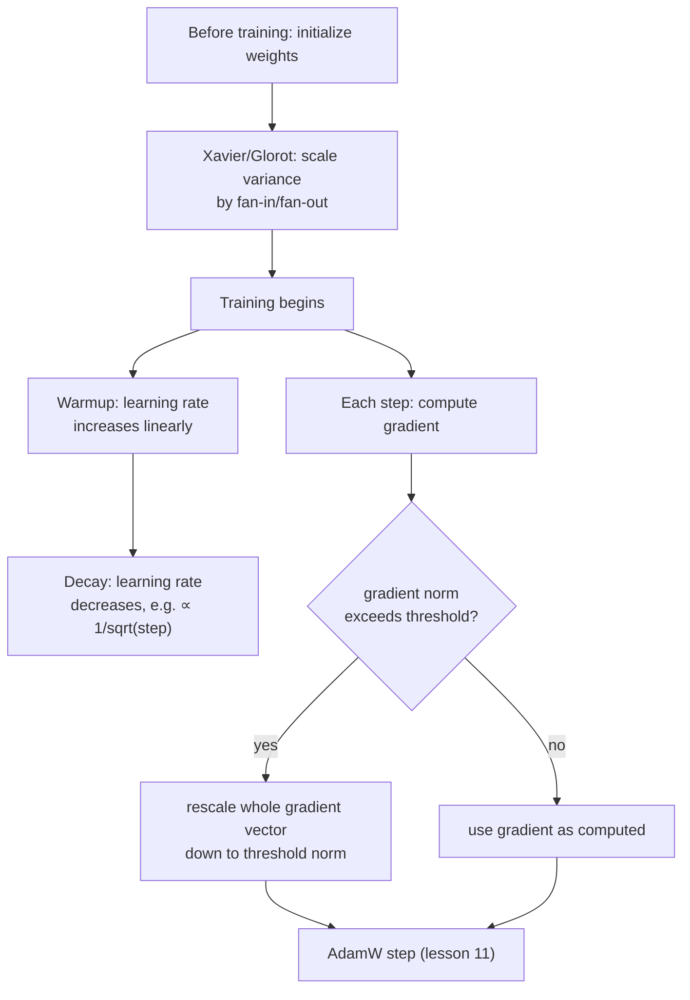

# Lição 19. Inicialização, warm-up e gradient clipping

**Ligação com a missão:** A lição 11 fechou a etapa 4 com um passo de otimizador funcional. Uma execução de treinamento real precisa de mais três coisas ao redor desse passo para de fato funcionar na prática: começar os pesos em uma escala que não sabote o primeiríssimo forward pass, entrar com a learning rate de forma gradual em vez de aplicá-la imediatamente com força total e limitar o tamanho que uma única atualização pode ter. Nenhuma delas muda a matemática que as lições 9 a 11 derivaram; são o que impede essa matemática de explodir na prática.
**Fonte principal:** [Artigo científico: "On the difficulty of training Recurrent Neural Networks", Pascanu, Mikolov e Bengio, 2013](https://arxiv.org/abs/1211.5063)
**Pré-requisitos:** [Lição 5](0005-layer-norm-and-residuals.md), [Lição 11](0011-adamw-optimizer.md)

## Aquecimento

1. ▢ Por que dividir a atualização do Adam por `sqrt(v)`, o seu segundo momento, ajuda parâmetros com magnitudes típicas de gradiente diferentes?

Verificação

`v` estima a magnitude típica do gradiente ao quadrado de cada parâmetro; dividir pela sua raiz quadrada dá a um parâmetro com gradientes normalmente pequenos um passo efetivo relativamente maior e a um com gradientes normalmente grandes um passo relativamente menor, adaptando-se por parâmetro em vez de usar um único tamanho de passo fixo para tudo.

2. ▢ Por que uma conexão residual ajuda a treinar uma pilha profunda de blocos transformer?

Verificação

Ela dá aos gradientes um caminho direto pela conexão identidade `+ x` em cada camada, seja qual for o que a transformação de cada subcamada faça, mantendo um sinal de treinamento utilizável chegando até as primeiras camadas de uma pilha profunda.

## Saiba isto

### A inicialização decide se as ativações sobrevivem ao primeiro forward pass

Antes de qualquer treinamento acontecer, os pesos de uma rede começam em alguma escala escolhida aleatoriamente, e só essa escala pode determinar se a rede é treinável. Se os pesos iniciais forem grandes demais, as ativações (e, depois, os gradientes que fluem para trás por elas) podem crescer camada após camada; pequenos demais, e encolhem em direção a zero do mesmo modo. A **inicialização de Xavier (Glorot)** trata isso diretamente: em vez de escolher uma variância fixa para todo peso, independentemente do tamanho da camada, ela escala a variância inicial dos pesos de uma camada pelo fan-in e pelo fan-out dessa camada (o número de entradas e de saídas a que a camada se conecta), especificamente para que a variância das ativações e dos gradientes permaneça aproximadamente consistente entre as camadas, em vez de encolher ou crescer de forma composta a cada uma delas. Esse é o mesmo problema de fundo que as conexões residuais e a normalização da lição 5 tratam, magnitude instável do sinal ao longo de uma pilha profunda, mas é uma correção separada, que opera bem no início do treinamento, antes de um único passo de gradiente ter sido dado.

### Warm-up: a learning rate começa baixa porque as estimativas do próprio otimizador começam pouco confiáveis

Um cronograma de **warm-up da learning rate** não aplica a learning rate-alvo desde o primeiro passo; ele aumenta a learning rate de forma linear (ou por alguma outra curva simples) ao longo de um número fixo de passos de warm-up, só atingindo a força total quando o warm-up termina. Isso trata de um problema específico do início do treinamento: as estimativas de momento do Adam (o `m` e o `v` da lição 11) começam em zero e ainda estão sendo calibradas com muito pouco dado nos primeiros passos, exatamente a mesma instabilidade que a própria correção de viés da lição 11 (`m_hat`, `v_hat`) existe para compensar. Aplicar uma learning rate grande a atualizações calculadas a partir dessas estimativas iniciais ainda pouco confiáveis arrisca um passo grande em uma direção mal informada, antes de o otimizador ter visto gradientes suficientes para saber para onde de fato deveria estar indo.

### Decay: a learning rate volta a encolher quando o treinamento já tem para onde ir

Depois do warm-up, a learning rate também não permanece fixa; o cronograma do próprio artigo original do transformer a diminui depois, de forma proporcional ao inverso da raiz quadrada do número do passo, de modo que a taxa sobe durante o warm-up e depois cai gradualmente pelo resto do treinamento. Uma learning rate menor mais adiante no treinamento permite atualizações mais finas e precisas quando o modelo já está em uma região razoável do espaço de pesos, em vez de continuar dando passos dimensionados para o progresso inicial e grosseiro do treinamento.

### Gradient clipping: limitar o tamanho de uma atualização, e não a sua direção

Mesmo com uma inicialização razoável e uma learning rate aquecida, um único batch pode ocasionalmente produzir um gradiente incomumente grande, um **exploding gradient**, que de outro modo causaria uma única atualização destrutivamente grande. O **gradient norm clipping** é a correção padrão: calcular a norma geral do vetor de gradiente (a sua magnitude geral, tratando o gradiente de todos os parâmetros em conjunto como um único vetor) e, se essa norma ultrapassar um limite escolhido, reescalar o vetor de gradiente inteiro para baixo, de modo que a sua norma seja exatamente igual ao limite, deixando a sua direção completamente inalterada. Essa é uma escolha de design deliberada: fazer o clipping do gradiente de cada parâmetro de forma independente distorceria a direção para a qual o gradiente combinado de fato aponta; escalar o vetor inteiro para baixo de modo uniforme limita o tamanho da atualização preservando a direção que o otimizador calculou.

## Prática

1. ▢ Por que a inicialização de Xavier escala a variância inicial dos pesos de uma camada pelo seu fan-in e fan-out, em vez de usar uma única variância fixa para toda camada da rede?

Dica

Considere o que acontece com a variância das ativações entre as camadas se toda camada usasse a mesma escala inicial fixa de pesos, independentemente do seu tamanho.

Verificação

Uma variância fixa, independentemente do tamanho da camada, deixa a variância das ativações (e dos gradientes) encolher ou crescer de forma composta a cada camada, já que o efeito de uma camada sobre a variância depende de quantas entradas e saídas ela tem. Escalar pelo fan-in e pelo fan-out é projetado especificamente para manter essa variância aproximadamente consistente entre as camadas.

2. ▢ Por que aplicar a learning rate-alvo completa desde o primeiríssimo passo de treinamento arrisca uma atualização grande e mal direcionada, especificamente por causa de como os momentos do Adam funcionam?

Verificação

As estimativas de momento do Adam (`m` e `v`) começam em zero e ainda estão sendo calibradas com muito pouco dado nos primeiros passos; uma learning rate grande aplicada a atualizações calculadas a partir dessas estimativas iniciais ainda pouco confiáveis arrisca um passo grande antes de o otimizador ter acumulado histórico de gradiente suficiente para conhecer uma boa direção.

3. ▢ Uma equipe faz o clipping dos gradientes limitando o valor do gradiente de cada parâmetro individualmente, em vez de escalar o vetor de gradiente inteiro pela sua norma geral. O que isso arrisca que o clipping por norma evita?

Verificação

Fazer o clipping do gradiente de cada parâmetro de forma independente pode distorcer a direção para a qual o vetor de gradiente combinado de fato aponta, já que parâmetros diferentes são limitados em quantidades diferentes em relação aos seus próprios valores. O clipping por norma reescala o vetor inteiro de modo uniforme, limitando o tamanho geral da atualização e deixando a sua direção completamente inalterada.

4. ▢ Por que um cronograma de learning rate diminui de novo depois do warm-up, em vez de permanecer no seu valor de pico pelo resto do treinamento?

Verificação

Uma learning rate menor mais adiante no treinamento permite atualizações mais finas e precisas quando o modelo já está em uma região razoável do espaço de pesos, em vez de continuar dando passos dimensionados para o progresso inicial e grosseiro do treinamento, o que arrisca passar do ponto à medida que o modelo se aproxima de uma boa solução.

5. ▢ Qual afirmação descreve corretamente a relação entre inicialização, warm-up, decay e gradient clipping?

    - a) As quatro técnicas mudam como a própria atualização do AdamW é calculada matematicamente
    - b) A inicialização define uma escala inicial estável antes de o treinamento começar; o warm-up e o decay moldam a learning rate ao longo do treinamento para combinar com a confiabilidade do próprio otimizador em cada etapa; o gradient clipping limita o tamanho de uma atualização preservando a sua direção, e as quatro operam ao redor do passo do otimizador sem mudar a sua fórmula
    - c) O gradient clipping e a inicialização de Xavier resolvem o mesmo problema no mesmo ponto do treinamento
    - d) Um cronograma de warm-up existe para compensar exploding gradients, o mesmo problema que o gradient clipping trata

Verificação

**b)** É o papel preciso e complementar que cada peça desempenha ao redor do passo do otimizador da lição 11. (a) é falsa: nenhuma das quatro muda a fórmula de atualização do próprio AdamW; elas operam ao redor dela. (c) é falsa: a inicialização de Xavier age uma vez, antes de o treinamento começar; o gradient clipping age sobre o gradiente de cada passo ao longo de todo o treinamento. (d) é falsa: o warm-up trata da falta de confiabilidade do próprio otimizador no início do treinamento, um problema diferente do gradiente grande ocasional que o gradient clipping limita.

## Prática no mundo real

- [ ] Implemente a inicialização de Xavier para uma pequena camada linear a partir de operações com tensores brutos e compare a variância das suas ativações de saída com a de uma camada inicializada com uma variância fixa, independente do tamanho da camada.
- [ ] Adicione um warm-up linear seguido de decay por inverso da raiz quadrada à learning rate do seu loop de treinamento e plote a learning rate resultante contra o passo de treinamento para confirmar que ela bate com o formato que esta lição descreve.
- [ ] Amanhã: leia por inteiro a análise da fonte principal sobre o problema do exploding gradient e anote que intuição geométrica ela dá para o motivo de os gradientes poderem crescer sem controle ao longo de uma computação profunda ou recorrente.

## Para ir além

- [Artigo científico: "On the difficulty of training Recurrent Neural Networks", Pascanu, Mikolov e Bengio, 2013](https://arxiv.org/abs/1211.5063)
- [Artigo científico: "Attention Is All You Need", Vaswani et al., 2017](https://arxiv.org/abs/1706.03762)
- [Recursos](../RESOURCES.md)

---

Não ficou claro? Releia a fonte principal no topo, já que esta lição a comprime e é na compressão que o entendimento escapa. Consulte o [glossário](../GLOSSARY.md) para qualquer termo que pareceu escorregadio.

Se o problema é a lição em si, e não o material, isso é um defeito: [abra uma issue](https://github.com/TokenCemetery/teach/issues).
