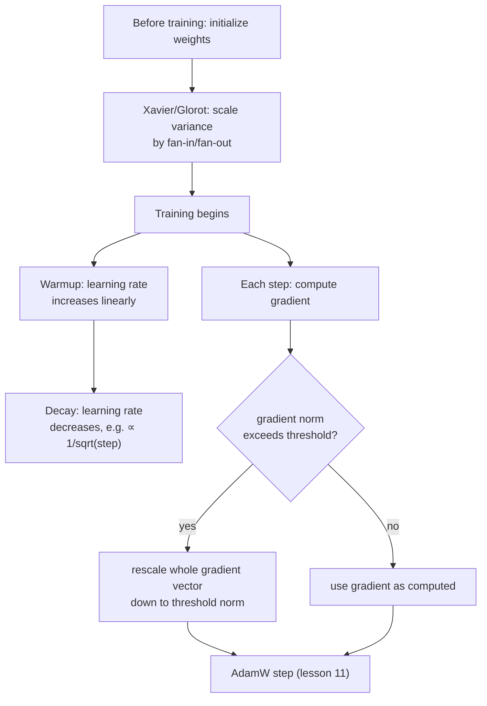

# Урок 19. Инициализация, прогрев и отсечение градиента

**Связь с целью курса:** Урок 11 завершил этап 4 рабочим шагом оптимизатора. Чтобы реальный запуск обучения на практике заработал, вокруг этого шага нужны ещё три вещи: начинать веса с масштаба, который не саботирует самый первый прямой проход, плавно вводить скорость обучения, а не применять её сразу в полную силу, и ограничивать, насколько большим может быть одно обновление. Ничто из этого не меняет математику, выведенную в уроках 9-11; это то, что не даёт этой математике взорваться на практике.
**Первоисточник:** [Научная статья: "On the difficulty of training Recurrent Neural Networks", Pascanu, Mikolov, and Bengio, 2013](https://arxiv.org/abs/1211.5063)
**Предварительные требования:** [Урок 5](0005-layer-norm-and-residuals.md), [Урок 11](0011-adamw-optimizer.md)

## Разминка

1. ▢ Почему деление обновления Adam на `sqrt(v)`, его второй момент, помогает параметрам с разной типичной величиной градиентов?

Проверка

`v` оценивает типичную величину квадрата градиента каждого параметра; деление на её квадратный корень даёт параметру с обычно малыми градиентами относительно больший эффективный шаг, а параметру с обычно большими градиентами относительно меньший, подстраиваясь под каждый параметр, а не используя один фиксированный размер шага для всех.

2. ▢ Почему остаточная связь помогает обучать глубокий стек блоков трансформера?

Проверка

Она даёт градиентам прямой путь по тождественной связи `+ x` на каждом слое, независимо от того, что делает преобразование каждого подслоя, и сохраняет пригодный для обучения сигнал, доходящий даже до самых ранних слоёв глубокого стека.

## Что нужно знать

### Инициализация решает, переживут ли активации самый первый прямой проход вообще

До начала любого обучения веса сети стартуют с некоторого случайно выбранного масштаба, и один этот масштаб может определить, можно ли сеть обучить. Если начальные веса слишком велики, активации (а позже и градиенты, текущие назад через них) могут расти слой за слоем; если слишком малы, они так же стремятся к нулю. **Инициализация Ксавье (Глорота)** (Xavier (Glorot) initialization) решает это напрямую: вместо выбора одной фиксированной дисперсии для каждого веса независимо от размера слоя она масштабирует начальную дисперсию весов слоя по числу входов и выходов этого слоя (fan-in и fan-out, сколько входов и выходов слой соединяет), именно чтобы дисперсия активаций и градиентов оставалась примерно одинаковой по слоям, а не нарастала или убывала с каждым слоем. Это та же базовая проблема, которую решают остаточные связи и нормализация из урока 5, нестабильная величина сигнала по глубокому стеку, но это отдельное исправление, действующее в самом начале обучения, до того как сделан хоть один шаг градиента.

### Прогрев: скорость обучения стартует низкой, потому что собственные оценки оптимизатора стартуют ненадёжными

Расписание **прогрева скорости обучения** (learning rate warmup) не применяет целевую скорость обучения с первого шага; оно увеличивает её линейно (или по другой простой кривой) в течение фиксированного числа шагов прогрева и достигает полной силы только после его завершения. Это решает проблему, специфичную для самого начала обучения: оценки моментов Adam (`m` и `v` из урока 11) стартуют с нуля и в самых ранних шагах всё ещё калибруются по очень малому объёму данных, и это в точности та же нестабильность, которой противодействует собственная поправка смещения из урока 11 (`m_hat`, `v_hat`). Применение большой скорости обучения к обновлениям, вычисленным по этим всё ещё ненадёжным ранним оценкам, рискует большим шагом в плохо обоснованном направлении, до того как оптимизатор увидел достаточно градиентов, чтобы понять, куда на самом деле ему двигаться.

### Спад: скорость обучения снова уменьшается, когда у обучения появляется, куда идти

После прогрева скорость обучения тоже не остаётся фиксированной; расписание оригинальной статьи о трансформере уменьшает её после этого пропорционально обратному квадратному корню от номера шага, так что скорость растёт во время прогрева, а затем постепенно спадает на всём остальном обучении. Меньшая скорость обучения позже в процессе позволяет делать более тонкие, точные обновления, когда модель уже находится в разумной области пространства весов, а не продолжать делать шаги размером для раннего, грубого прогресса обучения.

### Отсечение градиента: ограничить размер обновления, а не его направление

Даже при разумной инициализации и прогретой скорости обучения один батч может порой дать необычно большой градиент, **взрывной градиент** (exploding gradient), который иначе вызвал бы одно разрушительно большое обновление. **Отсечение градиента по норме** (gradient norm clipping) это стандартное решение: вычислить общую норму вектора градиента (его общую величину, рассматривая градиенты всех параметров вместе как один вектор) и, если эта норма превышает выбранный порог, пропорционально уменьшить весь вектор градиента так, чтобы его норма в точности равнялась порогу, оставив направление совершенно неизменным. Это осознанный выбор конструкции: отсечение градиента каждого параметра по отдельности исказило бы направление, в котором на самом деле указывает совокупный градиент; равномерное уменьшение всего вектора ограничивает размер обновления, сохраняя направление, которое вычислил оптимизатор.

## Практика

1. ▢ Почему инициализация Ксавье масштабирует начальную дисперсию весов слоя по его fan-in и fan-out, а не использует одну фиксированную дисперсию для каждого слоя сети?

Подсказка

Подумайте, что происходит с дисперсией активаций по слоям, если бы каждый слой использовал один и тот же фиксированный начальный масштаб весов независимо от своего размера.

Проверка

Фиксированная дисперсия независимо от размера слоя позволяет дисперсии активаций (и градиентов) нарастать или убывать с каждым слоем, потому что влияние слоя на дисперсию зависит от того, сколько у него входов и выходов. Масштабирование по fan-in и fan-out специально задумано, чтобы вместо этого удерживать эту дисперсию примерно одинаковой по слоям.

2. ▢ Почему применение полной целевой скорости обучения с самого первого шага обучения рискует плохо направленным большим обновлением именно из-за того, как работают моменты Adam?

Проверка

Оценки моментов Adam (`m` и `v`) стартуют с нуля и в самых ранних шагах всё ещё калибруются по очень малому объёму данных; большая скорость обучения, применённая к обновлениям, вычисленным по этим всё ещё ненадёжным ранним оценкам, рискует большим шагом до того, как оптимизатор накопил достаточно истории градиентов, чтобы знать хорошее направление.

3. ▢ Команда отсекает градиенты, ограничивая значение градиента каждого отдельного параметра независимо, а не масштабируя весь вектор градиента по его общей норме. Чем это рискует, чего избегает отсечение по норме?

Проверка

Отсечение градиента каждого параметра по отдельности может исказить направление, в котором на самом деле указывает вектор совокупного градиента, поскольку разные параметры ограничиваются на разную величину относительно собственных значений. Отсечение по норме пропорционально уменьшает весь вектор, ограничивая общий размер обновления и оставляя его направление совершенно неизменным.

4. ▢ Почему расписание скорости обучения снова убывает после прогрева, а не остаётся на пиковом значении до конца обучения?

Проверка

Меньшая скорость обучения позже в процессе позволяет делать более тонкие, точные обновления, когда модель уже находится в разумной области пространства весов, а не продолжать делать шаги размером для раннего, грубого прогресса обучения, что рискует перескоком по мере приближения модели к хорошему решению.

5. ▢ Какое утверждение правильно описывает отношения между инициализацией, прогревом, спадом и отсечением градиента?

    - a) Все четыре техники меняют то, как математически вычисляется само обновление AdamW
    - b) Инициализация задаёт стабильный стартовый масштаб до начала обучения; прогрев и спад формируют скорость обучения по ходу обучения в соответствии с надёжностью самого оптимизатора на каждой стадии; отсечение градиента ограничивает размер обновления, сохраняя его направление, и все четыре действуют вокруг шага оптимизатора, не меняя его формулу
    - c) Отсечение градиента и инициализация Ксавье решают одну и ту же проблему в одной и той же точке обучения
    - d) Расписание прогрева существует, чтобы противодействовать взрывным градиентам, той же проблеме, которую решает отсечение градиента

Проверка

**b)** Это точные, дополняющие друг друга роли, которые каждая часть играет вокруг шага оптимизатора из урока 11. Вариант (a) неверен: ни одна из этих четырёх не меняет формулу обновления самого AdamW; они действуют вокруг неё. Вариант (c) неверен: инициализация Ксавье действует один раз, до начала обучения; отсечение градиента действует на градиент каждого шага на протяжении всего обучения. Вариант (d) неверен: прогрев решает ненадёжность самого оптимизатора в начале обучения, а это другая проблема, чем редкий большой градиент, который ограничивает отсечение градиента.

## Практика в реальной работе

- [ ] Реализуйте инициализацию Ксавье для небольшого линейного слоя из «сырых» тензорных операций и сравните дисперсию его выходных активаций со слоем, инициализированным фиксированной дисперсией, не зависящей от размера слоя.
- [ ] Добавьте в скорость обучения своего цикла обучения линейный прогрев с последующим спадом по обратному квадратному корню и постройте график получившейся скорости обучения по шагу обучения, чтобы убедиться, что он соответствует форме, которую описывает этот урок.
- [ ] Завтра: прочитайте целиком анализ проблемы взрывных градиентов в первоисточнике и отметьте, какую геометрическую интуицию он даёт для того, почему градиенты могут неконтролируемо расти по глубокому или рекуррентному вычислению.

## Что почитать дальше

- [Научная статья: "On the difficulty of training Recurrent Neural Networks", Pascanu, Mikolov, and Bengio, 2013](https://arxiv.org/abs/1211.5063)
- [Научная статья: "Attention Is All You Need", Vaswani et al., 2017](https://arxiv.org/abs/1706.03762)
- [Ресурсы](../RESOURCES.md)

---

Не доходит? Перечитайте первоисточник в начале: этот урок его сжимает, а при сжатии понимание как раз и теряется. Загляните в [глоссарий](../GLOSSARY.md), если какой-то термин показался скользким.

Если неясен сам урок, а не материал, это дефект: [откройте issue](https://github.com/TokenCemetery/teach/issues).
