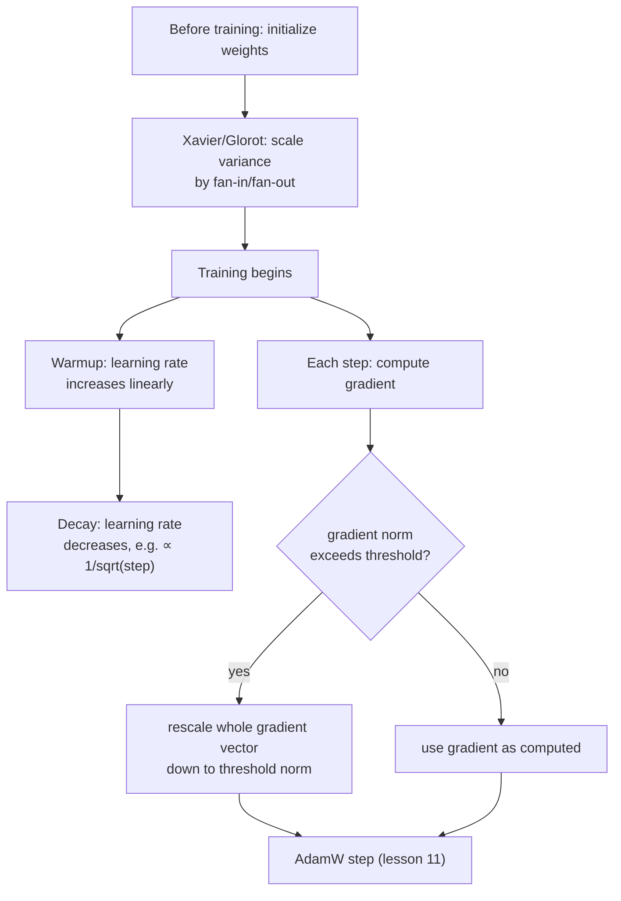

# 第 19 课：初始化、预热与梯度裁剪

**使命关联:** 第 11 课以一个可以工作的优化器步骤，为第 4 阶段收尾。一次真实的训练运行，围绕这一步还需要另外三样东西，才能在实践中真正奏效：让权重从一个不会破坏最初那次前向传播的尺度起步，把学习率逐步引入而不是一开始就全力施加，以及限制单次更新允许有多大。这些都没有改变第 9 到 11 课推导的数学；它们是让那些数学在实践中不至于崩溃的东西。
**主要来源:** [论文：“On the difficulty of training Recurrent Neural Networks”，Pascanu、Mikolov 和 Bengio，2013](https://arxiv.org/abs/1211.5063)
**前置知识:** [第 5 课](0005-layer-norm-and-residuals.md)、[第 11 课](0011-adamw-optimizer.md)

## 热身

1. ▢ 为什么用 `sqrt(v)`（它的二阶矩）去除 Adam 的更新量，对典型梯度量级不同的参数有帮助？

检查

`v` 估计每个参数典型的梯度平方量级；除以它的平方根，让梯度通常较小的参数得到相对更大的有效步长，让梯度通常较大的参数得到相对更小的步长，按参数调整，而不是对所有东西使用同一个固定的步长。

2. ▢ 为什么残差连接有助于训练一个很深的 Transformer 块堆叠？

检查

它在每一层通过恒等连接 `+ x` 给梯度一条直接的通路，不论每个子层的变换做了什么，都让一个可用的训练信号能够到达深层堆叠中最靠前的那些层。

## 要点

### 初始化决定激活值能否撑过最初的前向传播

在任何训练发生之前，网络的权重从某个随机选定的尺度开始，仅凭这个尺度，就可能决定网络是否可训练。如果初始权重太大，激活值（以及之后反向流经它们的梯度）可能一层一层地增大；太小，它们则同样一层层缩向零。**Xavier（Glorot）初始化**直接处理了这一点：它不是不管层的大小，为每个权重挑选同一个固定的方差，而是按该层的扇入和扇出（该层所连接的输入数和输出数）来缩放它的初始权重方差，专门为了让激活值和梯度的方差在各层之间大致保持一致，而不是每过一层就越积越小或越积越大。这与第 5 课的残差连接和归一化所处理的是同一个根本问题，即深层堆叠中信号量级的不稳定，但它是另一种修正，作用在训练的最开始，在迈出第一步梯度之前。

### 预热：学习率从低处起步，因为优化器自己的估计一开始就不可靠

**学习率预热**的调度，不是从第一步就施加目标学习率；它在固定数量的预热步骤里，线性地（或按其他某种简单曲线）提高学习率，直到预热完成才达到全力。这针对的是训练最开始特有的一个问题：Adam 的矩估计（第 11 课的 `m` 和 `v`）从零开始，在最初几步里仍在根据极少的数据做校准，这与第 11 课自己的偏差修正（`m_hat`、`v_hat`）所要抵消的，正是同样的不稳定。在由这些仍不可靠的早期估计算出的更新上施加很大的学习率，有可能朝着一个信息不足的方向迈出一大步，而这时优化器还没有见过足够多的梯度，不知道自己究竟该往哪里走。

### 衰减：训练有了去处之后，学习率会再次缩小

预热之后，学习率也不会一直固定；原始 Transformer 论文自己的调度，是在此后让它按步数的平方根的倒数成比例地下降，所以学习率在预热期间攀升，然后在训练的其余时间里逐渐回落。训练后期更小的学习率，允许在模型已经处于权重空间中一个合理的区域之后，做出更精细、更精确的更新，而不是继续迈出那种适合训练早期粗放进展的步子。

### 梯度裁剪：限制更新的大小，而不是它的方向

即使有合理的初始化和预热过的学习率，单个批次偶尔也会产生一个异常大的梯度，即**梯度爆炸**，否则它会造成一次破坏性的巨大更新。**梯度范数裁剪**是标准的修正办法：计算梯度向量整体的范数（它整体的大小，把每个参数的梯度合在一起看作一个向量），如果这个范数超过选定的阈值，就把整个梯度向量缩小，使它的范数恰好等于阈值，方向完全不变。这是一个刻意的设计选择：对每个参数的梯度分别裁剪，会扭曲合并后的梯度实际指向的方向；把整个向量统一缩小，则限制了更新的大小，同时保留了优化器算出的方向。

## 练习

1. ▢ 为什么 Xavier 初始化按扇入和扇出来缩放一层的初始权重方差，而不是对网络里的每一层都使用同一个固定的方差？

提示

想一想，如果每一层不管大小，都使用同样固定的初始权重尺度，激活值方差在各层之间会怎样。

检查

不管层的大小，都用固定的方差，会让激活值（和梯度）的方差每过一层就越积越小或越积越大，因为一层对方差的影响，取决于它有多少个输入和输出。按扇入和扇出缩放，正是专门为了让这个方差在各层之间大致保持一致而设计的。

2. ▢ 为什么恰恰因为 Adam 的矩的工作方式，从最初的训练步骤起就施加完整的目标学习率，有可能造成方向不佳的大幅更新？

检查

Adam 的矩估计（`m` 和 `v`）从零开始，在最初几步里仍在根据极少的数据做校准；在由这些仍不可靠的早期估计算出的更新上施加很大的学习率，有可能在优化器积累起足够的梯度历史、知道一个好的方向之前，就迈出一大步。

3. ▢ 一个团队裁剪梯度的办法，是分别限制每个参数的梯度值，而不是按梯度向量的整体范数去缩放整个向量。这有什么风险是基于范数的裁剪所避免的？

检查

分别裁剪每个参数的梯度，可能会扭曲合并后的梯度向量实际指向的方向，因为不同的参数，相对于它们自己的值，被限制的幅度各不相同。基于范数的裁剪是把整个向量统一缩小，限制了更新的整体大小，同时让它的方向完全不变。

4. ▢ 为什么学习率的调度在预热之后又会下降，而不是在训练的其余时间里一直保持在峰值？

检查

训练后期更小的学习率，允许在模型已经处于权重空间中一个合理的区域之后，做出更精细、更精确的更新，而不是继续迈出适合训练早期粗放进展的步子，那样在模型越来越接近一个好的解时，有可能冲过头。

5. ▢ 下面哪一项说法正确描述了初始化、预热、衰减和梯度裁剪之间的关系？

    - a) 这四种技术都改变了 AdamW 更新本身在数学上的计算方式
    - b) 初始化在训练开始之前设定一个稳定的起始尺度；预热和衰减在整个训练过程中塑造学习率，以匹配优化器自己在每个阶段的可靠程度；梯度裁剪限制更新的大小，同时保留它的方向，这四者都是围绕优化器步骤运作，而不改变它的公式
    - c) 梯度裁剪和 Xavier 初始化在训练的同一个时刻解决同一个问题
    - d) 预热调度的存在，是为了抵消梯度爆炸，也就是梯度裁剪所处理的同一个问题

检查

**b)** 这正是每个部分围绕第 11 课的优化器步骤所扮演的、精确而互补的角色。(a) 是错的：这四者都没有改变 AdamW 自己的更新公式；它们是围绕它运作。(c) 是错的：Xavier 初始化只在训练开始之前作用一次；梯度裁剪则在整个训练过程中作用于每一步的梯度。(d) 是错的：预热处理的是优化器自己在训练早期的不可靠，这与梯度裁剪所限制的、偶尔出现的大梯度是不同的问题。

## 实战练习

- [ ] 用原始张量运算为一个小的线性层实现 Xavier 初始化，并把它的输出激活值的方差，与用固定的、与层大小无关的方差初始化的层做比较。
- [ ] 给你的训练循环的学习率加上线性预热，然后接平方根倒数的衰减，并绘制得到的学习率随训练步数变化的曲线，确认它与本课描述的形状一致。
- [ ] 明天：完整阅读主要来源对梯度爆炸问题的分析，并记下它为梯度为什么会在很深的或循环的计算里不受控制地增长，给出了什么几何直觉。

## 延伸阅读

- [论文：“On the difficulty of training Recurrent Neural Networks”，Pascanu、Mikolov 和 Bengio，2013](https://arxiv.org/abs/1211.5063)
- [论文：“Attention Is All You Need”，Vaswani 等，2017](https://arxiv.org/abs/1706.03762)
- [资源](../RESOURCES.md)

---

没学明白？请重读顶部的主要来源，因为本课是对它的压缩，而理解正是在压缩中流失的。如果有哪个术语觉得含糊，可以查看[术语表](../GLOSSARY.md)。

如果问题出在课程本身，而不是学习材料，那就是一个缺陷：[提交 issue](https://github.com/TokenCemetery/teach/issues)。
