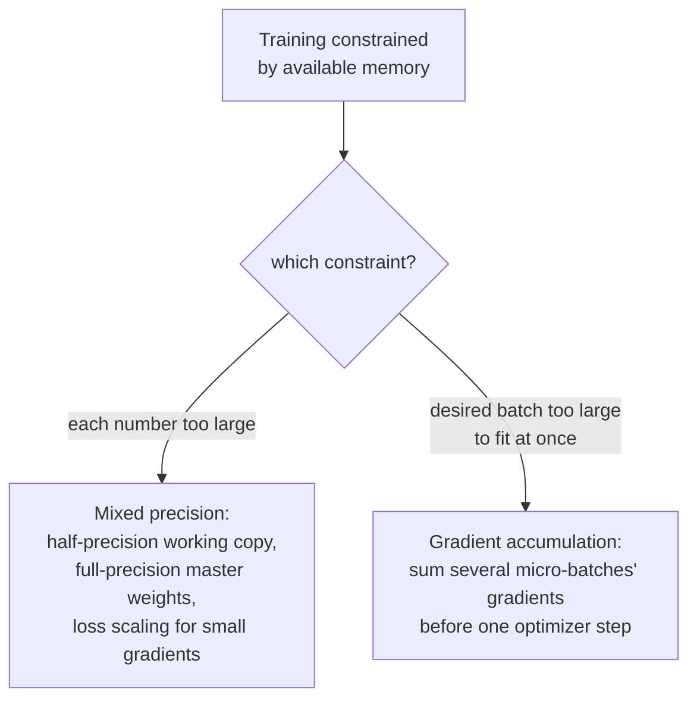

# Lección 20. Precisión mixta y gradient accumulation

**Vínculo con la misión:** La lección 19 hizo fiable un único paso de entrenamiento: una inicialización sensata, un learning rate introducido de forma gradual, un gradiente acotado. Esta lección aborda una restricción distinta y muy práctica: el hardware real tiene una cantidad fija de memoria, y tanto la precisión mixta como la gradient accumulation existen para encajar una ejecución de entrenamiento que de otro modo sería demasiado grande para esa memoria, reduciendo lo que cuesta almacenar cada número y simulando un batch mayor del que cabría jamás en memoria de una vez.
**Fuente principal:** [Paper: "Mixed Precision Training", Micikevicius et al., 2018](https://arxiv.org/abs/1710.03740)
**Requisitos previos:** [Lección 10](0010-backward-pass-and-autograd.md), [Lección 19](0019-initialization-warmup-and-gradient-clipping.md)

## Calentamiento

1. ▢ ¿Qué rellena llamar a `loss.backward()`, y por qué suele haber que poner a cero los gradientes antes de la siguiente llamada?

Comprobación

Rellena el atributo `.grad` de cada parámetro entrenable con el gradiente de la pérdida respecto de ese parámetro. Los gradientes se acumulan por defecto en lugar de sobrescribirse, así que, sin ponerlos antes a cero, el gradiente de un nuevo backward pass quedaría contaminado por los valores sobrantes del paso anterior.

2. ▢ ¿Por qué reescala el gradient norm clipping todo el vector de gradiente en lugar de limitar por separado el gradiente de cada parámetro?

Comprobación

Limitar cada parámetro por separado distorsionaría la dirección hacia la que apunta realmente el gradiente combinado. Reescalar todo el vector según su norma global limita el tamaño de la actualización y deja su dirección completamente sin cambios.

## Qué debes saber

### La media precisión reduce a más o menos la mitad la huella de cada número

El entrenamiento ordinario almacena pesos, activaciones y gradientes como números de coma flotante de 32 bits (precisión simple). El **entrenamiento con precisión mixta** los almacena en cambio en formato de 16 bits (media precisión) durante la mayor parte del cálculo, lo que, como enuncia con claridad el propio planteamiento del paper, reduce el consumo de memoria casi a la mitad, y puede acelerar de forma significativa el cálculo en hardware construido para aritmética de media precisión. La contrapartida es real: los números de media precisión tienen un rango numérico mucho más limitado que los de precisión simple, y entrenar de forma ingenua por completo en media precisión arriesga que los valores pequeños sufran underflow hasta exactamente cero.

### Una copia maestra en precisión completa, guardada junto a la copia de trabajo en media precisión

La primera corrección del paper para el rango limitado de la media precisión es mantener una **copia maestra de los pesos en precisión completa (simple)**, que acumula las actualizaciones del optimizador en cada paso; solo una copia de estos pesos, redondeada a media precisión, se usa realmente para el cálculo de forward y de backward. Esto importa porque una actualización individual de un peso puede ser lo bastante pequeña como para sufrir underflow hasta cero si se aplica directamente a un valor ya redondeado a media precisión, pero acumular las actualizaciones en la copia maestra de precisión completa conserva esos cambios pequeños a lo largo de muchos pasos, y solo pierde precisión cuando esa copia maestra se redondea hacia abajo para el cálculo real de cada paso.

### Escalado de la pérdida: hacer los gradientes pequeños lo bastante grandes para sobrevivir a la media precisión

La segunda corrección del paper aborda específicamente los gradientes: muchos valores de gradiente son lo bastante pequeños como para sufrir underflow hasta cero en el rango limitado de la media precisión antes de llegar siquiera al optimizador. El **escalado de la pérdida** (loss scaling) multiplica la pérdida por algún factor constante (a menudo grande) antes de la retropropagación, lo que multiplica cada gradiente resultante por ese mismo factor, y eleva los gradientes pequeños que de otro modo se desvanecerían hasta el rango representable de la media precisión. Después del backward pass, los gradientes se dividen de nuevo por el mismo factor de escala antes de que el paso del optimizador los use realmente, lo que deshace el efecto del escalado sobre la propia actualización habiendo rescatado por el camino los valores pequeños del underflow.

### La gradient accumulation reutiliza un hecho que este espacio de trabajo ya estableció

El propio calentamiento de la lección 11 ya lo enunció: los gradientes se acumulan por defecto en lugar de sobrescribirse, que es exactamente por lo que hay que ponerlos a cero antes de un backward pass nuevo. La **gradient accumulation** consiste simplemente en elegir no ponerlos a cero durante varios batches seguidos: ejecutar forward y backward pass sobre varios **micro-batches** más pequeños en secuencia, dejando que los gradientes de cada uno se sumen a los anteriores en lugar de ponerlos a cero y dar el paso de inmediato, y solo llamar al paso del optimizador (y poner a cero) después de que se hayan acumulado un número elegido de micro-batches. La actualización resultante se calcula a partir de la suma de los gradientes de varios micro-batches, y simula el efecto de un batch mayor que nunca tuvo que caber en memoria de una vez.

### Ambas técnicas resuelven una restricción de memoria, no de modelado

Ni la precisión mixta ni la gradient accumulation cambian lo que calcula el modelo ni cuál es el objetivo de entrenamiento; una ejecución correctamente implementada con cualquiera de las dos técnicas (o con ambas a la vez) debería converger esencialmente al mismo resultado que una que no las necesitara. Lo que cambian tiene que ver por completo con encajar una ejecución de entrenamiento en un hardware con menos memoria de la que exigirían de otro modo las cifras de la ejecución o el batch size deseado, una reduciendo el costo de almacenamiento de cada número y la otra cambiando memoria por unos cuantos forward y backward pass extra por paso del optimizador.

## Práctica

1. ▢ ¿Por qué no puede un modelo simplemente entrenar por completo en media precisión sin ningún otro ajuste, dado el ahorro de memoria que eso supondría?

Pista

Considera qué le pasa a un valor lo bastante pequeño una vez almacenado en un formato con un rango numérico limitado.

Comprobación

El rango numérico limitado de la media precisión hace que los valores suficientemente pequeños, incluidos muchos valores de gradiente, puedan sufrir underflow hasta exactamente cero y perder información que necesita una ejecución de entrenamiento completa; por eso mismo propone el paper una copia maestra de los pesos en precisión completa y el escalado de la pérdida, en lugar de entrenar solo en media precisión.

2. ▢ ¿Por qué el entrenamiento con precisión mixta conserva una copia maestra de los pesos en precisión completa, en lugar de almacenar los pesos solo en media precisión?

Comprobación

Una actualización de un peso puede ser lo bastante pequeña como para sufrir underflow hasta cero si se aplica directamente a un valor ya redondeado a media precisión. Acumular las actualizaciones en una copia maestra de precisión completa conserva esos cambios pequeños a lo largo de muchos pasos; solo la copia usada para el cálculo real de forward y de backward se redondea a media precisión en cada paso.

3. ▢ ¿Qué le hace el escalado de la pérdida a los gradientes durante la retropropagación, y por qué se deshace antes de que el paso del optimizador los use realmente?

Comprobación

Multiplicar la pérdida por un factor de escala antes de la retropropagación multiplica cada gradiente resultante por ese mismo factor, y eleva los gradientes pequeños que de otro modo sufrirían underflow hasta cero al rango representable de la media precisión. Dividir de nuevo por el mismo factor después del backward pass deshace el efecto del escalado sobre la actualización real, de modo que solo se corrigió el problema del underflow, no la magnitud verdadera de la actualización.

4. ▢ Un equipo quiere un batch size efectivo de 256, pero su hardware solo puede alojar 64 ejemplos en memoria a la vez. ¿Cómo les permite la gradient accumulation lograrlo, y qué tiene que cambiar específicamente respecto del entrenamiento ordinario para que funcione?

Comprobación

Ejecutan forward y backward pass sobre cuatro micro-batches de 64 ejemplos cada uno, sin poner a cero los gradientes ni dar el paso del optimizador entre ellos, y dejan que los gradientes de cada micro-batch se acumulen sobre los anteriores (el mismo comportamiento de acumular por defecto que nombró la lección 11). Solo después de que hayan corrido los cuatro micro-batches usa el paso del optimizador el gradiente combinado y acumulado, y luego se ponen a cero los gradientes para la siguiente ronda, lo que simula un batch de 256 ejemplos que nunca tuvo que caber en memoria de una vez.

5. ▢ ¿Qué afirmación describe correctamente lo que cambian la precisión mixta y la gradient accumulation del entrenamiento?

    - a) Ambas técnicas cambian las salidas calculadas por el modelo y el objetivo de entrenamiento, cambiando algo de exactitud por ahorro de memoria
    - b) La precisión mixta reduce el costo de almacenamiento de pesos, activaciones y gradientes usando una copia maestra en precisión completa y el escalado de la pérdida para contrarrestar el rango limitado de la media precisión; la gradient accumulation simula un batch mayor sumando los gradientes de varios micro-batches antes de un paso del optimizador; ninguna cambia lo que calcula el modelo
    - c) La gradient accumulation requiere poner a cero los gradientes tras cada micro-batch, igual que el entrenamiento ordinario
    - d) El escalado de la pérdida cambia de forma permanente la magnitud de los gradientes que usa el paso del optimizador

Comprobación

**b)** Ese es el papel preciso, centrado en la memoria, que cumple cada técnica, sin alterar lo que se calcula. (a) es falsa: correctamente implementadas, ambas técnicas apuntan a la memoria y al throughput, no al resultado calculado por el modelo. (c) es falsa: la gradient accumulation retiene específicamente la puesta a cero entre micro-batches, y deja que los gradientes se vayan acumulando. (d) es falsa: el efecto del escalado de la pérdida se deshace (dividiendo de nuevo) antes del paso del optimizador, específicamente para que la magnitud verdadera de la actualización no se vea afectada.

## Prácticas en el mundo real

- [ ] Implementa la gradient accumulation en tu bucle de entrenamiento: ejecuta varios forward/backward pass de micro-batches sin poner a cero los gradientes, luego da el paso del optimizador una sola vez, y confirma que el gradiente acumulado coincide con el que habría producido un batch mayor.
- [ ] Si tu hardware lo soporta, ejecuta unos cuantos pasos de entrenamiento en media precisión con una copia maestra de los pesos en precisión completa, y compara el uso de memoria con una ejecución ordinaria en precisión completa con el mismo batch size.
- [ ] Mañana: lee completa la sección de la fuente principal sobre el escalado de la pérdida, y anota cómo recomienda elegir el factor de escala, y qué señal indica que el factor es demasiado grande o demasiado pequeño.

## Para profundizar

- [Paper: "Mixed Precision Training", Micikevicius et al., 2018](https://arxiv.org/abs/1710.03740)
- [Repo: nanoGPT, Karpathy](https://github.com/karpathy/nanoGPT)
- [Recursos](../RESOURCES.md)

---

¿No termina de quedar claro? Vuelve a leer la fuente primaria de arriba, ya que esta lección la comprime y en la compresión es donde se escapa la comprensión. Consulta el [glosario](../GLOSSARY.md) por si algún término te resultó resbaladizo.

Si lo poco claro es la propia lección y no el material, eso es un defecto: [abre un issue](https://github.com/TokenCemetery/teach/issues).
