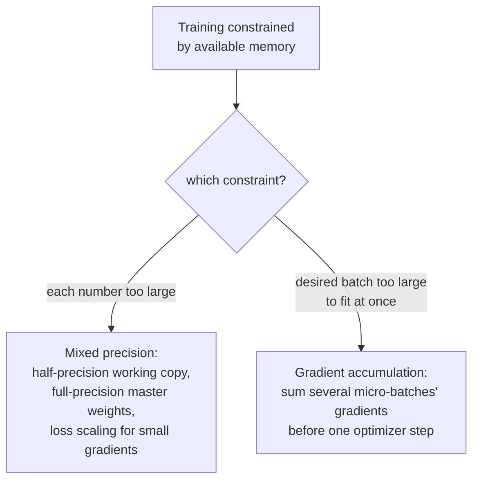

# Leçon 20. Précision mixte et accumulation de gradient

**Lien avec la mission :** La leçon 19 a fiabilisé un seul pas d'entraînement : une initialisation saine, un learning rate qui monte progressivement, un gradient plafonné. Cette leçon traite une contrainte différente et très pratique : le matériel réel a une quantité fixe de mémoire, et la précision mixte comme l'accumulation de gradient existent pour faire tenir un run d'entraînement qui serait sinon trop gros pour cette mémoire, en réduisant ce que coûte le stockage de chaque nombre et en simulant un batch plus grand que ce que la mémoire pourrait jamais contenir d'un coup.
**Source primaire :** [Article : "Mixed Precision Training", Micikevicius et al., 2018](https://arxiv.org/abs/1710.03740)
**Prérequis :** [Leçon 10](0010-backward-pass-and-autograd.md), [Leçon 19](0019-initialization-warmup-and-gradient-clipping.md)

## Échauffement

1. ▢ Qu'est-ce qu'un appel à `loss.backward()` remplit, et pourquoi les gradients doivent-ils généralement être remis à zéro avant l'appel suivant ?

Vérifier

Il remplit l'attribut `.grad` de chaque paramètre entraînable avec le gradient de la loss par rapport à ce paramètre. Les gradients s'accumulent par défaut au lieu d'écraser, donc sans remise à zéro préalable, le gradient d'une nouvelle passe arrière serait contaminé par les valeurs résiduelles du pas précédent.

2. ▢ Pourquoi l'écrêtage de la norme du gradient remet-il à l'échelle tout le vecteur gradient plutôt que de plafonner indépendamment le gradient de chaque paramètre ?

Vérifier

Plafonner chaque paramètre indépendamment déformerait la direction vers laquelle pointe réellement le gradient combiné. Remettre à l'échelle tout le vecteur par sa norme globale plafonne l'ampleur de la mise à jour tout en laissant sa direction complètement inchangée.

## À savoir

### La demi-précision réduit d'environ moitié l'empreinte de chaque nombre

L'entraînement ordinaire stocke les poids, les activations et les gradients sous forme de nombres à virgule flottante de 32 bits (simple précision). L'**entraînement en précision mixte** (mixed precision training) les stocke à la place au format 16 bits (demi-précision) pour l'essentiel du calcul, ce qui, selon la formulation même de l'article, réduit la consommation de mémoire de près de moitié et peut accélérer sensiblement le calcul sur du matériel conçu pour l'arithmétique en demi-précision. Le compromis est réel : les nombres en demi-précision ont une plage numérique bien plus limitée que ceux en simple précision, et entraîner naïvement tout en demi-précision risque de faire tomber de petites valeurs à exactement zéro par underflow.

### Une copie maître en pleine précision, conservée à côté de la copie de travail en demi-précision

La première correction de l'article à la plage limitée de la demi-précision est de conserver une **copie maître des poids en pleine précision (simple)**, qui accumule les mises à jour de l'optimiseur à chaque pas ; seule une copie arrondie à la baisse de ces poids, en demi-précision, est réellement utilisée pour le calcul avant et arrière. Cela compte parce qu'une mise à jour individuelle d'un poids peut être assez petite pour tomber à zéro par underflow si on l'applique directement à une valeur en demi-précision déjà arrondie, alors qu'accumuler les mises à jour dans la copie maître en pleine précision préserve ces petits changements sur de nombreux pas, la précision n'étant perdue que lorsque cette copie maître est arrondie à la baisse pour le calcul réel de chaque pas.

### Le loss scaling : rendre les petits gradients assez grands pour survivre à la demi-précision

La seconde correction de l'article traite précisément des gradients : beaucoup de valeurs de gradient sont assez petites pour tomber à zéro par underflow dans la plage limitée de la demi-précision avant même d'atteindre l'optimiseur. Le **loss scaling** multiplie la loss par un facteur constant (souvent grand) avant la rétropropagation, ce qui multiplie chaque gradient obtenu par ce même facteur, et remonte dans la plage représentable de la demi-précision des petits gradients qui s'évanouiraient sinon. Après la passe arrière, les gradients sont divisés par le même facteur d'échelle avant que le pas d'optimiseur les utilise réellement, ce qui annule l'effet de la mise à l'échelle sur la mise à jour elle-même tout en ayant sauvé les petites valeurs de l'underflow en chemin.

### L'accumulation de gradient réutilise un fait que cet espace de travail a déjà établi

L'échauffement de la leçon 11 l'avait déjà énoncé : les gradients s'accumulent par défaut au lieu d'écraser, ce qui explique précisément pourquoi il faut les remettre à zéro avant une nouvelle passe arrière. L'**accumulation de gradient** (gradient accumulation) consiste simplement à choisir de ne pas les remettre à zéro pendant plusieurs batchs de suite : exécuter des passes avant et des passes arrière sur plusieurs **micro-batchs** plus petits en séquence, en laissant les gradients de chacun s'ajouter aux précédents au lieu d'être remis à zéro et utilisés immédiatement pour un pas, et n'appeler le pas d'optimiseur (et la remise à zéro) qu'après qu'un nombre choisi de micro-batchs se sont accumulés. La mise à jour obtenue est calculée à partir de la somme des gradients de plusieurs micro-batchs, ce qui simule l'effet d'un seul batch plus grand qui n'a jamais eu à tenir en mémoire d'un coup.

### Les deux techniques résolvent une contrainte de mémoire, pas une contrainte de modélisation

Ni la précision mixte ni l'accumulation de gradient ne changent ce que le modèle calcule ni quel est l'objectif d'entraînement ; un run correctement implémenté avec l'une ou l'autre technique (ou les deux ensemble) devrait converger vers essentiellement le même résultat qu'un run qui n'en avait pas besoin. Ce qu'elles changent concerne entièrement l'ajustement d'un run d'entraînement à du matériel qui a moins de mémoire que ce que les nombres du run ou la taille de batch voulue exigeraient sinon, l'une en réduisant le coût de stockage de chaque nombre, l'autre en échangeant de la mémoire contre quelques passes avant et passes arrière supplémentaires par pas d'optimiseur.

## Pratique

1. ▢ Pourquoi un modèle ne peut-il pas simplement s'entraîner entièrement en demi-précision sans autre ajustement, étant donné les économies de mémoire que cela procurerait ?

Indice

Réfléchissez à ce qui arrive à une valeur suffisamment petite une fois stockée dans un format à plage numérique limitée.

Vérifier

La plage numérique limitée de la demi-précision signifie que des valeurs suffisamment petites, dont beaucoup de valeurs de gradient, peuvent tomber à exactement zéro par underflow, ce qui perd de l'information dont un run d'entraînement complet a besoin ; c'est précisément pourquoi l'article propose une copie maître des poids en pleine précision et un loss scaling plutôt qu'un entraînement en demi-précision seule.

2. ▢ Pourquoi l'entraînement en précision mixte conserve-t-il une copie maître des poids en pleine précision, plutôt que de ne jamais stocker les poids qu'en demi-précision ?

Vérifier

Une mise à jour de poids peut être assez petite pour tomber à zéro par underflow si on l'applique directement à une valeur en demi-précision déjà arrondie. Accumuler les mises à jour dans une copie maître en pleine précision préserve ces petits changements sur de nombreux pas ; seule la copie utilisée pour le calcul avant et arrière réel est arrondie à la baisse en demi-précision à chaque pas.

3. ▢ Que fait le loss scaling aux gradients pendant la rétropropagation, et pourquoi est-il annulé avant que le pas d'optimiseur les utilise réellement ?

Vérifier

Multiplier la loss par un facteur d'échelle avant la rétropropagation multiplie chaque gradient obtenu par ce même facteur, ce qui remonte dans la plage représentable de la demi-précision des petits gradients qui tomberaient sinon à zéro par underflow. Diviser par le même facteur après la passe arrière annule l'effet de la mise à l'échelle sur la mise à jour réelle, de sorte que seul le problème d'underflow a été corrigé, et non l'ampleur véritable de la mise à jour.

4. ▢ Une équipe veut une taille de batch effective de 256 mais son matériel ne peut contenir que 64 exemples en mémoire à la fois. Comment l'accumulation de gradient leur permet-elle d'y parvenir, et que faut-il précisément changer par rapport à l'entraînement ordinaire pour que cela fonctionne ?

Vérifier

Ils exécutent des passes avant et des passes arrière sur quatre micro-batchs de 64 exemples chacun, sans remettre les gradients à zéro ni faire de pas d'optimiseur entre eux, en laissant les gradients de chaque micro-batch s'accumuler sur les précédents (le comportement d'accumulation par défaut que la leçon 11 a nommé). Ce n'est qu'après l'exécution des quatre micro-batchs que le pas d'optimiseur utilise le gradient combiné, accumulé, puis les gradients sont remis à zéro pour le tour suivant, ce qui simule un batch de 256 exemples qui n'a jamais eu à tenir en mémoire d'un coup.

5. ▢ Quelle affirmation décrit correctement ce que la précision mixte et l'accumulation de gradient changent à l'entraînement ?

    - a) Les deux techniques changent les sorties calculées du modèle et l'objectif d'entraînement, en échangeant un peu de précision contre des économies de mémoire
    - b) La précision mixte réduit le coût de stockage des poids, des activations et des gradients grâce à une copie maître en pleine précision et à un loss scaling qui contrent la plage limitée de la demi-précision ; l'accumulation de gradient simule un batch plus grand en sommant les gradients de plusieurs micro-batchs avant un pas d'optimiseur ; aucune des deux ne change ce que le modèle calcule
    - c) L'accumulation de gradient exige de remettre les gradients à zéro après chaque micro-batch, comme l'entraînement ordinaire
    - d) Le loss scaling change de façon permanente l'amplitude des gradients que le pas d'optimiseur utilise

Vérifier

**b)** C'est le rôle précis, centré sur la mémoire, de chaque technique, sans altérer ce qui est calculé. (a) est faux : correctement implémentées, les deux techniques visent la mémoire et le débit, pas le résultat calculé par le modèle. (c) est faux : l'accumulation de gradient s'abstient précisément de remettre à zéro entre les micro-batchs, ce qui laisse les gradients s'accumuler. (d) est faux : l'effet du loss scaling est annulé (par division) avant le pas d'optimiseur, précisément pour que l'ampleur véritable de la mise à jour ne soit pas affectée.

## Exercices en situation réelle

- [ ] Implémentez l'accumulation de gradient dans votre boucle d'entraînement : exécutez plusieurs passes avant et arrière de micro-batchs sans remettre les gradients à zéro, puis faites un seul pas d'optimiseur, et vérifiez que le gradient accumulé correspond à ce qu'un seul batch plus grand aurait produit.
- [ ] Si votre matériel le permet, exécutez quelques pas d'entraînement en demi-précision avec une copie maître des poids en pleine précision, et comparez l'usage mémoire à celui d'un run ordinaire en pleine précision à la même taille de batch.
- [ ] Demain : lisez en entier la section de la source primaire sur le loss scaling, et notez comment elle recommande de choisir le facteur d'échelle, et quel signal indique que le facteur est trop grand ou trop petit.

## Pour aller plus loin

- [Article : "Mixed Precision Training", Micikevicius et al., 2018](https://arxiv.org/abs/1710.03740)
- [Dépôt : nanoGPT, Karpathy](https://github.com/karpathy/nanoGPT)
- [Ressources](../RESOURCES.md)

---

Ça ne passe pas ? Relisez la source primaire en haut de page, car cette leçon la condense et c'est dans la condensation que la compréhension s'échappe. Consultez le [glossaire](../GLOSSARY.md) pour tout terme qui vous a paru glissant.

Si c'est la leçon elle-même qui n'est pas claire plutôt que la matière, c'est un défaut : [ouvrez une issue](https://github.com/TokenCemetery/teach/issues).
