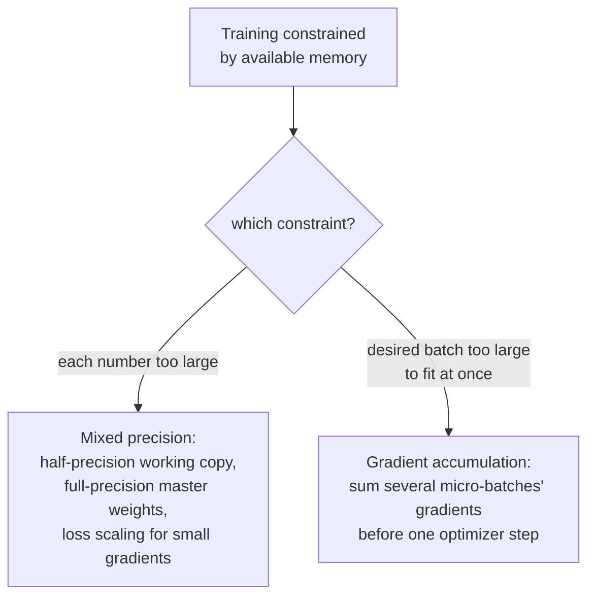

# पाठ 20. Mixed Precision और Gradient Accumulation

**मिशन से संबंध:** पाठ 19 ने एक अकेले training step को भरोसेमंद बनाया: समझदार initialization, धीरे-धीरे लाया गया learning rate, सीमित gradient। यह पाठ एक अलग, बेहद व्यावहारिक बाधा सँभालता है: असली hardware में memory की तय मात्रा होती है, और mixed precision और gradient accumulation दोनों ऐसे training run को समाने लायक़ बनाने के लिए हैं जो वरना उस memory के लिए बहुत बड़ा होता, एक हर संख्या के भंडारण की लागत घटाकर और दूसरी ऐसा batch नक़ल करके जिसे memory कभी एक साथ नहीं रख सकती।
**मुख्य स्रोत:** [पेपर: "Mixed Precision Training", Micikevicius et al., 2018](https://arxiv.org/abs/1710.03740)
**पूर्व-आवश्यकताएँ:** [पाठ 10](0010-backward-pass-and-autograd.md), [पाठ 19](0019-initialization-warmup-and-gradient-clipping.md)

## वार्म-अप

1. ▢ `loss.backward()` बुलाने से क्या भरता है, और अगली call से पहले gradients को आम तौर पर शून्य क्यों करना पड़ता है?

जाँचें

वह हर train हो सकने वाले parameter के `.grad` attribute को उस parameter के प्रति loss के gradient से भरता है। Gradients डिफ़ॉल्ट रूप से overwrite होने के बजाय accumulate होते हैं, इसलिए पहले शून्य किए बिना, नए backward pass का gradient पिछले step के बचे हुए मानों से दूषित हो जाता।

2. ▢ Gradient norm clipping हर parameter का gradient अलग-अलग सीमित करने की जगह पूरे gradient vector को rescale क्यों करती है?

जाँचें

हर parameter को अलग-अलग सीमित करने से जुड़े हुए gradient की असल दिशा बिगड़ती। पूरे vector को उसके कुल norm से rescale करना update का आकार सीमित करता है और उसकी दिशा बिल्कुल नहीं बदलता।

## यह जानें

### Half precision हर संख्या का footprint लगभग आधा कर देता है

सामान्य training weights, activations और gradients को 32-bit (single-precision) floating-point संख्याओं के रूप में रखती है। **Mixed precision training** computation के ज़्यादातर हिस्से में उन्हें इसके बजाय 16-bit (half-precision) format में रखती है, जिसके बारे में पेपर का अपना कथन साफ़ कहता है कि memory की खपत लगभग आधी हो जाती है, और half-precision arithmetic के लिए बने hardware पर computation सार्थक रूप से तेज़ हो सकता है। यह सौदा असली है: half-precision संख्याओं की संख्यात्मक सीमा single-precision से कहीं सीमित होती है, और बिना सोचे पूरी तरह half precision में train करना छोटे मानों के ठीक शून्य तक underflow होने का जोखिम रखता है।

### Half-precision वाली काम की copy के साथ पूरी precision में रखी master copy

Half precision की सीमित range के लिए पेपर का पहला सुधार **weights की master copy को पूरी (single) precision में** रखना है, जो हर step पर optimizer के updates जमा करती है; forward और backward computation के लिए इन weights की सिर्फ़ half-precision, नीचे गोल की हुई copy इस्तेमाल होती है। यह इसलिए मायने रखता है कि किसी अकेले weight update को सीधे पहले से गोल किए half-precision मान पर लगाया जाए तो वह इतना छोटा हो सकता है कि शून्य तक underflow हो जाए, पर पूरी precision वाली master copy में updates जमा करना उन छोटे बदलावों को कई steps तक बचाए रखता है, और precision तभी खोती है जब हर step की असली गणना के लिए उस master copy को नीचे गोल किया जाता है।

### Loss scaling: छोटे gradients को इतना बड़ा बनाना कि वे half precision में बच सकें

पेपर का दूसरा सुधार ख़ास तौर पर gradients के लिए है: कई gradient मान इतने छोटे होते हैं कि optimizer तक पहुँचने से पहले ही half precision की सीमित range में शून्य तक underflow हो जाते। **Loss scaling** backpropagation से पहले loss को किसी (अक्सर बड़े) स्थिर गुणक से गुणा करती है, जो नतीजे में बने हर gradient को उसी गुणक से गुणा कर देता है, और वरना ग़ायब हो जाने वाले छोटे gradients को half precision की दर्शाई जा सकने वाली range में ऊपर उठा देता है। Backward pass के बाद, optimizer step के उन्हें असल में इस्तेमाल करने से पहले gradients को उसी scaling गुणक से वापस भाग दे दिया जाता है, जो update पर scaling के असर को पलट देता है, जबकि रास्ते में छोटे मानों को underflow होने से बचा चुका होता है।

### Gradient accumulation वह तथ्य फिर इस्तेमाल करती है जो यह workspace पहले स्थापित कर चुका है

पाठ 11 का अपना वार्म-अप पहले ही कह चुका है: gradients डिफ़ॉल्ट रूप से overwrite होने के बजाय accumulate होते हैं, और इसीलिए नए backward pass से पहले उन्हें शून्य करना पड़ता है। **Gradient accumulation** बस यह चुनना है कि लगातार कई batches तक उन्हें शून्य न किया जाए: कई छोटे **micro-batches** पर एक के बाद एक forward और backward pass चलाना, हर एक के gradients को तुरंत शून्य और step होने की जगह पिछले वालों पर जुड़ने देना, और optimizer step (और शून्य करना) तभी बुलाना जब चुनी हुई संख्या के micro-batches जमा हो जाएँ। नतीजे वाला update कई micro-batches के gradients के योग से compute होता है, और उस एक बड़े batch का असर नक़ल करता है जिसे कभी एक साथ पूरा memory में समाना ही नहीं पड़ा।

### दोनों तकनीकें memory की बाधा हल करती हैं, modeling की नहीं

न mixed precision और न gradient accumulation यह बदलती है कि model क्या compute करता है या training objective क्या है; इनमें से किसी तकनीक (या दोनों साथ) का सही ढंग से लागू किया हुआ run लगभग उसी नतीजे पर पहुँचना चाहिए जिस पर वह run पहुँचता जिसे इनकी ज़रूरत नहीं पड़ी। ये जो बदलती हैं वह पूरी तरह इस बारे में है कि training run को उस hardware पर बिठाया जाए जिसमें run की संख्याओं या उसके चाहे हुए batch size के लिए ज़रूरी से कम memory है, एक हर संख्या का भंडारण-ख़र्च घटाकर, दूसरी memory के बदले हर optimizer step पर कुछ अतिरिक्त forward और backward pass लेकर।

## अभ्यास

1. ▢ Memory की जो बचत मिलती है उसे देखते हुए भी, model बिना किसी और समायोजन के पूरी तरह half precision में train क्यों नहीं कर सकता?

संकेत

सोचें कि सीमित संख्यात्मक range वाले format में रखे जाने पर काफ़ी छोटे मान का क्या होता है।

जाँचें

Half precision की सीमित संख्यात्मक range का मतलब है कि काफ़ी छोटे मान, जिनमें कई gradient मान शामिल हैं, ठीक शून्य तक underflow हो सकते हैं, और ऐसी जानकारी खो सकते हैं जो पूरे training run को चाहिए; ठीक इसीलिए पेपर अकेले half precision में train करने के बजाय पूरी precision वाली master weight copy और loss scaling का प्रस्ताव देता है।

2. ▢ Mixed precision training weights की पूरी precision वाली master copy क्यों रखती है, weights को सिर्फ़ half precision में रखने के बजाय?

जाँचें

किसी weight update को सीधे पहले से गोल किए half-precision मान पर लगाया जाए तो वह इतना छोटा हो सकता है कि शून्य तक underflow हो जाए। पूरी precision वाली master copy में updates जमा करना उन छोटे बदलावों को कई steps तक बचाए रखता है; सिर्फ़ असली forward/backward गणना के लिए इस्तेमाल होने वाली copy हर step पर half precision तक नीचे गोल की जाती है।

3. ▢ Backpropagation के दौरान loss scaling gradients के साथ क्या करती है, और optimizer step के उन्हें असल में इस्तेमाल करने से पहले उसे पलटा क्यों जाता है?

जाँचें

Backpropagation से पहले loss को scaling गुणक से गुणा करना नतीजे में बने हर gradient को उसी गुणक से गुणा कर देता है, जो वरना शून्य तक underflow हो जाने वाले छोटे gradients को half precision की दर्शाई जा सकने वाली range में ऊपर उठा देता है। Backward pass के बाद उसी गुणक से वापस भाग देना असली update पर scaling का असर पलट देता है, इसलिए सिर्फ़ underflow की समस्या ठीक हुई, update का असली परिमाण नहीं बदला।

4. ▢ एक टीम को 256 का effective batch size चाहिए पर उनका hardware एक साथ memory में सिर्फ़ 64 examples रख सकता है। Gradient accumulation उन्हें यह कैसे हासिल करने देती है, और इसे काम कराने के लिए सामान्य training से ख़ास तौर पर क्या बदलना पड़ता है?

जाँचें

वे 64-64 examples के चार micro-batches पर forward और backward pass चलाते हैं, उनके बीच gradients शून्य किए या optimizer step लिए बिना, और हर micro-batch के gradients को पिछले वालों पर जमा होने देते हैं (वही डिफ़ॉल्ट-रूप-से-accumulate वाला व्यवहार जिसका पाठ 11 ने नाम लिया था)। चारों micro-batches चलने के बाद ही optimizer step जुड़े हुए, जमा किए gradient का इस्तेमाल करता है, फिर अगले दौर के लिए gradients शून्य किए जाते हैं, और यह 256 examples के उस एक batch की नक़ल है जिसे कभी एक साथ पूरा memory में समाना नहीं पड़ा।

5. ▢ कौन-सा दावा सही बताता है कि mixed precision और gradient accumulation training के बारे में क्या बदलते हैं?

    - a) दोनों तकनीकें model के computed outputs और training objective बदलती हैं, memory की बचत के लिए कुछ accuracy का सौदा करते हुए
    - b) Mixed precision weights, activations और gradients के भंडारण की लागत घटाती है, half precision की सीमित range का सामना करने के लिए पूरी precision वाली master copy और loss scaling के साथ; gradient accumulation एक optimizer step से पहले कई micro-batches के gradients जोड़कर बड़े batch की नक़ल करती है; दोनों में से कोई नहीं बदलता कि model क्या compute करता है
    - c) Gradient accumulation के लिए हर micro-batch के बाद gradients शून्य करने पड़ते हैं, सामान्य training की ही तरह
    - d) Loss scaling optimizer step जिन gradients का इस्तेमाल करता है उनका परिमाण स्थायी रूप से बदल देती है

जाँचें

**b)** हर तकनीक की यही सटीक, memory पर केंद्रित भूमिका है, जो compute हो रहा है उसे बदले बिना। (a) ग़लत है: सही ढंग से लागू होने पर दोनों तकनीकें memory और throughput को निशाना बनाती हैं, model के computed नतीजे को नहीं। (c) ग़लत है: gradient accumulation ख़ास तौर पर micro-batches के बीच शून्य करना रोके रखती है, और gradients को जमा होने देती है। (d) ग़लत है: loss scaling का असर optimizer step से पहले पलट दिया जाता है (वापस भाग देकर), ख़ास तौर पर इसीलिए कि update का असली परिमाण अप्रभावित रहे।

## असली दुनिया का अभ्यास

- [ ] अपने training loop में gradient accumulation लागू करें: gradients शून्य किए बिना कई micro-batch के forward/backward pass चलाएँ, फिर optimizer को एक बार step दें, और पक्का करें कि जमा किया हुआ gradient उससे मेल खाता है जो एक बड़ा batch बनाता।
- [ ] अगर आपका hardware सपोर्ट करता है, तो पूरी precision वाली master weight copy के साथ half precision में कुछ training steps चलाएँ, और उसी batch size पर सामान्य पूरी-precision वाले run से memory का इस्तेमाल तुलना करें।
- [ ] कल: मुख्य स्रोत का loss scaling वाला खंड पूरा पढ़ें, और ध्यान दें कि वह scaling गुणक चुनने के लिए क्या सुझाता है, और कौन-सा संकेत बताता है कि गुणक बहुत बड़ा है या बहुत छोटा।

## आगे बढ़ने के लिए

- [पेपर: "Mixed Precision Training", Micikevicius et al., 2018](https://arxiv.org/abs/1710.03740)
- [Repo: nanoGPT, Karpathy](https://github.com/karpathy/nanoGPT)
- [संसाधन](../RESOURCES.md)

---

बात नहीं बन रही? ऊपर दिए मुख्य स्रोत को दोबारा पढ़ें, क्योंकि यह पाठ उसे संक्षिप्त करता है और समझ संक्षेप में ही रिसती है। जो शब्द फिसलन भरा लगे, उसके लिए [शब्दावली](../GLOSSARY.md) देखें।

अगर दिक़्क़त सामग्री की नहीं बल्कि पाठ की ही है, तो वह एक खोट है: [issue खोलें](https://github.com/TokenCemetery/teach/issues)।
