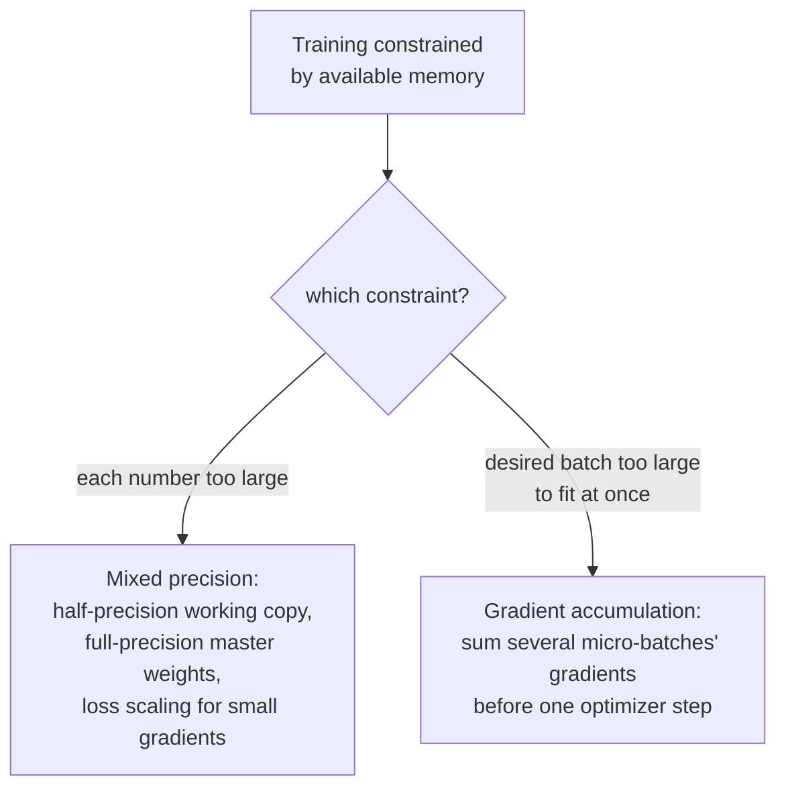

# Lição 20. Precisão mista e gradient accumulation

**Ligação com a missão:** A lição 19 tornou confiável um único passo de treinamento: inicialização sensata, uma learning rate de entrada gradual, um gradiente limitado. Esta lição trata de uma restrição diferente e muito prática: o hardware real tem uma quantidade fixa de memória, e tanto a precisão mista quanto a gradient accumulation existem para encaixar uma execução de treinamento que de outro modo seria grande demais para essa memória, encolhendo o que cada número custa para armazenar e simulando um batch maior do que a memória jamais comportaria de uma só vez.
**Fonte principal:** [Artigo científico: "Mixed Precision Training", Micikevicius et al., 2018](https://arxiv.org/abs/1710.03740)
**Pré-requisitos:** [Lição 10](0010-backward-pass-and-autograd.md), [Lição 19](0019-initialization-warmup-and-gradient-clipping.md)

## Aquecimento

1. ▢ O que chamar `loss.backward()` preenche e por que os gradientes normalmente precisam ser zerados antes da próxima chamada?

Verificação

Ela preenche o atributo `.grad` de cada parâmetro treinável com o gradiente da loss em relação a esse parâmetro. Os gradientes se acumulam por padrão, em vez de sobrescrever, então, sem zerar antes, o gradiente de um novo backward pass seria contaminado pelos valores remanescentes do passo anterior.

2. ▢ Por que o gradient norm clipping reescala o vetor de gradiente inteiro em vez de limitar o gradiente de cada parâmetro de forma independente?

Verificação

Limitar cada parâmetro de forma independente distorceria a direção para a qual o gradiente combinado de fato aponta. Reescalar o vetor inteiro pela sua norma geral limita o tamanho da atualização e deixa a sua direção completamente inalterada.

## Saiba isto

### A meia precisão corta a pegada de cada número aproximadamente pela metade

O treinamento comum armazena pesos, ativações e gradientes como números de ponto flutuante de 32 bits (precisão simples). O **treinamento em precisão mista** os armazena, em vez disso, no formato de 16 bits (meia precisão) durante a maior parte da computação, o que, nas palavras do enquadramento do próprio artigo, reduz o consumo de memória em quase metade e pode acelerar de forma significativa a computação em hardware feito para aritmética de meia precisão. A troca é real: os números de meia precisão têm uma faixa numérica muito mais limitada que os de precisão simples, e treinar ingenuamente inteiro em meia precisão arrisca que valores pequenos sofram underflow até exatamente zero.

### Uma cópia master em precisão completa, mantida ao lado da cópia de trabalho em meia precisão

A primeira correção do artigo para a faixa limitada da meia precisão é manter uma **cópia master dos pesos em precisão completa (simples)**, que acumula as atualizações do otimizador a cada passo; apenas uma cópia desses pesos em meia precisão, arredondada para baixo, é de fato usada no cálculo do forward e do backward. Isso importa porque uma atualização individual de peso pode ser pequena o bastante para sofrer underflow até zero se aplicada diretamente a um valor de meia precisão já arredondado, mas acumular atualizações na cópia master em precisão completa preserva essas pequenas mudanças ao longo de muitos passos, só perdendo precisão quando essa cópia master é arredondada para baixo para o cálculo real de cada passo.

### Loss scaling: tornar os gradientes pequenos grandes o bastante para sobreviver à meia precisão

A segunda correção do artigo trata especificamente dos gradientes: muitos valores de gradiente são pequenos o bastante para sofrer underflow até zero na faixa limitada da meia precisão antes mesmo de chegar ao otimizador. O **loss scaling** multiplica a loss por algum fator constante (muitas vezes grande) antes da backpropagation, o que multiplica todo gradiente resultante por esse mesmo fator, elevando gradientes pequenos que de outro modo desapareceriam para dentro da faixa representável da meia precisão. Depois do backward pass, os gradientes são divididos de volta pelo mesmo fator de escala antes de o passo do otimizador de fato usá-los, desfazendo o efeito do escalonamento sobre a própria atualização e tendo resgatado os valores pequenos do underflow no caminho.

### A gradient accumulation reutiliza um fato que este workspace já estabeleceu

O próprio aquecimento da lição 11 já o declarou: os gradientes se acumulam por padrão, em vez de sobrescrever, e é exatamente por isso que precisam ser zerados antes de um novo backward pass. A **gradient accumulation** é simplesmente escolher não zerá-los por vários batches seguidos: rodar forward e backward passes em vários **micro-batches** menores em sequência, deixando que os gradientes de cada um se somem aos anteriores em vez de serem zerados e usados em um passo imediatamente, e só chamar o passo do otimizador (e zerar) depois que um número escolhido de micro-batches tiver se acumulado. A atualização resultante é calculada a partir da soma dos gradientes de vários micro-batches, simulando o efeito de um batch maior que nunca precisou caber de uma só vez na memória.

### As duas técnicas resolvem uma restrição de memória, e não uma de modelagem

Nem a precisão mista nem a gradient accumulation mudam o que o modelo calcula ou qual é o objetivo de treinamento; uma execução corretamente implementada com qualquer uma das técnicas (ou as duas juntas) deveria convergir para essencialmente o mesmo resultado de uma que não precisou delas. O que elas mudam diz respeito inteiramente a encaixar uma execução de treinamento em um hardware com menos memória do que os números da execução ou o batch size desejado exigiriam, uma encolhendo o custo de armazenamento de cada número, a outra trocando memória por alguns forward e backward passes extras por passo do otimizador.

## Prática

1. ▢ Por que um modelo não pode simplesmente treinar inteiro em meia precisão, sem outros ajustes, dada a economia de memória que isso daria?

Dica

Considere o que acontece com um valor suficientemente pequeno quando armazenado em um formato com faixa numérica limitada.

Verificação

A faixa numérica limitada da meia precisão significa que valores suficientemente pequenos, incluindo muitos valores de gradiente, podem sofrer underflow até exatamente zero, perdendo informação de que uma execução de treinamento completa precisa; é exatamente por isso que o artigo propõe uma cópia master dos pesos em precisão completa e o loss scaling, em vez de treinar apenas em meia precisão.

2. ▢ Por que o treinamento em precisão mista mantém uma cópia master dos pesos em precisão completa, em vez de armazenar os pesos apenas em meia precisão?

Verificação

Uma atualização de peso pode ser pequena o bastante para sofrer underflow até zero se aplicada diretamente a um valor de meia precisão já arredondado. Acumular atualizações em uma cópia master em precisão completa preserva essas pequenas mudanças ao longo de muitos passos; apenas a cópia usada no cálculo real de forward/backward é arredondada para meia precisão a cada passo.

3. ▢ O que o loss scaling faz com os gradientes durante a backpropagation e por que ele é desfeito antes de o passo do otimizador de fato usá-los?

Verificação

Multiplicar a loss por um fator de escala antes da backpropagation multiplica todo gradiente resultante por esse mesmo fator, elevando gradientes pequenos que de outro modo sofreriam underflow até zero para dentro da faixa representável da meia precisão. Dividir de volta pelo mesmo fator depois do backward pass desfaz o efeito do escalonamento sobre a atualização de fato, de modo que apenas o problema do underflow foi corrigido, e não a magnitude verdadeira da atualização.

4. ▢ Uma equipe quer um batch size efetivo de 256, mas o seu hardware só comporta 64 exemplos na memória de uma só vez. Como a gradient accumulation permite que eles consigam isso e o que exatamente precisa mudar em relação ao treinamento comum para funcionar?

Verificação

Eles rodam forward e backward passes em quatro micro-batches de 64 exemplos cada, sem zerar os gradientes nem dar o passo do otimizador entre eles, deixando que os gradientes de cada micro-batch se acumulem sobre os anteriores (o mesmo comportamento de acumular por padrão que a lição 11 nomeou). Só depois de os quatro micro-batches terem rodado o passo do otimizador usa o gradiente combinado e acumulado, e então os gradientes são zerados para a rodada seguinte, simulando um batch de 256 exemplos que nunca precisou caber de uma só vez na memória.

5. ▢ Qual afirmação descreve corretamente o que a precisão mista e a gradient accumulation mudam no treinamento?

    - a) As duas técnicas mudam as saídas calculadas pelo modelo e o objetivo de treinamento, trocando alguma acurácia por economia de memória
    - b) A precisão mista encolhe o custo de armazenamento de pesos, ativações e gradientes usando uma cópia master em precisão completa e o loss scaling para compensar a faixa limitada da meia precisão; a gradient accumulation simula um batch maior somando os gradientes de vários micro-batches antes de um passo do otimizador; nenhuma das duas muda o que o modelo calcula
    - c) A gradient accumulation exige zerar os gradientes depois de cada micro-batch, como no treinamento comum
    - d) O loss scaling muda de forma permanente a magnitude dos gradientes que o passo do otimizador usa

Verificação

**b)** É o papel preciso, voltado à memória, que cada técnica desempenha, sem alterar o que está sendo calculado. (a) é falsa: corretamente implementadas, as duas técnicas visam memória e throughput, e não o resultado calculado pelo modelo. (c) é falsa: a gradient accumulation especificamente retém o ato de zerar entre micro-batches, deixando os gradientes se acumularem. (d) é falsa: o efeito do loss scaling é desfeito (dividindo de volta) antes do passo do otimizador, justamente para que a magnitude verdadeira da atualização não seja afetada.

## Prática no mundo real

- [ ] Implemente a gradient accumulation no seu loop de treinamento: rode vários forward/backward passes de micro-batches sem zerar os gradientes, depois dê um único passo do otimizador, e confirme que o gradiente acumulado bate com o que um batch maior teria produzido.
- [ ] Se o seu hardware suportar, rode alguns passos de treinamento em meia precisão com uma cópia master dos pesos em precisão completa e compare o uso de memória com o de uma execução comum em precisão completa no mesmo batch size.
- [ ] Amanhã: leia por inteiro a seção da fonte principal sobre loss scaling e anote como ela recomenda escolher o fator de escala e que sinal indica que o fator é grande ou pequeno demais.

## Para ir além

- [Artigo científico: "Mixed Precision Training", Micikevicius et al., 2018](https://arxiv.org/abs/1710.03740)
- [Repositório: nanoGPT, Karpathy](https://github.com/karpathy/nanoGPT)
- [Recursos](../RESOURCES.md)

---

Não ficou claro? Releia a fonte principal no topo, já que esta lição a comprime e é na compressão que o entendimento escapa. Consulte o [glossário](../GLOSSARY.md) para qualquer termo que pareceu escorregadio.

Se o problema é a lição em si, e não o material, isso é um defeito: [abra uma issue](https://github.com/TokenCemetery/teach/issues).
