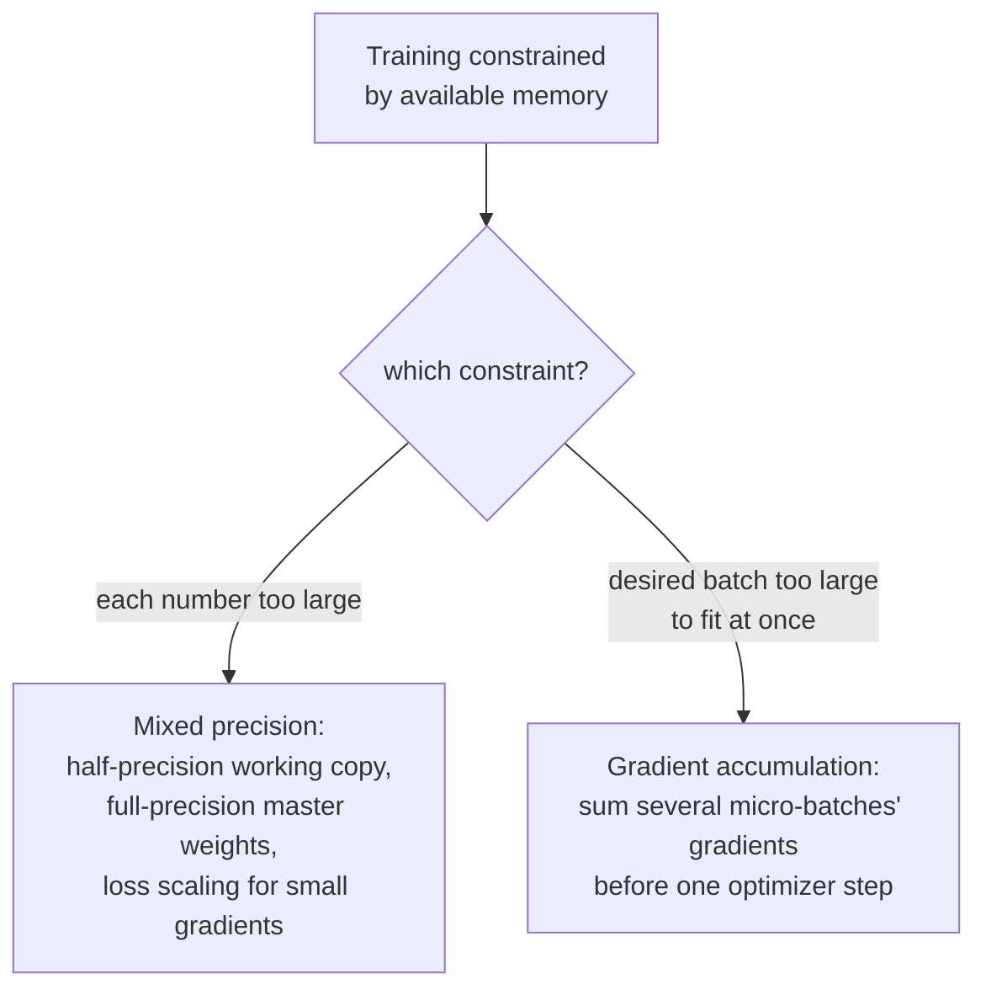

# Урок 20. Смешанная точность и накопление градиентов

**Связь с целью курса:** Урок 19 сделал надёжным один шаг обучения: разумная инициализация, плавно вводимая скорость обучения, ограниченный градиент. Этот урок посвящён другому, очень практическому ограничению: у реального оборудования фиксированный объём памяти, и смешанная точность, и накопление градиентов существуют, чтобы вместить запуск обучения, который иначе был бы слишком велик для этой памяти: первая уменьшает стоимость хранения каждого числа, второе имитирует батч, больший, чем когда-либо поместился бы в память целиком.
**Первоисточник:** [Научная статья: "Mixed Precision Training", Micikevicius et al., 2018](https://arxiv.org/abs/1710.03740)
**Предварительные требования:** [Урок 10](0010-backward-pass-and-autograd.md), [Урок 19](0019-initialization-warmup-and-gradient-clipping.md)

## Разминка

1. ▢ Что заполняет вызов `loss.backward()` и почему градиенты, как правило, нужно обнулять перед следующим вызовом?

Проверка

Он заполняет атрибут `.grad` каждого обучаемого параметра градиентом потерь по этому параметру. Градиенты по умолчанию накапливаются, а не перезаписываются, поэтому без предварительного обнуления градиент нового обратного прохода был бы загрязнён остатками значений предыдущего шага.

2. ▢ Почему отсечение градиента по норме пропорционально уменьшает весь вектор градиента, а не ограничивает градиент каждого параметра по отдельности?

Проверка

Независимое ограничение каждого параметра исказило бы направление, в котором на самом деле указывает совокупный градиент. Пропорциональное уменьшение всего вектора по его общей норме ограничивает размер обновления, оставляя его направление совершенно неизменным.

## Что нужно знать

### Половинная точность сокращает объём каждого числа примерно вдвое

Обычное обучение хранит веса, активации и градиенты как 32-битные числа с плавающей запятой (одинарная точность). **Обучение со смешанной точностью** (mixed precision training) вместо этого хранит их в 16-битном формате (половинная точность) на большей части вычислений, что, как прямо сказано в формулировке самой статьи, сокращает расход памяти почти вдвое и может заметно ускорить вычисления на оборудовании, рассчитанном на арифметику половинной точности. Компромисс реален: у чисел половинной точности гораздо более ограниченный численный диапазон, чем у чисел одинарной точности, и если наивно обучать целиком в половинной точности, малые значения рискуют обнулиться из-за потери значимости.

### Главная копия в полной точности, хранимая рядом с рабочей копией в половинной точности

Первое исправление статьи для ограниченного диапазона половинной точности это поддержание **главной копии весов в полной (одинарной) точности**, которая накапливает обновления оптимизатора на каждом шаге; для прямого и обратного вычисления реально используется лишь копия этих весов в половинной точности, округлённая вниз. Это важно, потому что отдельное обновление веса может быть настолько малым, что обнулится из-за потери значимости, если применить его прямо к уже округлённому значению половинной точности, а накопление обновлений в главной копии в полной точности сохраняет эти малые изменения на многих шагах, теряя точность только когда эта главная копия округляется вниз для фактического вычисления каждого шага.

### Масштабирование потерь: сделать малые градиенты достаточно большими, чтобы пережить половинную точность

Второе исправление статьи касается именно градиентов: многие значения градиентов настолько малы, что обнулились бы из-за потери значимости в ограниченном диапазоне половинной точности, ещё до того как дойдут до оптимизатора. **Масштабирование потерь** (loss scaling) умножает потери на некоторый (часто большой) постоянный множитель перед обратным распространением, что умножает каждый получающийся градиент на тот же множитель и поднимает иначе исчезающие малые градиенты в представимый диапазон половинной точности. После обратного прохода градиенты делятся обратно на тот же масштабирующий множитель, прежде чем шаг оптимизатора реально их использует, отменяя влияние масштабирования на само обновление, но спасая малые значения от обнуления по дороге.

### Накопление градиентов использует факт, который это рабочее пространство уже установило

Разминка урока 11 уже говорила об этом: градиенты по умолчанию накапливаются, а не перезаписываются, и именно поэтому их нужно обнулять перед новым обратным проходом. **Накопление градиентов** (gradient accumulation) это просто решение не обнулять их несколько батчей подряд: выполнять прямой и обратный проходы на нескольких меньших **микробатчах** (micro-batches) последовательно, позволяя градиентам каждого из них прибавляться к предыдущим, а не обнуляться и сразу применяться, и вызывать шаг оптимизатора (и обнуление) только после того, как накопилось выбранное число микробатчей. Получающееся обновление вычисляется по сумме градиентов нескольких микробатчей и имитирует эффект одного большего батча, которому никогда не приходилось целиком помещаться в память.

### Обе техники решают ограничение памяти, а не ограничение моделирования

Ни смешанная точность, ни накопление градиентов не меняют то, что вычисляет модель, и не меняют цель обучения; правильно реализованный запуск с любой из этих техник (или с обеими вместе) должен сойтись по существу к тому же результату, что и запуск, которому они не понадобились. Они меняют только то, как вместить запуск обучения в оборудование с меньшим объёмом памяти, чем потребовали бы числа запуска или желаемый размер батча: одна уменьшает стоимость хранения каждого числа, другое меняет память на несколько лишних прямых и обратных проходов на шаг оптимизатора.

## Практика

1. ▢ Почему модель не может просто обучаться целиком в половинной точности без других поправок, учитывая экономию памяти, которую это дало бы?

Подсказка

Подумайте, что происходит с достаточно малым значением, когда оно хранится в формате с ограниченным численным диапазоном.

Проверка

Ограниченный численный диапазон половинной точности означает, что достаточно малые значения, в том числе многие значения градиентов, могут обнуляться из-за потери значимости, теряя информацию, которая нужна полному запуску обучения; именно поэтому статья предлагает главную копию весов в полной точности и масштабирование потерь, а не обучение только в половинной точности.

2. ▢ Почему обучение со смешанной точностью хранит главную копию весов в полной точности, а не только веса в половинной точности?

Проверка

Обновление веса может быть настолько малым, что обнулится из-за потери значимости, если применить его прямо к уже округлённому значению половинной точности. Накопление обновлений в главной копии в полной точности сохраняет эти малые изменения на многих шагах; до половинной точности на каждом шаге округляется только копия, используемая для фактического прямого и обратного вычисления.

3. ▢ Что масштабирование потерь делает с градиентами при обратном распространении и почему оно отменяется, прежде чем шаг оптимизатора реально их использует?

Проверка

Умножение потерь на масштабирующий множитель перед обратным распространением умножает каждый получающийся градиент на тот же множитель и поднимает малые градиенты, которые иначе обнулились бы из-за потери значимости, в представимый диапазон половинной точности. Обратное деление на тот же множитель после обратного прохода отменяет влияние масштабирования на фактическое обновление, так что исправляется только проблема потери значимости, а не истинная величина обновления.

4. ▢ Команде нужен эффективный размер батча 256, но их оборудование вмещает в память одновременно только 64 примера. Как накопление градиентов позволяет им этого достичь и что именно нужно изменить по сравнению с обычным обучением, чтобы это заработало?

Проверка

Они выполняют прямой и обратный проходы на четырёх микробатчах по 64 примера, не обнуляя градиенты и не делая шаг оптимизатора между ними, позволяя градиентам каждого микробатча накапливаться на предыдущих (то же поведение «накапливать по умолчанию», которое назвал урок 11). Только после того, как выполнены все четыре микробатча, шаг оптимизатора использует объединённый накопленный градиент, а затем градиенты обнуляются для следующего раунда, и это имитирует один батч из 256 примеров, которому никогда не приходилось целиком помещаться в память.

5. ▢ Какое утверждение правильно описывает, что смешанная точность и накопление градиентов меняют в обучении?

    - a) Обе техники меняют вычисляемые выходы модели и цель обучения, жертвуя частью точности ради экономии памяти
    - b) Смешанная точность уменьшает стоимость хранения весов, активаций и градиентов, используя главную копию в полной точности и масштабирование потерь, чтобы компенсировать ограниченный диапазон половинной точности; накопление градиентов имитирует больший батч суммированием градиентов нескольких микробатчей перед одним шагом оптимизатора; ни то ни другое не меняет того, что вычисляет модель
    - c) Накопление градиентов требует обнулять градиенты после каждого микробатча, как обычное обучение
    - d) Масштабирование потерь навсегда меняет величину градиентов, которые использует шаг оптимизатора

Проверка

**b)** Это точная роль каждой техники, ориентированная на память и не меняющая того, что вычисляется. Вариант (a) неверен: при правильной реализации обе техники нацелены на память и пропускную способность, а не на вычисляемый моделью результат. Вариант (c) неверен: накопление градиентов именно что удерживает обнуление между микробатчами, давая градиентам накапливаться. Вариант (d) неверен: эффект масштабирования потерь отменяется (обратным делением) перед шагом оптимизатора, именно чтобы истинная величина обновления не пострадала.

## Практика в реальной работе

- [ ] Реализуйте накопление градиентов в своём цикле обучения: выполните несколько прямых и обратных проходов на микробатчах без обнуления градиентов, затем сделайте один шаг оптимизатора и убедитесь, что накопленный градиент совпадает с тем, что дал бы один больший батч.
- [ ] Если ваше оборудование это позволяет, выполните несколько шагов обучения в половинной точности с главной копией весов в полной точности и сравните расход памяти с обычным запуском в полной точности при том же размере батча.
- [ ] Завтра: прочитайте целиком раздел первоисточника о масштабировании потерь и отметьте, как он рекомендует выбирать масштабирующий множитель и какой сигнал указывает, что множитель слишком велик или слишком мал.

## Что почитать дальше

- [Научная статья: "Mixed Precision Training", Micikevicius et al., 2018](https://arxiv.org/abs/1710.03740)
- [Репозиторий: nanoGPT, Karpathy](https://github.com/karpathy/nanoGPT)
- [Ресурсы](../RESOURCES.md)

---

Не доходит? Перечитайте первоисточник в начале: этот урок его сжимает, а при сжатии понимание как раз и теряется. Загляните в [глоссарий](../GLOSSARY.md), если какой-то термин показался скользким.

Если неясен сам урок, а не материал, это дефект: [откройте issue](https://github.com/TokenCemetery/teach/issues).
