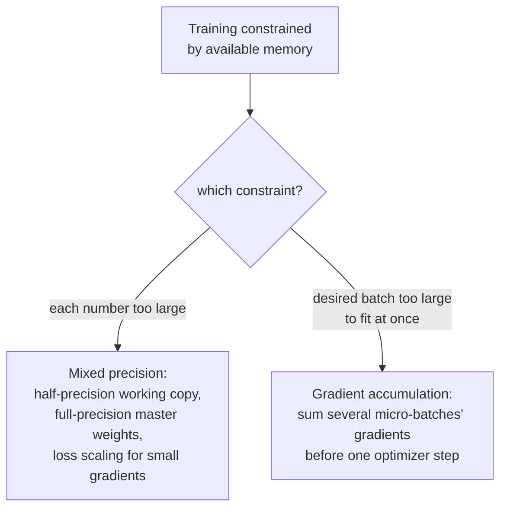

# 第 20 课：混合精度与梯度累积

**使命关联:** 第 19 课让单个训练步骤变得可靠：合理的初始化、逐步引入的学习率、有上限的梯度。本课处理的是另一个非常实际的约束：真实的硬件内存有限，混合精度和梯度累积的存在，都是为了把一次否则对这些内存来说太大的训练运行装进去，办法是缩小每个数字的存储成本，以及模拟一个内存永远无法一次装下的更大批次。
**主要来源:** [论文：“Mixed Precision Training”，Micikevicius 等，2018](https://arxiv.org/abs/1710.03740)
**前置知识:** [第 10 课](0010-backward-pass-and-autograd.md)、[第 19 课](0019-initialization-warmup-and-gradient-clipping.md)

## 热身

1. ▢ 调用 `loss.backward()` 会填充什么？为什么在下一次调用之前，通常必须把梯度清零？

检查

它用损失对每个可训练参数的梯度，填充该参数的 `.grad` 属性。梯度默认是累加而不是覆盖，所以如果不先清零，新一次反向传播的梯度就会被上一步遗留的值污染。

2. ▢ 为什么梯度范数裁剪是重新缩放整个梯度向量，而不是分别限制每个参数的梯度？

检查

分别限制每个参数，会扭曲合并后的梯度实际指向的方向。按整体范数重新缩放整个向量，限制了更新的大小，同时让它的方向完全不变。

## 要点

### 半精度把每个数字的占用大致减半

普通的训练把权重、激活值和梯度存成 32 位（单精度）浮点数。**混合精度训练**在计算的大部分时间里，改用 16 位（半精度）格式来存储它们，论文自己的表述直截了当地指出，这把内存消耗减少了将近一半，而且在为半精度算术而设计的硬件上，能明显加快计算。这种取舍是真实的：半精度数字的数值范围，比单精度的有限得多，完全用半精度来训练，会有很小的值下溢为恰好是零的风险。

### 一份全精度的主副本，与半精度的工作副本并存

论文针对半精度范围有限所提出的第一个修正，是维护一份**全（单）精度的权重主副本**，每一步都在它上面累积优化器的更新；真正用于前向和反向计算的，只是这些权重的一份半精度的、向下取整后的副本。这一点之所以重要，是因为单个权重更新可能小到，直接加到一个已经取整过的半精度值上就会下溢为零，而在全精度主副本里累积更新，则能在许多步之间保住这些微小的变化，只在这份主副本为每一步的实际计算而向下取整时，才损失精度。

### 损失缩放：让小梯度变大，足以撑过半精度

论文的第二个修正专门针对梯度：许多梯度值小到，在半精度有限的范围内，还没到达优化器就会下溢为零。**损失缩放**在反向传播之前，把损失乘以某个（通常很大的）常数因子，这会把随之得到的每个梯度都乘以同一个因子，把本来会消失的小梯度，抬进半精度可表示的范围。反向传播之后，梯度在优化器步骤真正使用它们之前，要除以同一个缩放因子还原回去，抵消了缩放对更新本身的影响，同时一路上已经把小的值从下溢中挽救了出来。

### 梯度累积复用了这个工作区早已确立的一个事实

第 11 课自己的热身里已经说过：梯度默认是累加而不是覆盖，这正是它们必须在新的一次反向传播之前清零的原因。**梯度累积**不过是选择连续好几个批次都不把它们清零：依次在几个较小的**微批次**上运行前向和反向传播，让每一个的梯度叠加到前面的梯度上，而不是立刻清零并走一步，只有在累积了选定数量的微批次之后，才调用优化器步骤（并清零）。得到的更新，是根据几个微批次的梯度之和算出来的，模拟了一个更大批次的效果，而这个批次其实从未需要一次性装进内存。

### 这两种技术解决的是内存约束，而不是建模约束

混合精度和梯度累积，都没有改变模型计算什么，也没有改变训练目标是什么；一次正确实现的、用了其中任何一种技术（或两者一起）的运行，应当收敛到与不需要它们的运行基本相同的结果。它们所改变的，完全在于把一次训练运行装进内存比这次运行的数字或所期望的批大小原本所需的更少的硬件上，一个靠缩小每个数字的存储成本，另一个靠用每个优化器步骤多做几次前向和反向传播，来换取内存。

## 练习

1. ▢ 考虑到完全用半精度训练能带来的内存节省，为什么模型不能不做任何其他调整，直接完全用半精度训练？

提示

想一想，一个足够小的值，一旦存进数值范围有限的格式里，会发生什么。

检查

半精度有限的数值范围，意味着足够小的值，包括许多梯度值，可能下溢为恰好是零，丢掉完整的训练运行所需要的信息；这正是论文提出全精度的主权重副本和损失缩放，而不是只用半精度训练的原因。

2. ▢ 为什么混合精度训练要保留一份全精度的权重主副本，而不是只用半精度存储权重？

检查

权重更新可能小到，直接加到一个已经取整过的半精度值上就会下溢为零。在全精度主副本里累积更新，能在许多步之间保住这些微小的变化；只有用于实际前向/反向计算的那份副本，在每一步才被向下取整成半精度。

3. ▢ 损失缩放在反向传播期间对梯度做了什么？为什么要在优化器步骤真正使用它们之前把它还原？

检查

在反向传播之前把损失乘以一个缩放因子，会把随之得到的每个梯度都乘以同一个因子，把本来会下溢为零的小梯度，抬进半精度可表示的范围。反向传播之后再除以同一个因子，抵消了缩放对实际更新的影响，所以被修正的只有下溢问题，而不是更新真实的量级。

4. ▢ 一个团队想要 256 的有效批大小，但他们的硬件一次只能在内存里装下 64 个样本。梯度累积如何让他们做到这一点？与普通训练相比，具体要改变什么才能行得通？

检查

他们对四个各含 64 个样本的微批次运行前向和反向传播，期间不清零梯度，也不让优化器走步，让每个微批次的梯度累加到前面的梯度上（即第 11 课点出的默认累加的行为）。只有在这四个微批次都运行完之后，优化器步骤才使用合并后的、累积的梯度，然后为下一轮把梯度清零，模拟了一个包含 256 个样本、却从未需要一次性装进内存的批次。

5. ▢ 下面哪一项说法正确描述了混合精度和梯度累积对训练改变了什么？

    - a) 两种技术都改变了模型计算出的输出和训练目标，用一些精度换取内存节省
    - b) 混合精度用全精度的主副本和损失缩放来对付半精度有限的范围，缩小权重、激活值和梯度的存储成本；梯度累积通过在一次优化器步骤之前，把几个微批次的梯度求和，来模拟更大的批次；两者都不改变模型计算什么
    - c) 梯度累积要求在每个微批次之后都清零梯度，与普通训练相同
    - d) 损失缩放永久地改变了优化器步骤所用梯度的量级

检查

**b)** 这正是每种技术所扮演的、以内存为重点的精确角色，而不改变所计算的东西。(a) 是错的：正确实现之后，两种技术针对的都是内存和吞吐量，而不是模型计算出的结果。(c) 是错的：梯度累积恰恰是在微批次之间不清零，让梯度累积起来。(d) 是错的：损失缩放的影响，在优化器步骤之前被抵消了（除回去），恰恰是为了不影响更新真实的量级。

## 实战练习

- [ ] 在你的训练循环里实现梯度累积：运行几次微批次的前向/反向传播，期间不清零梯度，然后让优化器只走一步，并确认累积的梯度与一个更大的批次本来会产生的一致。
- [ ] 如果你的硬件支持，用全精度的权重主副本，以半精度运行几步训练，并与同样批大小下普通的全精度运行比较内存使用情况。
- [ ] 明天：完整阅读主要来源中关于损失缩放的那一节，并记下它建议如何选择缩放因子，以及什么信号表明这个因子太大或太小。

## 延伸阅读

- [论文：“Mixed Precision Training”，Micikevicius 等，2018](https://arxiv.org/abs/1710.03740)
- [仓库：nanoGPT，Karpathy](https://github.com/karpathy/nanoGPT)
- [资源](../RESOURCES.md)

---

没学明白？请重读顶部的主要来源，因为本课是对它的压缩，而理解正是在压缩中流失的。如果有哪个术语觉得含糊，可以查看[术语表](../GLOSSARY.md)。

如果问题出在课程本身，而不是学习材料，那就是一个缺陷：[提交 issue](https://github.com/TokenCemetery/teach/issues)。
