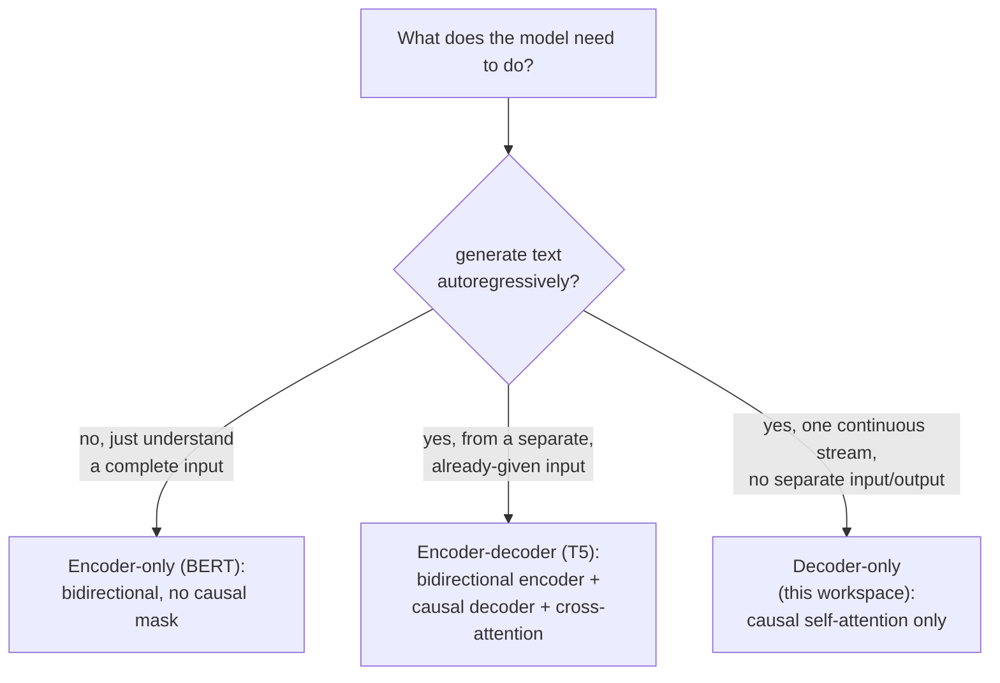

# Lección 21. Arquitecturas encoder-decoder y encoder-only

**Vínculo con la misión:** La lección 3 añadió una máscara causal porque la generación autorregresiva "que acabará haciendo el modelo de este espacio de trabajo" la exigía, sin decir nunca cómo es un transformer cuando *no* la necesita. Esta lección sitúa la arquitectura decoder-only que construyó todo este espacio de trabajo frente a las otras dos formas que usan realmente los modelos reales, y deriva exactamente por qué cada una necesita (o no necesita) la máscara causal que construyó la lección 3.
**Fuente principal:** [Paper: "BERT: Pre-training of Deep Bidirectional Transformers for Language Understanding", Devlin et al., 2018](https://arxiv.org/abs/1810.04805)
**Requisitos previos:** [Lección 3](0003-causal-masking.md), [Lección 20](0020-mixed-precision-and-gradient-accumulation.md)

## Calentamiento

1. ▢ ¿Por qué la atención de la posición `i` no debe incluir ninguna posición `j` mayor que `i`, dado cómo se usará realmente el modelo en el momento de la inferencia?

Comprobación

En la inferencia, el modelo genera un token cada vez usando solo los tokens que vinieron antes; los tokens posteriores a la posición actual todavía no existen cuando se la está prediciendo. Dejar que el entrenamiento atienda a una posición posterior enseñaría al modelo a depender de información que nunca está disponible en el momento real de generar.

2. ▢ ¿Por qué el entrenamiento con precisión mixta conserva una copia maestra de los pesos en precisión completa, en lugar de almacenar los pesos solo en media precisión?

Comprobación

Una actualización de un peso puede ser lo bastante pequeña como para sufrir underflow hasta cero si se aplica directamente a un valor ya redondeado a media precisión. Acumular las actualizaciones en una copia maestra de precisión completa conserva esos cambios pequeños a lo largo de muchos pasos.

## Qué debes saber

### La máscara causal existe específicamente porque la generación es de un token cada vez

Toda la justificación de la lección 3 para la máscara causal era la generación: un modelo que produce texto un token cada vez solo puede usar tokens que ya existen, así que el entrenamiento tiene que ajustarse a esa restricción o aprenderá a depender de información que no estará disponible más adelante. Esta justificación solo se aplica a un modelo que genera realmente su salida de forma autorregresiva. Un modelo cuyo trabajo es entender un fragmento de texto ya completo, no generar uno, no tiene que satisfacer tal restricción, y nada lo obliga a enmascarar nada.

### Encoder-only: atención bidireccional, porque no hay nada que generar

**BERT** es la arquitectura **encoder-only** canónica, y su propio paper enuncia la decisión de diseño directamente: preentrena representaciones bidireccionales profundas **condicionando conjuntamente en el contexto de la izquierda y el de la derecha en todas las capas**, sin máscara causal en ninguna parte, de modo que cada posición puede atender a cualquier otra, anterior o posterior, de la misma secuencia. Esto es posible precisamente porque un modelo encoder-only no está generando una secuencia token a token; está construyendo una representación de una entrada completa y ya dada, y luego lee esa representación (mediante una capa de salida añadida) para responder una pregunta sobre toda la entrada, clasificación, extracción, relevancia, en lugar de continuarla. La restricción de la lección 3 (no atender a tokens que todavía no existen) simplemente no se aplica, porque en la entrada que recibe un modelo encoder-only no hay un "todavía no".

### Encoder-decoder: dos pilas, y una tercera subcapa que las conecta

El paper original del transformer (la fuente principal de este mismo espacio de trabajo) describe en realidad una arquitectura **encoder-decoder**, y este espacio de trabajo construyó solo su mitad decoder. Un modelo encoder-decoder como **T5** pasa una secuencia de entrada por un **encoder** bidireccional (estructurado como el de BERT, sin máscara causal, ya que toda la entrada ya está dada), y luego genera una secuencia de salida mediante un **decoder** que combina tres subcapas por bloque en lugar de las dos de este espacio de trabajo: self-attention causal sobre la salida del propio decoder hasta ahora (exactamente el mecanismo de la lección 3), una nueva subcapa de **cross-attention** cuyas queries vienen del decoder pero cuyas keys y values vienen de la salida del encoder, que permite al decoder consultar toda la entrada mientras genera, y el bloque feed-forward. La contribución propia de T5 fue mostrar que una enorme gama de tareas de NLP (traducción, resumen, clasificación, respuesta a preguntas) puede reformularse en un único formato coherente de **texto a texto**, texto de entrada y texto de salida, que es exactamente la forma que un modelo encoder-decoder está construido para consumir y producir.

### El modelo decoder-only de este espacio de trabajo es lo que queda cuando la entrada y la salida son el mismo flujo único

Un modelo decoder-only no tiene encoder separado ni ninguna subcapa de cross-attention, porque no tiene una "entrada" separada que consultar mientras genera otra cosa; la secuencia en la que se condiciona y la secuencia que genera son el mismo flujo único, solo que en posiciones distintas dentro de él. Por eso mismo la máscara causal de la lección 3, aplicada a la self-attention de ese único flujo, fue la única adaptación arquitectónica que necesitó jamás este espacio de trabajo: nunca hubo una segunda secuencia sobre la que atender, solo el propio pasado de una secuencia.

### Por qué decoder-only se volvió la forma dominante para la generación de propósito general

Un modelo encoder-only estructuralmente no puede generar texto de forma autorregresiva en absoluto, su atención bidireccional nunca se entrenó para predecir un siguiente token a partir de un simple prefijo, que es exactamente lo que la restricción de la lección 3 existe para hacer posible. Un modelo encoder-decoder sí puede generar, pero necesita dos pilas coordinadas y un mecanismo de cross-attention, más adecuados para una tarea con una separación limpia y fija entre entrada y salida (traduce esta frase, resume este documento) que para una conversación abierta donde lo que cuenta como "entrada" y como "salida" cambia turno a turno. El flujo único de un modelo decoder-only maneja ambos papeles a la vez con una arquitectura y un objetivo de entrenamiento, que es por lo que los modelos generativos abiertos y de propósito general hacia los que ha ido construyendo este espacio de trabajo convergieron en ella.

## Práctica

1. ▢ ¿Por qué no puede usarse la propia arquitectura de BERT para generar texto un token cada vez, como hace el modelo decoder-only de este espacio de trabajo?

Pista

Considera qué asume realmente la atención bidireccional de BERT, tal como se entrenó, sobre qué tokens están disponibles.

Comprobación

La atención bidireccional de BERT condiciona en el contexto de la izquierda y el de la derecha en cada capa, lo que significa que se entrenó asumiendo que toda la entrada ya está disponible en cada posición; nunca se entrenó para predecir un token usando solo un prefijo, que es exactamente la restricción que impone la máscara causal de la lección 3 y que la arquitectura de BERT no tiene.

2. ▢ El bloque decoder de un modelo encoder-decoder tiene tres subcapas en lugar de las dos de este espacio de trabajo. ¿Qué hace la tercera, y de dónde vienen sus entradas?

Comprobación

Cross-attention: sus queries vienen de la propia secuencia del decoder, pero sus keys y values vienen de la salida del encoder, lo que permite al decoder consultar toda la entrada ya codificada mientras genera su propia secuencia de salida un token cada vez.

3. ▢ ¿Por qué el modelo decoder-only de este espacio de trabajo nunca necesita una subcapa de cross-attention?

Comprobación

Porque no tiene un encoder separado ni una secuencia de entrada separada sobre la que atender; la secuencia en la que se condiciona y la secuencia que genera son el mismo flujo único, así que la self-attention causal sobre ese único flujo es el único mecanismo de atención que necesita la arquitectura.

4. ▢ ¿Por qué una arquitectura encoder-decoder, y no decoder-only, es adecuada para una tarea como la traducción automática con una separación limpia entre entrada y salida, aunque un modelo decoder-only también podría en principio aprender a traducir?

Comprobación

El propio planteamiento de T5 muestra el valor de la forma texto a texto: una entrada fija (la frase de origen) está completamente disponible de antemano y el encoder puede procesarla de forma bidireccional, mientras el decoder genera la traducción con cross-attention de vuelta a esa entrada completa. Una tarea con esta clase de separación limpia y de un solo golpe entre entrada y salida encaja directamente con la división encoder-decoder, mientras que una conversación abierta, turno a turno, no tiene un punto fijo donde termine la "entrada" y empiece la "salida".

5. ▢ ¿Qué afirmación distingue correctamente las arquitecturas encoder-only, encoder-decoder y decoder-only?

    - a) Las tres usan la misma máscara causal que construyó este espacio de trabajo en la lección 3, solo que aplicada a distinto número de pilas
    - b) Encoder-only (BERT) usa atención bidireccional sin máscara causal, ya que no genera texto de forma autorregresiva; encoder-decoder (T5) empareja un encoder bidireccional con un decoder causal conectados por cross-attention; decoder-only (este espacio de trabajo) usa solo self-attention causal sobre un único flujo compartido
    - c) La cross-attention es una subcapa que los modelos decoder-only usan para atender a sus propias capas anteriores
    - d) BERT puede usarse para la generación autorregresiva de texto exactamente igual que el modelo decoder-only de este espacio de trabajo

Comprobación

**b)** Esa es la distinción arquitectónica precisa que establece esta lección. (a) es falsa: el encoder de BERT no usa ninguna máscara causal, ya que no genera tokens uno a uno. (c) es falsa: la cross-attention conecta un decoder con la salida de un encoder separado, no un modelo con sus propias capas anteriores. (d) es falsa: el entrenamiento bidireccional de BERT nunca aprendió a predecir un token a partir de un simple prefijo, justo la capacidad que la máscara causal de la lección 3 existe para dar.

## Prácticas en el mundo real

- [ ] Para una biblioteca de modelos a la que tengas acceso, encuentra un modelo encoder-only (como una variante de BERT), un modelo encoder-decoder (como una variante de T5) y un modelo decoder-only, y comprueba la configuración de la máscara de atención de cada uno en su código o su configuración.
- [ ] Para una tarea que conozcas (clasificación, traducción o chat abierto), decide cuál de las tres formas de arquitectura encaja mejor con ella, y explica por qué usando el planteamiento de esta lección.
- [ ] Mañana: lee completa la sección del paper de BERT sobre los objetivos de preentrenamiento (masked language modeling y next sentence prediction), y anota en qué se diferencian del propio objetivo de entrenamiento de siguiente token de este espacio de trabajo (lección 9).

## Para profundizar

- [Paper: "BERT: Pre-training of Deep Bidirectional Transformers for Language Understanding", Devlin et al., 2018](https://arxiv.org/abs/1810.04805)
- [Paper: "Exploring the Limits of Transfer Learning with a Unified Text-to-Text Transformer" (T5), Raffel et al., 2019](https://arxiv.org/abs/1910.10683)
- [Paper: "Attention Is All You Need", Vaswani et al., 2017](https://arxiv.org/abs/1706.03762)
- [Recursos](../RESOURCES.md)

---

¿No termina de quedar claro? Vuelve a leer la fuente primaria de arriba, ya que esta lección la comprime y en la compresión es donde se escapa la comprensión. Consulta el [glosario](../GLOSSARY.md) por si algún término te resultó resbaladizo.

Si lo poco claro es la propia lección y no el material, eso es un defecto: [abre un issue](https://github.com/TokenCemetery/teach/issues).
