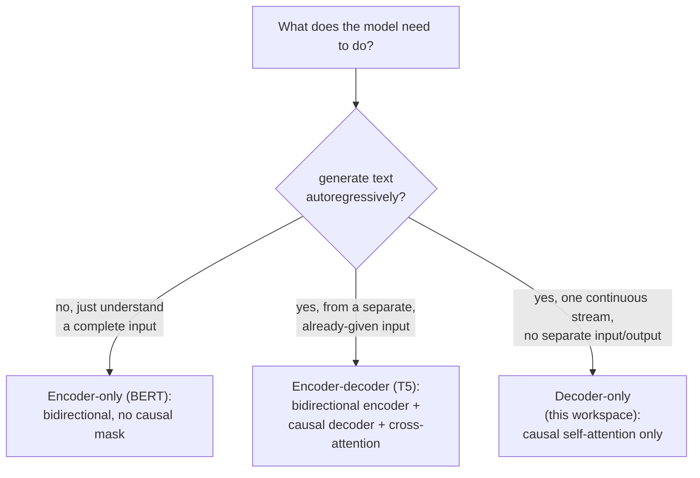

# Leçon 21. Architectures encodeur-décodeur et encodeur seul

**Lien avec la mission :** La leçon 3 a ajouté un masque causal parce que « le modèle de cet espace de travail finira par faire » de la génération autorégressive, sans jamais dire à quoi ressemble un transformer quand il n'en a *pas* besoin. Cette leçon situe l'architecture decoder-only que tout cet espace de travail a construite par rapport aux deux autres formes que les vrais modèles utilisent, et dérive exactement pourquoi chacune a besoin (ou non) du masque causal que la leçon 3 a construit.
**Source primaire :** [Article : "BERT: Pre-training of Deep Bidirectional Transformers for Language Understanding", Devlin et al., 2018](https://arxiv.org/abs/1810.04805)
**Prérequis :** [Leçon 3](0003-causal-masking.md), [Leçon 20](0020-mixed-precision-and-gradient-accumulation.md)

## Échauffement

1. ▢ Pourquoi l'attention de la position `i` ne doit-elle inclure aucune position `j` supérieure à `i`, étant donné la façon dont le modèle sera réellement utilisé à l'inférence ?

Vérifier

À l'inférence, le modèle génère un token à la fois en utilisant seulement les tokens qui le précèdent ; les tokens situés après la position courante n'existent pas encore au moment où elle est prédite. Laisser l'entraînement porter son attention sur une position ultérieure apprendrait au modèle à s'appuyer sur une information qui n'est jamais disponible au moment de la génération réelle.

2. ▢ Pourquoi l'entraînement en précision mixte conserve-t-il une copie maître des poids en pleine précision, plutôt que de ne jamais stocker les poids qu'en demi-précision ?

Vérifier

Une mise à jour de poids peut être assez petite pour tomber à zéro par underflow si on l'applique directement à une valeur en demi-précision déjà arrondie. Accumuler les mises à jour dans une copie maître en pleine précision préserve ces petits changements sur de nombreux pas.

## À savoir

### Le masque causal existe précisément parce que la génération se fait un token à la fois

Toute la justification du masquage causal à la leçon 3 était la génération : un modèle qui produit du texte un token à la fois ne peut jamais utiliser que des tokens qui existent déjà, donc l'entraînement doit respecter cette contrainte sous peine d'apprendre à s'appuyer sur une information qui ne sera plus là ensuite. Cette justification ne s'applique qu'à un modèle qui génère réellement sa sortie de façon autorégressive. Un modèle dont la tâche est de comprendre un texte déjà complet, et non d'en générer un, n'a aucune contrainte de ce genre à satisfaire, et rien ne l'oblige à masquer quoi que ce soit.

### Encoder-only : une attention bidirectionnelle, parce qu'il n'y a rien à générer

**BERT** est l'architecture **encoder-only** canonique, et son article énonce directement le choix de conception : il pré-entraîne des représentations bidirectionnelles profondes en **conditionnant conjointement sur le contexte de gauche et de droite dans toutes les couches**, sans aucun masque causal, chaque position pouvant porter son attention sur toutes les autres, avant comme après elle, dans la même séquence. C'est possible précisément parce qu'un modèle encoder-only ne génère pas une séquence token par token ; il construit une représentation d'une entrée complète, déjà donnée, puis lit cette représentation (par une couche de sortie ajoutée) pour répondre à une question sur toute l'entrée, classification, extraction, pertinence, plutôt que de la prolonger. La contrainte de la leçon 3 (ne pas porter son attention sur des tokens qui n'existent pas encore) ne s'applique tout simplement pas, parce qu'il n'y a pas de « pas encore » dans l'entrée donnée à un modèle encoder-only.

### Encoder-decoder : deux piles, et une troisième sous-couche qui les relie

L'article du transformer d'origine (la propre source primaire de cet espace de travail) décrit en réalité une architecture **encoder-decoder**, et cet espace de travail n'en a construit que la moitié décodeur. Un modèle encoder-decoder comme **T5** fait passer une séquence d'entrée par un **encodeur** bidirectionnel (structuré comme celui de BERT, sans masque causal, puisque toute l'entrée est déjà donnée), puis génère une séquence de sortie par un **décodeur** qui combine trois sous-couches par bloc au lieu des deux de cet espace de travail : une self-attention causale sur la sortie déjà produite du décodeur (exactement le mécanisme de la leçon 3), une nouvelle sous-couche de **cross-attention** dont les requêtes viennent du décodeur mais dont les clés et les valeurs viennent de la sortie de l'encodeur, ce qui permet au décodeur de consulter toute l'entrée pendant qu'il génère, et le bloc feed-forward. La contribution propre de T5 a été de montrer qu'un très large éventail de tâches de NLP (traduction, résumé, classification, question-réponse) peut se ramener à un seul format cohérent **text-to-text**, texte en entrée, texte en sortie, ce qui est exactement la forme qu'un modèle encoder-decoder est construit pour consommer et produire.

### Le modèle decoder-only de cet espace de travail, c'est ce qui reste quand l'entrée et la sortie forment un seul et même flux

Un modèle decoder-only n'a ni encodeur distinct ni aucune sous-couche de cross-attention, parce qu'il n'a pas d'« entrée » séparée à consulter pendant qu'il génère autre chose ; la séquence sur laquelle il se conditionne et la séquence qu'il génère sont le même flux unique, simplement à des positions différentes. C'est précisément pourquoi le masque causal de la leçon 3, appliqué à la self-attention de ce flux unique, a été le seul aménagement d'architecture dont cet espace de travail ait jamais eu besoin : il n'y a jamais eu de seconde séquence sur laquelle porter son attention, seulement le passé d'une seule séquence.

### Pourquoi le decoder-only est devenu la forme dominante pour la génération à usage général

Un modèle encoder-only ne peut structurellement pas générer de texte de façon autorégressive, son attention bidirectionnelle n'a jamais été entraînée à prédire un token suivant à partir d'un simple préfixe, ce que la contrainte de la leçon 3 existe précisément pour rendre possible. Un modèle encoder-decoder peut générer, mais il lui faut deux piles coordonnées et un mécanisme de cross-attention, mieux adaptés à une tâche à séparation entrée puis sortie nette et fixe (traduire cette phrase, résumer ce document) qu'à une conversation ouverte où ce qui compte comme « entrée » et « sortie » change à chaque tour. Le flux unique d'un modèle decoder-only gère les deux rôles à la fois avec une seule architecture et un seul objectif d'entraînement, ce qui explique pourquoi les modèles génératifs ouverts à usage général vers lesquels cet espace de travail a progressé ont convergé vers lui.

## Pratique

1. ▢ Pourquoi l'architecture de BERT ne peut-elle pas servir à générer du texte un token à la fois, comme le fait le modèle decoder-only de cet espace de travail ?

Indice

Réfléchissez à ce que l'attention bidirectionnelle de BERT a réellement été entraînée à supposer sur les tokens disponibles.

Vérifier

L'attention bidirectionnelle de BERT se conditionne sur le contexte de gauche et de droite à chaque couche, ce qui signifie qu'elle a été entraînée en supposant que toute l'entrée est déjà disponible à chaque position ; elle n'a jamais été entraînée à prédire un token à partir d'un simple préfixe, ce qui est exactement la contrainte qu'impose le masque causal de la leçon 3 et que l'architecture de BERT n'a pas.

2. ▢ Le bloc décodeur d'un modèle encoder-decoder a trois sous-couches au lieu des deux de cet espace de travail. Que fait la troisième, et d'où viennent ses entrées ?

Vérifier

La cross-attention : ses requêtes viennent de la séquence propre du décodeur, mais ses clés et ses valeurs viennent de la sortie de l'encodeur, ce qui permet au décodeur de consulter l'entrée complète, déjà encodée, pendant qu'il génère sa propre séquence de sortie un token à la fois.

3. ▢ Pourquoi le modèle decoder-only de cet espace de travail n'a-t-il jamais besoin d'une sous-couche de cross-attention ?

Vérifier

Parce qu'il n'a ni encodeur distinct ni séquence d'entrée séparée sur laquelle porter son attention ; la séquence sur laquelle il se conditionne et la séquence qu'il génère sont le même flux unique, donc la self-attention causale sur ce flux unique est le seul mécanisme d'attention dont l'architecture ait besoin.

4. ▢ Pourquoi une architecture encoder-decoder, plutôt que decoder-only, est-elle bien adaptée à une tâche comme la traduction automatique, à séparation entrée puis sortie nette, même si un modèle decoder-only pourrait en principe aussi apprendre à traduire ?

Vérifier

La formulation de T5 montre l'intérêt de la forme text-to-text : une entrée fixe (la phrase source) est entièrement disponible dès le départ et peut être traitée de façon bidirectionnelle par l'encodeur, tandis que le décodeur génère la traduction avec une cross-attention vers cette entrée complète. Une tâche à séparation entrée puis sortie nette, en une seule fois, correspond directement à la séparation encoder-decoder, alors qu'une conversation ouverte, tour par tour, n'a pas de point fixe où l'« entrée » s'arrête et où la « sortie » commence.

5. ▢ Quelle affirmation distingue correctement les architectures encoder-only, encoder-decoder et decoder-only ?

    - a) Les trois utilisent le même masquage causal que cet espace de travail a construit à la leçon 3, simplement appliqué à des nombres de piles différents
    - b) L'encoder-only (BERT) utilise une attention bidirectionnelle sans masque causal, puisqu'il ne génère pas de texte de façon autorégressive ; l'encoder-decoder (T5) associe un encodeur bidirectionnel à un décodeur causal reliés par la cross-attention ; le decoder-only (cet espace de travail) n'utilise que de la self-attention causale sur un flux partagé unique
    - c) La cross-attention est une sous-couche que les modèles decoder-only utilisent pour porter leur attention sur leurs propres couches antérieures
    - d) BERT peut servir à la génération autorégressive de texte exactement comme le modèle decoder-only de cet espace de travail

Vérifier

**b)** C'est la distinction d'architecture précise qu'établit cette leçon. (a) est faux : l'encodeur de BERT n'utilise aucun masque causal, puisqu'il ne génère pas de tokens un à un. (c) est faux : la cross-attention relie un décodeur à la sortie d'un encodeur distinct, et non un modèle à ses propres couches antérieures. (d) est faux : l'entraînement bidirectionnel de BERT n'a jamais appris à prédire un token à partir d'un simple préfixe, exactement la capacité que le masque causal de la leçon 3 existe pour fournir.

## Exercices en situation réelle

- [ ] Dans une bibliothèque de modèles à laquelle vous avez accès, trouvez un modèle encoder-only (comme une variante de BERT), un modèle encoder-decoder (comme une variante de T5) et un modèle decoder-only, et vérifiez la configuration du masque d'attention de chacun dans son code ou sa config.
- [ ] Pour une tâche que vous connaissez (classification, traduction ou chat ouvert), décidez laquelle des trois formes d'architecture lui convient le mieux, et expliquez pourquoi avec la grille de cette leçon.
- [ ] Demain : lisez en entier la section de l'article de BERT sur les objectifs de pré-entraînement (masked language modeling et next sentence prediction), et notez en quoi ils diffèrent de l'objectif d'entraînement par token suivant de cet espace de travail (leçon 9).

## Pour aller plus loin

- [Article : "BERT: Pre-training of Deep Bidirectional Transformers for Language Understanding", Devlin et al., 2018](https://arxiv.org/abs/1810.04805)
- [Article : "Exploring the Limits of Transfer Learning with a Unified Text-to-Text Transformer" (T5), Raffel et al., 2019](https://arxiv.org/abs/1910.10683)
- [Article : "Attention Is All You Need", Vaswani et al., 2017](https://arxiv.org/abs/1706.03762)
- [Ressources](../RESOURCES.md)

---

Ça ne passe pas ? Relisez la source primaire en haut de page, car cette leçon la condense et c'est dans la condensation que la compréhension s'échappe. Consultez le [glossaire](../GLOSSARY.md) pour tout terme qui vous a paru glissant.

Si c'est la leçon elle-même qui n'est pas claire plutôt que la matière, c'est un défaut : [ouvrez une issue](https://github.com/TokenCemetery/teach/issues).
