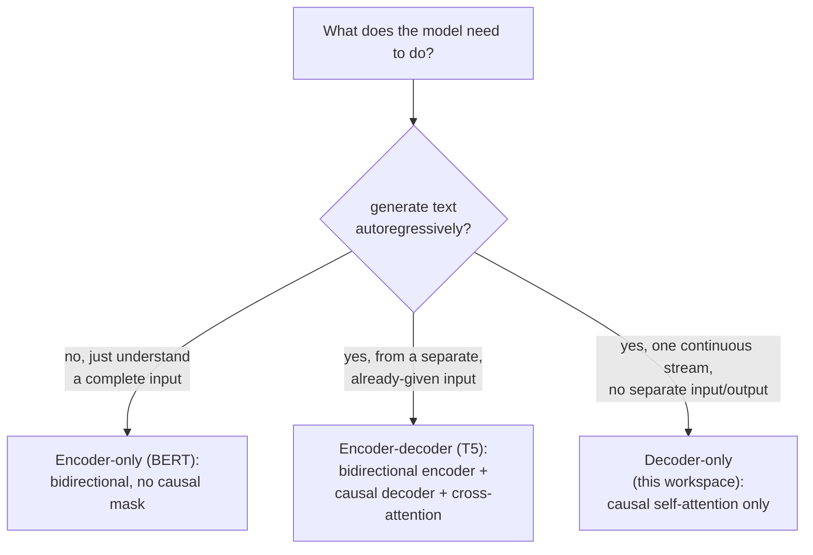

# पाठ 21. Encoder-Decoder और Encoder-Only Architectures

**मिशन से संबंध:** पाठ 3 ने causal mask इसलिए जोड़ा क्योंकि "इस workspace का model आगे चलकर" autoregressive generation करेगा, पर यह कभी नहीं बताया कि transformer तब कैसा दिखता है जब उसे इसकी ज़रूरत *नहीं* होती। यह पाठ इस पूरे workspace में बने decoder-only architecture को उन दो दूसरे आकारों के सामने रखता है जो असली models असल में इस्तेमाल करते हैं, और निकालता है कि हर एक को पाठ 3 में बने causal mask की ज़रूरत क्यों है (या क्यों नहीं)।
**मुख्य स्रोत:** [पेपर: "BERT: Pre-training of Deep Bidirectional Transformers for Language Understanding", Devlin et al., 2018](https://arxiv.org/abs/1810.04805)
**पूर्व-आवश्यकताएँ:** [पाठ 3](0003-causal-masking.md), [पाठ 20](0020-mixed-precision-and-gradient-accumulation.md)

## वार्म-अप

1. ▢ Inference के समय model का असल इस्तेमाल जिस तरह होगा, उसे देखते हुए position `i` की attention में `i` से बड़ी कोई position `j` क्यों शामिल नहीं होनी चाहिए?

जाँचें

Inference में model एक बार में एक token generate करता है और सिर्फ़ अपने से पहले आए tokens का इस्तेमाल करता है; मौजूदा position के बाद के tokens उसे predict करते समय मौजूद ही नहीं होते। Training में किसी बाद की position पर attend करने देना model को ऐसी जानकारी पर निर्भर होना सिखा देता जो असली generation के समय कभी उपलब्ध नहीं होती।

2. ▢ Mixed precision training weights की पूरी precision वाली master copy क्यों रखती है, weights को सिर्फ़ half precision में रखने के बजाय?

जाँचें

किसी weight update को सीधे पहले से गोल किए half-precision मान पर लगाया जाए तो वह इतना छोटा हो सकता है कि शून्य तक underflow हो जाए। पूरी precision वाली master copy में updates जमा करना उन छोटे बदलावों को कई steps तक बचाए रखता है।

## यह जानें

### Causal mask ख़ास तौर पर इसलिए है क्योंकि generation एक बार में एक token होती है

पाठ 3 में causal masking का पूरा औचित्य generation था: text को एक बार में एक token बनाने वाला model सिर्फ़ उन्हीं tokens का इस्तेमाल कर सकता है जो पहले से मौजूद हैं, इसलिए training को उस पाबंदी से मेल खाना पड़ता है वरना वह ऐसी जानकारी पर निर्भर होना सीख लेता है जो बाद में वहाँ नहीं होगी। यह औचित्य सिर्फ़ उस model पर लागू होता है जो असल में output को autoregressively generate करता है। जिस model का काम text के पहले से पूरे टुकड़े को समझना है, उसे generate करना नहीं, उस पर ऐसी कोई पाबंदी निभाने को नहीं है, और कुछ भी mask करने के लिए कुछ उसे मजबूर नहीं करता।

### Encoder-only: bidirectional attention, क्योंकि generate करने को कुछ नहीं है

**BERT** मानक **encoder-only** architecture है, और उसका अपना पेपर इस design चुनाव को सीधे कहता है: वह **सभी layers में बाएँ और दाएँ दोनों संदर्भ पर एक साथ conditioning** करके गहरी bidirectional representations को pre-train करता है, कहीं कोई causal mask नहीं, हर position उसी sequence की हर दूसरी position पर, उससे पहले और बाद की, attend कर सकती है। यह ठीक इसलिए संभव है कि encoder-only model sequence को token-दर-token generate नहीं कर रहा; वह पहले से दिए गए पूरे input की representation बना रहा है, फिर उस representation को पढ़कर (एक जोड़ी गई output layer से) पूरे input के बारे में सवाल का जवाब दे रहा है, classification, extraction, relevance, उसे आगे बढ़ाने के बजाय। पाठ 3 की पाबंदी (उन tokens पर attend न करना जो अभी मौजूद नहीं हैं) बस लागू नहीं होती, क्योंकि encoder-only model को दिए गए input में कोई "अभी नहीं" है ही नहीं।

### Encoder-decoder: दो stacks, और उन्हें जोड़ने वाली तीसरी sublayer

मूल transformer पेपर (इस workspace का अपना मुख्य स्रोत) असल में **encoder-decoder** architecture बताता है, और इस workspace ने उसका सिर्फ़ decoder वाला आधा हिस्सा बनाया। **T5** जैसा encoder-decoder model input sequence को bidirectional **encoder** (BERT जैसी बनावट, कोई causal mask नहीं, क्योंकि पूरा input पहले से दिया है) से गुज़ारता है, फिर एक **decoder** से output sequence generate करता है, जिसमें हर block में इस workspace के दो की जगह तीन sublayers होती हैं: decoder के अब तक के अपने output पर causal self-attention (ठीक पाठ 3 का तंत्र), एक नई **cross-attention** sublayer जिसकी queries decoder से आती हैं पर keys और values encoder के output से, जो decoder को generate करते समय पूरा input देखने देती है, और feed-forward block। T5 का अपना योगदान यह दिखाना था कि NLP tasks की बहुत बड़ी range (अनुवाद, सारांश, classification, सवाल-जवाब) सब एक एकसमान **text-to-text** format में ढाली जा सकती है, input text अंदर, output text बाहर, जो ठीक वही आकार है जिसे लेने और बनाने के लिए encoder-decoder model बना है।

### इस workspace का decoder-only model वह है जो तब बचता है जब input और output एक ही stream हों

Decoder-only model में कोई अलग encoder और कोई cross-attention sublayer नहीं होती, क्योंकि उसके पास कुछ और generate करते समय देखने को कोई अलग "input" नहीं है; जिस sequence पर वह conditioning कर रहा है और जो sequence वह generate कर रहा है वे एक ही अकेली stream हैं, बस उसके भीतर अलग positions पर। ठीक इसीलिए पाठ 3 का causal mask, उसी एक stream की self-attention पर लगाया हुआ, वह अकेला architectural समायोजन था जिसकी इस workspace को कभी ज़रूरत पड़ी: attend करने के लिए कभी कोई दूसरी sequence थी ही नहीं, सिर्फ़ एक sequence का अपना अतीत।

### सामान्य-उद्देश्य generation के लिए decoder-only प्रमुख आकार क्यों बना

Encoder-only model संरचनात्मक रूप से text को autoregressively generate कर ही नहीं सकता, उसकी bidirectional attention को सिर्फ़ prefix से अगला token predict करना कभी सिखाया नहीं गया, और पाठ 3 की पाबंदी इसी को संभव बनाने के लिए है। Encoder-decoder model generate कर सकता है, पर उसे दो समन्वित stacks और cross-attention तंत्र चाहिए, जो साफ़, तय input-फिर-output वाले बँटवारे के task (यह वाक्य अनुवाद करो, यह document सारांशित करो) के लिए ज़्यादा ठीक बैठता है, बजाय खुली बातचीत के जहाँ "input" और "output" किसे गिना जाए वह turn-दर-turn बदलता रहता है। Decoder-only model की अकेली stream दोनों भूमिकाएँ एक साथ एक architecture और एक training objective से सँभाल लेती है, और इसीलिए सामान्य-उद्देश्य, खुले-अंत वाले generative models, जिनकी ओर यह workspace बढ़ रहा था, उसी पर आकर टिके।

## अभ्यास

1. ▢ BERT का अपना architecture text को एक बार में एक token generate करने के लिए क्यों इस्तेमाल नहीं हो सकता, जैसा इस workspace का decoder-only model करता है?

संकेत

सोचें कि BERT की bidirectional attention को असल में यह मानना सिखाया गया कि कौन-से tokens उपलब्ध हैं।

जाँचें

BERT की bidirectional attention हर layer में बाएँ और दाएँ दोनों संदर्भ पर conditioning करती है, यानी उसे यह मानकर train किया गया कि हर position पर पूरा input पहले से उपलब्ध है; उसे सिर्फ़ prefix से token predict करना कभी नहीं सिखाया गया, और यही वह पाबंदी है जो पाठ 3 का causal mask लागू करता है और BERT के architecture में नहीं है।

2. ▢ Encoder-decoder model के decoder block में इस workspace के दो की जगह तीन sublayers होती हैं। तीसरी क्या करती है, और उसके inputs कहाँ से आते हैं?

जाँचें

Cross-attention: उसकी queries decoder की अपनी sequence से आती हैं, पर उसकी keys और values encoder के output से, जो decoder को अपनी output sequence को एक बार में एक token generate करते समय पूरा, पहले से encode हुआ input देखने देती है।

3. ▢ इस workspace के decoder-only model को cross-attention sublayer की कभी ज़रूरत क्यों नहीं पड़ती?

जाँचें

क्योंकि उसके पास attend करने के लिए कोई अलग encoder या अलग input sequence नहीं है; जिस sequence पर वह conditioning करता है और जो sequence वह generate करता है वे एक ही अकेली stream हैं, इसलिए उस एक stream पर causal self-attention ही वह अकेला attention तंत्र है जो architecture को चाहिए।

4. ▢ Machine translation जैसे साफ़ input-फिर-output बँटवारे वाले task के लिए encoder-decoder architecture, decoder-only की जगह, ठीक क्यों बैठता है, जबकि decoder-only model भी सैद्धांतिक रूप से अनुवाद करना सीख सकता है?

जाँचें

T5 का अपना कथन text-to-text आकार का मूल्य दिखाता है: तय input (स्रोत वाक्य) पहले से पूरा उपलब्ध है और encoder उसे bidirectional रूप से प्रोसेस कर सकता है, जबकि decoder अनुवाद को उस पूरे input पर वापस cross-attention के साथ generate करता है। इस तरह के साफ़, एक-बार के input-फिर-output बँटवारे वाला task encoder-decoder के बँटवारे से सीधे मेल खाता है, जहाँ खुली, turn-दर-turn बातचीत में कोई तय बिंदु नहीं होता जहाँ "input" ख़त्म हो और "output" शुरू हो।

5. ▢ कौन-सा दावा encoder-only, encoder-decoder और decoder-only architectures में सही अंतर करता है?

    - a) तीनों उसी causal masking का इस्तेमाल करते हैं जो इस workspace ने पाठ 3 में बनाई, बस अलग संख्या के stacks पर लगाई हुई
    - b) Encoder-only (BERT) बिना causal mask के bidirectional attention इस्तेमाल करता है, क्योंकि वह text को autoregressively generate नहीं कर रहा; encoder-decoder (T5) bidirectional encoder को causal decoder से जोड़ता है जो cross-attention से जुड़े हैं; decoder-only (यह workspace) एक साझा stream पर सिर्फ़ causal self-attention इस्तेमाल करता है
    - c) Cross-attention ऐसी sublayer है जिसे decoder-only models अपनी ही पहले की layers पर attend करने के लिए इस्तेमाल करते हैं
    - d) BERT को autoregressive text generation के लिए ठीक वैसे ही इस्तेमाल किया जा सकता है जैसे इस workspace के decoder-only model को

जाँचें

**b)** यही वह सटीक architectural अंतर है जो यह पाठ स्थापित करता है। (a) ग़लत है: BERT का encoder कोई causal mask इस्तेमाल ही नहीं करता, क्योंकि वह tokens को एक बार में एक generate नहीं कर रहा। (c) ग़लत है: cross-attention decoder को किसी अलग encoder के output से जोड़ती है, model को उसकी अपनी पहले की layers से नहीं। (d) ग़लत है: BERT की bidirectional training ने सिर्फ़ prefix से token predict करना कभी नहीं सीखा, और पाठ 3 का causal mask ठीक यही क्षमता देने के लिए है।

## असली दुनिया का अभ्यास

- [ ] अपनी पहुँच वाली किसी model library में एक encoder-only model (जैसे BERT का कोई variant), एक encoder-decoder model (जैसे T5 का कोई variant), और एक decoder-only model ढूँढें, और हर एक के code या config में उसका attention mask configuration जाँचें।
- [ ] किसी ऐसे task के लिए जिससे आप परिचित हैं (classification, अनुवाद, या खुली बातचीत), तय करें कि तीन architecture आकारों में से कौन-सा उसके लिए सबसे ठीक बैठता है, और इस पाठ के ढाँचे से समझाएँ कि क्यों।
- [ ] कल: BERT पेपर का pre-training objectives वाला खंड (masked language modeling और next sentence prediction) पूरा पढ़ें, और ध्यान दें कि वे इस workspace के अपने next-token training objective (पाठ 9) से कैसे अलग हैं।

## आगे बढ़ने के लिए

- [पेपर: "BERT: Pre-training of Deep Bidirectional Transformers for Language Understanding", Devlin et al., 2018](https://arxiv.org/abs/1810.04805)
- [पेपर: "Exploring the Limits of Transfer Learning with a Unified Text-to-Text Transformer" (T5), Raffel et al., 2019](https://arxiv.org/abs/1910.10683)
- [पेपर: "Attention Is All You Need", Vaswani et al., 2017](https://arxiv.org/abs/1706.03762)
- [संसाधन](../RESOURCES.md)

---

बात नहीं बन रही? ऊपर दिए मुख्य स्रोत को दोबारा पढ़ें, क्योंकि यह पाठ उसे संक्षिप्त करता है और समझ संक्षेप में ही रिसती है। जो शब्द फिसलन भरा लगे, उसके लिए [शब्दावली](../GLOSSARY.md) देखें।

अगर दिक़्क़त सामग्री की नहीं बल्कि पाठ की ही है, तो वह एक खोट है: [issue खोलें](https://github.com/TokenCemetery/teach/issues)।
