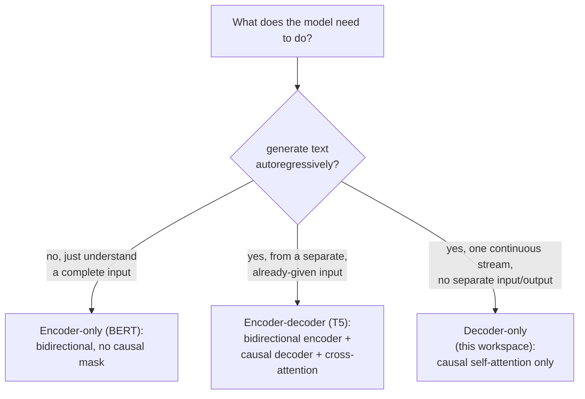

# Lição 21. Arquiteturas encoder-decoder e encoder-only

**Ligação com a missão:** A lição 3 acrescentou uma máscara causal porque "o modelo deste workspace acabará fazendo" geração autorregressiva, sem nunca dizer como é um transformer quando ele *não* precisa disso. Esta lição situa a arquitetura decoder-only que este workspace inteiro construiu em relação às outras duas formas que os modelos reais de fato usam e deriva exatamente por que cada uma precisa (ou não precisa) da máscara causal que a lição 3 construiu.
**Fonte principal:** [Artigo científico: "BERT: Pre-training of Deep Bidirectional Transformers for Language Understanding", Devlin et al., 2018](https://arxiv.org/abs/1810.04805)
**Pré-requisitos:** [Lição 3](0003-causal-masking.md), [Lição 20](0020-mixed-precision-and-gradient-accumulation.md)

## Aquecimento

1. ▢ Por que a atenção da posição `i` não deve incluir nenhuma posição `j` maior que `i`, dado como o modelo será de fato usado na inferência?

Verificação

Na inferência, o modelo gera um token por vez usando apenas os tokens que vieram antes dele; os tokens depois da posição atual ainda não existem quando ela está sendo prevista. Deixar o treinamento atender a uma posição posterior ensinaria o modelo a depender de informação que nunca está disponível na hora da geração de verdade.

2. ▢ Por que o treinamento em precisão mista mantém uma cópia master dos pesos em precisão completa, em vez de armazenar os pesos apenas em meia precisão?

Verificação

Uma atualização de peso pode ser pequena o bastante para sofrer underflow até zero se aplicada diretamente a um valor de meia precisão já arredondado. Acumular atualizações em uma cópia master em precisão completa preserva essas pequenas mudanças ao longo de muitos passos.

## Saiba isto

### A máscara causal existe especificamente porque a geração é um token por vez

Toda a justificativa da lição 3 para a máscara causal era a geração: um modelo que produz texto um token por vez só pode usar tokens que já existem, então o treinamento precisa corresponder a essa restrição, ou ele aprende a depender de informação que não estará lá depois. Essa justificativa só se aplica a um modelo que de fato gera saída de forma autorregressiva. Um modelo cujo trabalho é compreender um trecho de texto já completo, e não gerar um, não tem essa restrição a satisfazer, e nada o força a mascarar coisa alguma.

### Encoder-only: atenção bidirecional, porque não há nada para gerar

O **BERT** é a arquitetura **encoder-only** canônica, e o seu próprio artigo declara a escolha de design diretamente: ele pré-treina representações bidirecionais profundas **condicionando-se conjuntamente ao contexto da esquerda e da direita em todas as camadas**, sem máscara causal em lugar nenhum, toda posição pode atender a toda outra posição, antes e depois dela, na mesma sequência. Isso é possível justamente porque um modelo encoder-only não está gerando uma sequência token a token; ele está construindo uma representação de uma entrada completa e já dada, e então lê essa representação (por uma camada de saída acrescentada) para responder a uma pergunta sobre a entrada inteira, classificação, extração, relevância, em vez de continuá-la. A restrição da lição 3 (não atender a tokens que ainda não existem) simplesmente não se aplica, porque não há "ainda não" na entrada que um modelo encoder-only recebe.

### Encoder-decoder: duas pilhas e uma terceira subcamada que as conecta

O artigo original do transformer (a própria fonte principal deste workspace) na verdade descreve uma arquitetura **encoder-decoder**, e este workspace construiu apenas a sua metade decoder. Um modelo encoder-decoder como o **T5** passa uma sequência de entrada por um **encoder** bidirecional (estruturado como o do BERT, sem máscara causal, já que a entrada inteira já é dada) e então gera uma sequência de saída por um **decoder** que combina três subcamadas por bloco em vez das duas deste workspace: a self-attention causal sobre a saída do próprio decoder até ali (exatamente o mecanismo da lição 3), uma nova subcamada de **cross-attention** cujas queries vêm do decoder mas cujas keys e values vêm da saída do encoder, permitindo que o decoder consulte a entrada completa enquanto gera, e o bloco feed-forward. A contribuição do próprio T5 foi mostrar que uma enorme gama de tarefas de NLP (tradução, sumarização, classificação, perguntas e respostas) pode ser toda reformulada em um único formato consistente de **texto para texto**, texto de entrada entra, texto de saída sai, que é exatamente o formato que um modelo encoder-decoder é construído para consumir e produzir.

### O modelo decoder-only deste workspace é o que sobra quando entrada e saída são um mesmo fluxo

Um modelo decoder-only não tem encoder separado nem subcamada de cross-attention, porque não tem uma "entrada" separada para consultar enquanto gera outra coisa; a sequência em que ele se condiciona e a sequência que ele gera são o mesmo fluxo único, apenas em posições diferentes dentro dele. É precisamente por isso que a máscara causal da lição 3, aplicada à self-attention desse fluxo único, foi a única acomodação arquitetural de que este workspace precisou: nunca houve uma segunda sequência sobre a qual atender, apenas o próprio passado de uma sequência.

### Por que o decoder-only se tornou a forma dominante para geração de propósito geral

Um modelo encoder-only estruturalmente não consegue gerar texto de forma autorregressiva, a sua atenção bidirecional nunca foi treinada para prever um próximo token a partir de apenas um prefixo, que é exatamente o que a restrição da lição 3 existe para tornar possível. Um modelo encoder-decoder consegue gerar, mas precisa de duas pilhas coordenadas e de um mecanismo de cross-attention, mais adequado a uma tarefa com uma divisão nítida e fixa entre entrada e saída (traduza esta frase, resuma este documento) do que a uma conversa aberta em que o que conta como "entrada" e "saída" muda a cada turno. O fluxo único de um modelo decoder-only lida com os dois papéis ao mesmo tempo com uma arquitetura e um objetivo de treinamento, e é por isso que os modelos generativos abertos e de propósito geral rumo aos quais este workspace vem construindo convergiram para ele.

## Prática

1. ▢ Por que a própria arquitetura do BERT não pode ser usada para gerar texto um token por vez, como o modelo decoder-only deste workspace faz?

Dica

Considere o que a atenção bidirecional do BERT foi de fato treinada para supor sobre quais tokens estão disponíveis.

Verificação

A atenção bidirecional do BERT se condiciona ao contexto da esquerda e da direita em todas as camadas, o que significa que ela foi treinada supondo que a entrada inteira já está disponível em toda posição; ela nunca foi treinada para prever um token usando apenas um prefixo, que é exatamente a restrição que a máscara causal da lição 3 impõe e que a arquitetura do BERT não tem.

2. ▢ O bloco decoder de um modelo encoder-decoder tem três subcamadas em vez das duas deste workspace. O que a terceira faz e de onde vêm as suas entradas?

Verificação

Cross-attention: as suas queries vêm da própria sequência do decoder, mas as suas keys e values vêm da saída do encoder, permitindo que o decoder consulte a entrada completa e já codificada enquanto gera a sua própria sequência de saída um token por vez.

3. ▢ Por que o modelo decoder-only deste workspace nunca precisa de uma subcamada de cross-attention?

Verificação

Porque ele não tem encoder separado nem sequência de entrada separada sobre a qual atender; a sequência em que ele se condiciona e a sequência que ele gera são o mesmo fluxo único, então a self-attention causal sobre esse fluxo único é o único mecanismo de atenção de que a arquitetura precisa.

4. ▢ Por que uma arquitetura encoder-decoder, e não decoder-only, é bem adequada a uma tarefa como a tradução automática, com uma divisão nítida entre entrada e saída, mesmo que um modelo decoder-only também pudesse, em princípio, aprender a traduzir?

Verificação

O enquadramento do próprio T5 mostra o valor do formato de texto para texto: uma entrada fixa (a frase de origem) está totalmente disponível de antemão e pode ser processada de forma bidirecional pelo encoder, enquanto o decoder gera a tradução com cross-attention de volta a essa entrada completa. Uma tarefa com esse tipo de divisão limpa e de uma só vez entre entrada e saída corresponde diretamente à divisão do encoder-decoder, enquanto uma conversa aberta, turno a turno, não tem um ponto fixo em que a "entrada" termina e a "saída" começa.

5. ▢ Qual afirmação distingue corretamente as arquiteturas encoder-only, encoder-decoder e decoder-only?

    - a) As três usam a mesma máscara causal que este workspace construiu na lição 3, apenas aplicada a números diferentes de pilhas
    - b) O encoder-only (BERT) usa atenção bidirecional sem máscara causal, já que não gera texto de forma autorregressiva; o encoder-decoder (T5) une um encoder bidirecional a um decoder causal conectados por cross-attention; o decoder-only (este workspace) usa apenas self-attention causal sobre um fluxo compartilhado
    - c) A cross-attention é uma subcamada que os modelos decoder-only usam para atender às suas próprias camadas anteriores
    - d) O BERT pode ser usado para geração autorregressiva de texto exatamente como o modelo decoder-only deste workspace

Verificação

**b)** É a distinção arquitetural precisa que esta lição estabelece. (a) é falsa: o encoder do BERT não usa nenhuma máscara causal, já que não gera tokens um por vez. (c) é falsa: a cross-attention conecta um decoder à saída de um encoder separado, e não um modelo às suas próprias camadas anteriores. (d) é falsa: o treinamento bidirecional do BERT nunca aprendeu a prever um token a partir de apenas um prefixo, exatamente a capacidade que a máscara causal da lição 3 existe para fornecer.

## Prática no mundo real

- [ ] Para uma biblioteca de modelos a que você tenha acesso, encontre um modelo encoder-only (como uma variante do BERT), um modelo encoder-decoder (como uma variante do T5) e um modelo decoder-only, e confira a configuração da máscara de atenção de cada um no seu código ou configuração.
- [ ] Para uma tarefa que você conhece (classificação, tradução ou chat aberto), decida qual das três formas de arquitetura melhor se ajusta a ela e explique por quê usando o enquadramento desta lição.
- [ ] Amanhã: leia por inteiro a seção do artigo do BERT sobre os objetivos de pré-treinamento (masked language modeling e next sentence prediction) e anote como eles diferem do objetivo de treinamento de próximo token deste workspace (lição 9).

## Para ir além

- [Artigo científico: "BERT: Pre-training of Deep Bidirectional Transformers for Language Understanding", Devlin et al., 2018](https://arxiv.org/abs/1810.04805)
- [Artigo científico: "Exploring the Limits of Transfer Learning with a Unified Text-to-Text Transformer" (T5), Raffel et al., 2019](https://arxiv.org/abs/1910.10683)
- [Artigo científico: "Attention Is All You Need", Vaswani et al., 2017](https://arxiv.org/abs/1706.03762)
- [Recursos](../RESOURCES.md)

---

Não ficou claro? Releia a fonte principal no topo, já que esta lição a comprime e é na compressão que o entendimento escapa. Consulte o [glossário](../GLOSSARY.md) para qualquer termo que pareceu escorregadio.

Se o problema é a lição em si, e não o material, isso é um defeito: [abra uma issue](https://github.com/TokenCemetery/teach/issues).
