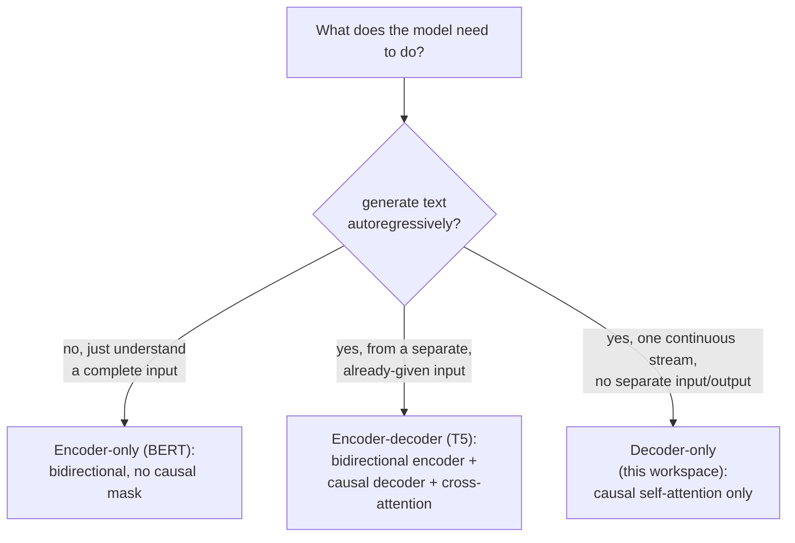

# Урок 21. Архитектуры энкодер-декодер и только энкодер

**Связь с целью курса:** Урок 3 добавил каузальную маску, потому что модель этого рабочего пространства «в итоге будет выполнять» авторегрессивную генерацию, ни разу не сказав, как выглядит трансформер, когда ему это *не* нужно. Этот урок сопоставляет архитектуру только с декодером, которую построило всё это рабочее пространство, с двумя другими формами, которые реально используют настоящие модели, и выводит, почему каждой из них нужна (или не нужна) каузальная маска, построенная в уроке 3.
**Первоисточник:** [Научная статья: "BERT: Pre-training of Deep Bidirectional Transformers for Language Understanding", Devlin et al., 2018](https://arxiv.org/abs/1810.04805)
**Предварительные требования:** [Урок 3](0003-causal-masking.md), [Урок 20](0020-mixed-precision-and-gradient-accumulation.md)

## Разминка

1. ▢ Почему внимание позиции `i` не должно включать ни одну позицию `j`, большую, чем `i`, учитывая, как модель будет реально использоваться при инференсе?

Проверка

При инференсе модель генерирует по одному токену, используя только токены, шедшие до него; токенов после текущей позиции в момент её предсказания ещё не существует. Если разрешить при обучении обращать внимание на более позднюю позицию, модель научится полагаться на информацию, которой никогда не будет во время реальной генерации.

2. ▢ Почему обучение со смешанной точностью хранит главную копию весов в полной точности, а не только веса в половинной точности?

Проверка

Обновление веса может быть настолько малым, что обнулится из-за потери значимости, если применить его прямо к уже округлённому значению половинной точности. Накопление обновлений в главной копии в полной точности сохраняет эти малые изменения на многих шагах.

## Что нужно знать

### Каузальная маска существует именно потому, что генерация идёт по одному токену

Всё обоснование каузального маскирования в уроке 3 держалось на генерации: модель, порождающая текст по одному токену, может использовать только токены, которые уже существуют, поэтому обучение должно соответствовать этому ограничению, иначе оно научится полагаться на информацию, которой потом не будет. Это обоснование применимо только к модели, которая действительно генерирует выход авторегрессивно. У модели, чья задача понять уже готовый фрагмент текста, а не сгенерировать его, нет такого ограничения, и ничто не заставляет её что-либо маскировать вообще.

### Только энкодер: двунаправленное внимание, потому что нечего генерировать

**BERT** это каноническая архитектура **только с энкодером** (encoder-only), и статья о ней прямо называет это проектное решение: она предобучает глубокие двунаправленные представления, **одновременно обуславливая их и левым, и правым контекстом во всех слоях**, без каузальной маски где-либо, и каждая позиция может обращать внимание на любую другую, до и после неё, в той же последовательности. Это возможно именно потому, что модель только с энкодером не генерирует последовательность токен за токеном; она строит представление полного, уже заданного входа, а затем считывает это представление (через один добавленный выходной слой), чтобы ответить на вопрос о всём входе, классификация, извлечение, релевантность, а не продолжает его. Ограничение из урока 3 (не обращать внимание на токены, которых ещё нет) здесь просто неприменимо, потому что во входе, который получает модель только с энкодером, нет никакого «ещё нет».

### Энкодер-декодер: два стека и третий подслой, который их соединяет

Оригинальная статья о трансформере (первоисточник этого рабочего пространства) на самом деле описывает архитектуру **энкодер-декодер** (encoder-decoder), а это рабочее пространство построило только её половину с декодером. Модель энкодер-декодер вроде **T5** пропускает входную последовательность через двунаправленный **энкодер** (устроенный как у BERT, без каузальной маски, поскольку весь вход уже задан), а затем генерирует выходную последовательность через **декодер**, который объединяет три подслоя на блок вместо двух в этом рабочем пространстве: каузальное самовнимание по собственному выходу декодера на данный момент (в точности механизм из урока 3), новый подслой **перекрёстного внимания** (cross-attention), запросы которого берутся из декодера, а ключи и значения из выхода энкодера и который позволяет декодеру обращаться к полному входу во время генерации, и feed-forward-блок. Вклад самой T5 состоял в том, чтобы показать, что огромный круг задач NLP (перевод, суммаризация, классификация, ответы на вопросы) можно привести к одному единому формату **«текст в текст»** (text-to-text): на входе текст, на выходе текст, и это в точности та форма, которую модель энкодер-декодер построена принимать и порождать.

### Модель только с декодером из этого рабочего пространства это то, что остаётся, когда вход и выход это один и тот же поток

У модели только с декодером нет отдельного энкодера и нет подслоя перекрёстного внимания вообще, потому что у неё нет отдельного «входа», к которому нужно обращаться, пока она генерирует что-то другое; последовательность, по которой она строит условие, и последовательность, которую она генерирует, это один и тот же единый поток, только в разных его позициях. Именно поэтому каузальная маска из урока 3, применённая к самовниманию этого одного потока, была единственной архитектурной уступкой, которая когда-либо понадобилась этому рабочему пространству: второй последовательности, по которой нужно было бы обращать внимание, никогда не было, было только прошлое одной последовательности.

### Почему только с декодером стала доминирующей формой для универсальной генерации

Модель только с энкодером структурно вообще не может генерировать текст авторегрессивно, её двунаправленное внимание никогда не обучали предсказывать следующий токен по одному лишь префиксу, а именно это и призвано сделать возможным ограничение из урока 3. Модель энкодер-декодер генерировать может, но ей нужны два согласованных стека и механизм перекрёстного внимания, что лучше подходит для задачи с чётким, фиксированным разделением «сначала вход, потом выход» (переведи это предложение, суммаризируй этот документ), чем для открытого диалога, где то, что считать «входом» и «выходом», сдвигается с каждой репликой. Единый поток модели только с декодером справляется с обеими ролями сразу одной архитектурой и одной целью обучения, и поэтому универсальные открытые генеративные модели, к которым стремилось это рабочее пространство, сошлись именно на ней.

## Практика

1. ▢ Почему собственную архитектуру BERT нельзя использовать для генерации текста по одному токену, как это делает модель только с декодером из этого рабочего пространства?

Подсказка

Подумайте, какое допущение о доступности токенов на самом деле заложено в обучение двунаправленного внимания BERT.

Проверка

Двунаправленное внимание BERT обусловлено и левым, и правым контекстом в каждом слое, то есть оно обучалось в предположении, что полный вход уже доступен в каждой позиции; его никогда не обучали предсказывать токен только по префиксу, а именно это ограничение обеспечивает каузальная маска из урока 3 и именно его нет в архитектуре BERT.

2. ▢ У блока декодера в модели энкодер-декодер три подслоя вместо двух в этом рабочем пространстве. Что делает третий и откуда берутся его входы?

Проверка

Перекрёстное внимание: его запросы берутся из собственной последовательности декодера, а ключи и значения из выхода энкодера, что позволяет декодеру обращаться к полному, уже закодированному входу, пока он генерирует собственную выходную последовательность по одному токену.

3. ▢ Почему модели только с декодером из этого рабочего пространства подслой перекрёстного внимания никогда не нужен?

Проверка

Потому что у неё нет отдельного энкодера или отдельной входной последовательности, по которой нужно обращать внимание; последовательность, по которой строится условие, и последовательность, которую она генерирует, это один и тот же единый поток, так что каузальное самовнимание по этому одному потоку единственный механизм внимания, который нужен архитектуре.

4. ▢ Почему архитектура энкодер-декодер, а не только с декодером, хорошо подходит для задачи вроде машинного перевода с чётким разделением «сначала вход, потом выход», хотя модель только с декодером в принципе тоже могла бы научиться переводить?

Проверка

Формулировка самой T5 показывает ценность формы «текст в текст»: фиксированный вход (исходное предложение) полностью доступен заранее и может обрабатываться энкодером двунаправленно, а декодер генерирует перевод с перекрёстным вниманием обратно к этому полному входу. Задача с таким чётким одноразовым разделением «сначала вход, потом выход» напрямую соответствует разделению в энкодер-декодере, тогда как в открытом диалоге по репликам нет фиксированной точки, где «вход» заканчивается и начинается «выход».

5. ▢ Какое утверждение правильно различает архитектуры только с энкодером, энкодер-декодер и только с декодером?

    - a) Все три используют то же каузальное маскирование, которое это рабочее пространство построило в уроке 3, только применённое к разному числу стеков
    - b) Только с энкодером (BERT) использует двунаправленное внимание без каузальной маски, поскольку не генерирует текст авторегрессивно; энкодер-декодер (T5) сочетает двунаправленный энкодер с каузальным декодером, соединёнными перекрёстным вниманием; только с декодером (это рабочее пространство) использует лишь каузальное самовнимание по одному общему потоку
    - c) Перекрёстное внимание это подслой, который модели только с декодером используют, чтобы обращать внимание на собственные более ранние слои
    - d) BERT можно использовать для авторегрессивной генерации текста точно так же, как модель только с декодером из этого рабочего пространства

Проверка

**b)** Это точное архитектурное различие, которое устанавливает этот урок. Вариант (a) неверен: энкодер BERT вообще не использует каузальную маску, поскольку не генерирует токены по одному. Вариант (c) неверен: перекрёстное внимание соединяет декодер с выходом отдельного энкодера, а не модель с её собственными более ранними слоями. Вариант (d) неверен: двунаправленное обучение BERT никогда не учило предсказывать токен по одному лишь префиксу, а именно эту способность и призвана дать каузальная маска из урока 3.

## Практика в реальной работе

- [ ] Для библиотеки моделей, к которой у вас есть доступ, найдите одну модель только с энкодером (вроде варианта BERT), одну модель энкодер-декодер (вроде варианта T5) и одну модель только с декодером и проверьте настройку маски внимания каждой в её коде или конфигурации.
- [ ] Для знакомой вам задачи (классификация, перевод или открытый чат) решите, какая из трёх форм архитектуры подходит ей лучше всего, и объясните почему, используя рамку этого урока.
- [ ] Завтра: прочитайте целиком раздел статьи о BERT про цели предобучения (маскированное языковое моделирование и предсказание следующего предложения) и отметьте, чем они отличаются от собственной цели обучения этого рабочего пространства, предсказания следующего токена (урок 9).

## Что почитать дальше

- [Научная статья: "BERT: Pre-training of Deep Bidirectional Transformers for Language Understanding", Devlin et al., 2018](https://arxiv.org/abs/1810.04805)
- [Научная статья: "Exploring the Limits of Transfer Learning with a Unified Text-to-Text Transformer" (T5), Raffel et al., 2019](https://arxiv.org/abs/1910.10683)
- [Научная статья: "Attention Is All You Need", Vaswani et al., 2017](https://arxiv.org/abs/1706.03762)
- [Ресурсы](../RESOURCES.md)

---

Не доходит? Перечитайте первоисточник в начале: этот урок его сжимает, а при сжатии понимание как раз и теряется. Загляните в [глоссарий](../GLOSSARY.md), если какой-то термин показался скользким.

Если неясен сам урок, а не материал, это дефект: [откройте issue](https://github.com/TokenCemetery/teach/issues).
