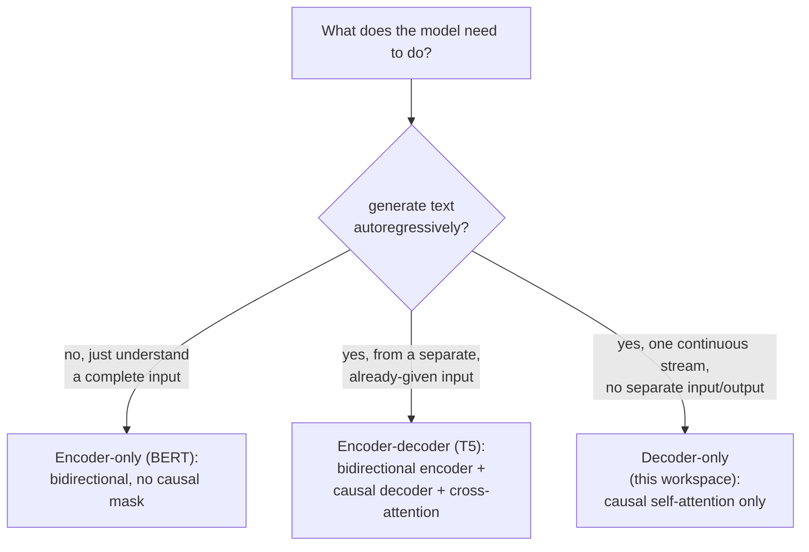

# 第 21 课：编码器-解码器与仅编码器架构

**使命关联:** 第 3 课加入因果掩码，是因为“这个工作区的模型最终要做的”是自回归生成，却从未说过一个 Transformer 在*不需要*这样做时是什么样子。本课把这整个工作区搭建的仅解码器架构，放到真实模型实际使用的另外两种形态旁边做对照，并推导每一种为什么需要（或不需要）第 3 课搭建的因果掩码。
**主要来源:** [论文：“BERT: Pre-training of Deep Bidirectional Transformers for Language Understanding”，Devlin 等，2018](https://arxiv.org/abs/1810.04805)
**前置知识:** [第 3 课](0003-causal-masking.md)、[第 20 课](0020-mixed-precision-and-gradient-accumulation.md)

## 热身

1. ▢ 考虑到模型在推理时的实际用法，为什么位置 `i` 的注意力不能包含任何大于 `i` 的位置 `j`？

检查

推理时，模型一次生成一个 token，只使用在它之前出现的 token；在预测当前位置时，它之后的 token 还不存在。如果训练时允许关注更靠后的位置，就会教模型去依赖一种在真正生成时永远得不到的信息。

2. ▢ 为什么混合精度训练要保留一份全精度的权重主副本，而不是只用半精度存储权重？

检查

权重更新可能小到，直接加到一个已经取整过的半精度值上就会下溢为零。在全精度主副本里累积更新，能在许多步之间保住这些微小的变化。

## 要点

### 因果掩码的存在，恰恰是因为生成是一次一个 token

第 3 课为因果掩码给出的全部理由都是生成：一个一次生成一个 token 的模型，只能使用已经存在的 token，所以训练必须与这一约束相符，否则它会学着去依赖以后并不存在的信息。这个理由只适用于真正以自回归方式生成输出的模型。一个任务是理解一段已经完整的文本、而不是生成文本的模型，没有这样的约束需要满足，也没有什么东西强迫它去掩码任何东西。

### 仅编码器：双向注意力，因为没有要生成的东西

**BERT** 是典型的**仅编码器**架构，它自己的论文直接陈述了这个设计选择：它通过**在所有层里同时以左右两侧的上下文为条件**，来预训练深层的双向表示，任何地方都没有因果掩码，每个位置都可以关注同一序列里的每个其他位置，不论在它之前还是之后。这之所以可能，恰恰是因为仅编码器模型并不是逐个 token 地生成序列；它是为一段完整的、已经给定的输入构建一个表示，然后（通过额外加上的一个输出层）把这个表示读出来，回答关于整段输入的问题，比如分类、抽取、相关性，而不是去续写它。第 3 课的约束（不能关注尚不存在的 token）在这里根本不适用，因为仅编码器模型拿到的输入里，没有“尚未”这回事。

### 编码器-解码器：两组堆叠，外加把它们连起来的第三个子层

最初的 Transformer 论文（这个工作区自己的主要来源）描述的其实是**编码器-解码器**架构，而这个工作区只搭建了它的解码器那一半。像 **T5** 这样的编码器-解码器模型，让输入序列穿过一个双向的**编码器**（结构与 BERT 的相同，没有因果掩码，因为整个输入都是已经给定的），然后通过一个**解码器**来生成输出序列，解码器的每个块不是这个工作区的两个子层，而是三个：在解码器到目前为止自己的输出上做的因果自注意力（正是第 3 课的机制）、一个新的**交叉注意力**子层（它的查询来自解码器，而键和值来自编码器的输出，让解码器在生成时可以查阅完整的输入），以及前馈块。T5 自己的贡献，是表明大量的 NLP 任务（翻译、摘要、分类、问答）都可以被纳入同一种一致的**文本到文本**格式，输入文本进，输出文本出，这恰恰是编码器-解码器模型所要消化和产生的形态。

### 这个工作区的仅解码器模型，是输入和输出为同一个数据流时剩下的东西

仅解码器模型根本没有独立的编码器，也没有交叉注意力子层，因为在生成别的东西时，它没有独立的“输入”可以查阅；它所依据的序列与它正在生成的序列，是同一个单一的数据流，只是处在其中不同的位置。这正是为什么第 3 课的因果掩码，应用于那一个数据流的自注意力，是这个工作区所需要的唯一的架构上的迁就：从来没有第二个序列可供跨越去关注，只有一个序列自己的过去。

### 为什么仅解码器成为通用生成的主流形态

仅编码器模型在结构上根本无法以自回归方式生成文本，它的双向注意力从未被训练成只凭前缀去预测下一个 token，而这恰恰是第 3 课的约束所要使之成为可能的事。编码器-解码器模型可以生成，但需要两组协调的堆叠和一个交叉注意力机制，更适合输入与输出泾渭分明的任务（翻译这句话，总结这篇文档），而不太适合开放式的对话，那里什么算“输入”、什么算“输出”，每一轮都在变。仅解码器模型的单一数据流，用一种架构和一个训练目标同时承担了两个角色，这就是这个工作区一路搭建所朝向的那类通用的、开放式的生成模型，最终都收敛到它的原因。

## 练习

1. ▢ 为什么 BERT 自己的架构不能像这个工作区的仅解码器模型那样，用来一次生成一个 token 的文本？

提示

想一想，BERT 的双向注意力实际上是被训练成假定哪些 token 可用的。

检查

BERT 的双向注意力在每一层里都同时以左右两侧的上下文为条件，这意味着它是在假定完整的输入在每个位置上都已经可用的前提下训练的；它从未被训练成只凭前缀去预测一个 token，而这恰恰是第 3 课的因果掩码所强制的约束，BERT 的架构并没有它。

2. ▢ 编码器-解码器模型的解码器块有三个子层，而不是这个工作区的两个。第三个做什么？它的输入来自哪里？

检查

交叉注意力：它的查询来自解码器自己的序列，而键和值来自编码器的输出，让解码器在一次一个 token 地生成自己的输出序列时，可以查阅完整的、已经编码好的输入。

3. ▢ 为什么这个工作区的仅解码器模型从不需要交叉注意力子层？

检查

因为它没有独立的编码器，也没有独立的输入序列可供跨越去关注；它所依据的序列与它所生成的序列是同一个单一的数据流，所以在这一个数据流上做的因果自注意力，就是这个架构所需要的唯一的注意力机制。

4. ▢ 尽管仅解码器模型原则上也能学会翻译，为什么对于像机器翻译这种输入与输出泾渭分明的任务，编码器-解码器架构比仅解码器更合适？

检查

T5 自己的表述展示了文本到文本这种形态的价值：固定的输入（源语句）从一开始就完全可用，可以由编码器做双向处理，而解码器则通过回看那份完整输入的交叉注意力，来生成译文。具有这种干净的、一次性的先输入后输出划分的任务，直接对应着编码器-解码器的划分，而开放式的、一轮一轮的对话则没有一个固定的点来划分“输入”在哪里结束、“输出”从哪里开始。

5. ▢ 下面哪一项说法正确区分了仅编码器、编码器-解码器和仅解码器架构？

    - a) 三者都使用这个工作区在第 3 课搭建的同样的因果掩码，只是应用在不同数量的堆叠上
    - b) 仅编码器（BERT）使用没有因果掩码的双向注意力，因为它不以自回归方式生成文本；编码器-解码器（T5）把一个双向编码器与一个因果解码器配成一对，二者由交叉注意力连接；仅解码器（这个工作区）只在一个共享的数据流上使用因果自注意力
    - c) 交叉注意力是仅解码器模型用来关注它自己更早的层的子层
    - d) BERT 可以像这个工作区的仅解码器模型一样，用于自回归的文本生成

检查

**b)** 这正是本课确立的精确的架构区别。(a) 是错的：BERT 的编码器完全不使用因果掩码，因为它不是一次生成一个 token。(c) 是错的：交叉注意力把解码器连到一个独立编码器的输出上，而不是把一个模型连到它自己更早的层上。(d) 是错的：BERT 的双向训练从未学会只凭前缀去预测一个 token，而这恰恰是第 3 课的因果掩码所要提供的能力。

## 实战练习

- [ ] 在你能接触到的某个模型库里，找出一个仅编码器模型（比如 BERT 的变体）、一个编码器-解码器模型（比如 T5 的变体）和一个仅解码器模型，并在各自的代码或配置里检查它们的注意力掩码配置。
- [ ] 对一个你熟悉的任务（分类、翻译，或开放式对话），判断三种架构形态里哪一种最适合它，并用本课的框架解释原因。
- [ ] 明天：完整阅读 BERT 论文中关于预训练目标（掩码语言建模和下一句预测）的那一节，并记下它们与这个工作区自己的下一个 token 的训练目标（第 9 课）有何不同。

## 延伸阅读

- [论文：“BERT: Pre-training of Deep Bidirectional Transformers for Language Understanding”，Devlin 等，2018](https://arxiv.org/abs/1810.04805)
- [论文：“Exploring the Limits of Transfer Learning with a Unified Text-to-Text Transformer”（T5），Raffel 等，2019](https://arxiv.org/abs/1910.10683)
- [论文：“Attention Is All You Need”，Vaswani 等，2017](https://arxiv.org/abs/1706.03762)
- [资源](../RESOURCES.md)

---

没学明白？请重读顶部的主要来源，因为本课是对它的压缩，而理解正是在压缩中流失的。如果有哪个术语觉得含糊，可以查看[术语表](../GLOSSARY.md)。

如果问题出在课程本身，而不是学习材料，那就是一个缺陷：[提交 issue](https://github.com/TokenCemetery/teach/issues)。
