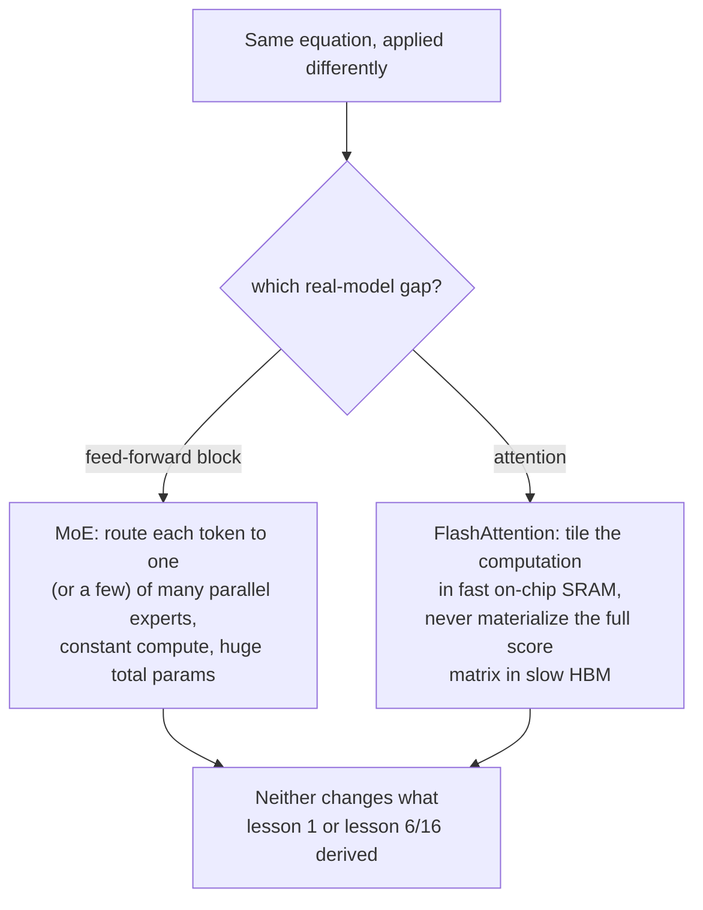

# Lección 22. Mixture-of-Experts y FlashAttention

**Vínculo con la misión:** Cada lección de este espacio de trabajo derivó un cálculo denso aplicado de manera uniforme a cada token, un bloque feed-forward, un cálculo de atención, ejecutados de forma idéntica sin importar la entrada. Los modelos grandes reales rompen ambos supuestos de maneras que nunca cambian la matemática de fondo que construyó este espacio de trabajo: el **mixture-of-experts (MoE)** enruta distintos tokens por distintos parámetros en lugar de por los mismos, y **FlashAttention** calcula la ecuación exacta de la lección 1 con una relación completamente distinta, y más rápida, con la memoria de la GPU. Ninguno es una operación nueva; ambos son una manera distinta de ejecutar las operaciones ya derivadas.
**Fuente principal:** [Paper: "FlashAttention: Fast and Memory-Efficient Exact Attention with IO-Awareness", Dao et al., 2022](https://arxiv.org/abs/2205.14135)
**Requisitos previos:** [Lección 1](0001-scaled-dot-product-attention.md), [Lección 16](0016-swiglu-and-the-gated-feed-forward.md)

## Calentamiento

1. ▢ ¿Por qué aplica el bloque feed-forward de este espacio de trabajo las mismas matrices de pesos al vector de cada posición de forma independiente, y qué cambia SwiGLU de ese cálculo?

Comprobación

Aplicar los mismos pesos a cada posición (sin mezcla entre posiciones) es lo que hace que el bloque sea por posición, y complementa el papel de mezcla entre posiciones de la atención. SwiGLU cambia el cálculo interno (un diseño con puerta y dos proyecciones de expansión) pero no esta estructura por posición; sigue aplicándose de forma idéntica a cada posición.

2. ▢ Escribe de memoria la ecuación de la scaled dot-product attention.

Comprobación

`Attention(Q, K, V) = softmax(QK^T / sqrt(d_k)) V`.

## Qué debes saber

### Los modelos ordinarios gastan el mismo cómputo en cada token; MoE no

Cada bloque feed-forward que construyó este espacio de trabajo (lección 6, lección 16) reutiliza exactamente los mismos parámetros para cada token que pasa por él. Una capa de **mixture-of-experts (MoE)** sustituye ese único bloque feed-forward por varias copias en paralelo, llamadas **expertos**, más un pequeño **router** que selecciona qué experto (o expertos) procesan realmente un token dado. El propio planteamiento del Switch Transformer enuncia directamente la contrapartida resultante: el modelo pasa a tener **activación dispersa**, con un número total de parámetros descomunal repartido entre todos sus expertos, pero un **costo de cómputo por token más o menos constante**, ya que para ese token solo se ejecutan los expertos elegidos por el router, no todos.

### Más parámetros sin más cómputo por token es una palanca de escalado totalmente distinta

Esto desacopla dos cosas que normalmente van atadas: en un modelo denso, el número total de parámetros y el costo de cómputo de procesar un token escalan juntos, ya que cada parámetro toca a cada token. Un modelo MoE puede hacer crecer su número total de parámetros añadiendo más expertos sin hacer crecer lo que cuesta procesar un token cualquiera, porque añadir un experto solo añade otra opción que el router podría elegir, no más trabajo que tenga que hacer cada token. La simplificación concreta del Switch Transformer, enrutar cada token a exactamente un experto en lugar de combinar varios, se eligió específicamente para reducir los costos de comunicación y de estabilidad de entrenamiento con los que topaban los diseños MoE anteriores, más complejos, y el paper informa de que esto permitió que los modelos dispersos escalaran hasta el rango del billón de parámetros con aceleraciones del preentrenamiento de varias veces respecto de un modelo denso equivalente.

### FlashAttention no cambia la ecuación de la atención, cambia cómo toca esa ecuación la memoria

El costo en tiempo y en memoria de la self-attention crece de forma cuadrática con la longitud de la secuencia, ya que la query de cada posición tiene que compararse con cada key. El propio diagnóstico del paper de por qué esto hace lentas las implementaciones reales no es la ecuación en sí, sino que una implementación ingenua materializa la matriz completa de puntuaciones de atención, de tamaño cuadrático, en la memoria principal grande pero lenta de la GPU (HBM), y luego la vuelve a leer para el softmax y la suma ponderada final, y esas lecturas y escrituras en memoria lenta, y no la aritmética, dominan el tiempo real transcurrido. **FlashAttention** es explícitamente **consciente de la E/S** (IO-aware): reestructura el mismo cálculo mediante **tiling**, procesando de una vez pequeños fragmentos de la secuencia por completo dentro de la memoria pequeña pero rápida del chip de la GPU (SRAM), de modo que la matriz completa de puntuaciones nunca se escribe en la memoria lenta.

### Exacta, no aproximada: la misma salida, por otro camino

El paper es concreto en que FlashAttention calcula atención **exacta**, la ecuación precisa de la lección 1, `softmax(QK^T / sqrt(d_k)) V`, sin atajo matemático ni contrapartida de calidad, a diferencia de los métodos de atención aproximada anteriores con los que el paper se contrasta, que según señalan los autores a menudo no lograban una aceleración real en tiempo transcurrido pese a reducir la complejidad computacional nominal. La contribución real de FlashAttention tiene que ver puramente con la E/S: menos lecturas y escrituras de memoria entre HBM y SRAM para el resultado matemático idéntico, que es exactamente por lo que al leer código real de modelos se ve una implementación de la atención estructuralmente distinta de la versión directa de la lección 1, que aun así tiene que producir la misma salida que derivó la lección 1.

## Práctica

1. ▢ Un modelo denso duplica el número de parámetros de su bloque feed-forward, y el costo de cómputo de cada token a través de ese bloque se duplica más o menos también. Un modelo MoE duplica su número total de parámetros de expertos añadiendo más expertos. ¿Se duplica también el costo de cómputo de cada token?

Pista

Considera qué selecciona realmente el router para un token dado, sin importar cuántos expertos existan en total.

Comprobación

No. Añadir más expertos solo añade más opciones entre las que el router puede elegir; el costo de cómputo de un token depende de a cuántos expertos se enruta realmente (uno, en el Switch Transformer), no del número total de expertos que existen. Los parámetros totales y el costo de cómputo por token están desacoplados de una manera en que no lo están en un modelo denso.

2. ▢ ¿Por qué enruta el Switch Transformer cada token a exactamente un experto, en lugar de combinar varios, como hacían los diseños MoE anteriores?

Comprobación

El propio planteamiento del paper dice que se eligió específicamente para reducir los costos de comunicación y de cómputo, y la inestabilidad de entrenamiento, con los que había topado el enrutamiento multiexperto más complejo, simplificando el algoritmo de enrutamiento y conservando aun así la propiedad de activación dispersa y costo constante por token.

3. ▢ ¿Por qué se vuelve lenta una implementación ingenua de la atención específicamente con longitudes de secuencia largas, según el propio diagnóstico de FlashAttention?

Comprobación

La matriz completa de puntuaciones de atención crece de forma cuadrática con la longitud de la secuencia, y una implementación ingenua materializa esa matriz entera en la memoria principal grande pero lenta de la GPU (HBM), y luego la vuelve a leer para el softmax y la suma ponderada; esas lecturas y escrituras de memoria, y no la aritmética en sí, dominan el tiempo real transcurrido a medida que crece la matriz.

4. ▢ ¿Calcula FlashAttention una versión distinta y aproximada de la atención para lograr su aceleración, como hacían algunos métodos anteriores?

Comprobación

No. FlashAttention es explícitamente exacta, y calcula el resultado matemático idéntico al de la ecuación de la lección 1; su aceleración viene por completo de ser consciente de la E/S, dividiendo el cálculo en bloques para mantenerse en la memoria rápida del chip y evitar materializar la matriz completa de puntuaciones en la memoria lenta, no de ninguna aproximación ni contrapartida de calidad.

5. ▢ ¿Qué afirmación describe correctamente lo que cambian MoE y FlashAttention de la matemática que derivó este espacio de trabajo?

    - a) MoE cambia la ecuación de la atención, y FlashAttention cambia la ecuación del bloque feed-forward
    - b) MoE desacopla el número total de parámetros del costo de cómputo por token enrutando los tokens a un subconjunto de bloques feed-forward expertos en paralelo; FlashAttention calcula la ecuación exacta y sin cambios de la atención pero reestructura el acceso a memoria para evitar materializar la matriz completa de puntuaciones en la memoria lenta de la GPU
    - c) FlashAttention aproxima la atención para cambiar calidad por velocidad, igual que hacían los métodos anteriores que mejora
    - d) Ni MoE ni FlashAttention cambian nada de cuánto cómputo total requiere una ejecución de entrenamiento

Comprobación

**b)** Ese es el cambio preciso, y sin solapamiento, que hace cada técnica. (a) es falsa: MoE afecta al bloque feed-forward, no a la atención; FlashAttention afecta a la atención, no al bloque feed-forward. (c) es falsa: FlashAttention es explícitamente exacta, a diferencia de los métodos aproximados con los que se contrasta. (d) es falsa: MoE cambia el cómputo por token respecto de los parámetros totales, y FlashAttention cambia el costo en tiempo real mediante la eficiencia de memoria; ambos afectan de forma significativa a los costos reales de cómputo, solo que no al resultado matemático.

## Prácticas en el mundo real

- [ ] Para un modelo al que tengas acceso (o sus detalles de arquitectura publicados), comprueba si usa un bloque feed-forward denso o una capa de mixture-of-experts, y si es MoE, cuántos expertos tiene y cuántos se activan por token.
- [ ] Comprueba si una biblioteca que uses (como `transformers`) expone una implementación de FlashAttention como opción, y qué beneficio de velocidad o de memoria declara frente a una implementación estándar de la atención con longitudes de secuencia largas.
- [ ] Mañana: lee completo el análisis de complejidad de E/S del paper de FlashAttention, y anota cómo se compara matemáticamente el número de accesos a HBM que requiere con el de la atención estándar.

## Para profundizar

- [Paper: "FlashAttention: Fast and Memory-Efficient Exact Attention with IO-Awareness", Dao et al., 2022](https://arxiv.org/abs/2205.14135)
- [Paper: "Switch Transformers: Scaling to Trillion Parameter Models with Simple and Efficient Sparsity", Fedus, Zoph, and Shazeer, 2021](https://arxiv.org/abs/2101.03961)
- [Paper: "Attention Is All You Need", Vaswani et al., 2017](https://arxiv.org/abs/1706.03762)
- [Recursos](../RESOURCES.md)

---

¿No termina de quedar claro? Vuelve a leer la fuente primaria de arriba, ya que esta lección la comprime y en la compresión es donde se escapa la comprensión. Consulta el [glosario](../GLOSSARY.md) por si algún término te resultó resbaladizo.

Si lo poco claro es la propia lección y no el material, eso es un defecto: [abre un issue](https://github.com/TokenCemetery/teach/issues).
