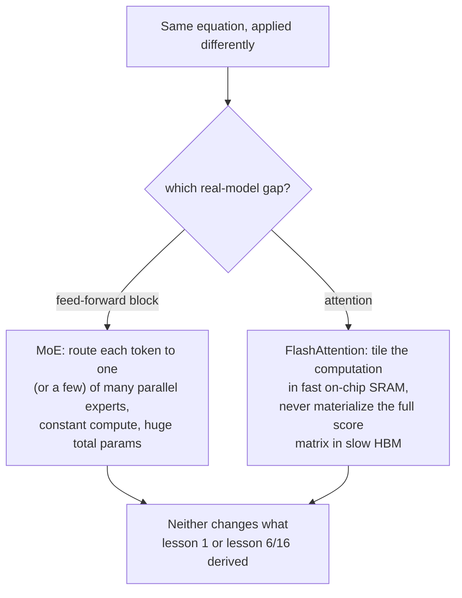

# Leçon 22. Mixture-of-experts et FlashAttention

**Lien avec la mission :** Chaque leçon de cet espace de travail a dérivé un calcul dense appliqué uniformément à chaque token, un seul bloc feed-forward, un seul calcul d'attention, exécutés de façon identique quelle que soit l'entrée. Les vrais grands modèles remettent en cause ces deux hypothèses sans jamais changer les mathématiques sous-jacentes que cet espace de travail a construites : le **mixture-of-experts (MoE)** fait passer des tokens différents par des paramètres différents au lieu des mêmes, et **FlashAttention** calcule l'équation exacte de la leçon 1 avec un rapport complètement différent, et plus rapide, à la mémoire du GPU. Ni l'un ni l'autre n'est une nouvelle opération ; tous deux sont une autre façon d'exécuter les opérations déjà dérivées.
**Source primaire :** [Article : "FlashAttention: Fast and Memory-Efficient Exact Attention with IO-Awareness", Dao et al., 2022](https://arxiv.org/abs/2205.14135)
**Prérequis :** [Leçon 1](0001-scaled-dot-product-attention.md), [Leçon 16](0016-swiglu-and-the-gated-feed-forward.md)

## Échauffement

1. ▢ Pourquoi le bloc feed-forward de cet espace de travail applique-t-il les mêmes matrices de poids au vecteur de chaque position indépendamment, et que change SwiGLU à ce calcul ?

Vérifier

Appliquer les mêmes poids à chaque position (sans mélange entre positions) est ce qui rend le bloc position par position, en complément du rôle de mélange entre positions de l'attention. SwiGLU change le calcul interne (une conception à porte, à deux projections vers le haut) mais pas cette structure position par position ; il est toujours appliqué de façon identique à chaque position.

2. ▢ Écrivez de mémoire l'équation de la scaled dot-product attention.

Vérifier

`Attention(Q, K, V) = softmax(QK^T / sqrt(d_k)) V`.

## À savoir

### Les modèles ordinaires dépensent le même calcul pour chaque token ; pas le MoE

Chaque bloc feed-forward que cet espace de travail a construit (leçon 6, leçon 16) réutilise exactement les mêmes paramètres pour chaque token qui le traverse. Une couche **mixture-of-experts (MoE)** remplace ce bloc feed-forward unique par plusieurs copies en parallèle, appelées **experts**, plus un petit **routeur** qui choisit quel expert (ou quels experts) traite réellement un token donné. La formulation du Switch Transformer énonce directement le compromis qui en résulte : le modèle devient à **activation parcimonieuse** (sparsely activated), avec un nombre total de paramètres démesuré réparti sur tous ses experts, mais un **coût de calcul à peu près constant par token**, puisque seuls l'expert ou les experts choisis par le routeur s'exécutent réellement pour ce token, et non tous.

### Plus de paramètres sans plus de calcul par token, c'est un tout autre levier de mise à l'échelle

Cela découple deux choses normalement liées : le nombre total de paramètres d'un modèle dense et le coût de calcul du traitement d'un token croissent ensemble, puisque chaque paramètre touche chaque token. Un modèle MoE peut accroître son nombre total de paramètres en ajoutant des experts sans accroître ce que coûte le traitement d'un token donné, parce qu'ajouter un expert ajoute seulement une option de plus que le routeur peut choisir, et non du travail de plus que chaque token doit faire. La simplification propre au Switch Transformer, qui consiste à router chaque token vers exactement un expert au lieu d'en combiner plusieurs, a été choisie précisément pour réduire les coûts de communication et d'instabilité d'entraînement qu'avaient rencontrés les conceptions de MoE antérieures, plus complexes, et l'article indique que cela a permis aux modèles parcimonieux de passer à l'échelle jusqu'à des milliers de milliards de paramètres avec des accélérations de pré-entraînement de plusieurs fois par rapport à un modèle dense équivalent.

### FlashAttention ne change pas l'équation de l'attention, elle change la façon dont cette équation touche la mémoire

Le coût en temps et en mémoire de la self-attention croît de façon quadratique avec la longueur de séquence, puisque la requête de chaque position doit être comparée à chaque clé. Le diagnostic de l'article sur la raison pour laquelle cela rend les implémentations réelles lentes n'est pas l'équation elle-même : c'est qu'une implémentation naïve matérialise la matrice complète des scores d'attention, de taille quadratique, dans la grande mais lente mémoire principale du GPU (HBM), puis la relit pour le softmax et la somme pondérée finale, et ce sont ces lectures et écritures vers la mémoire lente, et non l'arithmétique, qui dominent le temps réel. **FlashAttention** est explicitement **sensible aux entrées-sorties** (IO-aware) : elle restructure le même calcul avec du **tiling** (découpage en tuiles), en traitant de petits morceaux de la séquence à la fois entièrement dans la petite mais rapide mémoire du GPU située sur la puce (SRAM), de sorte que la matrice complète des scores n'est jamais écrite en mémoire lente.

### Exacte, pas approchée : même sortie, un autre chemin pour l'obtenir

L'article précise que FlashAttention calcule l'attention **exacte**, l'équation précise de la leçon 1, `softmax(QK^T / sqrt(d_k)) V`, sans raccourci mathématique ni compromis de qualité, contrairement aux méthodes d'attention approchée antérieures auxquelles l'article s'oppose, et dont les auteurs notent qu'elles ne parvenaient souvent pas à produire une vraie accélération en temps réel malgré la réduction de la complexité de calcul nominale. La contribution réelle de FlashAttention concerne uniquement les entrées-sorties : moins de lectures et d'écritures mémoire entre la HBM et la SRAM pour le résultat mathématique identique, ce qui explique précisément pourquoi la lecture de vrai code de modèle montre une implémentation de l'attention qui paraît structurellement différente de la version directe de la leçon 1, tout en devant produire la même sortie que la leçon 1 a dérivée.

## Pratique

1. ▢ Un modèle dense double le nombre de paramètres de son bloc feed-forward, et le coût de calcul de chaque token à travers ce bloc double à peu près lui aussi. Un modèle MoE double son nombre total de paramètres d'experts en ajoutant des experts. Le coût de calcul de chaque token double-t-il aussi ?

Indice

Réfléchissez à ce que le routeur choisit réellement pour un token donné, quel que soit le nombre total d'experts existants.

Vérifier

Non. Ajouter des experts ne fait qu'ajouter des options parmi lesquelles le routeur peut choisir ; le coût de calcul d'un token dépend du nombre d'experts vers lesquels il est réellement routé (un seul, pour le Switch Transformer), et non du nombre total d'experts existants. Le nombre total de paramètres et le coût de calcul par token sont découplés d'une façon dont ceux d'un modèle dense ne le sont pas.

2. ▢ Pourquoi le Switch Transformer route-t-il chaque token vers exactement un expert, plutôt que d'en combiner plusieurs comme le faisaient les conceptions de MoE antérieures ?

Vérifier

La formulation de l'article indique que cela a été choisi précisément pour réduire les coûts de communication et de calcul, et l'instabilité d'entraînement, qu'avait rencontrés le routage multi-experts plus complexe, ce qui simplifie l'algorithme de routage tout en conservant la propriété d'activation parcimonieuse à coût constant par token.

3. ▢ Pourquoi une implémentation naïve de l'attention devient-elle lente précisément aux grandes longueurs de séquence, selon le diagnostic même de FlashAttention ?

Vérifier

La matrice complète des scores d'attention croît de façon quadratique avec la longueur de séquence, et une implémentation naïve matérialise toute cette matrice dans la grande mais lente mémoire principale du GPU (HBM), puis la relit pour le softmax et la somme pondérée ; ce sont ces lectures et écritures mémoire, et non l'arithmétique elle-même, qui dominent le temps réel à mesure que la matrice grandit.

4. ▢ FlashAttention calcule-t-elle une version différente, approchée, de l'attention pour obtenir son accélération, comme le faisaient certaines méthodes antérieures ?

Vérifier

Non. FlashAttention est explicitement exacte, elle calcule le résultat mathématique identique à l'équation de la leçon 1 ; son accélération vient entièrement du fait d'être sensible aux entrées-sorties, en découpant le calcul en tuiles pour rester dans la mémoire rapide située sur la puce et éviter de matérialiser la matrice complète des scores en mémoire lente, et non d'une approximation ou d'un compromis de qualité.

5. ▢ Quelle affirmation décrit correctement ce que le MoE et FlashAttention changent chacun aux mathématiques que cet espace de travail a dérivées ?

    - a) Le MoE change l'équation de l'attention, et FlashAttention change l'équation du bloc feed-forward
    - b) Le MoE découple le nombre total de paramètres du coût de calcul par token en routant les tokens vers un sous-ensemble de blocs feed-forward experts en parallèle ; FlashAttention calcule l'équation exacte, inchangée, de l'attention mais restructure les accès mémoire pour éviter de matérialiser la matrice complète des scores dans la mémoire lente du GPU
    - c) FlashAttention approche l'attention pour échanger de la qualité contre de la vitesse, comme les méthodes antérieures qu'elle améliore
    - d) Ni le MoE ni FlashAttention ne changent quoi que ce soit au calcul total qu'exige un run d'entraînement

Vérifier

**b)** C'est le changement précis et sans recouvrement qu'apporte chaque technique. (a) est faux : le MoE touche le bloc feed-forward, pas l'attention ; FlashAttention touche l'attention, pas le bloc feed-forward. (c) est faux : FlashAttention est explicitement exacte, contrairement aux méthodes approchées auxquelles elle est opposée. (d) est faux : le MoE change le calcul par token par rapport au nombre total de paramètres, et FlashAttention change le coût en temps réel par l'efficacité mémoire ; les deux affectent de façon significative les vrais coûts de calcul, mais pas le résultat mathématique.

## Exercices en situation réelle

- [ ] Pour un modèle auquel vous avez accès (ou dont vous avez les détails d'architecture publiés), vérifiez s'il utilise un bloc feed-forward dense ou une couche mixture-of-experts, et dans le cas du MoE, combien d'experts et combien sont activés par token.
- [ ] Vérifiez si une bibliothèque que vous utilisez (comme `transformers`) propose une implémentation de FlashAttention en option, et ce qu'elle annonce comme gain de vitesse ou de mémoire par rapport à une implémentation d'attention standard aux grandes longueurs de séquence.
- [ ] Demain : lisez en entier l'analyse de complexité d'entrées-sorties de l'article de FlashAttention, et notez comment le nombre d'accès à la HBM qu'elle exige se compare mathématiquement à celui de l'attention standard.

## Pour aller plus loin

- [Article : "FlashAttention: Fast and Memory-Efficient Exact Attention with IO-Awareness", Dao et al., 2022](https://arxiv.org/abs/2205.14135)
- [Article : "Switch Transformers: Scaling to Trillion Parameter Models with Simple and Efficient Sparsity", Fedus, Zoph et Shazeer, 2021](https://arxiv.org/abs/2101.03961)
- [Article : "Attention Is All You Need", Vaswani et al., 2017](https://arxiv.org/abs/1706.03762)
- [Ressources](../RESOURCES.md)

---

Ça ne passe pas ? Relisez la source primaire en haut de page, car cette leçon la condense et c'est dans la condensation que la compréhension s'échappe. Consultez le [glossaire](../GLOSSARY.md) pour tout terme qui vous a paru glissant.

Si c'est la leçon elle-même qui n'est pas claire plutôt que la matière, c'est un défaut : [ouvrez une issue](https://github.com/TokenCemetery/teach/issues).
