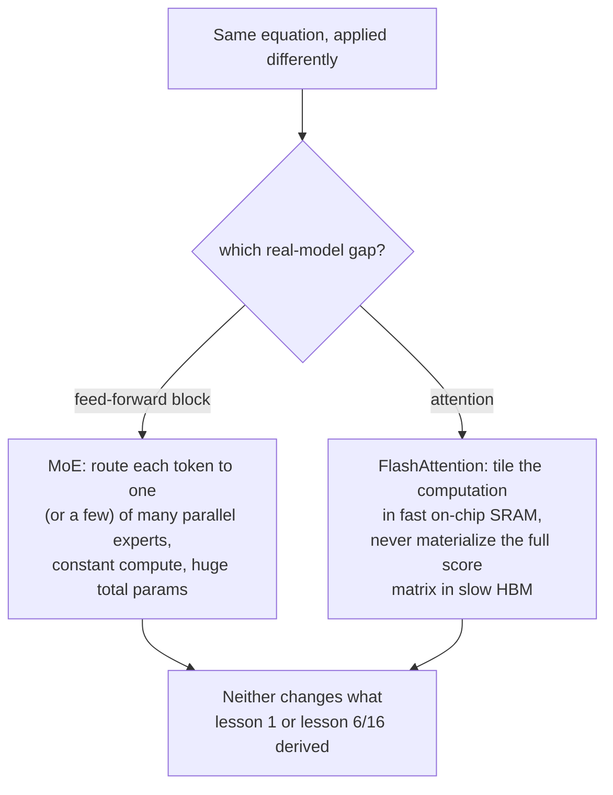

# पाठ 22. Mixture-of-Experts और FlashAttention

**मिशन से संबंध:** इस workspace के हर पाठ ने एक घनी गणना निकाली जो हर token पर एकसमान लगती है, एक feed-forward block, एक attention गणना, input चाहे जो हो एक जैसी चलती हुई। असली बड़े models दोनों मान्यताएँ ऐसे तरीक़ों से तोड़ते हैं जो इस workspace में बने बुनियादी गणित को कभी नहीं बदलते: **mixture-of-experts (MoE)** अलग-अलग tokens को एक ही parameters की जगह अलग-अलग parameters से गुज़ारता है, और **FlashAttention** पाठ 1 का ठीक वही समीकरण GPU memory के साथ बिल्कुल अलग, तेज़ संबंध से compute करता है। दोनों में से कोई नया operation नहीं है; दोनों पहले से निकाले गए operations को चलाने का अलग तरीक़ा हैं।
**मुख्य स्रोत:** [पेपर: "FlashAttention: Fast and Memory-Efficient Exact Attention with IO-Awareness", Dao et al., 2022](https://arxiv.org/abs/2205.14135)
**पूर्व-आवश्यकताएँ:** [पाठ 1](0001-scaled-dot-product-attention.md), [पाठ 16](0016-swiglu-and-the-gated-feed-forward.md)

## वार्म-अप

1. ▢ इस workspace का feed-forward block हर position के vector पर वही weight matrices स्वतंत्र रूप से क्यों लगाता है, और SwiGLU उस गणना के बारे में क्या बदलता है?

जाँचें

हर position पर वही weights लगाना (positions के बीच कोई मिलावट नहीं) ही block को position-wise बनाता है, जो attention की positions के आर-पार मिलाने वाली भूमिका का पूरक है। SwiGLU भीतरी गणना बदलता है (gated, दो-up-projection वाला design) पर यह position-wise संरचना नहीं; वह अब भी हर position पर एकसमान लगता है।

2. ▢ Scaled dot-product attention का समीकरण याददाश्त से लिखें।

जाँचें

`Attention(Q, K, V) = softmax(QK^T / sqrt(d_k)) V`।

## यह जानें

### सामान्य models हर token पर बराबर compute ख़र्च करते हैं; MoE नहीं करता

इस workspace में बना हर feed-forward block (पाठ 6, पाठ 16) जो भी token उससे गुज़रे उसके लिए ठीक वही parameters दोबारा इस्तेमाल करता है। **Mixture-of-experts (MoE)** layer उस एक feed-forward block की जगह कई parallel copies रखती है, जिन्हें **experts** कहते हैं, और एक छोटा **router** जो चुनता है कि किसी token को कौन-सा expert (या experts) असल में प्रोसेस करे। Switch Transformer का अपना कथन नतीजे वाला सौदा सीधे कहता है: model **sparsely activated** बन जाता है, जिसके सभी experts में फैला कुल parameter count बेहिसाब है, पर प्रति token **computational लागत लगभग स्थिर** है, क्योंकि उस token के लिए सिर्फ़ router के चुने expert(s) ही असल में चलते हैं, सभी नहीं।

### प्रति token ज़्यादा compute के बिना ज़्यादा parameters बिल्कुल अलग scaling लीवर है

यह उन दो चीज़ों को अलग करता है जो आम तौर पर साथ बँधी होती हैं: घने model का कुल parameter count और एक token प्रोसेस करने की compute लागत साथ-साथ बढ़ते हैं, क्योंकि हर parameter हर token को छूता है। MoE model ज़्यादा experts जोड़कर अपना कुल parameter count बढ़ा सकता है बिना इसे बढ़ाए कि किसी एक token को प्रोसेस करने में क्या लगता है, क्योंकि expert जोड़ना बस एक और विकल्प जोड़ना है जिसे router चुन सकता है, हर token को करने वाला और काम नहीं। Switch Transformer का ख़ास सरलीकरण, हर token को कई experts को मिलाने की जगह ठीक एक expert तक भेजना, ख़ास तौर पर उन communication और training-स्थिरता की लागतों को घटाने के लिए चुना गया जिनसे पहले के, ज़्यादा जटिल MoE designs टकराए थे, और पेपर बताता है कि इससे sparse models trillion-parameter की range तक scale हो सके, बराबर के घने model पर pretraining में कई गुना तेज़ी के साथ।

### FlashAttention attention का समीकरण नहीं बदलता, वह बदलता है कि वह समीकरण memory को कैसे छूता है

Self-attention की समय और memory लागत sequence length के साथ quadratic रूप से बढ़ती है, क्योंकि हर position की query को हर key से तुलना करनी पड़ती है। पेपर का अपना निदान कि इससे असली implementations धीमे क्यों होते हैं, समीकरण ख़ुद नहीं है, बल्कि यह है कि सीधा implementation attention scores का पूरा, quadratic रूप से बड़ा matrix GPU की बड़ी-पर-धीमी main memory (HBM) में बनाता है, फिर softmax और अंतिम भारित योग के लिए उसे वापस पढ़ता है, और धीमी memory में वे पढ़ना और लिखना, arithmetic नहीं, wall-clock समय पर हावी होते हैं। **FlashAttention** साफ़ तौर पर **IO-aware** है: वह उसी गणना को **tiling** से दोबारा बनाता है, sequence के छोटे टुकड़ों को एक बार में पूरी तरह GPU की छोटी-पर-तेज़ on-chip memory (SRAM) के भीतर प्रोसेस करते हुए, इसलिए पूरा score matrix धीमी memory में कभी लिखा ही नहीं जाता।

### Exact, approximate नहीं: वही output, उस तक पहुँचने का अलग रास्ता

पेपर साफ़ कहता है कि FlashAttention **exact** attention compute करता है, पाठ 1 का सटीक समीकरण, `softmax(QK^T / sqrt(d_k)) V`, बिना किसी गणितीय शॉर्टकट या गुणवत्ता के सौदे के, उन पहले के approximate-attention तरीक़ों के उलट जिनसे पेपर अपनी तुलना करता है, और जिनके बारे में लेखक कहते हैं कि वे नामात्र compute जटिलता घटाने के बावजूद अक्सर असली wall-clock तेज़ी नहीं दे पाए। FlashAttention का असली योगदान पूरी तरह IO के बारे में है: ठीक उसी गणितीय नतीजे के लिए HBM और SRAM के बीच कम memory पढ़ना और लिखना, और ठीक इसीलिए असली model code पढ़ने पर attention का ऐसा implementation दिखता है जो संरचनात्मक रूप से पाठ 1 के सीधे संस्करण से अलग दिखता है, जबकि उसे अब भी वही output बनाना है जो पाठ 1 ने निकाला।

## अभ्यास

1. ▢ एक घना model अपने feed-forward block का parameter count दोगुना करता है, और उस block से हर token की compute लागत भी लगभग दोगुनी हो जाती है। एक MoE model ज़्यादा experts जोड़कर अपना कुल expert parameter count दोगुना करता है। क्या हर token की compute लागत भी दोगुनी होती है?

संकेत

सोचें कि कुल कितने experts हैं इसकी परवाह किए बिना router किसी token के लिए असल में क्या चुनता है।

जाँचें

नहीं। ज़्यादा experts जोड़ना बस और विकल्प जोड़ना है जिनमें से router चुन सकता है; किसी token की compute लागत इस पर निर्भर करती है कि वह असल में कितने experts तक भेजा गया (Switch Transformer में एक), इस पर नहीं कि कुल कितने experts मौजूद हैं। कुल parameters और प्रति-token compute लागत ऐसे अलग हैं जैसे घने model के नहीं होते।

2. ▢ Switch Transformer हर token को ठीक एक expert तक क्यों भेजता है, पहले के MoE designs की तरह कई को मिलाने के बजाय?

जाँचें

पेपर का अपना कथन कहता है कि यह ख़ास तौर पर उन communication और computational लागतों, और training अस्थिरता, को घटाने के लिए चुना गया जिनसे ज़्यादा जटिल बहु-expert routing टकरा चुका था, routing algorithm को सरल बनाते हुए और फिर भी sparsely-activated, प्रति-token स्थिर लागत वाला गुण बनाए रखते हुए।

3. ▢ FlashAttention के अपने निदान के अनुसार, सीधा attention implementation ख़ास तौर पर लंबी sequence lengths पर धीमा क्यों हो जाता है?

जाँचें

पूरा attention score matrix sequence length के साथ quadratic रूप से बढ़ता है, और सीधा implementation उस पूरे matrix को GPU की बड़ी पर धीमी main memory (HBM) में बनाता है, फिर softmax और भारित योग के लिए उसे वापस पढ़ता है; matrix के बढ़ने पर wall-clock समय पर वे memory पढ़ना और लिखना हावी होते हैं, arithmetic ख़ुद नहीं।

4. ▢ क्या FlashAttention अपनी तेज़ी पाने के लिए attention का अलग, approximate संस्करण compute करता है, जैसा कुछ पहले के तरीक़े करते थे?

जाँचें

नहीं। FlashAttention साफ़ तौर पर exact है, और पाठ 1 के समीकरण जैसा ही गणितीय नतीजा compute करता है; उसकी तेज़ी पूरी तरह IO-aware होने से आती है, यानी गणना को टुकड़ों में बाँटकर तेज़ on-chip memory में रखना और पूरा score matrix धीमी memory में न बनाना, किसी approximation या गुणवत्ता के सौदे से नहीं।

5. ▢ कौन-सा दावा सही बताता है कि इस workspace के निकाले गणित के बारे में MoE और FlashAttention हर एक क्या बदलते हैं?

    - a) MoE attention का समीकरण बदलता है, और FlashAttention feed-forward block का समीकरण बदलता है
    - b) MoE tokens को parallel expert feed-forward blocks के एक उपसमूह तक भेजकर कुल parameter count को प्रति-token compute लागत से अलग करता है; FlashAttention attention का exact, न बदला हुआ समीकरण compute करता है पर memory access को इस तरह दोबारा बनाता है कि पूरा score matrix धीमी GPU memory में न बने
    - c) FlashAttention गुणवत्ता के बदले गति के लिए attention का approximation करता है, ठीक उन पहले के तरीक़ों की तरह जिन्हें वह सुधारता है
    - d) न MoE और न FlashAttention इस बारे में कुछ बदलते हैं कि training run को कुल कितने compute की ज़रूरत है

जाँचें

**b)** हर तकनीक का यही सटीक, एक-दूसरे से न टकराने वाला बदलाव है। (a) ग़लत है: MoE feed-forward block को प्रभावित करता है, attention को नहीं; FlashAttention attention को प्रभावित करता है, feed-forward block को नहीं। (c) ग़लत है: FlashAttention साफ़ तौर पर exact है, उन approximate तरीक़ों के उलट जिनसे उसकी तुलना की गई। (d) ग़लत है: MoE कुल parameters के सापेक्ष प्रति-token compute बदलता है, और FlashAttention memory कुशलता के ज़रिए wall-clock लागत बदलता है; दोनों असली compute लागतों को सार्थक रूप से प्रभावित करते हैं, बस गणितीय नतीजे को नहीं।

## असली दुनिया का अभ्यास

- [ ] अपनी पहुँच वाले किसी model के लिए (या उसके प्रकाशित architecture ब्योरों से), जाँचें कि वह घना feed-forward block इस्तेमाल करता है या mixture-of-experts layer, और अगर MoE, तो कितने experts हैं और प्रति token कितने सक्रिय होते हैं।
- [ ] जाँचें कि आपकी इस्तेमाल की किसी library (जैसे `transformers`) में FlashAttention का implementation विकल्प के रूप में है या नहीं, और लंबी sequence lengths पर मानक attention implementation की तुलना में वह गति या memory का क्या फ़ायदा बताता है।
- [ ] कल: FlashAttention पेपर का IO-complexity विश्लेषण पूरा पढ़ें, और ध्यान दें कि उसे जितने HBM accesses चाहिए वे गणितीय रूप से मानक attention के accesses से कैसे तुलना खाते हैं।

## आगे बढ़ने के लिए

- [पेपर: "FlashAttention: Fast and Memory-Efficient Exact Attention with IO-Awareness", Dao et al., 2022](https://arxiv.org/abs/2205.14135)
- [पेपर: "Switch Transformers: Scaling to Trillion Parameter Models with Simple and Efficient Sparsity", Fedus, Zoph, and Shazeer, 2021](https://arxiv.org/abs/2101.03961)
- [पेपर: "Attention Is All You Need", Vaswani et al., 2017](https://arxiv.org/abs/1706.03762)
- [संसाधन](../RESOURCES.md)

---

बात नहीं बन रही? ऊपर दिए मुख्य स्रोत को दोबारा पढ़ें, क्योंकि यह पाठ उसे संक्षिप्त करता है और समझ संक्षेप में ही रिसती है। जो शब्द फिसलन भरा लगे, उसके लिए [शब्दावली](../GLOSSARY.md) देखें।

अगर दिक़्क़त सामग्री की नहीं बल्कि पाठ की ही है, तो वह एक खोट है: [issue खोलें](https://github.com/TokenCemetery/teach/issues)।
