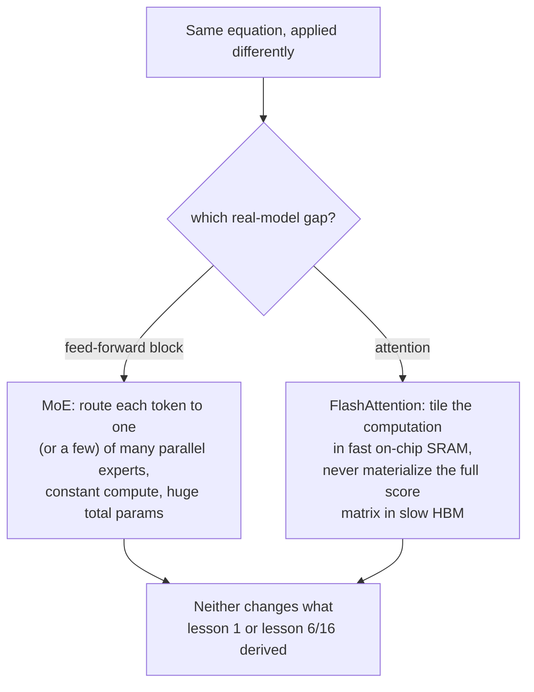

# Lição 22. Mixture-of-experts e FlashAttention

**Ligação com a missão:** Toda lição deste workspace derivou uma computação densa aplicada de modo uniforme a todo token, um bloco feed-forward, um cálculo de atenção, executado de forma idêntica seja qual for a entrada. Os grandes modelos reais quebram as duas suposições de formas que nunca mudam a matemática de fundo que este workspace construiu: a **mixture-of-experts (MoE)** roteia tokens diferentes por parâmetros diferentes em vez dos mesmos, e a **FlashAttention** calcula a equação exata da lição 1 com uma relação completamente diferente, e mais rápida, com a memória da GPU. Nenhuma das duas é uma operação nova; ambas são uma forma diferente de executar as operações já derivadas.
**Fonte principal:** [Artigo científico: "FlashAttention: Fast and Memory-Efficient Exact Attention with IO-Awareness", Dao et al., 2022](https://arxiv.org/abs/2205.14135)
**Pré-requisitos:** [Lição 1](0001-scaled-dot-product-attention.md), [Lição 16](0016-swiglu-and-the-gated-feed-forward.md)

## Aquecimento

1. ▢ Por que o bloco feed-forward deste workspace aplica as mesmas matrizes de pesos ao vetor de cada posição de forma independente e o que o SwiGLU muda nessa computação?

Verificação

Aplicar os mesmos pesos a toda posição (sem mistura entre posições) é o que torna o bloco por posição, complementando o papel de mistura entre posições da atenção. O SwiGLU muda a computação interna (um design com gate e duas projeções de expansão), mas não essa estrutura por posição; ele continua sendo aplicado de forma idêntica a toda posição.

2. ▢ Escreva de memória a equação da scaled dot-product attention.

Verificação

`Attention(Q, K, V) = softmax(QK^T / sqrt(d_k)) V`.

## Saiba isto

### Os modelos comuns gastam o mesmo compute em todo token; o MoE não

Todo bloco feed-forward que este workspace construiu (lição 6, lição 16) reutiliza exatamente os mesmos parâmetros para todo token que passa por ele. Uma camada de **mixture-of-experts (MoE)** substitui esse único bloco feed-forward por várias cópias paralelas, chamadas de **experts**, mais um pequeno **router** que seleciona qual expert (ou quais experts) de fato processa um dado token. O enquadramento do próprio Switch Transformer declara diretamente a troca resultante: o modelo se torna **ativado de forma esparsa**, com uma contagem total de parâmetros descomunal espalhada por todos os seus experts, mas um **custo computacional aproximadamente constante por token**, já que apenas o(s) expert(s) escolhido(s) pelo router de fato executa(m) para aquele token, e não todos eles.

### Mais parâmetros sem mais compute por token é uma alavanca de escala inteiramente diferente

Isso desacopla duas coisas que normalmente andam presas juntas: a contagem total de parâmetros de um modelo denso e o custo de compute de processar um token escalam juntos, já que todo parâmetro toca todo token. Um modelo MoE pode fazer crescer a sua contagem total de parâmetros adicionando mais experts sem fazer crescer o que um único token custa para ser processado, porque adicionar um expert apenas adiciona mais uma opção que o router pode escolher, e não mais trabalho que todo token precisa fazer. A simplificação específica do Switch Transformer, rotear cada token para exatamente um expert em vez de combinar vários, foi escolhida especificamente para reduzir os custos de comunicação e de estabilidade de treinamento que os desenhos de MoE anteriores, mais complexos, encontravam, e o artigo relata que isso permitiu que modelos esparsos escalassem até a faixa de trilhões de parâmetros com aceleração de pré-treinamento de várias vezes em relação a um modelo denso equivalente.

### A FlashAttention não muda a equação da atenção, muda como essa equação toca a memória

O custo de tempo e de memória da self-attention cresce de forma quadrática com o comprimento da sequência, já que a query de toda posição precisa ser comparada com toda key. O diagnóstico do próprio artigo sobre por que isso torna as implementações reais lentas não é a equação em si, é que uma implementação ingênua materializa a matriz completa de scores de atenção, de tamanho quadrático, na memória principal grande mas lenta da GPU (HBM), e depois a lê de volta para o softmax e a soma ponderada final, e essas leituras e escritas na memória lenta, e não a aritmética, dominam o tempo de relógio. A **FlashAttention** é explicitamente **ciente de IO**: ela reestrutura a mesma computação usando **tiling**, processando pequenos pedaços da sequência por vez inteiramente dentro da memória pequena mas rápida da GPU dentro do chip (SRAM), de modo que a matriz completa de scores nunca é escrita na memória lenta.

### Exata, não aproximada: a mesma saída, por um caminho diferente

O artigo é específico ao dizer que a FlashAttention calcula a atenção **exata**, a equação precisa da lição 1, `softmax(QK^T / sqrt(d_k)) V`, sem nenhum atalho matemático ou troca de qualidade, ao contrário dos métodos anteriores de atenção aproximada com que o artigo se contrasta e que, observam os autores, muitas vezes não conseguiam produzir um ganho real de tempo de relógio apesar de reduzir a complexidade nominal de compute. A contribuição real da FlashAttention diz respeito puramente ao IO: menos leituras e escritas de memória entre a HBM e a SRAM para o resultado matemático idêntico, e é exatamente por isso que ler código real de modelos mostra uma implementação de atenção que parece estruturalmente diferente da versão direta da lição 1, ainda precisando produzir a mesma saída que a lição 1 derivou.

## Prática

1. ▢ Um modelo denso dobra a contagem de parâmetros do seu bloco feed-forward, e o custo de compute de todo token por esse bloco também dobra, aproximadamente. Um modelo MoE dobra a sua contagem total de parâmetros de experts adicionando mais experts. O custo de compute de todo token também dobra?

Dica

Considere o que o router de fato seleciona para um dado token, independentemente de quantos experts existam no total.

Verificação

Não. Adicionar mais experts apenas adiciona mais opções entre as quais o router pode escolher; o custo de compute de um token depende de para quantos experts ele é de fato roteado (um, no Switch Transformer), e não do número total de experts que existem. Os parâmetros totais e o custo de compute por token ficam desacoplados de um modo que os de um modelo denso não ficam.

2. ▢ Por que o Switch Transformer roteia cada token para exatamente um expert, em vez de combinar vários, como faziam os desenhos de MoE anteriores?

Verificação

O enquadramento do próprio artigo declara que isso foi escolhido especificamente para reduzir os custos de comunicação e de computação, e a instabilidade de treinamento, que o roteamento multiexpert mais complexo encontrava, simplificando o algoritmo de roteamento e ainda mantendo a propriedade de ativação esparsa e custo constante por token.

3. ▢ Por que uma implementação ingênua de atenção se torna lenta especificamente em comprimentos de sequência longos, segundo o próprio diagnóstico da FlashAttention?

Verificação

A matriz completa de scores de atenção cresce de forma quadrática com o comprimento da sequência, e uma implementação ingênua materializa essa matriz inteira na memória principal grande mas lenta da GPU (HBM) e depois a lê de volta para o softmax e a soma ponderada; essas leituras e escritas de memória, e não a aritmética em si, dominam o tempo de relógio à medida que a matriz cresce.

4. ▢ A FlashAttention calcula uma versão diferente e aproximada da atenção para obter o seu ganho de velocidade, como alguns métodos anteriores faziam?

Verificação

Não. A FlashAttention é explicitamente exata, calculando o resultado matemático idêntico ao da equação da lição 1; o seu ganho de velocidade vem inteiramente de ser ciente de IO, dividindo a computação em blocos para permanecer na memória rápida dentro do chip e evitar materializar a matriz completa de scores na memória lenta, e não de qualquer aproximação ou troca de qualidade.

5. ▢ Qual afirmação descreve corretamente o que o MoE e a FlashAttention mudam, cada um, na matemática que este workspace derivou?

    - a) O MoE muda a equação da atenção, e a FlashAttention muda a equação do bloco feed-forward
    - b) O MoE desacopla a contagem total de parâmetros do custo de compute por token roteando tokens para um subconjunto de blocos feed-forward de experts em paralelo; a FlashAttention calcula a equação exata e inalterada da atenção, mas reestrutura o acesso à memória para evitar materializar a matriz completa de scores na memória lenta da GPU
    - c) A FlashAttention aproxima a atenção para trocar qualidade por velocidade, do mesmo modo que os métodos anteriores que ela aprimora
    - d) Nem o MoE nem a FlashAttention mudam nada sobre quanto compute total uma execução de treinamento exige

Verificação

**b)** É a mudança precisa e sem sobreposição que cada técnica faz. (a) é falsa: o MoE afeta o bloco feed-forward, e não a atenção; a FlashAttention afeta a atenção, e não o bloco feed-forward. (c) é falsa: a FlashAttention é explicitamente exata, ao contrário dos métodos aproximados com que ela é contrastada. (d) é falsa: o MoE muda o compute por token em relação aos parâmetros totais, e a FlashAttention muda o custo de tempo de relógio via eficiência de memória; ambos afetam de forma significativa os custos reais de compute, só não o resultado matemático.

## Prática no mundo real

- [ ] Para um modelo a que você tenha acesso (ou os detalhes de arquitetura publicados dele), confira se ele usa um bloco feed-forward denso ou uma camada de mixture-of-experts e, se for MoE, quantos experts e quantos são ativados por token.
- [ ] Confira se uma biblioteca que você usa (como a `transformers`) expõe uma implementação de FlashAttention como opção e qual benefício de velocidade ou memória ela relata em comparação com uma implementação de atenção padrão em comprimentos de sequência longos.
- [ ] Amanhã: leia por inteiro a análise de complexidade de IO do artigo da FlashAttention e anote como o número de acessos à HBM que ela exige se compara, matematicamente, ao da atenção padrão.

## Para ir além

- [Artigo científico: "FlashAttention: Fast and Memory-Efficient Exact Attention with IO-Awareness", Dao et al., 2022](https://arxiv.org/abs/2205.14135)
- [Artigo científico: "Switch Transformers: Scaling to Trillion Parameter Models with Simple and Efficient Sparsity", Fedus, Zoph e Shazeer, 2021](https://arxiv.org/abs/2101.03961)
- [Artigo científico: "Attention Is All You Need", Vaswani et al., 2017](https://arxiv.org/abs/1706.03762)
- [Recursos](../RESOURCES.md)

---

Não ficou claro? Releia a fonte principal no topo, já que esta lição a comprime e é na compressão que o entendimento escapa. Consulte o [glossário](../GLOSSARY.md) para qualquer termo que pareceu escorregadio.

Se o problema é a lição em si, e não o material, isso é um defeito: [abra uma issue](https://github.com/TokenCemetery/teach/issues).
